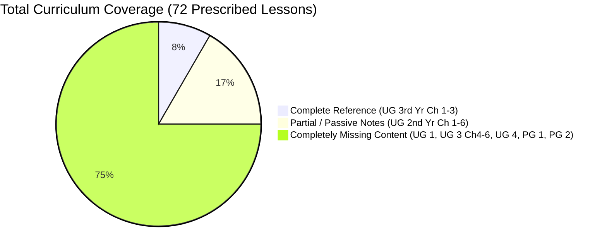

# Deliverable A: Reference Analysis & Source Material Audit
**AI Olympiad Curriculum Development — Undergraduate and Postgraduate Levels**
*Author: AI Olympiad Academic & Curriculum Engineering Team*
*Target Path: `c:\Users\rubee\OneDrive\Desktop\project\public\Undergraduate and Postgraduate Levels`*

---

## 1. Executive Summary of Audit

A thorough examination of the official workspace repository, reference materials, existing document files, and Class 3 pedagogical frameworks was conducted. The audit revealed that while foundational reference texts existed for selected undergraduate units, the overall curriculum across Undergraduate (UG 1st Year to Final Year) and Postgraduate (PG 1st Year to Final Year) levels had significant structural, pedagogical, and topical gaps. 

Specifically:
- **UG 1st Year (12 Lessons):** Completely absent from the reference folder. No lesson materials or activity books existed.
- **UG 2nd Year (12 Lessons):** Six document files (`AI.docx` to `AI_ 6.docx`) existed in a traditional, passive "study notes" format. These contained valuable conceptual explanations and isolated code snippets, but completely lacked the gamified, mission-driven, problem-based pedagogical design established in the AI Olympiad Class 3 benchmark.
- **UG 3rd Year (12 Lessons):** Three comprehensive activity books existed (`GenAI_LLM_Chapter1_Activity_Book-4.docx`, `AI_Powered_Development_Chapter2_Activity_Book-1.docx`, `AI_At_Work_Innovation_Chapter3_Activity_Book-1.docx`) covering Chapters 1, 2, and 3. However, Chapters 4, 5, and 6 were missing entirely.
- **UG Final Year (12 Lessons):** Completely absent from the reference folder.
- **PG 1st Year (12 Lessons):** Completely absent from the reference folder.
- **PG Final Year (12 Lessons):** Completely absent from the reference folder.

Across the entire 72-lesson syllabus, **54 lessons (75%) were entirely unwritten**, and the **18 lessons that had partial reference coverage required substantial restructuring** to meet university-level rigor, Olympiad competition standards, and gamified mission architecture.

---

## 2. Inventory of Examined Reference Materials

The following files from the project workspace and target directory were analyzed in detail:

| # | Reference File Path | Size | Detected Scope / Academic Year | Format & Nature | Pedagogical Evaluation & Gaps |
|---|---------------------|------|-------------------------------|-----------------|-------------------------------|
| 1 | `public/Undergraduate and Postgraduate Levels/AI.docx` | 919 KB | UG 2nd Year, Ch 1 (AI Basics: Learning from Data / Making Machines Smarter) | Passive theory notes, algorithms overview (Regression, k-NN, Trees, k-Means, Perceptrons). | Good conceptual foundations; zero gamified missions, lacks Olympiad-style multi-step problem solving, no rubric-driven labs. |
| 2 | `public/Undergraduate and Postgraduate Levels/AI  2.docx` | 870 KB | UG 2nd Year, Ch 2 (Communicate with AI: Program with AI / Data into Decisions) | Passive study notes, prompt writing tips, pandas data pipeline walkthrough. | Contains useful Python script for student mark processing; lacks interactive debugging challenges or API failure simulation. |
| 3 | `public/Undergraduate and Postgraduate Levels/AI 3.docx` | 795 KB | UG 2nd Year, Ch 3 (AI Applications: Smarter Business / Engineering Solutions) | Passive study notes, predictive maintenance, demand forecasting, IoT sensors. | Valuable industrial domain examples; lacks interactive simulation or competitive optimization tasks. |
| 4 | `public/Undergraduate and Postgraduate Levels/AI 4.docx` | 294 KB | UG 2nd Year, Ch 4 (AI and Career: Pick Your AI Path / Portfolio to Profession) | Brief career guidance document (89 paragraphs). | High-level lists of job titles and GitHub tips; lacks skill-gap audit simulations, portfolio code reviews, or interview challenges. |
| 5 | `public/Undergraduate and Postgraduate Levels/AI_5.docx` | 374 KB | UG 2nd Year, Ch 5 (AI Tools: AI Data Studio / Smart Automation Tools) | Architectural overview notes (102 paragraphs). | Defines 3-tier data studio (Ingest, Process, Output); lacks hands-on automation orchestration missions or ETL lab deliverables. |
| 6 | `public/Undergraduate and Postgraduate Levels/AI_ 6.docx` | 323 KB | UG 2nd Year, Ch 6 (Responsible AI: Fair AI, Fair Future / Ownership in the Age of AI) | Ethics overview notes (83 paragraphs), 7 pillars of Responsible AI. | Good definitions of fairness, watermarking, IP; lacks interactive bias auditing labs or model jailbreak mitigation exercises. |
| 7 | `public/Undergraduate and Postgraduate Levels/GenAI_LLM_Chapter1_Activity_Book-4.docx` | 2.47 MB | UG 3rd Year, Ch 1 (Generative Intelligence / Inside LLMs) | Comprehensive student activity book (861 paragraphs, 23 concepts/worksheets/puzzles). | High pedagogical quality. Uses worksheets, puzzles, and quizzes. Needs distillation into the canonical 2-lesson structure and alignment with Olympiad standards. |
| 8 | `public/Undergraduate and Postgraduate Levels/AI_Powered_Development_Chapter2_Activity_Book-1.docx` | 2.59 MB | UG 3rd Year, Ch 2 (AI-Powered Development / Connect, Create & Automate) | Student activity book (854 paragraphs, APIs, Function Calling, MCP, Agent Loops). | Strong coverage of modern tool calling and MCP; needs formalization into structured university-grade coding challenges and automated grading rubrics. |
| 9 | `public/Undergraduate and Postgraduate Levels/AI_At_Work_Innovation_Chapter3_Activity_Book-1.docx` | 2.72 MB | UG 3rd Year, Ch 3 (AI Automation at Work / AI for Innovation) | Student activity book (880 paragraphs, Impact-Effort matrix, Process Redesign, ROI math). | Strong business analysis exercises; requires technical implementation missions (e.g., Python automated process redesign scripts). |
| 10 | `public/GAIO Class3 Book.pdf` & `scratch/class3_all_pages.json` | 18.3 MB | Class 3 Primary Reference Benchmark | Gamified, mission-driven, 11-step learning journey. | Demonstrates the target engagement mechanics: Hook -> Concept -> Story/Scenario -> "Look Around You" -> "Let's Do It!" (Hands-on Mission) -> Worksheet -> Puzzle/Challenge -> Olympiad Quiz -> Real-World Connect. |
| 11 | `src/services/curriculumTopicProfilesHigher.ts` | 43.3 KB | Web App Catalog (UG 1st to PG Final) | TypeScript data dictionary intended for 72 topics. | Only 7 out of 72 topics were implemented in code; 65 topics were missing stub entries or placeholders. |
| 12 | `src/services/curriculumData.ts` | 70.5 KB | Canonical Syllabus Specification Table | 16-level academic syllabus definitions (`SYLLABUS_SPECS`). | Contains the official 6-chapter, 2-lesson framework across all undergraduate and postgraduate years. Serves as the authoritative source of truth. |

---

## 3. Analysis of Class 3 Reference Pedagogical Mechanics

The Class 3 textbook and platform implementation provide the gold-standard reference for interactive engagement. The design philosophy is rooted in:
1. **Immediate Contextual Immersion:** Every lesson begins with an authentic hook and scenario rather than dry definitions.
2. **Multi-Sensory Concept Breakdown:** Concepts are scaffolded through analogies, visual mental models, and step-by-step logic.
3. **The "Mission-Driven" Challenge (`Let's Do It!`):** The student is placed in an active role (e.g., "The Robot Commander" or "The Pattern Detective") with constraints, goals, and observable outputs.
4. **Varied Reinforcement Mechanics:** Worksheets test procedural understanding, puzzles test lateral thinking and pattern spotting, and Olympiad quizzes test critical discrimination.
5. **Applied Reflection:** Every unit connects back to real-world implications, ethics, and human agency.

### University-Level Translation of Engagement Mechanics
To adapt this model for undergraduate and postgraduate learners without patronizing them or dumbing down complex mathematics, we translate the elementary mechanics into authentic professional engineering and research simulations:

| Class 3 Elementary Mechanic | Undergraduate Translation (Applied / Systems) | Postgraduate Translation (Research / Architecture / Governance) |
|---|---|---|
| "Meet Bolt" (Cartoon Robot Companion) | **"System Under Test" / "Enterprise Persona"** (e.g., Lead AI Engineer, Junior Data Analyst, MLOps Specialist). | **"Principal Investigator" / "AI Architect" / "Governance Board"** addressing live production crises. |
| "Let's Do It!" (Physical Play / Toy commands) | **Technical Coding Quests & API Sandbox Challenges** with unit tests, latency caps, and memory limits. | **Architecture Tradeoff Tournaments & Experiment Ablation Labs** evaluating Pareto frontiers (accuracy vs cost vs safety). |
| Picture Story / Look Around You | **Realistic Production Incident Postmortems & Industry Case Studies** (e.g., AWS outage, high-frequency trading flash crash). | **Peer-Reviewed Literature Re-implementations & Empirically Grounded Whitepapers** analyzing novel failure modes. |
| Puzzle Fun / Trace & Colour | **Code Debugging Heuristics, Pipeline Optimization Puzzles & Matrix Alignment Challenges**. | **Mechanistic Circuit Discovery, Jailbreak Attack & Adversarial Red-Teaming Tournaments**. |
| Quiz Time (Basic Multiple Choice) | **Olympiad-Grade Conceptual & Applied Scenario Problems** with distractors testing subtle misconceptions. | **Multi-Stage Olympiad Case Analyses** requiring rigorous mathematical derivation, error bounds, and defense. |

---

## 4. Summary of Existing Coverage vs. Gaps by Academic Year

### Detailed Breakdown:
1. **UG 1st Year (0% covered in docs folder, 2/12 stubs in web app):**
   - *Status:* **100% Newly Developed**.
   - *Requirement:* Must establish rigorous programming in Python, data exploration with NumPy/Pandas, systematic prompt engineering, workbench tooling, and data privacy principles.
2. **UG 2nd Year (100% passive notes in docs folder, 0% interactive missions):**
   - *Status:* **Substantially Improved & Upgraded to Interactive Architecture**.
   - *Requirement:* Elevate the raw notes in `AI.docx` - `AI_ 6.docx` into interactive coding quests (Scikit-Learn, time-series anomaly detection, model bias audits, portfolio GitHub CI/CD pipelines).
3. **UG 3rd Year (50% activity book in docs folder, 50% completely missing):**
   - *Status:* **Ch 1-3 Refactored & Elevated; Ch 4-6 100% Newly Developed**.
   - *Requirement:* Standardize Ch 1-3 into the 2-lesson format; author new interactive content for Ch 4 (Industry Ready / Opportunity Map), Ch 5 (Chatbot Builder / AI Automation Studio), and Ch 6 (Truth in AI Era / Safe AI Systems).
4. **UG Final Year (0% covered in docs folder, 1/12 stub in web app):**
   - *Status:* **100% Newly Developed**.
   - *Requirement:* Enterprise-grade autonomous agent loops, multi-agent frameworks (LangGraph/CrewAI concepts), microservices deployment, MLOps latency optimization, corporate governance, and venture creation.
5. **PG 1st Year (0% covered in docs folder, 0% in web app):**
   - *Status:* **100% Newly Developed**.
   - *Requirement:* Advanced ML theory (loss surfaces, optimization dynamics, empirical risk minimization), RLHF/DPO mathematical formulation, diffusion probabilistic score matching, research methodology, mechanistic interpretability, and trust frameworks.
6. **PG Final Year (0% covered in docs folder, 1/12 stub in web app):**
   - *Status:* **100% Newly Developed**.
   - *Requirement:* Frontier scaling laws, emergent abilities, attention circuit reverse-engineering, multimodal embodied intelligence, breakthrough research-to-enterprise innovation, formal safety verification, and societal governance.

---

## 5. Pedagogical Architecture & Standardization Framework

To guarantee absolute academic rigor, reproducibility, and compliance with Olympiad standards, every developed lesson across all 6 levels strictly implements the **14-Point Lesson Architecture**:
1. **Syllabus Mapping:** Exact Level, Chapter, Lesson Title, and Canonical Codes.
2. **Outcomes & Prerequisites:** Measurable Bloom’s Taxonomy verbs (Analyze, Evaluate, Synthesize, Implement).
3. **Technical Industry/Research Scenario:** Authentic production environment with realistic stakes.
4. **Detailed Conceptual Explanations:** Deep mathematical and theoretical rigor without hand-waving.
5. **Architecture Diagram / Workflow Description:** Mermaid sequence, flowchart, or structural pipeline.
6. **Guided Technical Demonstration / Worked Example:** Runnable Python code or mathematical proof with step-by-step walkthrough.
7. **Unique Interactive Simulation, Game, or Mission:** Gamified quest with constraints, objective, mechanic, and scoring system.
8. **Practical Programming / Analysis Activity:** Hands-on lab specification.
9. **Measurable Deliverable:** Concrete artifact (script, model checkpoint, audit report, PR).
10. **Evaluation Criteria & Success Metrics:** Multi-criterion grading rubric (Correctness, Performance, Robustness).
11. **Olympiad-Style Assessments:** High-discrimination conceptual questions and complex scenario-based case challenges.
12. **Solutions & Evaluation Guidance:** Comprehensive answers, error analysis, and grading keys.
13. **Limitations, Risks & Responsible AI:** Real-world vulnerabilities, adversarial vectors, ethical considerations.
14. **Completion Criteria & Achievement Feedback:** Gamified badge, performance rank, and progression gate.
