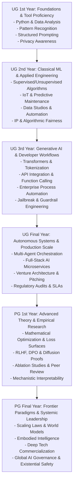

# Deliverable B: Complete Curriculum Mapping & Academic Progression Matrix
**AI Olympiad Curriculum Development — Undergraduate and Postgraduate Levels**
*Canonical Syllabus Source of Truth & Level Progression Schema*

---

## 1. High-Level Curriculum Architecture

The Global AI Olympiad curriculum for Higher Education spans **six academic levels**, each structured around the canonical six-chapter progression, with exactly **two comprehensive lessons per chapter**. This produces **72 distinct, fully developed lessons**.

### The 6 Canonical Chapters
1. **AI Basics:** Core theoretical foundations, mathematical paradigms, and computational machinery.
2. **Communicate with AI:** Interface paradigms, programming methodologies, prompt architectures, and developer workflows.
3. **AI Applications:** Real-world domain implementations, enterprise systems, industrial engineering, and research breakthroughs.
4. **AI and Career:** Professional trajectories, industry readiness, venture creation, research fellowships, and leadership.
5. **AI Tools:** Development environments, SDKs, agent studios, model hubs, and experimental workbenches.
6. **Responsible AI:** Fairness, auditability, security, copyright, governance, alignment, and societal impact.

---

## 2. Comprehensive Master Curriculum Mapping Table (72 Lessons)

| Level | Chapter | Lesson 1 Title | Lesson 2 Title | Primary Reference / Source | Development Status |
|---|---|---|---|---|---|
| **UG 1st Year** | Ch 1: AI Basics | Lesson 1: AI Demystified | Lesson 2: The Intelligence Behind Machines | Official Syllabus (`CAI-01`); foundational ML theory | **Newly Developed** |
| **UG 1st Year** | Ch 2: Communicate with AI | Lesson 1: Python + AI Starter | Lesson 2: Prompt with Purpose | Official Syllabus; Python stdlib & structured prompting | **Newly Developed** |
| **UG 1st Year** | Ch 3: AI Applications | Lesson 1: AI in the Real World | Lesson 2: AI in Your Profession | Official Syllabus; sector case studies | **Newly Developed** |
| **UG 1st Year** | Ch 4: AI and Career | Lesson 1: Navigate the AI Job World | Lesson 2: Build Your AI Skillset | Official Syllabus; tech labor market analytics | **Newly Developed** |
| **UG 1st Year** | Ch 5: AI Tools | Lesson 1: AI Workbench | Lesson 2: AI Coding Companion | Official Syllabus; IDEs, Jupyter, Copilot workflows | **Newly Developed** |
| **UG 1st Year** | Ch 6: Responsible AI | Lesson 1: Responsible Digital Intelligence | Lesson 2: Data Privacy Matters | Official Syllabus; GDPR, privacy-preserving computation | **Newly Developed** |
| **UG 2nd Year** | Ch 1: AI Basics | Lesson 1: Learning from Data | Lesson 2: Making Machines Smarter | `AI.docx` (Theory Notes); Scikit-Learn workflows | **Substantially Improved** |
| **UG 2nd Year** | Ch 2: Communicate with AI | Lesson 1: Program with AI | Lesson 2: Data into Decisions | `AI  2.docx` (Notes); Pandas & AI integration | **Substantially Improved** |
| **UG 2nd Year** | Ch 3: AI Applications | Lesson 1: AI for Smarter Business | Lesson 2: AI for Engineering Solutions | `AI 3.docx` (Notes); IoT & Predictive maintenance | **Substantially Improved** |
| **UG 2nd Year** | Ch 4: AI and Career | Lesson 1: Pick Your AI Path | Lesson 2: Portfolio to Profession | `AI 4.docx` (Notes); GitHub & technical portfolios | **Substantially Improved** |
| **UG 2nd Year** | Ch 5: AI Tools | Lesson 1: AI Data Studio | Lesson 2: Smart Automation Tools | `AI_5.docx` (Notes); ETL pipelines & cloud tooling | **Substantially Improved** |
| **UG 2nd Year** | Ch 6: Responsible AI | Lesson 1: Fair AI, Fair Future | Lesson 2: Ownership in the AI Age | `AI_ 6.docx` (Notes); 7 Pillars, licensing, copyright | **Substantially Improved** |
| **UG 3rd Year** | Ch 1: AI Basics | Lesson 1: Generative Intelligence | Lesson 2: Inside LLMs | `GenAI_LLM_Chapter1_Activity_Book-4.docx` | **Substantially Improved** |
| **UG 3rd Year** | Ch 2: Communicate with AI | Lesson 1: AI-Powered Development | Lesson 2: Connect, Create & Automate | `AI_Powered_Development_Chapter2_Activity_Book-1.docx` | **Substantially Improved** |
| **UG 3rd Year** | Ch 3: AI Applications | Lesson 1: AI Automation at Work | Lesson 2: AI for Innovation | `AI_At_Work_Innovation_Chapter3_Activity_Book-1.docx` | **Substantially Improved** |
| **UG 3rd Year** | Ch 4: AI and Career | Lesson 1: Become Industry Ready | Lesson 2: AI Opportunity Map | Official Syllabus (`DLE-03`); industry certifications | **Newly Developed** |
| **UG 3rd Year** | Ch 5: AI Tools | Lesson 1: Chatbot Builder | Lesson 2: AI Automation Studio | Official Syllabus; LangChain, Flowise, Vector DBs | **Newly Developed** |
| **UG 3rd Year** | Ch 6: Responsible AI | Lesson 1: Truth in the AI Era | Lesson 2: Safe AI Systems | Official Syllabus; Hallucination mitigation, Guardrails | **Newly Developed** |
| **UG Final Year** | Ch 1: AI Basics | Lesson 1: The Age of AI Agents | Lesson 2: Intelligence at Scale | Official Syllabus (`AAA-04`); Autonomous Agent Loops | **Newly Developed** |
| **UG Final Year** | Ch 2: Communicate with AI | Lesson 1: Build Smart Applications | Lesson 2: Design AI Workflows | Official Syllabus; Full-stack AI, streaming APIs, MCP | **Newly Developed** |
| **UG Final Year** | Ch 3: AI Applications | Lesson 1: AI for Enterprise | Lesson 2: AI for Start-ups | Official Syllabus; Enterprise SLAs, P99 latency, SaaS | **Newly Developed** |
| **UG Final Year** | Ch 4: AI and Career | Lesson 1: From Campus to AI Career | Lesson 2: Idea to AI Venture | Official Syllabus; Venture engineering, Seed pitch | **Newly Developed** |
| **UG Final Year** | Ch 5: AI Tools | Lesson 1: AI Prototype Lab | Lesson 2: Agent Builder Studio | Official Syllabus; CrewAI, LangGraph, Streamlit/FastAPI | **Newly Developed** |
| **UG Final Year** | Ch 6: Responsible AI | Lesson 1: Accountable AI | Lesson 2: AI Governance Essentials | Official Syllabus; Model auditing, EU AI Act compliance | **Newly Developed** |
| **PG 1st Year** | Ch 1: AI Basics | Lesson 1: Modern Intelligence Explained | Lesson 2: AI Beyond Automation | Official Syllabus (`AML-01`); Loss surfaces, Optimization | **Newly Developed** |
| **PG 1st Year** | Ch 2: Communicate with AI | Lesson 1: Develop with Intelligence | Lesson 2: Design Smart Workflows | Official Syllabus; RLHF, DPO, CoT reasoning proofs | **Newly Developed** |
| **PG 1st Year** | Ch 3: AI Applications | Lesson 1: AI for Advanced Research | Lesson 2: AI for Professional Innovation | Official Syllabus; Diffusion models, Score matching | **Newly Developed** |
| **PG 1st Year** | Ch 4: AI and Career | Lesson 1: AI Specialist Roadmap | Lesson 2: Research to Profession | Official Syllabus; Academic publishing, Peer review | **Newly Developed** |
| **PG 1st Year** | Ch 5: AI Tools | Lesson 1: AI Research Workbench | Lesson 2: Intelligent Prototype Lab | Official Syllabus; Weights & Biases, PyTorch Profiler | **Newly Developed** |
| **PG 1st Year** | Ch 6: Responsible AI | Lesson 1: Transparent AI | Lesson 2: Trustworthy AI Systems | Official Syllabus; Mechanistic interpretability, Circuits | **Newly Developed** |
| **PG Final Year** | Ch 1: AI Basics | Lesson 1: Frontiers of AI | Lesson 2: Human + Machine Intelligence | Official Syllabus (`FAI-02`); Scaling laws, Emergence | **Newly Developed** |
| **PG Final Year** | Ch 2: Communicate with AI | Lesson 1: Engineer Intelligent Solutions | Lesson 2: AI System Thinking | Official Syllabus; Multimodal architectures, Attention probe | **Newly Developed** |
| **PG Final Year** | Ch 3: AI Applications | Lesson 1: AI for Transformation | Lesson 2: AI for Breakthrough Innovation | Official Syllabus; World models, Embodied AI | **Newly Developed** |
| **PG Final Year** | Ch 4: AI and Career | Lesson 1: Lead with AI | Lesson 2: Research → Innovation → Enterprise | Official Syllabus; Tech strategy, Deep tech ventures | **Newly Developed** |
| **PG Final Year** | Ch 5: AI Tools | Lesson 1: Future AI Lab | Lesson 2: Innovation to Prototype | Official Syllabus; Distributed Ray, vLLM, TensorRT | **Newly Developed** |
| **PG Final Year** | Ch 6: Responsible AI | Lesson 1: AI & Society | Lesson 2: Building AI for Humanity | Official Syllabus; Existential risk, Constitutional AI | **Newly Developed** |

---

## 3. Pedagogical Progression Across Academic Levels

### Detailed Level-by-Level Learning Expectations

### 1. UG 1st Year: Foundations & Practical AI Literacy
- **Focus:** Build intuition without sacrificing computational precision. Bridge high-school mathematics to university Python programming.
- **Core Activities:** Python scripting with basic libraries, parameter intuition, prompt engineering benchmarks, and identifying real-world use cases.
- **Milestone Project:** Build a rule-assisted vs. statistical classifier and compare latency, accuracy, and edge cases.

### 2. UG 2nd Year: Applied Machine Learning & Data Engineering
- **Focus:** Rigorous classical machine learning pipelines (Scikit-Learn, Pandas, NumPy), predictive modeling, and feature engineering.
- **Core Activities:** Implementing regression, k-NN, decision trees, k-means, confusion matrices, predictive maintenance pipelines, and open-source licensing compliance audits.
- **Milestone Project:** Train, evaluate, and serialize an end-to-end industrial anomaly detection model with a clean REST API.

### 3. UG 3rd Year: Generative AI, LLM Engineering & Tool Integration
- **Focus:** Deep learning architectures, Transformer self-attention mechanics, tokenization, embeddings, API integration, and tool use.
- **Core Activities:** Implementing function calling with OpenAI/Anthropic/open-weight models, MCP hub design, RAG pipeline construction, prompt security testing, and jailbreak defense.
- **Milestone Project:** Deploy an enterprise RAG knowledge-retrieval assistant equipped with vector search and deterministic JSON schema validation.

### 4. UG Final Year: Autonomous Agents, Scalable Systems & Enterprise Readiness
- **Focus:** Production-grade system architecture, multi-agent frameworks, high-throughput distributed serving, enterprise SLAs, and business ventures.
- **Core Activities:** Building LangGraph/CrewAI multi-agent workflows with state machines, benchmark testing against P99 latency requirements, and creating venture pitch decks.
- **Milestone Project:** Deliver a production-ready, Dockerized multi-agent system executing real-world asynchronous tasks with audit logs and fallbacks.

### 5. PG 1st Year: Theoretical Optimization, Generative Proofs & Research Methodology
- **Focus:** Formal mathematical rigor, non-convex optimization, loss surfaces, empirical risk minimization, alignment algorithms (RLHF, DPO), diffusion score matching, and peer-reviewed ablation design.
- **Core Activities:** Deriving attention gradient flow, proving alignment objective loss dynamics, training score-matching models on toy manifolds, and authoring conference-grade ablation reports.
- **Milestone Project:** Conduct an empirical ablation study evaluating representation collapse or attention attribution across model checkpoints.

### 6. PG Final Year: Frontier Paradigms, World Models, Systemic Leadership & Governance
- **Focus:** Frontier scaling dynamics, emergence, mechanistic circuit discovery, multimodal world models, embodied AI, deep tech venture spinouts, and existential risk governance.
- **Core Activities:** Reverse-engineering induction heads in transformer circuits, evaluating world models on physical simulation benchmarks, and drafting legally defensible AI governance charters.
- **Milestone Project:** Formulate, implement, and formally evaluate a novel architectural variation or interpretability probe against a published state-of-the-art benchmark.
