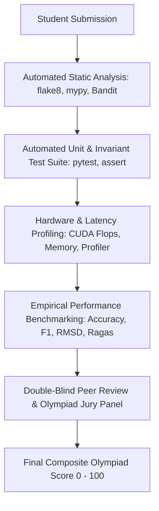

# Deliverable D: Project and Research Specifications
## AI Olympiad — Undergraduate and Postgraduate Higher Education Program

---

### Executive Overview
This document specifies the authoritative technical, empirical, and architectural capstone projects and research assignments for each academic level in the AI Olympiad Higher Education curriculum. Each specification establishes rigorous, level-appropriate performance criteria, testing frameworks, and evaluation rubrics designed to evaluate practical problem-solving, theoretical depth, and Olympiad-caliber excellence.

---

## 1. Undergraduate Capstone Project Specifications

### UG 1st Year Capstone: "The Applied AI Diagnostic Workbench"
- **Academic Focus:** Applied Python AI Foundations, API Integration, and Data Preprocessing.
- **Project Mandate:** Build an automated end-to-end data cleansing and multimodal analysis pipeline that ingests noisy real-world CSV/JSON datasets (e.g., healthcare intake or customer operations logs), cleanses missing values and outliers, executes exploratory data analysis (EDA), generates automated natural language executive insights via an LLM API, and produces a validated output report.
- **Technical Requirements:**
  1. Python 3.10+ utilizing NumPy, Pandas, Scikit-learn, and Matplotlib/Seaborn.
  2. Automated schema validation and null imputation (mean/median/KNN).
  3. Structured prompt chaining enforcing deterministic JSON schema responses (`Pydantic`).
  4. Unit test suite using `pytest` achieving $>85\%$ branch coverage.
- **Deliverables:**
  - `workbench_pipeline.py`: Fully runnable ingestion and inference script.
  - `data_validation_tests.py`: Test suite verifying pipeline resilience against corrupted inputs.
  - `diagnostic_report.pdf`: Auto-generated executive visual analytics report.
- **Evaluation Rubric:**
  - Data Hygiene & Engineering: 30%
  - Prompt Engineering & Structured Extraction: 30%
  - Code Quality & Test Coverage: 20%
  - Error Handling & Edge-Case Resilience: 20%

---

### UG 2nd Year Capstone: "Predictive Intelligence & Edge Optimization Engine"
- **Academic Focus:** Supervised Learning, Hyperparameter Tuning, and Edge Feature Engineering.
- **Project Mandate:** Design, train, and deploy a low-latency predictive maintenance classifier for industrial IoT telemetry (e.g., NASA Turbofan Jet Engine Degradation simulation). The model must predict remaining useful life (RUL) and impending mechanical failures $\ge 48$ hours in advance with low false-alarm rates ($< 2.5\%$).
- **Technical Requirements:**
  1. Implement and compare 3 model classes: Random Forests, Gradient Boosted Decision Trees (XGBoost/LightGBM), and a Multi-Layer Perceptron.
  2. Implement time-series feature engineering: rolling window statistics, lag features, and Fourier spectral energy features.
  3. Optimize hyperparameters via 5-fold cross-validation with Optuna.
  4. Deploy model as a lightweight REST API using FastAPI with $< 15\text{ ms}$ inference latency.
- **Deliverables:**
  - `predictive_model_trainer.py`: End-to-end training and cross-validation pipeline.
  - `model_artifact.onnx`: Optimized ONNX model format for cross-platform deployment.
  - `api_service.py`: Production-ready FastAPI inference service.
  - `technical_report.md`: Comparative evaluation matrix with ROC-AUC, F1-score, and latency benchmarks.
- **Evaluation Rubric:**
  - Feature Engineering & Domain Soundness: 30%
  - Model Performance & Calibration: 30%
  - Deployment Architecture & Latency: 25%
  - Methodological Rigor & Validation: 15%

---

### UG 3rd Year Capstone: "Full-Stack Retrieval-Augmented Generation (RAG) System"
- **Academic Focus:** Generative AI, Dense Vector Retrieval, and Automated Evaluation.
- **Project Mandate:** Build an enterprise-grade multimodal Retrieval-Augmented Generation (RAG) search engine over complex technical engineering manuals (e.g., Airbus or Boeing Flight Crew Operating Manuals). The system must extract complex tables, formulas, and diagrams, index them in a vector database, and provide verified, citation-backed answers with zero tolerance for ungrounded hallucinations.
- **Technical Requirements:**
  1. Multi-stage chunking (Recursive Character + Semantic Chunking) with metadata preservation.
  2. Dense vector indexing using HNSW (Hierarchical Navigable Small World) in Qdrant, Milvus, or FAISS.
  3. Hybrid search combining dense embeddings with sparse BM25 keyword matching via Reciprocal Rank Fusion (RRF).
  4. Automated Ragas / TruLens evaluation pipeline measuring Context Relevance, Faithfulness, and Answer Relevance across 100 test queries.
- **Deliverables:**
  - `rag_indexing_pipeline.py`: Document ingestion, PDF parsing, and vector indexing.
  - `hybrid_retriever.py`: Hybrid search and cross-encoder re-ranking module.
  - `evaluation_benchmarks.json`: Quantitative Ragas scores validating $>0.88$ Faithfulness.
  - `system_architecture_diagram.png`: Mermaid/UML architectural blueprint.
- **Evaluation Rubric:**
  - Retrieval Architecture & Hybrid Search: 30%
  - Generation Quality & Hallucination Suppression: 30%
  - Automated Evaluation Framework: 25%
  - Architectural Modularity & Cleanliness: 15%

---

### UG Final Year Capstone: "Autonomous Multi-Agent Enterprise Orchestration Platform"
- **Academic Focus:** Autonomous Agents, Distributed Tool-Use, and Enterprise Workflows.
- **Project Mandate:** Architect and deploy an autonomous multi-agent cyber-security incident response platform. Upon detection of a simulated infrastructure breach or suspicious network anomaly, an ensemble of specialized agents (Triage Agent, Forensics Agent, Threat Intelligence Agent, and Containment Agent) must autonomously collaborate to isolate infected containers, query SIEM logs, analyze executable binaries, draft firewall rules, and produce an incident post-mortem report.
- **Technical Requirements:**
  1. Multi-agent state orchestration using LangGraph or AutoGen with explicit cyclical directed graphs.
  2. Tool integration: Sandbox terminal execution, IP reputation lookups, and network graph analysis.
  3. Guardrail implementation: Pydantic-enforced validation schemas, rate-limiters, and Human-in-the-Loop (HITL) approval gates before executing destructive containment commands.
  4. Persistent state checkpointing and conversation memory utilizing Redis or SQLite.
- **Deliverables:**
  - `agent_ecosystem_orchestrator.py`: Complete multi-agent state graph definition.
  - `tools_library/`: Sandboxed tool execution modules with strict parameter sanitization.
  - `incident_simulation_bench.py`: Script simulating network attacks to benchmark agent response.
  - `capstone_portfolio_dossier.pdf`: End-to-end design specifications and video demonstration link.
- **Evaluation Rubric:**
  - Multi-Agent Orchestration & State Management: 35%
  - Guardrails, Safety Invariants & HITL Gates: 25%
  - Incident Containment Effectiveness: 25%
  - Production Readiness & Code Quality: 15%

---

## 2. Postgraduate Research Project Specifications

### PG 1st Year Research Project: "Geometric Deep Learning & Score-Based Generative SDEs"
- **Academic Focus:** Geometric Equivariance, SDE Generative Modeling, and Scientific Machine Learning.
- **Research Question:** *"Does an $SE(3)$-equivariant continuous-time score-based diffusion model outperform classical autoregressive graph Transformers in sampling low-energy molecular conformations while preserving invariant physical symmetries?"*
- **Technical & Scientific Requirements:**
  1. Formulate a continuous-time reverse SDE using the Variance Exploding (VE) or Variance Preserving (VP) formulation.
  2. Construct an Equivariant Graph Neural Network (EGNN) ensuring spatial coordinates transform equivariantly under rotation matrix $\mathbf{R} \in SO(3)$ and translation $\mathbf{t} \in \mathbb{R}^3$.
  3. Train model on QM9 or PDBbind molecular datasets using Denoising Score Matching loss.
  4. Perform rigorous statistical validation: Compute Root Mean Square Deviation (RMSD), energy stability via DFT or semi-empirical xTB, and report 95% bootstrap confidence intervals across $\ge 10$ seeds.
- **Deliverables:**
  - `egnn_diffusion_sde.py`: Complete PyTorch / PyG implementation of the equivariant diffusion model.
  - `ablation_and_evaluation.py`: Statistical significance and ablation harness.
  - `manuscript_draft.pdf`: 8-page conference-style research manuscript in LaTeX (NeurIPS template) with formal proofs and empirical figures.
- **Evaluation Rubric:**
  - Theoretical & Mathematical Soundness: 35%
  - Experimental Design & Statistical Rigor: 35%
  - Equivariance & Physical Law Adherence: 15%
  - Scientific Writing & Reproducibility: 15%

---

### PG Final Year Dissertation Project: "Certified Alignment & Formal Verification of Autonomous Frontiers"
- **Academic Focus:** Formal Safety Verification, Weak-to-Strong Generalization, and Planetary Governance.
- **Research Question:** *"Can deep neural policies controlling safety-critical cyber-physical systems be formally certified against non-linear dynamical instability, and can weak supervision scale to align superhuman agents without catastrophic reward hacking?"*
- **Technical & Scientific Requirements:**
  1. Develop an Interval Bound Propagation (IBP) and Branch-and-Bound ($\alpha$-CROWN) linear relaxation solver for deep ReLU policies.
  2. Implement an automated verification engine that evaluates input operating envelopes and formally proves output bounds satisfy Lyapunov stability invariants.
  3. Design a Weak-to-Strong Generalization experiment demonstrating positive Performance Gap Recovered ($\text{PGR} > 0.40$) on a complex reasoning or control benchmark.
  4. Package complete artifact adhering to ACM Artifact Badging Standards (Docker container, pinned seed scripts, and verification checksums).
- **Deliverables:**
  - `formal_verifier_engine.py`: PyTorch-based neural network formal verification harness.
  - `weak_to_strong_alignment.py`: Weak-to-strong training pipeline with entropy confidence regularization.
  - `doctoral_prospectus.pdf`: Complete 15-page dissertation prospectus detailing mathematical proofs, empirical verification results, and international governance policy.
- **Evaluation Rubric:**
  - Formal Mathematical Proofs & Soundness: 35%
  - Empirical Verification & Robustness: 30%
  - Novelty, Alignment Depth & Scientific Moat: 20%
  - Artifact Reproducibility & Compliance: 15%

---

## 3. Global AI Olympiad Evaluation & Scoring Protocols

### Unified Scoring Dimensions:
1. **Algorithmic Correctness & Soundness (30%):** Does the code accurately solve the prescribed problem without logical errors, data leakage, or unprincipled heuristics?
2. **Technical Depth & Architectural Elegance (25%):** Are design patterns appropriate, scalable, modular, and consistent with state-of-the-art standards?
3. **Empirical & Experimental Rigor (20%):** Are claims supported by statistical significance ($p$-values, confidence intervals, fair baseline comparisons)?
4. **Safety, Ethics & Responsible AI (15%):** Does the solution address privacy, security, alignment guardrails, and regulatory governance?
5. **Reproducibility & Artifact Quality (10%):** Can an external researcher replicate all findings using a single terminal command?
