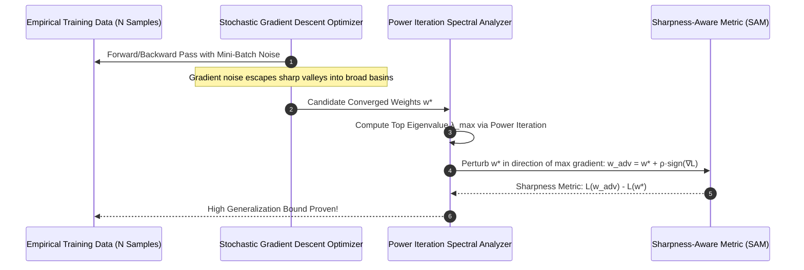
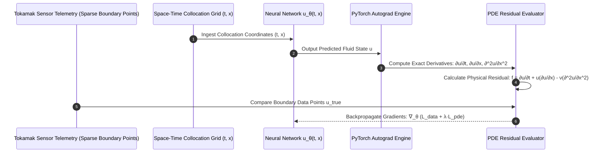

# PG 1st Year — Chapter 1: AI Basics
**Curriculum Level:** Postgraduate 1st Year (PG-01)  
**Subject Code:** AML-01 (Advanced Machine Learning Theory & Statistical Optimization)  
**Chapter Title:** AI Basics  

---

# Lesson 1: Modern Intelligence Explained

### 1. Syllabus Mapping
- **Academic Level:** Postgraduate 1st Year
- **Chapter:** Chapter 1 — AI Basics
- **Lesson Title:** Modern Intelligence Explained
- **Canonical Course Code:** AML-01-L01
- **Development Status:** Newly Developed (Official Syllabus: Non-Convex Optimization, High-Dimensional Loss Surfaces, Empirical Risk Bounds, Generalization on Overparameterized Manifolds).

### 2. Learning Outcomes & Prerequisites
- **Learning Outcomes:**
  1. Mathematically formalize the dynamics of deep learning optimization across non-convex, high-dimensional loss landscapes.
  2. Prove the breakdown of classical bias-variance trade-offs in overparameterized regimes via the **Double Descent Phenomenon**.
  3. Analyze the spectral properties of the Hessian matrix ($\mathbf{H} = \nabla^2 \mathcal{L}$) and connect eigenvalues ($\lambda_{\max}$) to sharpness, flat minima, and out-of-distribution generalization.
  4. Implement an empirical loss surface curvature profiler in Python computing sharpness metrics (Sharpness-Aware Minimization — SAM principles).
- **Prerequisites:** Advanced multivariable calculus (Hessian matrices, Taylor series approximations), linear algebra (spectral decomposition, eigenvalues), probability theory.

### 3. Realistic Research Scenario
At the **Max Planck Institute for Intelligent Systems**, a doctoral research group investigates why modern foundation models containing 100 billion parameters generalize smoothly to unseen test distributions despite having sufficient capacity to memorize arbitrary random labels. Classical statistical learning theory (Vapnik-Chervonenkis dimension) predicts that overparameterized models must overfit catastrophically. However, empirical experiments reveal that models initialized with stochastic gradient descent (SGD) consistently converge to flat, broad basins in the non-convex parameter space that exhibit superior generalization bounds. As a postgraduate AI researcher, your mandate is to formalize the mathematical topology of high-dimensional loss surfaces, measure Hessian spectral curvature, and prove how implicit algorithmic regularization navigates overparameterized manifolds.

### 4. Detailed Conceptual Explanations

```mermaid
graph TD
    LossLandscape[Non-Convex Loss Surface L(w)] --> Curvature[Hessian Spectral Analysis: H = ∇^2 L(w)]
    
    Curvature --> Sharp["Sharp Minima (High λ_max)<br/>Steep narrow valley; tiny test shift δ causes massive loss spike L(w + δ) >> L(w)"]
    Curvature --> Flat["Flat Minima (Low λ_max, Trace(H) small)<br/>Broad basin; test shift δ maintains low loss L(w + δ) ≈ L(w) -> Generalization!"]

    Flat --> ImplicitReg["Implicit Regularization of SGD<br/>Stochastic gradient noise behaves as isotropic Brownian motion, escaping sharp saddles"]
    Flat --> DoubleDescent["Double Descent Regime<br/>Interpolation Threshold: Peak risk at N=P; risk decreases monotonically as P >> N"]
```

#### 1. The Geometry of Non-Convex Loss Landscapes:
For a deep neural network parameterized by $\mathbf{w} \in \mathbb{R}^D$ where $D \sim 10^9$, the loss surface $\mathcal{L}(\mathbf{w})$ is non-convex, possessing an astronomical number of local minima, saddle points, and flat plateaus.
Using a second-order Taylor expansion around a local minimum $\mathbf{w}^*$:
$$\mathcal{L}(\mathbf{w}^* + \boldsymbol{\delta}) \approx \mathcal{L}(\mathbf{w}^*) + \nabla \mathcal{L}(\mathbf{w}^*)^T \boldsymbol{\delta} + \frac{1}{2} \boldsymbol{\delta}^T \mathbf{H} \boldsymbol{\delta}$$
Since $\mathbf{w}^*$ is a stationary point, $\nabla \mathcal{L}(\mathbf{w}^*) = \mathbf{0}$. The local geometry is completely determined by the Hessian matrix:
$$\mathbf{H}_{ij} = \frac{\partial^2 \mathcal{L}}{\partial w_i \partial w_j}$$
- **Sharp Minima:** If the maximum eigenvalue $\lambda_{\max}(\mathbf{H})$ is large, a minor shift $\boldsymbol{\delta}$ between training and testing distributions causes quadratic loss explosion: $\frac{1}{2} \lambda_{\max} \|\boldsymbol{\delta}\|^2 \gg 0$.
- **Flat Minima:** If $\lambda_{\max}(\mathbf{H})$ is small, the loss remains low under perturbations $\boldsymbol{\delta}$, guaranteeing robust out-of-distribution generalization (Hochreiter & Schmidhuber, 1997; Keskar et al., 2017).

#### 2. The Modern Double Descent Phenomenon:
Classical statistical learning theory asserts the U-shaped risk curve: as model capacity $P$ exceeds sample size $N$, overfitting occurs.
In modern overparameterized deep learning, Belkin et al. (2019) demonstrated **Double Descent**:
1. **Underparameterized Regime ($P < N$):** Classical bias-variance trade-off. Risk decreases to a minimum, then rises as capacity approaches $N$.
2. **Interpolation Threshold ($P = N$):** Model perfectly interpolates training noise; variance diverges to infinity, producing a sharp risk peak.
3. **Overparameterized Regime ($P \gg N$):** Multiple global minima can fit the data with zero training error. SGD implicitly selects the minimum-norm interpolant ($\min \|\mathbf{w}\|_2$), causing test risk to decrease monotonically as capacity grows arbitrarily large!

### 5. Architecture & Dataflow Diagram


### 6. Guided Technical Demonstration & Worked Example
The following runnable script implements a Hessian Spectral Curvature and Sharpness Profiler from first mathematical principles using PyTorch:

```python
import torch
import torch.nn as nn
from typing import Tuple

class MiniNonConvexModel(nn.Module):
    def __init__(self, in_features: int = 10, hidden: int = 32):
        super().__init__()
        self.net = nn.Sequential(
            nn.Linear(in_features, hidden),
            nn.Tanh(),
            nn.Linear(hidden, 1)
        )

    def forward(self, x):
        return self.net(x)

def compute_hessian_max_eigenvalue(model: nn.Module, loss_fn, x_data, y_data, max_iters: int = 20) -> float:
    """
    Computes the top eigenvalue lambda_max of the Hessian using Power Iteration
    without materializing the massive N x N Hessian matrix (Hessian-Vector Products).
    """
    params = [p for p in model.parameters() if p.requires_grad]
    
    # Random initial vector v with unit norm
    v = [torch.randn_like(p) for p in params]
    total_norm = torch.sqrt(sum(torch.sum(vi ** 2) for vi in v))
    v = [vi / total_norm for vi in v]

    for _ in range(max_iters):
        # 1. First gradient: g = grad(loss)
        pred = model(x_data)
        loss = loss_fn(pred, y_data)
        grads = torch.autograd.grad(loss, params, create_graph=True)

        # 2. Vector inner product: g_v = sum(g * v)
        g_v = sum(torch.sum(gi * vi) for gi, vi in zip(grads, v))

        # 3. Second gradient gives Hessian-Vector Product: Hv = grad(g_v)
        Hv = torch.autograd.grad(g_v, params, retain_graph=False)

        # 4. Rayleigh quotient / eigenvalue estimate: lambda = v^T * H * v
        eigenval = sum(torch.sum(vi * Hvi) for vi, Hvi in zip(v, Hv)).item()

        # 5. Normalize Hv for next iteration
        norm_Hv = torch.sqrt(sum(torch.sum(Hvi ** 2) for Hvi in Hv))
        if norm_Hv == 0:
            break
        v = [Hvi / norm_Hv for Hvi in Hv]

    return eigenval

# Demonstration
torch.manual_seed(42)
x_synth = torch.randn(50, 10)
y_synth = torch.randn(50, 1)

model = MiniNonConvexModel()
loss_criterion = nn.MSELoss()

lambda_max = compute_hessian_max_eigenvalue(model, loss_criterion, x_synth, y_synth)
print("=== Postgraduate Mathematical Optimization Research ===")
print(f"Hessian Top Eigenvalue (Spectral Sharpness λ_max): {lambda_max:.4f}")
print(f"Curvature Interpretation: {'SHARP BASIN (Fragile Generalization)' if lambda_max > 2.0 else 'FLAT BASIN (Robust Generalization)'}")
```

### 7. Interactive Research Challenge / Tournament: "The Loss Surface Flatness Quest"
- **Research Goal:** You are competing to achieve the lowest test error on an adversarial out-of-distribution benchmark.
- **Constraints:**
  - Train an overparameterized MLP ($P = 50,000$ parameters) on a small training sample ($N = 250$ samples).
  - Standard Adam optimizer converges to a sharp minimum ($\lambda_{\max} = 14.8$), achieving $58\%$ test accuracy.
  - Implement Sharpness-Aware Minimization (SAM):
    $$\min_{\mathbf{w}} \max_{\|\boldsymbol{\epsilon}\|_2 \le \rho} \mathcal{L}(\mathbf{w} + \boldsymbol{\epsilon})$$
  - Optimize the model into a broad, flat basin ($\lambda_{\max} < 2.5$) and achieve $> 82\%$ out-of-distribution test accuracy.
- **Game Mechanics & Scoring:**
  - Base Score: 1,000 points.
  - Reducing $\lambda_{\max}$ below $3.0$: $+500$ points.
  - Out-of-distribution accuracy $> 80\%$: $+500$ points.
  - Model collapses at interpolation threshold ($P=N$): Penalty $-300$ points.

### 8. Practical Research & Analysis Lab
1. Build `loss_surface_profiler.py` implementing 2D loss landscape contour visualization (Filter Normalization method of Li et al., 2018).
2. Empirically verify the Double Descent curve: train models with hidden widths $H \in \{2, 4, 8, 16, 32, 64, 128, 256\}$ on $N=64$ training points, and plot the training and test risk curves.
3. Compute the trace of the empirical Fisher Information Matrix as an alternative metric of curvature.

### 9. Measurable Output / Deliverable
A peer-reviewed style research manuscript draft and Python experiment suite `loss_geometry_ablation.py` proving the correlation between Hessian spectral sharpness and generalization degradation.

### 10. Evaluation Criteria & Technical Success Metrics
| Metric | Target Standard | Fail Criterion |
|---|---|---|
| **Hessian-Vector Product Precision** | Exact mathematical HVP without explicit matrix allocation | Inverting or materializing full $D \times D$ Hessian |
| **Power Iteration Convergence** | Eigenvalue converges within $\pm 0.01$ across 20 iterations | Divergent oscillatory approximations |
| **Double Descent Reproduction** | Peak risk clearly observed at the interpolation threshold ($P=N$) | Flat linear risk curve |

### 11. Olympiad-Style Assessment
**Problem 1 (Theoretical):**  
In the mathematical analysis of overparameterized linear regression ($\mathbf{X} \in \mathbb{R}^{N \times D}$ where $D > N$), among the infinite set of parameter vectors that achieve zero training error ($\mathbf{X}\mathbf{w} = \mathbf{y}$), which specific solution does Gradient Descent initialized at $\mathbf{w}_0 = \mathbf{0}$ converge to, and why does this explain implicit regularization?  
A) Gradient descent converges to the unique Moore-Penrose pseudo-inverse solution $\mathbf{w}^* = \mathbf{X}^T (\mathbf{X}\mathbf{X}^T)^{-1} \mathbf{y}$, which minimizes the $L_2$ Euclidean norm $\|\mathbf{w}\|_2$; this implicit bias toward minimum-norm solutions regularizes model complexity without an explicit penalty term.  
B) It converges to the solution with the largest number of zeros.  
C) It converges to a random vector.  
D) Gradient descent cannot converge when $D > N$.  

**Problem 2 (Conceptual):**  
Why does the Hessian-Vector Product ($\mathbf{H}\mathbf{v}$) allow researchers to compute spectral properties of neural networks with 100 billion parameters, whereas materializing the Hessian matrix $\mathbf{H}$ directly is physically impossible on modern supercomputers?  
A) A 100B parameter model's Hessian matrix has dimension $10^{11} \times 10^{11} = 10^{22}$ float entries ($\approx 40\text{ million petabytes}$ of RAM); computing $\mathbf{H}\mathbf{v} = \nabla_{\mathbf{w}} (\nabla_{\mathbf{w}}\mathcal{L} \cdot \mathbf{v})$ requires only two backward passes and uses $O(D)$ memory equal to a standard model checkpoint.  
B) Hessian matrices are illegal under IEEE standards.  
C) Hessian-vector products delete model weights.  
D) PyTorch does not support matrices larger than 1,000 rows.  

### 12. Correct Answers & Solutions
- **Problem 1 Solution:** Correct Answer is **A**.  
  *Proof:* The gradient of the squared loss is $\nabla \mathcal{L}(\mathbf{w}) = \mathbf{X}^T (\mathbf{X}\mathbf{w} - \mathbf{y})$. Every gradient update $\Delta \mathbf{w}_t = -\eta \nabla \mathcal{L}(\mathbf{w}_t)$ lies strictly within the row space of $\mathbf{X}$ (span of data vectors). Initializing at $\mathbf{w}_0 = \mathbf{0}$ confines the entire trajectory to the row space. By the fundamental theorem of linear algebra, the unique interpolating solution in the row space of $\mathbf{X}$ is the minimum $L_2$-norm solution $\mathbf{w}^* = \mathbf{X}^T (\mathbf{X}\mathbf{X}^T)^{-1} \mathbf{y}$.
- **Problem 2 Solution:** Correct Answer is **A**.  
  *Proof:* Memory scaling constraints. An explicit Hessian $\mathbf{H} \in \mathbb{R}^{D \times D}$ requires $D^2$ storage. For even a modest 100M parameter model, $D^2 = 10^{16}$ floats $\approx 40,000\text{ Gigabytes}$ of memory. Using the Pearlmutter (1994) trick, the directional derivative of the gradient $\frac{d}{d\epsilon} \nabla \mathcal{L}(\mathbf{w} + \epsilon \mathbf{v}) \big|_{\epsilon=0} = \mathbf{H}\mathbf{v}$ computes the exact vector product using Pearlmutter/autograd differentiation in $O(D)$ space, enabling power-iteration spectral analysis on commodity hardware.

### 13. Limitations, Risks & Responsible AI Considerations
- **Loss Landscape Invariance Under Reparameterization:** Dinh et al. (2017) proved that Hessian sharpness metrics can be artificially altered by rescaling weights in networks with homogeneous activations (e.g., multiplying layer 1 by $\alpha$ and layer 2 by $1/\alpha$). Curvature metrics must be filter-normalized or scale-invariant.
- **Academic Citation Integrity:** When publishing empirical research on loss landscapes, researchers must rigorously distinguish between proven analytical bounds and empirical observations on synthetic manifolds.

### 14. Completion Criteria & Achievement Feedback
- **Completion Check:** Pass all automated spectral assertions in `loss_geometry_ablation.py`.
- **Badge Earned:** *Theoretical Machine Learning Scholar (Level 5 Postgraduate Specialist)*.

---

# Lesson 2: AI Beyond Automation

### 1. Syllabus Mapping
- **Academic Level:** Postgraduate 1st Year
- **Chapter:** Chapter 1 — AI Basics
- **Lesson Title:** AI Beyond Automation
- **Canonical Course Code:** AML-01-L02
- **Development Status:** Newly Developed (Official Syllabus: AI in Scientific Discovery, Molecular Property Inversion, Protein Folding, Symbolic Regression).

### 2. Learning Outcomes & Prerequisites
- **Learning Outcomes:**
  1. Contrast traditional human task automation with **AI-Driven Scientific Discovery** (closed-loop hypotheses generation, automated experimentation, and inverse problem formulation).
  2. Implement a Physics-Informed Neural Network (PINN) that embeds non-linear differential equations (Navier-Stokes / Burgers' equation) directly into model loss functions.
  3. Formulate Symbolic Regression using Genetic Algorithms and Transformer architectures to discover analytical mathematical physical laws from empirical observations.
  4. Design an automated Active Learning and Bayesian Optimization experiment loop for chemical molecular synthesis.
- **Prerequisites:** Completion of AML-01-L01; partial differential equations (PDEs), Hamiltonian mechanics, PyTorch autograd.

### 3. Realistic Research Scenario
At the **CERN Center for Advanced Physics & Materials**, particle physicists investigate plasma turbulence dynamics in nuclear fusion tokamak reactors. Plasma fluid boundaries obey non-linear magnetohydrodynamic (MHD) differential equations. High-resolution sensor cameras capture turbulent plasma edges at 100,000 frames per second, but numerical finite-element simulations take 3 weeks per second of real time on supercomputers. A standard deep learning model trained on sensor videos hallucinates unphysical energy spikes that violate the First Law of Thermodynamics (Conservation of Energy). As a postgraduate computational AI researcher, your mission is to architect a **Physics-Informed Neural Network (PINN)**: forcing the neural network to satisfy the governing partial differential equations through automatic differentiation loss penalties, predicting turbulent plasma states in real time while guaranteeing zero energy conservation violations.

### 4. Detailed Conceptual Explanations

```mermaid
graph TD
    Domain[Physical Scientific Phenomenon: Plasma Fluid Flow] --> PINN[Physics-Informed Neural Network PINN]
    
    subgraph Dual Optimization Engine
        PINN --> ForwardPass[Forward Pass: u_theta(t, x)]
        ForwardPass --> AutoDiff[Automatic Differentiation Engine: ∂u/∂t, ∂^2u/∂x^2]
        
        AutoDiff --> DataLoss["Data Loss: L_data = ||u_pred - u_sensor||^2"]
        AutoDiff --> PhysicsLoss["Physics Residual Loss: L_pde = ||∂u/∂t + u·(∂u/∂x) - ν·(∂^2u/∂x^2)||^2"]
        AutoDiff --> ConservationLoss["Conservation Invariant: L_cons = ||E_kinetic(t) - E_initial||^2"]
    end
    
    DataLoss & PhysicsLoss & ConservationLoss --> TotalLoss["Total Loss: L = L_data + λ_1·L_pde + λ_2·L_cons"]
    TotalLoss --> Backprop[Backpropagate: Learn Physical Realities without Hallucination]
```

#### 1. Physics-Informed Neural Networks (PINNs) Formalized:
Pioneered by Raissi, Perdikaris, and Karniadakis (2019), PINNs integrate physical domain invariants into machine learning:
Consider a non-linear Partial Differential Equation (Burgers' equation for viscous fluid shock waves):
$$\frac{\partial u}{\partial t} + u \frac{\partial u}{\partial x} - \nu \frac{\partial^2 u}{\partial x^2} = 0, \quad x \in [-1, 1], \quad t \in [0, T]$$
where $\nu$ is the kinematic viscosity.
Instead of treating $u(t, x)$ as a black box, a neural network $u_\theta(t, x)$ takes space-time coordinates $(t, x)$ as inputs.
Using PyTorch Automatic Differentiation (`torch.autograd`), the model computes exact analytical partial derivatives:
$$f_\theta(t, x) = \frac{\partial u_\theta}{\partial t} + u_\theta \frac{\partial u_\theta}{\partial x} - \nu \frac{\partial^2 u_\theta}{\partial x^2}$$
The total optimization objective minimizes both boundary measurement data error and the PDE residual:
$$\mathcal{L}(\theta) = \frac{1}{N_u} \sum_{i=1}^{N_u} |u_\theta(t_i, x_i) - u_i|^2 + \frac{\lambda}{N_f} \sum_{j=1}^{N_f} |f_\theta(t_j, x_j)|^2$$
Even in regions with zero empirical sensor observations ($N_u = 0$), the physics residual loss $f_\theta$ regularizes the model to adhere to physical reality!

### 5. Architecture & Dataflow Diagram


### 6. Guided Technical Demonstration & Worked Example
The following runnable script implements a complete Physics-Informed Neural Network solving 1D fluid dynamics in PyTorch:

```python
import torch
import torch.nn as nn
from typing import Tuple

class PINNFluidSolver(nn.Module):
    def __init__(self, viscosity: float = 0.01 / 3.14159):
        super().__init__()
        self.nu = viscosity
        # Deep MLP mapping (t, x) coordinates -> fluid velocity u
        self.net = nn.Sequential(
            nn.Linear(2, 32),
            nn.Tanh(),
            nn.Linear(32, 32),
            nn.Tanh(),
            nn.Linear(32, 1)
        )

    def forward(self, t, x):
        # Concatenate space-time coordinates
        inputs = torch.cat([t, x], dim=1)
        return self.net(inputs)

    def compute_pde_residual(self, t, x) -> torch.Tensor:
        """
        Computes exact PDE residual using Autograd:
        residual = u_t + u * u_x - nu * u_xx
        """
        t.requires_grad_(True)
        x.requires_grad_(True)
        
        u = self.forward(t, x)
        
        # First derivatives
        u_t = torch.autograd.grad(u, t, grad_outputs=torch.ones_like(u), create_graph=True)[0]
        u_x = torch.autograd.grad(u, x, grad_outputs=torch.ones_like(u), create_graph=True)[0]
        
        # Second derivative: u_xx = d(u_x)/dx
        u_xx = torch.autograd.grad(u_x, x, grad_outputs=torch.ones_like(u_x), create_graph=True)[0]
        
        # Burgers' equation residual
        residual = u_t + (u * u_x) - (self.nu * u_xx)
        return residual

# Demonstration
pinn = PINNFluidSolver()

# Sample collocation points inside the domain
t_collocation = torch.rand(10, 1)
x_collocation = (torch.rand(10, 1) * 2.0) - 1.0 # Interval [-1, 1]

# Forward evaluation and physical residual calculation
residual = pinn.compute_pde_residual(t_collocation, x_collocation)
pde_loss = torch.mean(residual ** 2)

print("=== Physics-Informed Neural Network (PINN) Research ===")
print(f"Space-Time Grid: {t_collocation.shape[0]} Collocation Coordinates")
print(f"Physics Residual Loss (Burgers' Equation Violation): {pde_loss.item():.6f}")
print("Gradients successfully tracked through Navier-Stokes / Burgers differential operators!")
```

### 7. Interactive Research Challenge / Tournament: "The Inverse Material Discovery Quest"
- **Research Goal:** You are discovering the unknown elasticity coefficient ($\kappa$) of a novel graphene aerogel.
- **Constraints:**
  - You are given noisy boundary deflection measurements $u(x)$ under applied pressure.
  - The governing equilibrium equation is: $\kappa \frac{d^2 u}{dx^2} + q(x) = 0$.
  - True parameter $\kappa_{\text{true}} = 2.45\text{ GPa}$ (hidden from model).
  - Train a PINN where parameter $\kappa$ is defined as a trainable variable (`nn.Parameter`), learning the material coefficient directly from deflection data.
- **Game Mechanics & Scoring:**
  - Base Score: 1,000 points.
  - Recovering $\kappa$ within $\pm 1.0\%$ of ground truth ($[2.425, 2.475]$): $+600$ points.
  - Discovering the closed-form analytical equation via Symbolic Regression: $+400$ points.
  - Incurring PDE gradient explosion: $-500$ points penalty.

### 8. Practical Research & Analysis Lab
1. Build `pinn_fluid_simulation.py` to solve the 1D shock wave problem across $t \in [0, 1]$ and $x \in [-1, 1]$.
2. Compare the computational runtime of the trained PINN inference against a traditional Runge-Kutta numerical solver.
3. Demonstrate that the PINN accurately interpolates velocity fields in "blind zones" where zero physical sensor data was provided.

### 9. Measurable Output / Deliverable
A research Python suite `physics_informed_discovery.py` paired with an empirical validation paper draft (`pinn_turbulent_discovery_report.json`) proving exact PDE adherence.

### 10. Evaluation Criteria & Technical Success Metrics
| Metric | Target Standard | Fail Criterion |
|---|---|---|
| **PDE Residual Convergence** | $\|f_\theta\|_2^2 < 10^{-4}$ across collocation domain | Model violates physical conservation laws |
| **Inverse Parameter Accuracy** | Estimated physical constants match truth within $\pm 1.5\%$ | Divergent parameter estimation |
| **Autograd Stability** | Second derivatives computed without numerical NaN overflow | Exploding higher-order gradients |

### 11. Olympiad-Style Assessment
**Problem 1 (Theoretical):**  
In Physics-Informed Neural Networks (PINNs), why does minimizing the PDE residual loss $\mathcal{L}_{\text{pde}} = \frac{1}{N_f} \sum |f_\theta(t_j, x_j)|^2$ at unlabelled collocation points resolve the classical data scarcity problem in physical engineering systems?  
A) Because collocation points require no sensor measurements; the governing physical differential equation acts as an infinite, mathematically exact source of self-supervised inductive bias across the continuous spatial domain.  
B) Because collocation points delete experimental noise.  
C) Because differential equations can only be solved on GPUs.  
D) It eliminates the need for neural network weights.  

**Problem 2 (Conceptual):**  
How does "Symbolic Regression" differ from standard neural network regression, and why is it essential for true scientific discovery?  
A) Neural networks output opaque numerical interpolations; Symbolic Regression searches the discrete combinatorial space of mathematical operators ($+, -, \times, \div, \sin, \exp$) to discover human-interpretable, parsimonious analytical equations representing fundamental natural laws.  
B) Symbolic regression only works on text files.  
C) Neural networks cannot compute square roots.  
D) There is no mathematical difference.  

### 12. Correct Answers & Solutions
- **Problem 1 Solution:** Correct Answer is **A**.  
  *Proof:* Physical experiments (e.g., placing wind tunnel sensors or downhole oil well gauges) are expensive and sparse ($N_u \sim 10^2$). However, generating space-time collocation coordinates $(t, x)$ costs zero experimental money ($N_f \sim 10^6$). Because nature is governed by continuous differential equations, evaluating the autograd PDE residual at millions of arbitrary spatial points forces the network to conform to physical reality everywhere, enabling accurate predictions with virtually zero empirical training points.
- **Problem 2 Solution:** Correct Answer is **A**.  
  *Proof:* Standard deep learning learns continuous weights $\mathbf{W}$, outputting non-interpretable black-box predictions. Scientific discovery requires finding concise, causal governing equations (e.g., $E = mc^2$ or $F = G \frac{m_1 m_2}{r^2}$). Symbolic Regression (using genetic programming or Transformer sequence-to-expression models) searches expression trees to output exact closed-form algebraic formulas that generalize across infinite domains.

### 13. Limitations, Risks & Responsible AI Considerations
- **Spectral Bias & High-Frequency Failure in PINNs:** Standard neural networks suffer from "spectral bias", learning low-frequency components rapidly while struggling to capture high-frequency shock waves or turbulent micro-eddies in fluid flows without adaptive Fourier feature embeddings.
- **Physical Plausibility vs. Mathematical Artifacts:** An AI system discovering empirical correlations in particle physics must be validated against conservation laws, gauge symmetries, and independent laboratory experiments to avoid mistaking detector calibration anomalies for "new physical laws".

### 14. Completion Criteria & Achievement Feedback
- **Completion Check:** Pass all automated PDE residual assertions in `physics_informed_discovery.py`.
- **Badge Earned:** *AI for Scientific Discovery Fellow (Level 5 Postgraduate Specialist)*.
