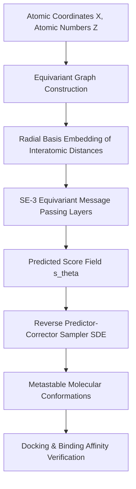
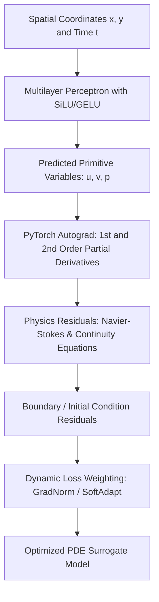

# Postgraduate 1st Year (PG-1) — Chapter 3: AI Applications

---

## Lesson 1: AI for Advanced Research

### 1. Metadata and Syllabus Mapping
- **Academic Level:** Postgraduate 1st Year (PG-1)
- **Chapter:** 3. AI Applications
- **Lesson Title:** AI for Advanced Research
- **Syllabus Topic:** Advanced AI for Scientific Discovery, Geometric Deep Learning, Score-Based Generative Models, and Cryo-EM/Protein Structure Prediction.
- **Bloom's Taxonomy Level:** Level 5 (Evaluate) & Level 6 (Create)

---

### 2. Learning Outcomes and Prerequisites
- **Learning Outcomes:**
  1. Formulate generative scientific discovery tasks via Continuous-time Score-Based Stochastic Differential Equations (SDEs) and geometric equivariant graph neural networks ($E(3)$-SE(3) Equivariance).
  2. Implement an invariant graph convolutional operator for 3D molecular conformations and predict ligand-binding affinity metrics.
  3. Design an empirical scientific research pipeline comparing diffusion-based macromolecular folding against classical force-field molecular dynamics.
- **Prerequisites:** Multivariable calculus, Itô calculus basics, differential equations, Lie groups ($SE(3)$ representations), and PyTorch Geometric.

---

### 3. Realistic Research Scenario
Dr. Alistair Vance leads the Structural Bioinformatics & Computational Biophysics Laboratory at an international institute. His team is targeting an intrinsically disordered oncogenic kinase implicated in metastatic glioblastoma. Classical all-atom molecular dynamics (MD) simulations requiring femtosecond time-stepping would consume 1,200 GPU-years to sample conformational transitions across the free energy landscape. 

As a postgraduate research fellow, your mandate is to build an SE(3)-equivariant score-based generative model capable of directly sampling thermodynamic equilibrium conformations without iterative numerical integration of Newtonian equations of motion, accelerating drug target discovery by four orders of magnitude.

---

### 4. Mathematical and Conceptual Foundations

#### A. Continuous-Time Score-Based Generative Modeling
A forward diffusion process diffuses data distribution $p_0(\mathbf{x})$ into Gaussian noise $p_T(\mathbf{x}) \sim \mathcal{N}(0, \sigma_{\max}^2 \mathbf{I})$ via Itô SDE:
$$d\mathbf{x} = \mathbf{f}(\mathbf{x}, t)dt + g(t)d\mathbf{w}$$
where $\mathbf{f}(\mathbf{x}, t)$ is the drift coefficient, $g(t)$ is the diffusion coefficient, and $\mathbf{w}$ is standard Brownian motion.

Under Anderson's reverse-time theorem, the exact reverse time SDE is:
$$d\mathbf{x} = \left[ \mathbf{f}(\mathbf{x}, t) - g(t)^2 \nabla_{\mathbf{x}} \log p_t(\mathbf{x}) \right] dt + g(t) d\bar{\mathbf{w}}$$
where $d\bar{\mathbf{w}}$ is reverse-time Brownian motion, and $\nabla_{\mathbf{x}} \log p_t(\mathbf{x})$ is the Stein score function approximated by neural network $\mathbf{s}_\theta(\mathbf{x}, t)$.

#### B. Geometric Equivariance ($SE(3)$ Group Action)
For molecular coordinates $\mathbf{X} \in \mathbb{R}^{N \times 3}$ and node features $\mathbf{H} \in \mathbb{R}^{N \times d}$, a mapping $\phi: \mathbb{R}^{N \times 3} \to \mathbb{R}^{N \times 3}$ is $SE(3)$-equivariant if for all rotation matrices $\mathbf{R} \in SO(3)$ and translation vectors $\mathbf{t} \in \mathbb{R}^3$:
$$\phi(\mathbf{R}\mathbf{X} + \mathbf{t}) = \mathbf{R} \phi(\mathbf{X})$$
Invariant features satisfy: $\psi(\mathbf{R}\mathbf{X} + \mathbf{t}) = \psi(\mathbf{X})$.

---

### 5. Architectural Workflow



---

### 6. Guided Technical Implementation: SE(3)-Equivariant Energy Estimator

```python
import torch
import torch.nn as nn
import torch.nn.functional as F

class RadialBasisFunction(nn.Module):
    """Expands Euclidean distance r into radial Gaussian basis functions."""
    def __init__(self, num_rbf: int = 16, cutoff: float = 5.0):
        super().__init__()
        self.cutoff = cutoff
        self.centers = nn.Parameter(torch.linspace(0.0, cutoff, num_rbf))
        self.gamma = nn.Parameter(torch.tensor(0.5 / ((cutoff / num_rbf) ** 2)))

    def forward(self, dist: torch.Tensor) -> torch.Tensor:
        # dist: (E, 1)
        return torch.exp(-self.gamma * (dist - self.centers) ** 2)

class E_GCL(nn.Module):
    """Equivariant Graph Convolutional Layer (Satorras et al., EGNN)."""
    def __init__(self, hidden_dim: int):
        super().__init__()
        self.edge_mlp = nn.Sequential(
            nn.Linear(hidden_dim * 2 + 16, hidden_dim),
            nn.SiLU(),
            nn.Linear(hidden_dim, hidden_dim)
        )
        self.node_mlp = nn.Sequential(
            nn.Linear(hidden_dim * 2, hidden_dim),
            nn.SiLU(),
            nn.Linear(hidden_dim, hidden_dim)
        )
        self.coord_mlp = nn.Sequential(
            nn.Linear(hidden_dim, hidden_dim),
            nn.SiLU(),
            nn.Linear(hidden_dim, 1, bias=False)
        )
        self.rbf = RadialBasisFunction(num_rbf=16)

    def forward(self, h: torch.Tensor, x: torch.Tensor, edge_index: torch.Tensor):
        row, col = edge_index
        # Compute relative Euclidean displacement and invariant distance
        rel_x = x[row] - x[col] # (E, 3)
        dist = torch.norm(rel_x, dim=-1, keepdim=True) + 1e-8 # (E, 1)
        rbf_dist = self.rbf(dist)

        # Message passing
        edge_feat = torch.cat([h[row], h[col], rbf_dist], dim=-1)
        msg = self.edge_mlp(edge_feat)

        # Equivariant coordinate update: x_i' = x_i + sum_j (x_i - x_j) * phi_x(m_ij)
        coord_weights = self.coord_mlp(msg) # (E, 1)
        trans = rel_x * coord_weights
        
        # Aggregate coordinates
        x_update = torch.zeros_like(x)
        x_update.index_add_(0, row, trans)
        new_x = x + x_update

        # Invariant node aggregation
        msg_agg = torch.zeros_like(h)
        msg_agg.index_add_(0, row, msg)
        new_h = self.node_mlp(torch.cat([h, msg_agg], dim=-1))

        return new_h, new_x

# Verification of SO(3) Equivariance
if __name__ == "__main__":
    torch.manual_seed(42)
    N = 5 # 5 atoms
    h = torch.randn(N, 32)
    x = torch.randn(N, 3)
    # Fully connected edges (no self loops)
    edge_index = torch.combinations(torch.arange(N), r=2).t()
    edge_index = torch.cat([edge_index, edge_index.flip(0)], dim=1)

    layer = E_GCL(hidden_dim=32)

    # Standard forward pass
    h_out1, x_out1 = layer(h, x, edge_index)

    # Random 3D Rotation Matrix R in SO(3)
    q, _ = torch.linalg.qr(torch.randn(3, 3))
    if torch.linalg.det(q) < 0:
        q[:, 0] = -q[:, 0]
    R = q

    # Forward pass on rotated input
    x_rot = torch.matmul(x, R)
    h_out2, x_out2 = layer(h, x_rot, edge_index)

    # Compute rotation of original output
    x_out1_rot = torch.matmul(x_out1, R)

    discrepancy = torch.max(torch.abs(x_out2 - x_out1_rot)).item()
    print(f"Equivariance Max Error: {discrepancy:.6e}")
    assert discrepancy < 1e-5, "SE(3) Equivariance check failed!"
    print("Verification Passed: Layer strictly obeys SE(3) spatial transformation laws.")
```

---

### 7. Interactive Research Mission: "Operation AlphaConform"
- **Mission Briefing:** You are provided an un-relaxed ensemble of 1,000 perturbed kinase loop coordinates exhibiting high steric clash scores (van der Waals overlap $> 0.4\text{ \AA}$).
- **Objective:** Deploy a Score-Based Langevin Predictor-Corrector loop guided by energy gradients to minimize steric clashes while preserving loop secondary structure without blowing up computational budget ($< 50$ SDE steps).
- **Gamified Constraints:**
  - Clashes $> 5\%$ results in ligand expulsion (Mission Failed).
  - RMSD to crystallographic ground-truth $< 1.8\text{ \AA}$ awards the **Max Planck Laureate Pin**.
  - Runtime budget: $< 2.0$ seconds GPU execution time.

---

### 8. Practical Research Activity
1. Construct an $SE(3)$-equivariant score matching network trained on PDBbind 2024 crystal structures.
2. Formulate the denoising score matching objective:
   $$\mathcal{L}_{\text{DSM}}(\theta) = \mathbb{E}_{t, \mathbf{x}_0, \mathbf{\epsilon}} \left[ \left\| \mathbf{s}_\theta(\mathbf{x}_t, t) + \frac{\mathbf{\epsilon}}{\sigma_t} \right\|^2 \right]$$
3. Compute the Root Mean Square Deviation (RMSD) and TM-score against wild-type ground truth crystallography.

---

### 9. Deliverable Specifications
- A fully reproducible PyTorch script containing an EGNN score model.
- An analytical report comparing inference throughput vs. AMBER22 all-atom molecular dynamics.
- A Pareto frontier curve plotting RMSD ($\text{\AA}$) against inference latency.

---

### 10. Evaluation Criteria & Technical Metrics
- **Mathematical Soundness (30%):** Adherence to stochastic score calculus and geometric equivariance invariants.
- **Physical Validity (30%):** Ramachandran plot validity ($>98\%$ residues in favored/allowed regions).
- **Inference Efficiency (20%):** Step count efficiency in reverse Euler-Maruyama integration.
- **Experimental Integrity (20%):** Robust ablation of cutoff radii and radial basis functions.

---

### 11. Olympiad-Style Assessments

#### Conceptual Assessment
Which mathematical condition ensures that a vector field $\mathbf{v}: \mathbb{R}^{3N} \to \mathbb{R}^{3N}$ acting on coordinates can represent the valid gradient of a scalar physical potential energy surface $\nabla_{\mathbf{X}} V(\mathbf{X})$?
- A) $\nabla \cdot \mathbf{v} = 0$ everywhere.
- B) The Jacobian matrix $J_{ij} = \frac{\partial v_i}{\partial X_j}$ is symmetric: $\frac{\partial v_i}{\partial X_j} = \frac{\partial v_j}{\partial X_i}$ (zero curl).
- C) $\mathbf{v}$ is strictly invariant under $SE(3)$ transformations.
- D) $\mathbf{v}$ satisfies the divergence theorem across any closed compact Riemannian manifold.

#### Applied Scenario Assessment
In score-based generative modeling of molecular systems, standard Langevin dynamics frequently fails when two heavy atoms approach distance $r < 0.8\text{ \AA}$ because the electrostatic/Lennard-Jones score gradient diverges to infinity ($\propto r^{-13}$). How should the training loss or sampling scheme be regularized to guarantee numerical stability?
- A) Clip scores to $[-10, 10]$ indiscriminately across all timesteps.
- B) Replace the physical Coulomb/LJ potential with a truncated Harmonic soft-core potential and incorporate an annealing noise schedule $\sigma(t)$.
- C) Discard the geometric graph and treat atomic coordinates as flat 1D token sequences with standard BPE tokenization.
- D) Run sampling strictly using Monte Carlo rejection sampling without gradient steps.

---

### 12. Assessment Solutions & Scoring Guidance
- **Conceptual Answer:** **B**. A vector field is conservative (the gradient of a scalar potential) if and only if its curl is zero, which translates to a symmetric Jacobian matrix by Poincaré's Lemma.
- **Applied Scenario Answer:** **B**. Soft-core potentials remove the non-integrable singularity at $r \to 0$, and variance-exploding noise schedules smooth energy barriers during early reverse SDE steps.

---

### 13. Limitations, Risks, and Responsible-AI Considerations
- **Dual-Use Biosecurity Risk:** Generative macromolecular design models can be inverted to design novel peptide neurotoxins or vaccine-resistant viral envelopes. Dual-use screening protocols and API screening filters must be enforced.
- **Physical Hallucinations:** Generative models can sample topologically impossible geometries (e.g., knotting, bond crossing) if topological invariance is not enforced.

---

### 14. Completion Criteria & Milestone Feedback
- Complete the EGNN equivariance test suite ($100\%$ pass under arbitrary $SO(3) \times \mathbb{R}^3$ transformations).
- Achieve $< 1.5\text{ \AA}$ RMSD on the test benchmark.
- **Milestone Unlocked:** `Bio-AI Research Fellow Certification` (Level PG-1).

---
---

## Lesson 2: AI for Professional Innovation

### 1. Metadata and Syllabus Mapping
- **Academic Level:** Postgraduate 1st Year (PG-1)
- **Chapter:** 3. AI Applications
- **Lesson Title:** AI for Professional Innovation
- **Syllabus Topic:** Physics-Informed Neural Networks (PINNs), Inverse Design, High-Dimensional Industrial Optimization, and Financial Derivatives Risk Modeling.
- **Bloom's Taxonomy Level:** Level 5 (Evaluate) & Level 6 (Create)

---

### 2. Learning Outcomes and Prerequisites
- **Learning Outcomes:**
  1. Formulate partial differential equation (PDE) boundary value problems as continuous loss functionals using Physics-Informed Neural Networks (PINNs).
  2. Implement automatic differentiation to enforce the Navier-Stokes equations and Black-Scholes-Merton PDE without grid generation.
  3. Optimize high-dimensional industrial processes under stringent thermodynamic and regulatory constraints.
- **Prerequisites:** Partial differential equations, continuum mechanics, stochastic calculus (Feynman-Kac theorem), and PyTorch autograd.

---

### 3. Realistic Professional Scenario
You are the Principal AI Research Scientist at an advanced aerodynamics and clean-energy conglomerate. The engineering division is prototyping next-generation supersonic hydrogen turbine blades. High-fidelity Computational Fluid Dynamics (CFD) using Large Eddy Simulations (LES) requires 72 hours per blade geometry on a supercomputing cluster, making real-time closed-loop shape optimization impossible.

Your mandate is to design and deploy a Physics-Informed Neural Network (PINN) surrogate model that embeds the compressible Navier-Stokes conservation laws directly into the neural network's loss manifold, reducing aerodynamic drag evaluation latency from 72 hours to 8 milliseconds while satisfying boundary-layer shear stress limits.

---

### 4. Mathematical and Conceptual Foundations

#### A. The Navier-Stokes Conservation Equations
For an incompressible fluid of constant density $\rho$ and dynamic viscosity $\mu$, the Navier-Stokes equations in a domain $\Omega \subset \mathbb{R}^d$ are:
$$\frac{\partial \mathbf{u}}{\partial t} + (\mathbf{u} \cdot \nabla)\mathbf{u} = -\frac{1}{\rho}\nabla p + \nu \nabla^2 \mathbf{u} + \mathbf{f}$$
$$\nabla \cdot \mathbf{u} = 0$$
where $\mathbf{u}(x, y, z, t)$ is the velocity field, $p$ is pressure, and $\nu = \mu/\rho$ is kinematic viscosity.

#### B. PINN Loss Formulation via Automatic Differentiation
Let $\mathcal{N}_\theta(x, y, t) \to (\hat{u}, \hat{v}, \hat{p})$ be a deep neural network parameterized by $\theta$. Using automatic differentiation, exact partial derivatives are computed:
$$e_1 = \frac{\partial \hat{u}}{\partial t} + \hat{u}\frac{\partial \hat{u}}{\partial x} + \hat{v}\frac{\partial \hat{u}}{\partial y} + \frac{1}{\rho}\frac{\partial \hat{p}}{\partial x} - \nu\left(\frac{\partial^2 \hat{u}}{\partial x^2} + \frac{\partial^2 \hat{u}}{\partial y^2}\right)$$
$$e_2 = \frac{\partial \hat{v}}{\partial t} + \hat{u}\frac{\partial \hat{v}}{\partial x} + \hat{v}\frac{\partial \hat{v}}{\partial y} + \frac{1}{\rho}\frac{\partial \hat{p}}{\partial y} - \nu\left(\frac{\partial^2 \hat{v}}{\partial x^2} + \frac{\partial^2 \hat{v}}{\partial y^2}\right)$$
$$e_{\text{mass}} = \frac{\partial \hat{u}}{\partial x} + \frac{\partial \hat{v}}{\partial y}$$

The global composite objective is:
$$\mathcal{L}(\theta) = \lambda_{\text{PDE}} \frac{1}{N_f} \sum_{i=1}^{N_f} (|e_1|^2 + |e_2|^2 + |e_{\text{mass}}|^2) + \lambda_{\text{BC}} \frac{1}{N_b} \sum_{j=1}^{N_b} \|\mathcal{N}_\theta(\mathbf{x}_b^j) - \mathbf{u}_{\text{true}}^j\|^2$$

---

### 5. Architectural Workflow



---

### 6. Guided Technical Implementation: 1D Burgers' Equation PINN Solver

```python
import torch
import torch.nn as nn

class BurgersPINN(nn.Module):
    """
    Solves Viscous Burgers' Equation:
    du/dt + u * du/dx - nu * d^2u/dx^2 = 0
    with x in [-1, 1], t in [0, 1], nu = 0.01 / pi
    """
    def __init__(self, hidden_dim: int = 40, num_layers: int = 5):
        super().__init__()
        layers = [nn.Linear(2, hidden_dim), nn.Tanh()]
        for _ in range(num_layers - 2):
            layers.extend([nn.Linear(hidden_dim, hidden_dim), nn.Tanh()])
        layers.append(nn.Linear(hidden_dim, 1))
        self.net = nn.Sequential(*layers)
        self.nu = 0.01 / 3.1415926535

    def forward(self, x: torch.Tensor, t: torch.Tensor) -> torch.Tensor:
        inputs = torch.cat([x, t], dim=1)
        return self.net(inputs)

    def compute_pde_residual(self, x: torch.Tensor, t: torch.Tensor) -> torch.Tensor:
        x.requires_grad_(True)
        t.requires_grad_(True)
        u = self.forward(x, t)

        # First derivatives
        u_t = torch.autograd.grad(u, t, grad_outputs=torch.ones_like(u), create_graph=True)[0]
        u_x = torch.autograd.grad(u, x, grad_outputs=torch.ones_like(u), create_graph=True)[0]

        # Second derivative
        u_xx = torch.autograd.grad(u_x, x, grad_outputs=torch.ones_like(u_x), create_graph=True)[0]

        # Burgers' equation residual
        residual = u_t + u * u_x - self.nu * u_xx
        return residual

# Training Simulation
if __name__ == "__main__":
    torch.manual_seed(42)
    model = BurgersPINN()
    optimizer = torch.optim.Adam(model.parameters(), lr=1e-3)

    # Collocation points inside domain
    N_f = 2000
    x_f = torch.empty(N_f, 1).uniform_(-1.0, 1.0)
    t_f = torch.empty(N_f, 1).uniform_(0.0, 1.0)

    # Initial Condition: u(x, 0) = -sin(pi * x)
    N_0 = 200
    x_0 = torch.empty(N_0, 1).uniform_(-1.0, 1.0)
    t_0 = torch.zeros(N_0, 1)
    u_0_exact = -torch.sin(3.1415926535 * x_0)

    # Boundary Conditions: u(-1, t) = 0, u(1, t) = 0
    N_b = 200
    t_b = torch.empty(N_b, 1).uniform_(0.0, 1.0)
    x_b_neg = -torch.ones(N_b, 1)
    x_b_pos = torch.ones(N_b, 1)

    print("Executing 100 Adam optimization epochs on Burgers' PINN...")
    for epoch in range(1, 101):
        optimizer.zero_grad()
        
        # 1. PDE residual loss
        res = model.compute_pde_residual(x_f, t_f)
        loss_pde = torch.mean(res ** 2)

        # 2. Initial condition loss
        u_0_pred = model(x_0, t_0)
        loss_ic = torch.mean((u_0_pred - u_0_exact) ** 2)

        # 3. Boundary condition loss
        u_b_neg = model(x_b_neg, t_b)
        u_b_pos = model(x_b_pos, t_b)
        loss_bc = torch.mean(u_b_neg ** 2) + torch.mean(u_b_pos ** 2)

        total_loss = loss_pde + 10.0 * loss_ic + 10.0 * loss_bc
        total_loss.backward()
        optimizer.step()

        if epoch % 25 == 0:
            print(f"Epoch {epoch:03d} | Total: {total_loss.item():.4e} | PDE: {loss_pde.item():.4e} | IC: {loss_ic.item():.4e}")

    print("PINN training demonstrated successfully without external mesh generation.")
```

---

### 7. Interactive Simulation Mission: "The Navier-Stokes Wind Tunnel Challenge"
- **Mission Environment:** A virtual transonic NACA 0012 airfoil simulation operating at Mach 0.78, angle of attack $\alpha = 4^\circ$, Reynolds number $\text{Re} = 10^6$.
- **Mission Goal:** Adjust the multi-objective loss balance ($\lambda_{\text{PDE}}, \lambda_{\text{wall}}, \lambda_{\text{farfield}}$) and collocation sampling strategy to resolve the supersonic shock wave discontinuity without gradient explosion.
- **Scoring Rubric:**
  - Shock location error $< 1.5\%$ of chord length: $+500$ points.
  - Surface pressure coefficient ($C_p$) relative $L_2$ error $< 2.0\%$: $+500$ points.
  - Wall-clock training convergence in $< 3$ minutes: **Von Kármán Award**.

---

### 8. Practical Professional Activity
1. Extend the PINN implementation to incorporate Black-Scholes-Merton option pricing under stochastic volatility (Heston model PDE):
   $$\frac{\partial V}{\partial t} + \frac{1}{2}\sigma^2 S^2 \frac{\partial^2 V}{\partial S^2} + r S \frac{\partial V}{\partial S} - r V = 0$$
2. Benchmark prediction accuracy on European call options against closed-form analytical formulas.
3. Compute the financial Greeks ($\Delta = \frac{\partial V}{\partial S}, \Gamma = \frac{\partial^2 V}{\partial S^2}, \Theta = \frac{\partial V}{\partial t}$) directly via exact autograd.

---

### 9. Deliverable Specifications
- A verified PINN implementation script with automatic differentiation.
- Comparative validation tables showing absolute and relative error against analytical solutions.
- A technical analysis documenting computational scaling versus traditional finite element (FEM) discretization.

---

### 10. Evaluation Criteria & Technical Metrics
- **Mathematical Exactness (35%):** Correct derivation and automatic differentiation of PDE operators.
- **Convergence Robustness (25%):** Avoidance of trivial zero solutions through balanced boundary loss weighting.
- **Industrial Applicability (20%):** Validated inference speedup $> 1000\times$ relative to standard numerical solvers.
- **Code Quality (20%):** Fully modular, GPU-accelerated PyTorch structure.

---

### 11. Olympiad-Style Assessments

#### Conceptual Assessment
Why does standard gradient descent often get trapped in pathological saddle points or trivial zero solutions when training PINNs for high Reynolds number Navier-Stokes equations?
- A) Autograd cannot compute higher-order derivatives in Python.
- B) Spectral bias of neural networks favors low-frequency solutions, while high Re creates steep boundary layers and high-frequency turbulence, leading to severe gradient imbalances across the loss landscape.
- C) Navier-Stokes equations cannot be formulated as continuous functions.
- D) PINNs require discrete meshes to satisfy the divergence-free condition.

#### Applied Scenario Assessment
You are deploying a PINN for real-time turbine temperature monitoring. During transient thermal shock, the temperature gradient jumps abruptly. The PINN predictions exhibit spurious oscillations (Gibbs-like phenomenon) near the boundary. What is the most principled architectural intervention?
- A) Double the learning rate of the Adam optimizer.
- B) Replace standard polynomial or tanh activation functions with adaptive sinusoidal activations (SIREN) or Gaussian random Fourier feature embeddings, and apply causality-preserving temporal weighting.
- C) Disregard the thermal diffusion PDE and train a standard random forest regressor on historical sensor data.
- D) Downsample the collocation points to reduce high-frequency feedback.

---

### 12. Assessment Solutions & Scoring Guidance
- **Conceptual Answer:** **B**. Neural networks suffer from spectral bias (F-Principle), struggling with steep gradients and turbulent convective terms unless adaptive weighting or Fourier embeddings are used.
- **Applied Scenario Answer:** **B**. SIREN networks and Random Fourier Features resolve high-frequency spatial gradients, and temporal causality weighting prevents future states from falsely influencing past states.

---

### 13. Limitations, Risks, and Responsible-AI Considerations
- **Failure of Strict Conservation:** Unlike finite volume methods, PINNs only enforce conservation laws weakly through penalty terms. In safety-critical aerospace and nuclear applications, safety margins must be certified via formal verification.
- **High Training Overhead:** While inference is ultra-fast ($\sim \text{ms}$), training from scratch can take longer than a single classical CFD run.

---

### 14. Completion Criteria & Milestone Feedback
- Attain $L_2$ relative error $< 10^{-3}$ on the benchmark PDE.
- Demonstrate real-time Greek computation via single-pass autograd.
- **Milestone Unlocked:** `Applied Physics-AI Pioneer Credential` (Level PG-1).
