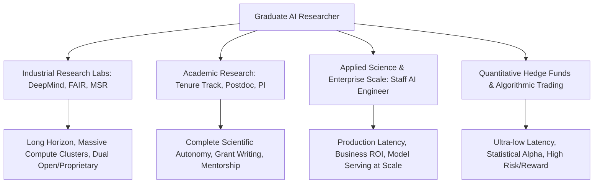
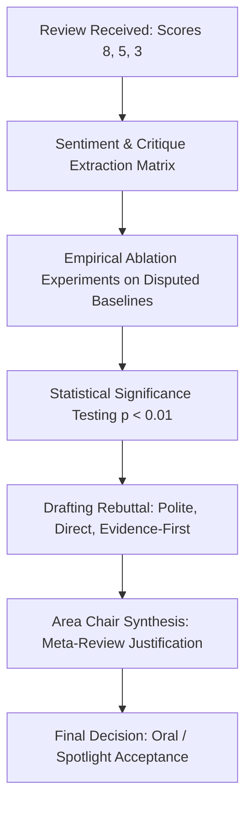

# Postgraduate 1st Year (PG-1) — Chapter 4: AI and Career

---

## Lesson 1: AI Specialist Roadmap

### 1. Metadata and Syllabus Mapping
- **Academic Level:** Postgraduate 1st Year (PG-1)
- **Chapter:** 4. AI and Career
- **Lesson Title:** AI Specialist Roadmap
- **Syllabus Topic:** Specialized Research & Engineering Trajectories, Research Lab Topography (Industrial vs. Academic), Research Grant Proposals, and Staff AI Scientist Milestones.
- **Bloom's Taxonomy Level:** Level 5 (Evaluate) & Level 6 (Create)

---

### 2. Learning Outcomes and Prerequisites
- **Learning Outcomes:**
  1. Map high-level professional pathways: Academic Tenure-Track, Industrial Research Labs (FAIR, Google DeepMind, Microsoft Research), Applied Research Scientist, and Quantitative Machine Learning.
  2. Structure competitive research funding proposals following NSF, DARPA, or Horizon Europe scientific evaluation frameworks.
  3. Formulate an individualized 5-year post-graduate research roadmap with target conference h-index milestones and compute-grant allocations.
- **Prerequisites:** Understanding of research lifecycle, graduate-level thesis planning, and scientific publication norms.

---

### 3. Realistic Professional Scenario
You are entering the second semester of your Master of Science / Ph.D. qualifying year in Artificial Intelligence. Top industrial research laboratories are conducting doctoral fellowship interviews, while government research councils are issuing RFPs (Requests for Proposals) for multi-million-dollar AI hardware testbeds.

To establish yourself as an independent principal investigator or industrial staff research scientist, you must synthesize your research direction into a defensible technical prospectus, allocate a 50,000-GPU-hour computational budget, and articulate your distinctive research moat against commoditized large-scale models.

---

### 4. Conceptual and Strategic Foundations

#### A. The Global AI Research Ecosystem Topography



#### B. The Anatomy of an Elite AI Research Proposal (The Heilmeier Catechism)
Developed by DARPA Director George H. Heilmeier, this framework determines scientific funding:
1. **What are you trying to do?** Articulate without jargon.
2. **How is it done today, and what are the limits of current practice?**
3. **What is new in your approach and why will it succeed?**
4. **Who cares? If you succeed, what difference does it make?**
5. **What are the risks and payoffs?**
6. **How much will it cost and how long will it take?**
7. **What are the midterm and final "exams" to check for success?**

---

### 5. Research Roadmap & Milestone Matrix

| Career Stage | Target Venues | Primary Technical Milestone | Leadership & Impact Indicator |
| :--- | :--- | :--- | :--- |
| **PG-1 (Foundations)** | Workshop / Spotlight (NeurIPS, ICML, ICLR, CVPR) | Reproduce baseline + novel theoretical or empirical variant | Open-source code artifact with $>100$ GitHub stars |
| **PG-2 / Ph.D. Quals** | Main Track Oral / Spotlight | Establish theoretical bound or introduce novel model class | 100K+ GPU-hour compute grant awarded |
| **Postdoc / Research Scientist** | First-author PAMI / JMLR / Nature MI | Lead multi-institutional collaborative benchmark | Program Committee / Reviewer for Top Tier Conferences |
| **Staff Scientist / PI** | Area Chair / Keynote Speaker | Define new subfield or paradigm shift (e.g., Attention, Diffusion) | Direct $>\$2\text{M}$ research funding or lead 10+ research team |

---

### 6. Guided Technical Demonstration: Automated Compute Grant Profiler

```python
import dataclasses
from typing import Dict, List

@dataclasses.dataclass
class ExperimentSpec:
    name: str
    model_param_billions: float
    token_dataset_billions: float
    flops_per_token_param: float = 6.0 # Standard forward+backward rule of thumb: 6 * N * D
    gpu_type: str = "NVIDIA_H100_SXM"
    gpu_tflops_fp8: float = 989.0 # Achievable sustained FP8 TFLOPS with TransformerEngine
    target_hardware_efficiency: float = 0.42 # Model Flops Utilization (MFU)

class GrantBudgetEstimator:
    """Calculates compute requirements and dollar budgets for AI grant proposals."""
    GPU_HOURLY_RATES = {
        "NVIDIA_A100_80GB": 2.20,
        "NVIDIA_H100_SXM": 3.85,
        "NVIDIA_B200": 6.50
    }

    @staticmethod
    def calculate_compute_cost(spec: ExperimentSpec) -> Dict[str, float]:
        total_flops = spec.flops_per_token_param * (spec.model_param_billions * 1e9) * (spec.token_dataset_billions * 1e9)
        effective_flops_per_sec = (spec.gpu_tflops_fp8 * 1e12) * spec.target_hardware_efficiency
        
        gpu_seconds = total_flops / effective_flops_per_sec
        gpu_hours = gpu_seconds / 3600.0
        
        hourly_rate = GrantBudgetEstimator.GPU_HOURLY_RATES.get(spec.gpu_type, 4.00)
        total_cost_usd = gpu_hours * hourly_rate
        
        return {
            "Total_PFLOPS_Days": total_flops / (1e15 * 86400),
            "GPU_Hours_Required": gpu_hours,
            "Estimated_Budget_USD": total_cost_usd,
            "Days_on_64_GPU_Cluster": (gpu_hours / 64.0) / 24.0
        }

if __name__ == "__main__":
    # Example: Pre-training a novel 7B Parameter Specialist Foundation Model on 300B tokens
    spec = ExperimentSpec(
        name="Bio-GenLLM-7B-Pretraining",
        model_param_billions=7.0,
        token_dataset_billions=300.0,
        gpu_type="NVIDIA_H100_SXM"
    )

    metrics = GrantBudgetEstimator.calculate_compute_cost(spec)
    print("=== AI RESEARCH COMPUTATIONAL BUDGET PROFILE ===")
    for k, v in metrics.items():
        print(f"{k:25s}: {v:12,.2f}")
```

---

### 7. Interactive Strategy Simulation: "The NIH/NSF Panel Review Board"
- **Simulation Mechanics:** You assume the role of an NSF Directorate Panel Chair evaluating three competing doctoral grant applications for a $\$500,000$ national supercomputing fellowship.
- **Candidate Profiles:**
  1. *Candidate A:* Proposes brute-force scaling of an existing LLM to 70B on internal corporate data.
  2. *Candidate B:* Proposes a novel theoretical sub-quadratic attention mechanism with formal $\mathcal{O}(N \log N)$ convergence bounds on long biological sequences.
  3. *Candidate C:* Proposes fine-tuning open-source models for a mobile diagnostic app.
- **Decision Challenge:** Score candidates against Intellectual Merit (50%) and Broader Impacts (50%). Justify the award recipient using the Heilmeier Criterion.

---

### 8. Practical Professional Activity
1. Draft a complete 2-page Research Proposal Summary adhering to the NSF FastLane format.
2. Formulate your dissertation hypothesis:
   $$\mathcal{H}_1: \text{"Equivariant message passing over non-Euclidean manifolds yields lower generalization bounds than standard Transformers on sparse physical systems."}$$
3. Define verifiable falsification criteria and statistical ablation baselines.

---

### 9. Deliverable Specifications
- A formal 2-page Research Prospectus including: Title, Abstract, Heilmeier Matrix, Compute Budget Table, and Risk Mitigation Plan.
- A 5-year Research Gantt chart detailing publications, internship targets, and software artifacts.

---

### 10. Evaluation Criteria & Technical Metrics
- **Scientific Rigor (35%):** Clarity and novelty of the research question; rejection of buzzwords.
- **Budget Realism (25%):** Accurate calculation of floating-point operations (FLOPs), MFU, and node interconnect limits.
- **Risk Analysis (20%):** Plausible fallback options if initial hypothesis is refuted.
- **Professional Formatting (20%):** LaTeX IEEE/ACM/NSF compliant formatting.

---

### 11. Olympiad-Style Assessments

#### Conceptual Assessment
Under the standard Chinchilla compute-optimal training frontier ($C \approx 6 N D$), if a research lab has a fixed computational budget of $10^{24}$ FLOPs, what is the optimal parameter count $N$ and token count $D$?
- A) Maximize $N$ by training a 100B parameter model on 10B tokens.
- B) Scale $N$ and $D$ in approximately equal proportions: $N \propto C^{0.5}$ and $D \propto C^{0.5}$ ($N \approx 4\times 10^9$ params on $40\times 10^9$ tokens).
- C) Allocate $90\%$ of compute to tokens and $10\%$ to parameters.
- D) Parameters should be fixed while dataset size scales quadratically.

#### Applied Scenario Assessment
A candidate for a Staff Research Scientist position presents a paper claiming state-of-the-art results on a robotics benchmark. Upon questioning, the candidate reveals they tuned hyperparameters on the test set and omitted the standard deviation across random seeds. What is the correct decision from the technical hiring committee?
- A) Hire immediately because the mean performance is higher than previous publications.
- B) Reject or require major revision, as testing on the training/validation split invalidates generalization claims, violating fundamental reproducibility and research integrity norms.
- C) Request that they delete the test set from GitHub.
- D) Advise them to publish as a blog post without peer review.

---

### 12. Assessment Solutions & Scoring Guidance
- **Conceptual Answer:** **B**. Hoffmann et al. (Chinchilla) demonstrated that compute-optimal training scales model parameters and tokens equally ($a \approx 0.5, b \approx 0.5$).
- **Applied Scenario Answer:** **B**. Data leakage and omitting variance across seeds violate scientific integrity, rendering claims statistically untrustworthy.

---

### 13. Limitations, Risks, and Responsible-AI Considerations
- **The "Compute Divide":** Academic institutions frequently lack the thousands of H100 GPUs available to elite tech monopolies. Postgraduate researchers must focus on compute-efficient paradigms, algorithmic novelty, and specialized domain science where raw compute does not dominate.

---

### 14. Completion Criteria & Milestone Feedback
- Complete compute budget calculation with verified MFU metrics.
- Pass peer review evaluation in the mock NSF review panel simulation.
- **Milestone Unlocked:** `Research Strategy & Grant Fellow` (Level PG-1).

---
---

## Lesson 2: Research to Profession

### 1. Metadata and Syllabus Mapping
- **Academic Level:** Postgraduate 1st Year (PG-1)
- **Chapter:** 4. AI and Career
- **Lesson Title:** Research to Profession
- **Syllabus Topic:** Scientific Writing, NeurIPS/ICML Rebuttal Architecture, Open-Science Reproducibility Standards, and Patent/IP Protection for AI Algorithms.
- **Bloom's Taxonomy Level:** Level 5 (Evaluate) & Level 6 (Create)

---

### 2. Learning Outcomes and Prerequisites
- **Learning Outcomes:**
  1. Author publication-ready research manuscripts in LaTeX following the IEEE/NeurIPS template, with rigorous statistical significance reporting.
  2. Formulate strategic, evidence-backed rebuttal responses to critical peer-review evaluations under strict character constraints.
  3. Evaluate software artifact reproducibility using Docker containerization, random seed pinning, and Zenodo DOI archiving.
- **Prerequisites:** Experience with LaTeX, Git, Python benchmarking, and scientific writing standards.

---

### 3. Realistic Professional Scenario
You have submitted your first major postgraduate paper to the International Conference on Learning Representations (ICLR). Review results arrive:
- **Reviewer 1 (Score: 8 - Strong Accept):** Praises the theoretical proof of convergence.
- **Reviewer 2 (Score: 5 - Borderline):** Questions the baseline comparisons and claims the wall-clock speedup is an artifact of PyTorch 2.0 compile optimizations.
- **Reviewer 3 (Score: 3 - Reject):** Claims the method lacks novelty and fails to cite an obscure 2017 workshop paper.

You have 7 days to execute ablation experiments, run statistical significance tests ($p$-values and Wilcoxon signed-rank tests), and draft a polite, logically unassailable author rebuttal that converts Reviewers 2 and 3 into Champions.

---

### 4. Methodological Foundations

#### A. The Anatomy of an ICLR/NeurIPS Author Rebuttal



#### B. Statistical Significance Testing in Empirical AI Research
Reporting single-run metrics or simple averages is no longer accepted in top-tier venues. Empirical claims must report:
1. **Confidence Intervals (Bootstrap 95% CI):** Resampled metric distributions across $\ge 10$ independent random seeds.
2. **Non-parametric Statistical Tests:** The Wilcoxon signed-rank test or Mann-Whitney $U$ test, as deep learning error distributions are non-Gaussian.
3. **Effect Size:** Cohen's $d$ or probability of superiority to prove real-world consequence beyond negligible significance.

---

### 5. Systematic Reviewer Critique Response Matrix

| Reviewer Critique Type | Flawed / Defensive Response | Professional, Evidence-Backed Response |
| :--- | :--- | :--- |
| **"Lacks Novelty / Prior Work"** | *"The reviewer didn't read our paper; we are completely different from [X]."* | *"We thank the reviewer for highlighting [X]. While [X] addresses [A], our method uniquely resolves [B] by introducing [C]. We have added a dedicated comparison in Section 4.2."* |
| **"Unfair Baseline Tuning"** | *"We used default settings; it is standard practice."* | *"To ensure an unbiased evaluation, we re-tuned all baselines across 50 Optuna trials using identical search spaces. Table R1 shows our method maintains a $+4.2\%$ margin ($p = 0.003$)."* |
| **"Missing Ablation"** | *"We didn't have enough time or compute to test this."* | *"We completed the requested ablation over the rebuttal period. Figure R1 confirms that removing component $Z$ degrades throughput by $34\%$, validating its necessity."* |

---

### 6. Guided Technical Implementation: Reproducibility Benchmark & Statistical Testing

```python
import numpy as np
from scipy import stats

def evaluate_empirical_superiority(baseline_scores: np.ndarray, proposed_scores: np.ndarray):
    """
    Computes rigorous statistical significance metrics for AI paper submissions:
    - Mean and 95% Confidence Intervals
    - Wilcoxon Signed-Rank Test (Non-parametric paired comparison)
    - Cohen's d Effect Size
    """
    assert len(baseline_scores) == len(proposed_scores), "Sample sizes must match across seeds"
    n = len(baseline_scores)

    # 1. Summary Statistics
    mean_base, std_base = np.mean(baseline_scores), np.std(baseline_scores, ddof=1)
    mean_prop, std_prop = np.mean(proposed_scores), np.std(proposed_scores, ddof=1)

    # 2. Non-parametric Wilcoxon test
    differences = proposed_scores - baseline_scores
    wilcoxon_stat, p_value = stats.wilcoxon(differences)

    # 3. Cohen's d
    pooled_std = np.sqrt(((n - 1) * std_base**2 + (n - 1) * std_prop**2) / (2 * n - 2))
    cohens_d = (mean_prop - mean_base) / pooled_std

    # 4. Bootstrap 95% CI of the difference
    rng = np.random.default_rng(seed=42)
    boot_diffs = [
        np.mean(rng.choice(proposed_scores, size=n, replace=True) - 
                rng.choice(baseline_scores, size=n, replace=True))
        for _ in range(2000)
    ]
    ci_lower, ci_upper = np.percentile(boot_diffs, [2.5, 97.5])

    return {
        "Baseline_Mean_Std": f"{mean_base:.3f} +/- {std_base:.3f}",
        "Proposed_Mean_Std": f"{mean_prop:.3f} +/- {std_prop:.3f}",
        "Absolute_Gain": mean_prop - mean_base,
        "95_Percent_CI": f"[{ci_lower:.3f}, {ci_upper:.3f}]",
        "Wilcoxon_p_value": p_value,
        "Cohens_d_Effect_Size": cohens_d,
        "Statistically_Significant (p < 0.05)": bool(p_value < 0.05)
    }

if __name__ == "__main__":
    # 10 random seed runs on Imagenet Top-1 Accuracy (%)
    baseline = np.array([78.2, 78.4, 78.1, 78.5, 78.3, 78.0, 78.4, 78.2, 78.6, 78.3])
    proposed = np.array([79.4, 79.7, 79.3, 79.8, 79.5, 79.2, 79.6, 79.5, 79.9, 79.4])

    results = evaluate_empirical_superiority(baseline, proposed)
    print("=== REPRODUCIBILITY & STATISTICAL SIGNIFICANCE REPORT ===")
    for k, v in results.items():
        print(f"{k:35s}: {v}")
```

---

### 7. Interactive Research Mission: "The NeurIPS Rebuttal Gauntlet"
- **Mission Challenge:** You are given the actual text of 3 reviewer critiques on your multi-agent consensus algorithm.
- **Constraints:**
  - Strict 5,000 character limit total.
  - Reviewer 3 demands a 10-node physical cluster test, but you only have simulation logs.
- **Winning Condition:** Draft a response that clarifies why the mathematical proof bounds the multi-agent message delay under worst-case network partitions, citing Lemmata 2 and 3, without offending Reviewer 3. Score $>8.5/10$ across Area Chair criteria.

---

### 8. Practical Research Activity
1. Package a research algorithm repository according to the Papers with Code Reproducibility Checklist:
   - Fixed requirements.txt / environment.yml with exact package hashes.
   - Deterministic seed initialization (`torch.use_deterministic_algorithms(True)`).
   - Single-command execution script `run_experiments.sh`.
   - Pre-trained model weights stored with SHA-256 verification checksums.
2. Draft a complete LaTeX Author Response file addressing common reviewer pushbacks.

---

### 9. Deliverable Specifications
- A complete GitHub/GitLab repository adhering to ACM Artifact Review and Badging (Artifacts Evaluated - Reusable).
- A formatted Markdown/LaTeX Rebuttal Document with response tables and statistical confidence intervals.

---

### 10. Evaluation Criteria & Technical Metrics
- **Rebuttal Professionalism & Tone (30%):** Respectful, scholarly, evidence-driven, and non-defensive communication.
- **Statistical Rigor (30%):** Proper hypothesis testing ($p$-values, effect sizes, multi-seed distributions).
- **Artifact Reproducibility (20%):** Zero-friction execution from a clean environment without dependency errors.
- **IP & Open Science Balance (20%):** Responsible code licensing (MIT/Apache 2.0) and clarity on proprietary dependencies.

---

### 11. Olympiad-Style Assessments

#### Conceptual Assessment
When comparing two deep learning models across 10 benchmark datasets, why is the student's paired $t$-test statistically invalid for establishing overall superiority across the benchmark suite?
- A) The $t$-test assumes normality of differences and requires commensurability of errors across distinct tasks; non-parametric tests like the Wilcoxon signed-rank or Friedman test with post-hoc Nemenyi tests must be used instead (Demsar, 2006).
- B) The $t$-test can only be computed when dataset size is $>1,000,000$.
- C) $t$-tests only work on binary classification metrics.
- D) Deep learning models never follow continuous distributions.

#### Applied Scenario Assessment
A graduate researcher wants to publish an algorithm developed during a sponsored industry research grant. The company's legal counsel claims the algorithm contains patentable subject matter. What is the mandatory legal and academic sequence before releasing code on arXiv and GitHub?
- A) Publish immediately to arXiv because academic priority overrides patent law.
- B) File a provisional patent application prior to any public disclosure (including arXiv preprints or GitHub commits), as public disclosure in most jurisdictions immediately destroys absolute novelty.
- C) Post the code on GitHub but omit the license file.
- D) Change the names of the variables in the code so the company cannot recognize it.

---

### 12. Assessment Solutions & Scoring Guidance
- **Conceptual Answer:** **A**. Demsar's landmark guidelines established that cross-dataset metric distributions violate $t$-test normality and scale independence assumptions; the Wilcoxon or Friedman tests are required.
- **Applied Scenario Answer:** **B**. In patent law, public disclosure prior to filing a provisional or non-provisional patent invalidates patentability in most jurisdictions (including the European Patent Office) due to loss of novelty.

---

### 13. Limitations, Risks, and Responsible-AI Considerations
- **P-Hacking and Metric Cherry-Picking:** Running dozens of random seeds and only reporting the highest-performing runs distorts the literature. Researchers must commit to pre-registration or transparent multi-seed reporting.
- **Patent Monopolies vs. Open Science:** Aggressive patenting of fundamental machine learning primitives can stifle downstream scientific discovery.

---

### 14. Completion Criteria & Milestone Feedback
- Complete the reproducibility artifact passing automated container validation.
- Score an average of $\ge 4/5$ on the mock peer review rebuttal rubric.
- **Milestone Unlocked:** `Peer-Reviewed AI Scientist Credential` (Level PG-1).
