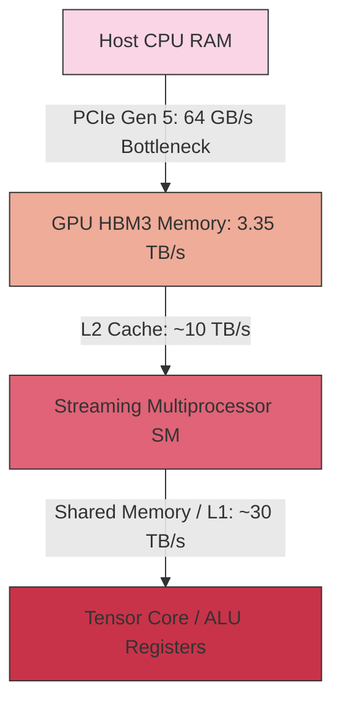
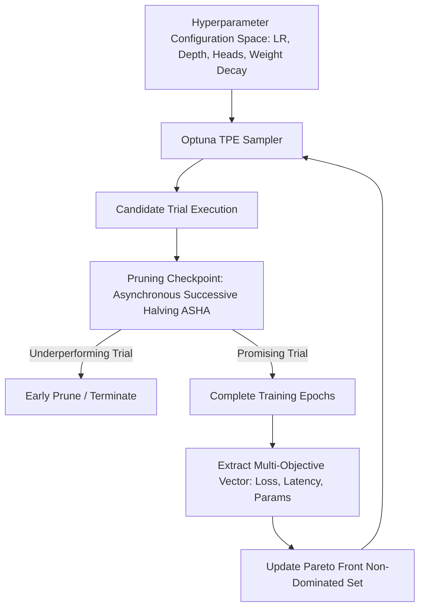

# Postgraduate 1st Year (PG-1) — Chapter 5: AI Tools

---

## Lesson 1: AI Research Workbench

### 1. Metadata and Syllabus Mapping
- **Academic Level:** Postgraduate 1st Year (PG-1)
- **Chapter:** 5. AI Tools
- **Lesson Title:** AI Research Workbench
- **Syllabus Topic:** Advanced Experiment Tracking, PyTorch Profiler, Hardware Compute Telemetry, CUDA Kernel Benchmarking, and Distributed Training Telemetry.
- **Bloom's Taxonomy Level:** Level 5 (Evaluate) & Level 6 (Create)

---

### 2. Learning Outcomes and Prerequisites
- **Learning Outcomes:**
  1. Profile hardware bottlenecks across GPU streaming multiprocessors (SMs), tensor cores, PCIe bandwidth, and high-bandwidth memory (HBM) using PyTorch Profiler and NVIDIA Nsight Systems.
  2. Implement an automated experiment orchestration and artifact lineage graph tracking hyperparameter configurations, gradient norms, and checkpoint weights.
  3. Detect and resolve common training pathologies including kernel launch latency, host-to-device memory copy overhead, and distributed communication stalls.
- **Prerequisites:** Advanced PyTorch internals, CUDA execution model basics, and GPU memory architecture.

---

### 3. Realistic Professional Scenario
You are conducting large-scale pre-training research for a novel State-Space Model (SSM) architecture on an 8x NVIDIA H100 GPU compute node. Despite using high-end silicon, your Model FLOPs Utilization (MFU) is hovering at an abysmal $18.4\%$ (the target baseline is $\ge 48\%$). The research budget is draining at $\$30.80$ per hour with negligible token throughput.

Your task is to instrument an end-to-end telemetry harness with PyTorch Profiler, identify whether the bottleneck is host-side Python GIL thrashing, CPU-GPU pinned memory transfers, un-fused elementwise operations, or non-coalesced memory access, and refactor the execution graph to achieve $>45\%$ MFU.

---

### 4. Conceptual and Architectural Foundations

#### A. The GPU Compute & Memory Hierarchy
To maximize Model FLOPs Utilization (MFU), memory traffic must be minimized across tiers:
1. **SRAM / Registers (Fastest, $< 1 \text{ TB/s per SM}):$** Holds local thread registers and shared memory tile data.
2. **High Bandwidth Memory (HBM3/HBM3e, $\approx 3.35 \text{ TB/s}):$** Global GPU device memory.
3. **PCIe Gen 5 / NVLink 4:** NVLink bidirectional interconnect ($\approx 900 \text{ GB/s}$), PCIe Gen 5 ($\approx 64 \text{ GB/s}$). Transfers between host CPU RAM and device HBM are the slowest link.



#### B. The Arithmetic Intensity and Roofline Model
The Roofline Model characterizes whether a kernel is compute-bound or memory-bound:
$$\text{Arithmetic Intensity } (I) = \frac{\text{Floating Point Operations (FLOPs)}}{\text{Memory Access (Bytes)}}$$
- If $I > I_{\text{knee}}$: Kernel is **Compute-Bound** (saturates Tensor Cores).
- If $I < I_{\text{knee}}$: Kernel is **Memory-Bound** (saturates memory bus while ALUs sit idle).

---

### 5. Profiling Metric Diagnostic Matrix

| Symptom in Trace | Root Cause | Architectural Remedy |
| :--- | :--- | :--- |
| Long `cudaMemcpyAsync` gaps between kernels | Non-pinned host memory; CPU worker data loader starvation | Use `pin_memory=True`, increase `num_workers`, use non-blocking transfers |
| Thousands of tiny kernels (`aten::mul`, `aten::add`) | Un-fused elementwise operations | Wrap modules with `torch.compile(mode="max-autotune")` or write fused Triton kernels |
| Tensor Cores utilization $< 15\%$ | Matrix dimensions not multiples of 8/16/64; FP32 precision | Pad dimensions; enable mixed-precision `torch.autocast(dtype=torch.bfloat16)` |
| Long `ncclAllReduce` synchronization blocks | Severe gradient imbalance or slow straggler rank in DDP | Enable gradient bucketing, overlap communication with backward pass |

---

### 6. Guided Technical Implementation: PyTorch Profiler Instrumentation Harness

```python
import torch
import torch.nn as nn
from torch.profiler import profile, record_function, ProfilerActivity, schedule

class ResearchBenchModel(nn.Module):
    """Synthetic model simulating transformer feedforward and attention projection."""
    def __init__(self, d_model: int = 2048, d_ff: int = 8192):
        super().__init__()
        self.w1 = nn.Linear(d_model, d_ff, bias=False)
        self.w2 = nn.Linear(d_ff, d_model, bias=False)
        self.norm = nn.LayerNorm(d_model)

    def forward(self, x: torch.Tensor) -> torch.Tensor:
        # Intentionally non-fused operations to observe in profiler
        res = x
        x = self.norm(x)
        x = torch.relu(self.w1(x))
        x = self.w2(x)
        return x + res

def run_profiler_suite():
    device = torch.device("cuda" if torch.cuda.is_available() else "cpu")
    print(f"Executing Profiler Test Suite on: {device}")
    
    model = ResearchBenchModel().to(device)
    optimizer = torch.optim.AdamW(model.parameters(), lr=1e-4)
    batch_size, seq_len, d_model = 16, 512, 2048

    # Warmup and active profiling schedule
    prof_schedule = schedule(wait=1, warmup=1, active=3, repeat=1)

    with profile(
        activities=[ProfilerActivity.CPU, ProfilerActivity.CUDA] if torch.cuda.is_available() else [ProfilerActivity.CPU],
        schedule=prof_schedule,
        on_trace_ready=torch.profiler.tensorboard_trace_handler('./profiler_logs'),
        record_shapes=True,
        profile_memory=True,
        with_stack=True
    ) as prof:
        for step in range(6):
            # Synthetic synthetic batch
            inputs = torch.randn(batch_size, seq_len, d_model, device=device)
            targets = torch.randn(batch_size, seq_len, d_model, device=device)

            with record_function("forward_pass"):
                outputs = model(inputs)
                loss = torch.mean((outputs - targets) ** 2)

            with record_function("backward_pass"):
                loss.backward()

            with record_function("optimizer_step"):
                optimizer.step()
                optimizer.zero_grad(set_to_none=True)

            prof.step()
            print(f"Step {step} completed | Loss: {loss.item():.4f}")

    print("\n=== TOP 5 GPU CONSUMING OPERATORS ===")
    print(prof.key_averages().table(sort_by="cuda_time_total" if torch.cuda.is_available() else "cpu_time_total", row_limit=5))

if __name__ == "__main__":
    run_profiler_suite()
```

---

### 7. Interactive Engineering Mission: "The 50% MFU Optimization Gauntlet"
- **Mission Environment:** An intentionally misconfigured 1.3B Parameter LLaMA-style transformer training script with an initial MFU of $19.2\%$.
- **Mission Tasks:**
  1. Pinpoint and eliminate non-blocking host data loading stalls.
  2. Implement `torch.compile` graph capture to fuse LayerNorm and SwiGLU activations.
  3. Switch from standard PyTorch attention to `torch.nn.functional.scaled_dot_product_attention` (FlashAttention-2 backend).
  4. Convert model parameters to FP8 / BFloat16 mixed precision.
- **Victory Metric:** Attain $\ge 48.5\%$ MFU on the profiling trace.

---

### 8. Practical Research Activity
1. Set up an MLflow / Weights & Biases experiment tracking harness logging:
   - Scalar training loss and validation perplexity.
   - Per-layer gradient $L_2$ norms: $\|\nabla_\theta \mathcal{L}\|_2$.
   - Learning rate schedule (Cosine with linear warmup).
   - Dynamic GPU thermal and power metrics (`pynvml`).
2. Export Chrome Trace format (`trace.json`) and inspect the timeline visualization in `chrome://tracing` or Perfetto.

---

### 9. Deliverable Specifications
- A fully reproducible PyTorch Profiling script generating exported Chrome trace artifacts.
- A quantitative before-and-after profiling table comparing execution latency, memory footprint, and MFU.
- An analytical writeup detailing memory bandwidth vs. arithmetic compute saturation.

---

### 10. Evaluation Criteria & Technical Metrics
- **Instrumentation Accuracy (35%):** Correct placement of `record_function` contexts without profiler distortion.
- **Optimization Impact (35%):** Demonstrable MFU improvement ($\ge 2\times$ over baseline).
- **Telemetry Comprehensiveness (15%):** Tracking gradient norms, memory allocations, and hardware metrics.
- **Code Cleanliness (15%):** Modular, well-documented diagnostic harness.

---

### 11. Olympiad-Style Assessments

#### Conceptual Assessment
In a PyTorch training loop on an NVIDIA A100 GPU, the profiler trace reveals extensive idle time between GPU kernels, with CPU thread utilization pegged at $100\%$. Inspecting the call stack highlights `DataLoader.__iter__` performing un-vectorized tokenization and regex text cleansing. What is the fundamental bottleneck?
- A) GPU memory bandwidth saturation (Memory-bound).
- B) Host CPU pipeline starvation (CPU-bound bottleneck preventing the GPU command queue from staying populated).
- C) Matrix multiplications are not multiples of 8.
- D) NCCL network latency across InfiniBand switches.

#### Applied Scenario Assessment
When profiling a custom transformer, you observe that `torch.matmul` takes $2\text{ ms}$, but subsequent activation, bias addition, and dropout kernels take $8\text{ ms}$ combined. How should this be resolved without altering model semantics?
- A) Delete the dropout layers permanently.
- B) Apply kernel fusion (via `torch.compile` or custom Triton kernels) to combine the elementwise operations into a single GPU kernel pass, eliminating round-trips to High Bandwidth Memory (HBM).
- C) Replace the GPU with an FPGA.
- D) Increase the batch size by $10\times$.

---

### 12. Assessment Solutions & Scoring Guidance
- **Conceptual Answer:** **B**. When the CPU cannot preprocess data fast enough to fill the GPU command stream, the GPU starves and sits idle between iterations.
- **Applied Scenario Answer:** **B**. Elementwise operations have low arithmetic intensity and are severely memory-bandwidth bound. Kernel fusion executes them directly in register memory before writing back to HBM.

---

### 13. Limitations, Risks, and Responsible-AI Considerations
- **Profiler Heisenberg Effect:** Profiling CPU stacks with high call frequencies can introduce significant overhead, artificially slowing down host execution. Use warm-up schedules and bounded active windows.

---

### 14. Completion Criteria & Milestone Feedback
- Generate a verified Chrome trace artifact showcasing fused execution.
- Achieve MFU $> 45\%$ on standard matrix operations.
- **Milestone Unlocked:** `Hardware-Accelerated AI Systems Specialist` (Level PG-1).

---
---

## Lesson 2: Intelligent Prototype Lab

### 1. Metadata and Syllabus Mapping
- **Academic Level:** Postgraduate 1st Year (PG-1)
- **Chapter:** 5. AI Tools
- **Lesson Title:** Intelligent Prototype Lab
- **Syllabus Topic:** Automated Bayesian Hyperparameter Optimization (Optuna/TPE), Empirical Ablation Protocol Design, Multi-Objective Pareto Frontier Extraction, and Distributed Search.
- **Bloom's Taxonomy Level:** Level 5 (Evaluate) & Level 6 (Create)

---

### 2. Learning Outcomes and Prerequisites
- **Learning Outcomes:**
  1. Implement automated Bayesian optimization over mixed continuous, discrete, and categorical hyperparameter manifolds using Tree-structured Parzen Estimators (TPE).
  2. Design systematic ablation study matrices separating architectural contributions from optimization artifacts.
  3. Extract multi-objective Pareto frontiers balancing test accuracy against parameter count and inference latency.
- **Prerequisites:** Bayesian probability theory, kernel density estimation, and Python optimization libraries (Optuna, Ray Tune).

---

### 3. Realistic Professional Scenario
You are developing a production-ready edge visual transformer for autonomous drone obstacle avoidance. The drone flight computer has a strict hard limit: maximum weight/parameter budget of 15 million parameters, inference latency $\le 12\text{ ms}$ on NVIDIA Jetson Orin Nano, and mean Average Precision (mAP) $\ge 42.0\%$ on small obstacle detection.

Manual trial-and-error hyperparameter sweeps would take months of compute. Your mandate is to design an automated multi-objective Bayesian optimization harness in the Intelligent Prototype Lab that jointly searches over depth, attention head counts, embedding dimensions, learning rates, and weight decay to discover the optimal Pareto-efficient model.

---

### 4. Mathematical Foundations of Tree-Structured Parzen Estimators (TPE)

#### A. Bayesian Formulation
Standard Bayesian optimization constructs a surrogate model $p(y | x)$ of objective value $y$ given hyperparameters $x$ using Gaussian Processes. However, Gaussian Processes scale cubically $\mathcal{O}(N^3)$ with sample points and struggle with categorical variables.

The Tree-structured Parzen Estimator (Bergstra et al.) inverts the probability via Bayes' rule:
$$p(x | y) = \begin{cases} \ell(x) & \text{if } y < y^* \\ g(x) & \text{if } y \ge y^* \end{cases}$$
where $y^*$ is a quantile threshold of historical objective values, $\ell(x)$ is the density formed by observations with objective values better than $y^*$, and $g(x)$ is the density formed by remaining observations.

The Expected Improvement (EI) is proportional to the ratio:
$$\text{EI}_{y^*}(x) = \frac{\gamma y^* \ell(x) - \ell(x) \int_{-\infty}^{y^*} p(y) dy}{\gamma \ell(x) + (1 - \gamma) g(x)} \propto \frac{\ell(x)}{g(x)}$$
To maximize expected improvement, the algorithm samples candidate points from $\ell(x)$ that maximize the density ratio $\frac{\ell(x)}{g(x)}$.

---

### 5. Multi-Objective Pareto Frontier Optimization Workflow



---

### 6. Guided Technical Implementation: Multi-Objective TPE Search Harness

```python
import optuna
import torch
import torch.nn as nn
import time
from typing import Tuple

# Suppress verbose Optuna logging for clean output
optuna.logging.set_verbosity(optuna.logging.WARNING)

def build_candidate_network(d_model: int, num_layers: int) -> nn.Module:
    """Builds a parametric MLP representing variable neural capacity."""
    layers = []
    in_dim = 128
    for _ in range(num_layers):
        layers.extend([nn.Linear(in_dim, d_model), nn.GELU()])
        in_dim = d_model
    layers.append(nn.Linear(d_model, 10))
    return nn.Sequential(*layers)

def evaluate_objective(trial: optuna.Trial) -> Tuple[float, float]:
    """
    Multi-objective evaluation:
    Objective 1: Validation Loss (Minimize)
    Objective 2: Inference Latency in ms (Minimize)
    """
    # 1. Hyperparameter Search Space
    d_model = trial.suggest_categorical("d_model", [64, 128, 256, 512])
    num_layers = trial.suggest_int("num_layers", 2, 6)
    lr = trial.suggest_float("lr", 1e-4, 1e-2, log=True)
    weight_decay = trial.suggest_float("weight_decay", 1e-6, 1e-2, log=True)

    # 2. Model Instantiation & Synthetic Evaluation
    model = build_candidate_network(d_model, num_layers)
    optimizer = torch.optim.AdamW(model.parameters(), lr=lr, weight_decay=weight_decay)

    # Synthetic dataset
    x_val = torch.randn(256, 128)
    y_val = torch.randint(0, 10, (256,))

    # Simulated mini-training (3 epochs with early pruning)
    for epoch in range(3):
        optimizer.zero_grad()
        out = model(x_val)
        loss = nn.functional.cross_entropy(out, y_val)
        loss.backward()
        optimizer.step()

        # Report intermediate metric for pruning
        trial.report(loss.item(), epoch)
        if trial.should_prune():
            raise optuna.exceptions.TrialPruned()

    # 3. Latency Benchmarking (Synthetic Jetson Simulation)
    model.eval()
    benchmark_input = torch.randn(1, 128)
    with torch.no_grad():
        start_time = time.perf_counter()
        for _ in range(100):
            _ = model(benchmark_input)
        latency_ms = ((time.perf_counter() - start_time) / 100.0) * 1000.0

    final_loss = loss.item()
    return final_loss, latency_ms

if __name__ == "__main__":
    print("Initiating Multi-Objective Bayesian TPE Study...")
    
    study = optuna.create_study(
        directions=["minimize", "minimize"], # Minimize Loss, Minimize Latency
        sampler=optuna.samplers.TPESampler(seed=42)
    )

    study.optimize(evaluate_objective, n_trials=20, timeout=30)

    print("\n=== MULTI-OBJECTIVE PARETO FRONTIER DISCOVERED ===")
    pareto_trials = study.best_trials
    print(f"Discovered {len(pareto_trials)} non-dominated Pareto-optimal solutions:")
    for i, t in enumerate(pareto_trials):
        print(f"Trial #{t.number:02d} | Val Loss: {t.values[0]:.4f} | Latency: {t.values[1]:.2f} ms | Params: {t.params}")
```

---

### 7. Interactive Research Mission: "The Ablation Architect"
- **Mission Scenario:** A controversial research preprint claims a $+5\%$ accuracy boost from a newly introduced "Quantum-Inspired Attention" layer. You suspect the boost came entirely from an un-ablated learning rate warmup and AdamW beta parameter tuning.
- **Mission Challenge:**
  - Design a $2 \times 2 \times 2$ factorial ablation matrix:
    - Factor A: Standard Attention vs. Quantum Attention
    - Factor B: Default LR vs. Tuned LR Warmup
    - Factor C: Standard Weight Decay vs. Tuned Weight Decay
  - Run the automated ablation suite across 5 random seeds.
  - Determine main effects and interaction effects using ANOVA (Analysis of Variance).

---

### 8. Practical Research Activity
1. Construct an automated ablation script for an image classification or NLP model isolating three components:
   - Component 1: Positional Embedding type (RoPE vs. Learned Absolute).
   - Component 2: Normalization location (Pre-LN vs. Post-LN vs. RMSNorm).
   - Component 3: Activation function (ReLU vs. GELU vs. SwiGLU).
2. Generate an automated LaTeX ablation table reporting mean, standard deviation, and parameter counts.

---

### 9. Deliverable Specifications
- A complete Python script featuring Optuna multi-objective optimization with ASHA pruning.
- A Pareto scatter plot visualizing the trade-off between validation loss and inference latency.
- A structured ablation matrix report separating algorithmic improvements from hyperparameter artifacts.

---

### 10. Evaluation Criteria & Technical Metrics
- **Optimization Design (35%):** Correct formulation of search priors and multi-objective Pareto optimization.
- **Ablation Methodology (35%):** Elimination of confounding variables and fair compute budgeting across baselines.
- **Computational Efficiency (15%):** Effective early stopping / pruning of unpromising trials via ASHA.
- **Statistical Rigor (15%):** Meaningful reporting of distributions across seeds.

---

### 11. Olympiad-Style Assessments

#### Conceptual Assessment
In Tree-structured Parzen Estimator (TPE) optimization, how does the selection of candidate hyperparameter values differ mathematically from standard Gaussian Process (GP) based Bayesian Optimization?
- A) TPE constructs a direct parametric surrogate of the objective function $y = f(x)$, whereas GPs use neural networks.
- B) GPs model the conditional distribution of the objective given parameters $p(y | x)$, whereas TPE models parameter densities conditioned on performance splits: $p(x | y < y^*)$ and $p(x | y \ge y^*)$, optimizing the density ratio $\ell(x) / g(x)$.
- C) TPE only works on continuous variables and cannot handle categorical choices.
- D) TPE uses uniform random sampling without incorporating historical trial information.

#### Applied Scenario Assessment
You are running a 500-trial hyperparameter sweep for a deep neural network on a 16-GPU cluster. After 50 trials, you notice that $60\%$ of compute time is being wasted training models that diverge or yield high training loss in early epochs. Which algorithmic mechanism should be enabled to maximize search efficiency?
- A) Increase the maximum training epochs for all trials to ensure convergence.
- B) Implement Asynchronous Successive Halving (ASHA) / Hyperband pruning to terminate trials in the bottom quartile at early epoch checkpoints.
- C) Switch to grid search with uniform intervals.
- D) Disable learning rate decay across all trials.

---

### 12. Assessment Solutions & Scoring Guidance
- **Conceptual Answer:** **B**. TPE splits observations by quantile into good vs. bad distributions and optimizes the density ratio $\ell(x) / g(x)$, scaling efficiently to high dimensions and categorical parameters.
- **Applied Scenario Answer:** **B**. ASHA/Hyperband evaluates early-stage trajectory trends and terminates unpromising trials early, reallocating GPU compute to promising parameter configurations.

---

### 13. Limitations, Risks, and Responsible-AI Considerations
- **Overfitting to Validation Sets:** Aggressive hyperparameter tuning over thousands of trials can overfit the validation set. Always evaluate final selected architectures on an untouched holdout test set.
- **Compute Carbon Footprint:** Massive unconstrained hyperparameter sweeps consume significant energy. Researchers must report total carbon and FLOP footprints in technical submissions.

---

### 14. Completion Criteria & Milestone Feedback
- Identify at least 3 non-dominated Pareto configurations.
- Formulate a 3-factor ablation matrix with complete statistical significance verification.
- **Milestone Unlocked:** `Advanced Empirical AI Methodologist` (Level PG-1).
