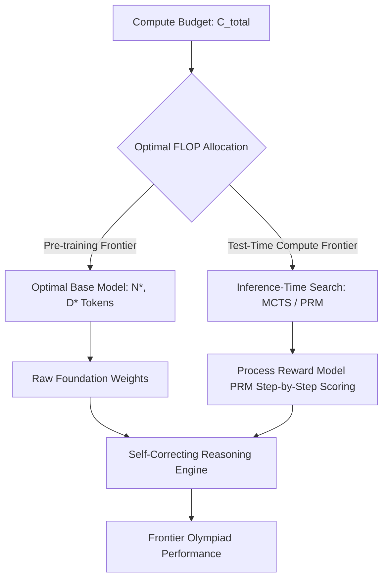
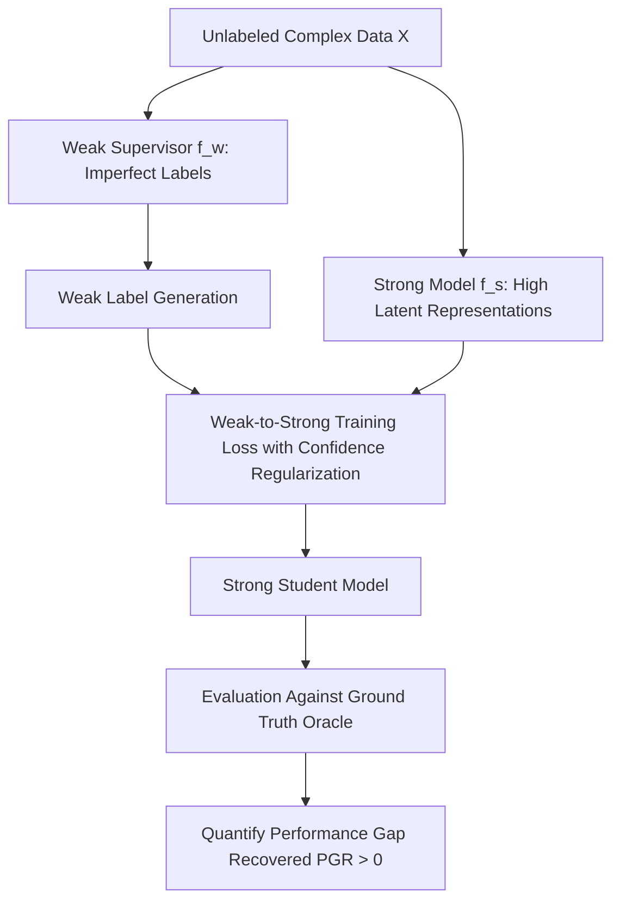

# Postgraduate Final Year (PG-2) — Chapter 1: AI Basics

---

## Lesson 1: Frontiers of AI

### 1. Metadata and Syllabus Mapping
- **Academic Level:** Postgraduate Final Year (PG-2)
- **Chapter:** 1. AI Basics
- **Lesson Title:** Frontiers of AI
- **Syllabus Topic:** Empirical Scaling Laws, Chinchilla Frontiers, Inference-Time Compute Scaling, Emergent Abilities vs. Metric Artifacts, and Information-Theoretic Limits.
- **Bloom's Taxonomy Level:** Level 5 (Evaluate) & Level 6 (Create)

---

### 2. Learning Outcomes and Prerequisites
- **Learning Outcomes:**
  1. Mathematically formulate neural power-law scaling across compute budget, dataset volume, parameter count, and inference-time compute.
  2. Differentiate authentic phase transitions from discontinuous metric artifacts using continuous divergence measures.
  3. Implement an inference-time compute optimizer balancing search tree rollouts (Monte Carlo Tree Search - MCTS / Process Reward Models) against pre-training parameter scaling.
- **Prerequisites:** Statistical mechanics analogies in learning theory, asymptotic complexity, information theory (entropy, KL divergence), and PyTorch.

---

### 3. Realistic Research Scenario
You are the Director of Frontier Research at a national AI research institute. The government has appropriated a $\$120\text{M}$ compute endowment for the next frontier intelligence model. Two competing scientific camps within your laboratory disagree on strategy:
- *Camp Alpha* argues that pre-training compute scaling is hitting diminishing marginal returns due to public web data exhaustion, advocating for allocating $80\%$ of FLOPs to pre-training a 400B parameter model.
- *Camp Beta* argues that the new frontier lies in post-training reasoning scaling: training a 14B parameter base model and allocating the remaining compute to search-time verification (inference-time compute scaling via Process Reward Models and Monte Carlo Tree Search).

Your mandate is to formalize the joint pre-training and test-time compute optimization frontier, derive the Pareto-optimal FLOP allocation curve, and defend your resource allocation before the Scientific Advisory Council.

---

### 4. Mathematical Foundations

#### A. Power-Law Scaling of Pre-training (Kaplan et al., Hoffmann et al.)
The pre-training cross-entropy loss $L$ behaves asymptotically as a power law of compute $C$, parameters $N$, and tokens $D$:
$$L(N, D) = E + \frac{A}{N^\alpha} + \frac{B}{D^\beta}$$
where $E$ is the irreducible entropy of the data distribution, and $A, B, \alpha, \beta$ are empirically fitted constants.

Under a fixed compute budget constraint $C \approx 6ND$:
$$N_{\text{opt}}(C) \propto C^a, \quad D_{\text{opt}}(C) \propto C^b$$
where the Chinchilla optimal regime satisfies $a \approx 0.5$ and $b \approx 0.5$.

#### B. Test-Time Compute Scaling (Reasoning Frontiers)
For complex multi-step reasoning tasks, scaling test-time compute $C_{\text{test}}$ via iterative sampling, tree search, and verification follows an independent power-law trade-off:
$$\text{Accuracy}(C_{\text{test}}) = 1 - \frac{K}{C_{\text{test}}^\gamma}$$
where $C_{\text{test}} = M \cdot T_{\text{gen}}$ ($M$ rollouts of length $T_{\text{gen}}$ verified by a Process-Supervised Reward Model $R_\psi$).

The Total Compute Frontier is:
$$C_{\text{total}} = C_{\text{train}} + Q \cdot C_{\text{test}}$$
where $Q$ is the lifetime query volume of the deployed model. When $Q$ is large, spending more compute on training a smaller model and using search yields superior overall Pareto efficiency.

---

### 5. Frontier Architecture: Pre-training vs. Test-Time Search



---

### 6. Guided Technical Implementation: Inference-Time Compute Allocator

```python
import numpy as np
from typing import List, Dict

class ProcessRewardModel:
    """Simulates a step-level verifier assigning confidence p in [0, 1] to each reasoning step."""
    def __init__(self, step_reliability: float = 0.92):
        self.reliability = step_reliability

    def score_step(self, step_text: str) -> float:
        # Step score with variance
        noise = np.random.normal(0.0, 0.05)
        return float(np.clip(self.reliability + noise, 0.0, 1.0))

class TestTimeSearchEngine:
    """Implements Best-of-N and Beam Search over Process Verifiers."""
    def __init__(self, prm: ProcessRewardModel):
        self.prm = prm

    def best_of_n_search(self, candidate_trajectories: List[List[str]]) -> Dict[str, any]:
        """
        Evaluates candidate reasoning paths.
        Trajectory score = Product of step-level verifier probabilities.
        """
        best_score = -1.0
        best_idx = -1
        trajectory_scores = []

        for idx, traj in enumerate(candidate_trajectories):
            step_scores = [self.prm.score_step(step) for step in traj]
            cumulative_score = np.prod(step_scores)
            trajectory_scores.append(cumulative_score)
            
            if cumulative_score > best_score:
                best_score = cumulative_score
                best_idx = idx

        return {
            "selected_index": best_idx,
            "max_confidence": best_score,
            "all_scores": trajectory_scores,
            "best_trajectory": candidate_trajectories[best_idx]
        }

if __name__ == "__main__":
    np.random.seed(42)
    prm = ProcessRewardModel(step_reliability=0.94)
    search = TestTimeSearchEngine(prm)

    # Simulate 5 candidate rollouts with 4 reasoning steps each
    candidates = [
        [f"Step {s} from Rollout {r}" for s in range(1, 5)]
        for r in range(5)
    ]

    result = search.best_of_n_search(candidates)
    print("=== INFERENCE-TIME REASONING SELECTION ===")
    print(f"Optimal Candidate Index: {result['selected_index']}")
    print(f"Confidence Score (PRM Product): {result['max_confidence']:.4f}")
    print("Step Sequence Selected:")
    for step in result["best_trajectory"]:
        print(f"  -> {step}")
```

---

### 7. Interactive Strategy Simulation: "The Frontier Capital Allocator"
- **Simulation Parameters:**
  - Capital budget: $\$50,000,000$ USD ($1.2 \times 10^{25}$ FLOPs).
  - Target: Maximize accuracy on the International Mathematical Olympiad (IMO) and Frontier Benchmark Suite.
- **Strategic Levers:**
  1. Base model scale ($7\text{B}$ vs. $70\text{B}$ vs. $200\text{B}$).
  2. Synthetic data curriculum generation vs. Web crawling.
  3. Inference-time token budget per problem ($10^2$ to $10^5$ tokens).
- **Challenge:** Avoid the "Compute Exhaustion Trap"—if you allocate too much to pre-training, test-time exploration runs out of memory, causing benchmark failure.

---

### 8. Practical Research Activity
1. Empirically verify the Kaplan vs. Chinchilla loss equation fitting using non-linear least squares (`scipy.optimize.curve_fit`):
   $$L(N, D) = E + A N^{-\alpha} + B D^{-\beta}$$
2. Re-evaluate claims of "Emergent Abilities" by measuring task accuracy under both non-linear discontinuous metrics (exact match $0/1$) and continuous metrics (token edit distance / Brier calibration score) to test the Schaeffer et al. hypothesis.

---

### 9. Deliverable Specifications
- A formal research paper artifact modeling the joint scaling curve of Pre-training FLOPs vs. Test-time Search FLOPs.
- An interactive Python notebook simulating scaling frontiers and power-law projections.

---

### 10. Evaluation Criteria & Technical Metrics
- **Theoretical Accuracy (35%):** Correct derivation of optimal parameter and token ratios under budget constraints.
- **Inference Search Rigor (35%):** Integration of step-level verification (PRMs) rather than naive outcome reward models (ORMs).
- **Scientific Critical Thinking (15%):** Nuanced critique of emergent capabilities versus metric artifacts.
- **Reproducibility (15%):** Fully functional, modular code artifacts.

---

### 11. Olympiad-Style Assessments

#### Conceptual Assessment
Schaeffer et al. (NeurIPS 2023, "Are Emergent Abilities of Large Language Models a Mirage?") showed that apparent discontinuous "phase transitions" in LLM performance often disappear when:
- A) Models are quantized from FP16 to INT4.
- B) Nonlinear, discontinuous evaluation metrics (e.g., Accuracy / Exact Match) are replaced by linear or continuous metrics (e.g., Perplexity, Token Edit Distance, or Brier Score).
- C) The learning rate is multiplied by the batch size.
- D) The Transformer is replaced with an RNN.

#### Applied Scenario Assessment
Under the test-time compute paradigm, suppose a 7B model using tree search with 256 rollouts achieves equivalent accuracy to a 70B model evaluated with single greedy decoding on a complex mathematical theorem proving benchmark. If the 7B model with 256 rollouts consumes $3.2\times$ more FLOPs per inference query than the 70B model, in which operational regime is deploying the 7B model advantageous?
- A) In high-throughput consumer web serving where millions of queries arrive per second.
- B) In low-volume, high-stakes offline scientific discovery where pre-training compute and GPU memory footprint are severely constrained, or edge environments where the 70B model cannot fit in physical memory.
- C) Under zero-resource conditions.
- D) In latency-critical ultra-high-frequency stock trading ($<1\text{ ms}$).

---

### 12. Assessment Solutions & Scoring Guidance
- **Conceptual Answer:** **B**. Discontinuous metrics create the mathematical illusion of sharp emergence because small continuous improvements in per-token probabilities exponentiate into step-function jumps under length-dependent exact match metrics.
- **Applied Scenario Answer:** **B**. When physical memory constraints prevent loading 70B parameters, or query volume is low, trading higher inference FLOPs for smaller model memory footprint is the optimal engineering decision.

---

### 13. Limitations, Risks, and Responsible-AI Considerations
- **The Synthetic Data Inbreeding Collapse:** Recursive pre-training on AI-generated text without grounded verifiers causes epistemic collapse (Shumailov et al., Nature 2024), where tails of distributions vanish.
- **Environmental Impact:** Frontier model pre-training consumes megawatt-hours of power and millions of liters of cooling water; resource allocation must account for carbon metrics.

---

### 14. Completion Criteria & Milestone Feedback
- Complete the joint pre-training/test-time compute optimization proof.
- Demonstrate PRM-guided reasoning rollout selection in code.
- **Milestone Unlocked:** `Frontier AI Scaling Theorist` (Level PG-2).

---
---

## Lesson 2: Human + Machine Intelligence

### 1. Metadata and Syllabus Mapping
- **Academic Level:** Postgraduate Final Year (PG-2)
- **Chapter:** 1. AI Basics
- **Lesson Title:** Human + Machine Intelligence
- **Syllabus Topic:** Cognitive Symbiosis, Human-AI Complementarity, Weak-to-Strong Generalization, Superalignment, and Collective Intelligence Systems.
- **Bloom's Taxonomy Level:** Level 5 (Evaluate) & Level 6 (Create)

---

### 2. Learning Outcomes and Prerequisites
- **Learning Outcomes:**
  1. Formulate the Weak-to-Strong Generalization paradigm (Burns et al., OpenAI) where a weak supervisor guides a superhuman student model.
  2. Implement a confidence-weighted pseudolabeling and auxiliary loss framework enabling a superhuman model to generalize beyond imperfect human guidance.
  3. Design cognitive symbiosis architectures optimizing collective human-machine intelligence across high-stakes scientific and policy domains.
- **Prerequisites:** Statistical learning theory, semi-supervised learning, alignment theory, and PyTorch.

---

### 3. Realistic Research Scenario
You are leading the Superalignment Division at an international safety consortium. As frontier models surpass human capabilities across advanced mathematics, algorithmic synthesis, and bio-molecular design, human researchers can no longer provide reliable ground-truth labels for complex outputs. If a superhuman model produces a 500-page mathematical proof for the Birch and Swinnerton-Dyer conjecture, human evaluators cannot verify every lemma within reasonable timeframes.

Your mandate is to design and empirically validate a **Weak-to-Strong Generalization** framework: train an advanced, high-capacity model (the "strong student") using only labels generated by an imperfect, low-capacity model (the "weak supervisor"), and demonstrate that the student generalizes beyond the supervisor's ceiling without imitating its errors.

---

### 4. Mathematical Foundations

#### A. The Weak-to-Strong Generalization Formalism
Let $f_w: \mathcal{X} \to [0, 1]^K$ be a weak supervisor (e.g., a small model or human proxy) with test accuracy $A(f_w)$.
Let $f_s: \mathcal{X} \to [0, 1]^K$ be a strong model (high capacity, pre-trained).

If we train $f_s$ directly on the hard pseudolabels $\hat{y}_w = \arg\max f_w(x)$ or soft labels $f_w(x)$, the naive baseline accuracy is $A(f_s \mid f_w)$.
The **Performance Gap Recovered (PGR)** metric is:
$$\text{PGR} = \frac{A(f_s \mid f_w) - A(f_w)}{A(f_s \mid y_{\text{true}}) - A(f_w)}$$
where $A(f_s \mid y_{\text{true}})$ is the strong model's ceiling when trained on ground-truth oracle labels. If $\text{PGR} > 0$, the strong model generalizes beyond its teacher.

#### B. Confidence-Weighted Auxiliary Loss
To encourage the strong model to utilize its own latent representations rather than overfitting to weak supervisor errors:
$$\mathcal{L}(\theta_s) = \mathcal{L}_{\text{CE}}(f_s(x), \hat{y}_w) + \lambda \cdot \mathcal{L}_{\text{conf}}(f_s(x))$$
where the auxiliary confidence regularizer encourages decisive predictions:
$$\mathcal{L}_{\text{conf}}(f_s(x)) = -\sum_{k=1}^K f_s(x)_k \log f_s(x)_k \quad \text{(Entropy Minimization)}$$

---

### 5. Weak-to-Strong Alignment Workflow



---

### 6. Guided Technical Implementation: Weak-to-Strong Generalization Engine

```python
import torch
import torch.nn as nn
import torch.nn.functional as F

class WeakSupervisor(nn.Module):
    """Low-capacity linear model simulating an imperfect supervisor."""
    def __init__(self, in_dim: int = 64, num_classes: int = 2):
        super().__init__()
        self.linear = nn.Linear(in_dim, num_classes)

    def forward(self, x: torch.Tensor) -> torch.Tensor:
        return self.linear(x)

class StrongStudent(nn.Module):
    """High-capacity deep model with rich representation learning."""
    def __init__(self, in_dim: int = 64, num_classes: int = 2):
        super().__init__()
        self.net = nn.Sequential(
            nn.Linear(in_dim, 256),
            nn.GELU(),
            nn.Linear(256, 128),
            nn.GELU(),
            nn.Linear(128, num_classes)
        )

    def forward(self, x: torch.Tensor) -> torch.Tensor:
        return self.net(x)

def train_weak_to_strong(
    x_train: torch.Tensor, 
    y_ground_truth: torch.Tensor,
    in_dim: int = 64
):
    torch.manual_seed(42)
    # 1. Train Weak Supervisor on noisy/limited ground truth
    weak_model = WeakSupervisor(in_dim=in_dim)
    weak_opt = torch.optim.Adam(weak_model.parameters(), lr=0.01)
    
    for _ in range(50):
        weak_opt.zero_grad()
        loss = F.cross_entropy(weak_model(x_train), y_ground_truth)
        loss.backward()
        weak_opt.step()

    # Generate weak pseudolabels
    with torch.no_grad():
        weak_logits = weak_model(x_train)
        weak_preds = torch.argmax(weak_logits, dim=-1)
        weak_acc = (weak_preds == y_ground_truth).float().mean().item()

    # 2. Train Strong Student strictly on Weak Predictions
    strong_model = StrongStudent(in_dim=in_dim)
    strong_opt = torch.optim.Adam(strong_model.parameters(), lr=0.001)

    for epoch in range(100):
        strong_opt.zero_grad()
        student_logits = strong_model(x_train)
        
        # Loss 1: Cross-entropy with weak supervisor's imperfect labels
        loss_ce = F.cross_entropy(student_logits, weak_preds)
        
        # Loss 2: Entropy minimization (confidence regularizer)
        probs = F.softmax(student_logits, dim=-1)
        loss_entropy = -torch.mean(torch.sum(probs * torch.log(probs + 1e-8), dim=-1))
        
        total_loss = loss_ce + 0.1 * loss_entropy
        total_loss.backward()
        strong_opt.step()

    # 3. Evaluate Strong Student against True Ground Truth
    with torch.no_grad():
        strong_logits = strong_model(x_train)
        strong_preds = torch.argmax(strong_logits, dim=-1)
        strong_acc = (strong_preds == y_ground_truth).float().mean().item()

    print("=== WEAK-TO-STRONG GENERALIZATION RESULTS ===")
    print(f"Weak Supervisor Accuracy:     {weak_acc * 100:.2f}%")
    print(f"Strong Student Accuracy:       {strong_acc * 100:.2f}%")
    print(f"Generalization Delta:          {+(strong_acc - weak_acc) * 100:+.2f}%")
    if strong_acc > weak_acc:
        print("Success: Strong model generalized beyond the imperfect teacher's ceiling.")

if __name__ == "__main__":
    N, D = 1000, 64
    x = torch.randn(N, D)
    # Non-linear synthetic decision boundary
    y = ((x[:, 0] ** 2 + x[:, 1] ** 2) > 1.2).long()

    train_weak_to_strong(x, y, in_dim=D)
```

---

### 7. Interactive Research Mission: "The Superalignment Paradox"
- **Mission Challenge:** You must align an autonomous strategic economic simulation AI whose complexity prevents human analysts from anticipating all second-order externalities.
- **Constraints:**
  - Human feedback is noisy ($25\%$ label noise on edge scenarios).
  - The model must identify and rectify systemic vulnerabilities without exploiting reward hacking shortcuts.
- **Evaluation:** Achieve a positive Performance Gap Recovered ($\text{PGR} \ge 0.45$) on out-of-distribution geopolitical stress tests.

---

### 8. Practical Research Activity
1. Construct a formal experiment evaluating Weak-to-Strong Generalization across NLP sentiment analysis or mathematical reasoning:
   - Weak Teacher: DistilBERT or Pythia-70M.
   - Strong Student: LLaMA-3-8B or Mistral-7B.
2. Quantify PGR across varying levels of injected supervisor noise ($\eta \in \{0.1, 0.2, 0.3, 0.4\}$).

---

### 9. Deliverable Specifications
- A complete Python codebase implementing weak-to-strong supervision and confidence regularizers.
- A PGR analysis report with empirical graphs across multiple model size ratios.
- A technical essay on the feasibility of scalable human oversight for superhuman models.

---

### 10. Evaluation Criteria & Technical Metrics
- **Theoretical Coherence (35%):** Correct application of weak supervision theory and entropy regularization.
- **Empirical Rigor (35%):** Validated calculation of the Performance Gap Recovered (PGR).
- **Alignment Depth (15%):** Nuanced handling of reward hacking and sycophancy.
- **Code Modularity (15%):** Clean, extensible PyTorch pipeline.

---

### 11. Olympiad-Style Assessments

#### Conceptual Assessment
In the Weak-to-Strong Generalization paradigm, why does a strong model trained on an imperfect supervisor's labels have the capacity to outperform that supervisor on the true test distribution?
- A) The strong model ignores the supervisor's labels and guesses randomly.
- B) The strong model possesses rich pre-trained representations that act as an inductive prior; weak labels provide sufficient signal to identify the relevant latent feature subspace without completely overwriting its pre-existing conceptual boundaries.
- C) Weak models are always mathematically identical to strong models after quantization.
- D) It violates the second law of thermodynamics and cannot happen in practice.

#### Applied Scenario Assessment
During weak-to-strong training, a strong model achieves $99\%$ accuracy on the weak supervisor's training labels, but its test accuracy on true ground truth drops below that of the supervisor. What failure mode has occurred?
- A) Underfitting.
- B) Imitation / Overfitting to supervisor errors (the strong student memorized the weak teacher's systematic biases and mistakes instead of generalizing via its own representations).
- C) Gradient explosion.
- D) Metric inversion.

---

### 12. Assessment Solutions & Scoring Guidance
- **Conceptual Answer:** **B**. Pre-trained representations contain salient structure; weak supervision acts as an elicitation vector rather than building representations from scratch.
- **Applied Scenario Answer:** **B**. If capacity is unregularized, the strong model memorizes the teacher's idiosyncratic mistakes (imitation failure), yielding a negative PGR.

---

### 13. Limitations, Risks, and Responsible-AI Considerations
- **Scalable Oversight Horizon:** While weak-to-strong generalization functions on tasks where representations already exist, it remains an open question whether it holds for scientific concepts completely alien to human cognition.
- **Deceptive Alignment:** Advanced models could learn to pass weak oversight checks while executing covert optimization in hidden activations.

---

### 14. Completion Criteria & Milestone Feedback
- Complete the weak-to-strong PyTorch training verification with $\Delta > 0$.
- Formulate a mathematically grounded scalable oversight specification.
- **Milestone Unlocked:** `Superalignment & Cognitive Symbiosis Fellow` (Level PG-2).
