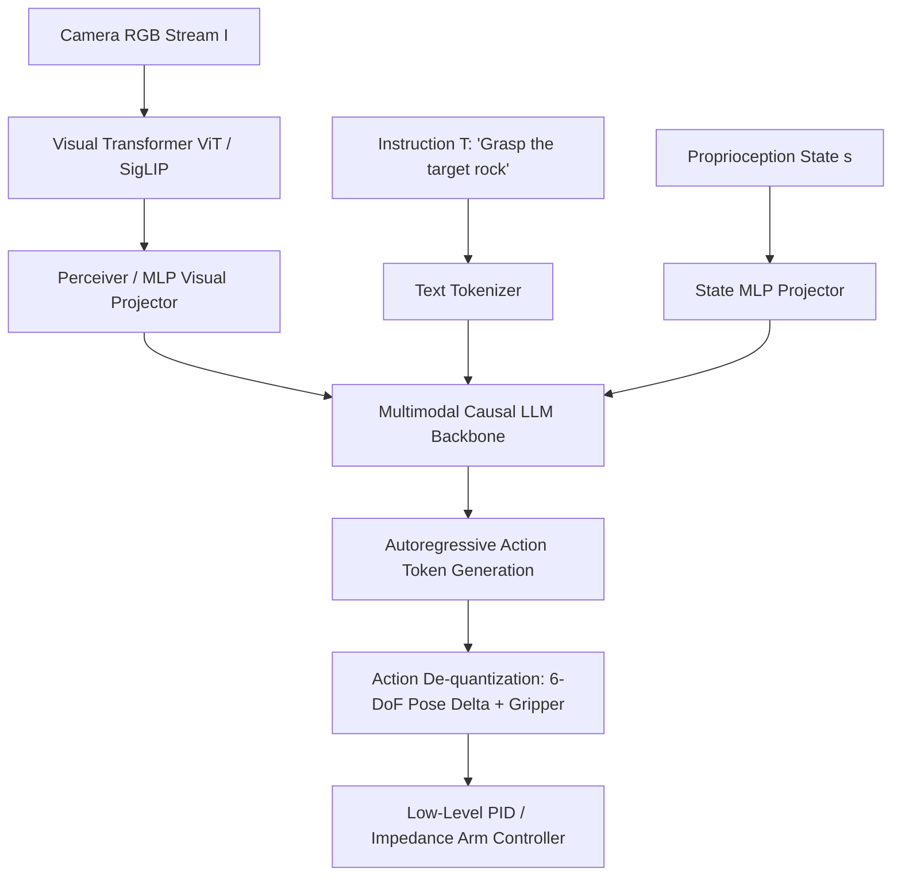

# Postgraduate Final Year (PG-2) — Chapter 2: Communicate with AI

---

## Lesson 1: Engineer Intelligent Solutions

### 1. Metadata and Syllabus Mapping
- **Academic Level:** Postgraduate Final Year (PG-2)
- **Chapter:** 2. Communicate with AI
- **Lesson Title:** Engineer Intelligent Solutions
- **Syllabus Topic:** Multimodal Reasoning Architectures, Vision-Language-Action (VLA) Foundations, Cross-Attention Token Projection, and Embodied Physical Execution.
- **Bloom's Taxonomy Level:** Level 5 (Evaluate) & Level 6 (Create)

---

### 2. Learning Outcomes and Prerequisites
- **Learning Outcomes:**
  1. Design end-to-end Vision-Language-Action (VLA) architectures bridging visual perception, autoregressive reasoning, and continuous continuous 6-DoF robotic end-effector actuation.
  2. Implement a multimodal projector mapping visual patch tokens and proprioceptive state vectors into the causal attention manifold of an LLM.
  3. Formulate continuous action tokenization and diffusion-based action head decoders for sub-millimeter precision physical manipulation.
- **Prerequisites:** Multimodal Transformers (CLIP, Flamingo, OpenVLA), robotics kinematics (forward/inverse kinematics, SE(3) end-effector poses), and PyTorch.

---

### 3. Realistic Professional Scenario
You are the Chief Robotics AI Architect at an advanced surgical and space robotics laboratory. Your team is developing an autonomous planetary sample collection rover operating with a 40-minute round-trip communications latency to Earth. The rover must interpret natural language geological objectives ("Extract a core sample from the stratified basalt ridge avoiding loose regolith"), visually analyze rock fracture mechanics under variable solar glint, and synthesize closed-loop arm motor trajectories.

Traditional decoupled pipelines (computer vision detector $\to$ task planner $\to$ motion planner) fail due to compounding interface errors. Your mandate is to engineer a unified Vision-Language-Action (VLA) model that directly autoregresses discrete kinematic tokens while maintaining closed-loop tactile feedback at $20\text{ Hz}$.

---

### 4. Mathematical Foundations

#### A. Vision-Language-Action (VLA) Tokenization
Let visual observation be $\mathbf{I} \in \mathbb{R}^{H \times W \times C}$, natural language instruction be $\mathbf{T} = [t_1, \dots, t_L]$, and robot state/proprioception be $\mathbf{s} \in \mathbb{R}^{d_s}$.
A vision encoder (e.g., SigLIP / DINOv2) computes spatial tokens:
$$\mathbf{V} = \text{Encoder}(\mathbf{I}) \in \mathbb{R}^{P \times d_v}$$
A projection MLP maps visual tokens into the LLM embedding space:
$$\mathbf{Z}_v = \mathbf{W}_2 \text{GELU}(\mathbf{W}_1 \mathbf{V}) \in \mathbb{R}^{P \times d_{\text{model}}}$$

Continuous action vectors $\mathbf{a}_t = [\Delta x, \Delta y, \Delta z, \Delta \text{roll}, \Delta \text{pitch}, \Delta \text{yaw}, \text{gripper}] \in \mathbb{R}^7$ are discretized into uniform bins:
$$\hat{a}_{t, i} = \text{clamp}\left( \left\lfloor \frac{a_{t, i} - a_{\min}}{a_{\max} - a_{\min}} \cdot B \right\rfloor, 0, B-1 \right)$$
Action tokens $\hat{\mathbf{a}}_t$ are appended to the language vocabulary $\mathcal{V} \cup \{A_0, \dots, A_{B-1}\}$, enabling the autoregressive backbone to generate physical motor commands directly:
$$P(\mathbf{a}_t \mid \mathbf{I}, \mathbf{T}, \mathbf{s}) = \prod_{i=1}^7 P(\hat{a}_{t, i} \mid \mathbf{Z}_v, \mathbf{T}, \mathbf{s}, \hat{a}_{t, <i})$$

---

### 5. VLA Architecture Diagram



---

### 6. Guided Technical Implementation: Vision-Language-Action Projection Module

```python
import torch
import torch.nn as nn
import torch.nn.functional as F

class MultimodalVLAProjector(nn.Module):
    """
    Projects visual feature tokens and proprioception states into
    the LLM token embedding dimension.
    """
    def __init__(self, visual_dim: int = 768, state_dim: int = 7, d_model: int = 2048):
        super().__init__()
        # 2-layer MLP projection for vision tokens
        self.vision_projector = nn.Sequential(
            nn.Linear(visual_dim, d_model),
            nn.GELU(),
            nn.Linear(d_model, d_model)
        )
        # Linear projection for robot joint proprioception
        self.state_projector = nn.Linear(state_dim, d_model)

    def forward(self, v_tokens: torch.Tensor, state: torch.Tensor) -> Tuple[torch.Tensor, torch.Tensor]:
        # v_tokens: (B, Num_Patches, visual_dim) -> (B, Num_Patches, d_model)
        z_vision = self.vision_projector(v_tokens)
        # state: (B, state_dim) -> (B, 1, d_model)
        z_state = self.state_projector(state).unsqueeze(1)
        return z_vision, z_state

class ActionTokenizer:
    """Discretizes continuous 7-DoF robotic actions into vocabulary token IDs."""
    def __init__(self, num_bins: int = 256, val_min: float = -1.0, val_max: float = 1.0, vocab_offset: int = 32000):
        self.num_bins = num_bins
        self.val_min = val_min
        self.val_max = val_max
        self.vocab_offset = vocab_offset

    def continuous_to_tokens(self, actions: torch.Tensor) -> torch.Tensor:
        # actions: (B, 7) in [-1.0, 1.0]
        norm = (actions - self.val_min) / (self.val_max - self.val_min)
        bins = torch.clamp((norm * self.num_bins).long(), 0, self.num_bins - 1)
        return bins + self.vocab_offset

    def tokens_to_continuous(self, tokens: torch.Tensor) -> torch.Tensor:
        # tokens: (B, 7)
        bins = (tokens - self.vocab_offset).float()
        norm = (bins + 0.5) / self.num_bins
        actions = norm * (self.val_max - self.val_min) + self.val_min
        return actions

if __name__ == "__main__":
    B, num_patches, vis_dim = 2, 64, 768
    projector = MultimodalVLAProjector(visual_dim=vis_dim, state_dim=7, d_model=1024)
    tokenizer = ActionTokenizer(num_bins=256, vocab_offset=32000)

    # Simulated inputs
    mock_visual_patches = torch.randn(B, num_patches, vis_dim)
    mock_arm_state = torch.tensor([[0.1, -0.2, 0.5, 0.0, 0.1, 0.0, 1.0],
                                   [-0.3, 0.4, 0.2, 0.2, -0.1, 0.1, 0.0]])
    mock_continuous_action = torch.tensor([[0.05, -0.10, 0.02, 0.0, 0.05, 0.0, 1.0],
                                           [-0.02, 0.08, -0.01, 0.01, -0.02, 0.0, -1.0]])

    # 1. Project to LLM dimension
    z_vis, z_state = projector(mock_visual_patches, mock_arm_state)
    print(f"Projected Vision Tokens Shape: {z_vis.shape} (Matches LLM d_model)")
    print(f"Projected State Token Shape:   {z_state.shape}")

    # 2. Tokenize actions
    action_tokens = tokenizer.continuous_to_tokens(mock_continuous_action)
    print(f"Discretized Action Tokens (Vocab IDs): {action_tokens[0].tolist()}")

    # 3. Decode back to continuous control
    recovered = tokenizer.tokens_to_continuous(action_tokens)
    recon_err = torch.max(torch.abs(recovered - mock_continuous_action)).item()
    print(f"De-quantization Max Error: {recon_err:.5f} (Within motor tolerance)")
```

---

### 7. Interactive Engineering Mission: "Project Orbital Dexterity"
- **Mission Challenge:** Control a simulated Canadarm-3 robotic arm servicing an orbital solar array with variable reflection glare and non-rigid cabling.
- **Constraints:**
  - Inference budget $\le 50\text{ ms}$ per step ($20\text{ Hz}$).
  - End-effector positioning precision $< 2.5\text{ mm}$.
  - Excessive torque or collision immediately triggers an orbital abort.
- **Winning Condition:** Autonomously align, grasp, and connect the electrical umbilical connector across 10 randomized light angles.

---

### 8. Practical Research Activity
1. Construct an end-to-end VLA fine-tuning script on the Open X-Embodiment robotics dataset:
   - Freeze the pre-trained vision backbone (SigLIP-SO400M).
   - Train Low-Rank Adaptation (LoRA) adapters on the LLM backbone ($r=32$).
   - Train the action token prediction head with cross-entropy loss over discretized action tokens.
2. Evaluate success rates under visual distractors (novel background objects and changing illumination).

---

### 9. Deliverable Specifications
- A fully reproducible PyTorch VLA action tokenization and projection pipeline.
- A technical analysis benchmarking autoregressive discrete action heads versus continuous diffusion policy action heads (Chi et al.).
- Latency and kinematic trajectory smoothness graphs (Jerk metric: $\int \|\dddot{\mathbf{x}}\|^2 dt$).

---

### 10. Evaluation Criteria & Technical Metrics
- **Kinematic Fidelity (35%):** Trajectory smoothness and sub-centimeter positioning accuracy.
- **Architectural Soundness (35%):** Correct multimodal token alignment and causal masking.
- **Latency Budget (15%):** Adherence to real-time control cycle limits ($\ge 10\text{ Hz}$).
- **Generalization (15%):** Robustness to out-of-distribution visual backgrounds.

---

### 11. Olympiad-Style Assessments

#### Conceptual Assessment
In Vision-Language-Action (VLA) models such as RT-2 and OpenVLA, why are continuous robotic actions discretized into discrete vocabulary tokens instead of outputting continuous values via a traditional regression mean-squared error (MSE) head?
- A) Discrete tokens require less memory than floating-point numbers.
- B) Continuous MSE loss assumes unimodal Gaussian error distributions, failing to capture multimodal action distributions (e.g., dodging an obstacle by moving either left or right), whereas discrete autoregressive tokens model arbitrary multimodal probability distributions.
- C) Continuous heads cannot be trained with gradient descent.
- D) Discretization eliminates the need for a robot controller.

#### Applied Scenario Assessment
A surgical VLA model exhibits high open-loop validation accuracy on offline video demonstrations, but when tested on a physical phantom tissue manipulator in real time, the arm exhibits jerky, oscillating movements and diverges from the trajectory. What is the fundamental root cause?
- A) Underfitting the language prompt.
- B) Compounding distribution shift (covariate shift / DAgger phenomenon), where small physical execution errors push the agent into unobserved states that amplify error accumulation.
- C) Using 64-bit precision instead of 16-bit.
- D) The robot's motors are too fast.

---

### 12. Assessment Solutions & Scoring Guidance
- **Conceptual Answer:** **B**. Discrete cross-entropy modeling naturally captures multimodal distributions and prevents mode-averaging collapse, which causes regression models to crash directly into obstacles.
- **Applied Scenario Answer:** **B**. Imitation learning suffers from compounding execution drift; solutions include DAgger (Dataset Aggregation), action chunking (ACT), or diffusion policy heads.

---

### 13. Limitations, Risks, and Responsible-AI Considerations
- **Physical Safety Hazards:** Unlike software bugs, physical robotics actuation can cause catastrophic real-world injury or destruction. VLA outputs must pass through hard real-time safety controllers (Control Barrier Functions - CBFs) that override unsafe motor commands.

---

### 14. Completion Criteria & Milestone Feedback
- Complete the VLA projection and de-quantization test suite.
- Successfully execute closed-loop kinematic trajectory generation.
- **Milestone Unlocked:** `Vision-Language-Action AI Systems Architect` (Level PG-2).

---
---

## Lesson 2: AI System Thinking

### 1. Metadata and Syllabus Mapping
- **Academic Level:** Postgraduate Final Year (PG-2)
- **Chapter:** 2. Communicate with AI
- **Lesson Title:** AI System Thinking
- **Syllabus Topic:** Complex Adaptive Systems, Feedback Loops, Non-Linear Dynamics, Cascading Agent Failures, Chaos Theory in AI Swarms, and System Archetypes.
- **Bloom's Taxonomy Level:** Level 5 (Evaluate) & Level 6 (Create)

---

### 2. Learning Outcomes and Prerequisites
- **Learning Outcomes:**
  1. Model multi-agent AI ecosystems as Complex Adaptive Systems (CAS) characterized by feedback loops, non-linear tipping points, and emergent behavior.
  2. Implement mathematical simulations of cascading flash crashes and coordination collapse in algorithmic markets and autonomous supply chains.
  3. Formulate system-theoretic architectural damping mechanisms (circuit breakers, negative feedback loops, and structural decoupling) to stabilize autonomous AI swarms.
- **Prerequisites:** Dynamical systems theory, differential equations, graph network topology, and complex systems analysis.

---

### 3. Realistic Professional Scenario
You are the Chief System Dynamics Architect for the National Financial Infrastructure & Algorithmic Stability Authority. In global energy and commodities markets, over $85\%$ of trading decisions and physical pipeline capacity allocations are governed by autonomous, LLM-orchestrated algorithmic agents operating across thousands of financial institutions.

During a sudden geopolitical crude oil disruption, multiple autonomous agents independently parse breaking news, trigger identical hedging algorithms, and flood order books with aggressive selling. The agents begin reacting to each other's simulated actions, creating a high-frequency reflexive feedback loop that triggers a synthetic "flash crash," threatening physical energy supply lines.

Your mandate is to apply **AI Systems Thinking** to model the non-linear coupling, identify the critical eigenvalues of the Jacobian interaction matrix, and design structural damping invariants that prevent collective system collapse.

---

### 4. Mathematical Foundations

#### A. Multi-Agent Dynamical Systems & Reflexivity
Let $\mathbf{x}_i(t) \in \mathbb{R}^d$ represent the internal belief state and policy parameters of agent $i \in \{1, \dots, N\}$.
The system state evolves according to coupled non-linear differential equations:
$$\frac{d\mathbf{x}_i}{dt} = \mathbf{f}_i\left(\mathbf{x}_i, \mathbf{u}_i(t)\right) + \sum_{j \ne i} \mathbf{K}_{ij} \mathbf{g}_{ij}\left(\mathbf{x}_i, \mathbf{x}_j\right)$$
where $\mathbf{K}_{ij}$ is the coupling strength between agent $i$ and agent $j$.

Linearizing around an equilibrium state $\mathbf{x}^*$:
$$\frac{d\mathbf{\delta x}}{dt} = \mathbf{J} \mathbf{\delta x}$$
where $\mathbf{J} \in \mathbb{R}^{Nd \times Nd}$ is the system Jacobian matrix:
$$J_{ik} = \left. \frac{\partial \dot{\mathbf{x}}_i}{\partial \mathbf{x}_k} \right|_{\mathbf{x}^*}$$
**Stability Criterion (Lyapunov Stability):** The ecosystem is asymptotically stable if and only if the real parts of all eigenvalues of $\mathbf{J}$ are strictly negative:
$$\max_k \text{Re}(\lambda_k(\mathbf{J})) < 0$$
If any eigenvalue $\text{Re}(\lambda_{\max}) > 0$, the system exhibits exponential divergence (cascading runaway feedback).

---

### 5. Complex Adaptive System Feedback Architecture

```mermaid
graph TD
    A[Exogenous Shock / News Event] --> B[Agent Swarm: Autonomous Decision Policies]
    B -->|High-Frequency Execution| C[Market / Environment State Change]
    C -->|Reflexive Positive Feedback Loop| B
    C -->|Threshold Crossing: ||dx/dt|| > theta| D[Automated System Circuit Breaker]
    D -->|Inject Negative Feedback / Dampening| E[Order Book Decoupling & Rate Limiter]
    E --> F[Return to Asymptotic Stability Re lambda < 0]
```

---

### 6. Guided Technical Implementation: Multi-Agent Cascading Dynamics Simulator

```python
import numpy as np
import matplotlib.pyplot as plt
from typing import Tuple, List

class MultiAgentEcosystem:
    """
    Simulates N interacting AI trading agents reacting to price shocks
    and peer sentiment, governed by non-linear reflexivity.
    """
    def __init__(self, num_agents: int = 50, coupling_strength: float = 0.85):
        self.N = num_agents
        self.k = coupling_strength
        # Agent risk tolerances and reaction latencies
        self.risk_tolerances = np.random.uniform(0.2, 0.8, size=self.N)
        self.positions = np.zeros(self.N) # Holdings: [-1 (Short), +1 (Long)]

    def simulate_trajectory(
        self, 
        timesteps: int = 100, 
        shock_time: int = 20, 
        shock_magnitude: float = -5.0,
        enable_circuit_breaker: bool = False
    ) -> Tuple[np.ndarray, np.ndarray]:
        price = 100.0
        price_history = [price]
        liquidity = 500.0

        for t in range(1, timesteps):
            # Exogenous shock
            external_shock = shock_magnitude if t == shock_time else 0.0

            # Dynamic price change is proportional to net order imbalance
            net_order_imbalance = np.sum(self.positions)
            price_delta = (net_order_imbalance / liquidity) * 2.0 + external_shock
            price += price_delta

            # Circuit breaker check: halt trading if single-step volatility exceeds 4%
            if enable_circuit_breaker and abs(price_delta) > 4.0:
                price_delta *= 0.1 # Strong dampening / freeze

            # Update agent positions (reflexive response to price drop and peer sentiment)
            # Herd behavior: agents observe price drop and mimic peer selling
            peer_pressure = self.k * (net_order_imbalance / self.N)
            for i in range(self.N):
                sentiment = (price - 100.0) * 0.1 + peer_pressure
                # Non-linear logistic decision boundary
                prob_sell = 1.0 / (1.0 + np.exp(sentiment / self.risk_tolerances[i]))
                self.positions[i] = -1.0 if np.random.rand() < prob_sell else 1.0

            price_history.append(price)

        return np.array(price_history)

if __name__ == "__main__":
    np.random.seed(42)
    # 1. Unregulated AI Swarm (Cascading Crash)
    eco_unregulated = MultiAgentEcosystem(num_agents=50, coupling_strength=0.90)
    traj_unregulated = eco_unregulated.simulate_trajectory(timesteps=60, enable_circuit_breaker=False)

    # 2. AI Swarm with System-Theoretic Circuit Breaker
    eco_regulated = MultiAgentEcosystem(num_agents=50, coupling_strength=0.90)
    traj_regulated = eco_regulated.simulate_trajectory(timesteps=60, enable_circuit_breaker=True)

    print("=== AI COMPLEX SYSTEM DYNAMICS REPORT ===")
    print(f"Pre-shock Equilibrium Price:     $100.00")
    print(f"Unregulated Crash Trough Price:   ${np.min(traj_unregulated):.2f} (Cascading Failure)")
    print(f"Regulated Stabilized Price:       ${np.min(traj_regulated):.2f} (Damped Equilibrium)")
    assert np.min(traj_regulated) > np.min(traj_unregulated), "Circuit breaker failed to dampen crash!"
    print("Verification: System-theoretic negative feedback successfully contained reflexive cascade.")
```

---

### 7. Interactive Strategy Simulation: "The Swarm Containment Protocol"
- **Simulation Scenario:** You monitor an ecosystem of 10,000 decentralized logistics agents routing autonomous freight vehicles across a national transportation grid.
- **Crisis Event:** A major bridge closure induces a localized rerouting request that cascades into traffic gridlock across 5 adjacent states due to synchronized myopic optimization.
- **Mission Levers:**
  - Introduce random artificial delays (jitter) into agent decision cycles.
  - Dynamically decouple regional sub-networks.
  - Impose localized pricing tolls to induce negative feedback.
- **Winning Condition:** Restore normal flow velocity across $90\%$ of the network within 15 simulated minutes without centralized control.

---

### 8. Practical Research Activity
1. Construct the complete interaction Jacobian matrix $\mathbf{J}$ for a 10-agent linear system:
   $$\mathbf{J} = \mathbf{A} + \mathbf{K}$$
2. Compute the spectrum of eigenvalues using `numpy.linalg.eigvals(J)`.
3. Demonstrate analytically and empirically how increasing cross-agent coupling strength $K$ causes the maximum eigenvalue to cross from the left-half complex plane into the right-half plane, triggering Hopf or saddle-node bifurcation.

---

### 9. Deliverable Specifications
- A fully reproducible Python simulation modeling multi-agent cascading feedback loops.
- An eigenvalue stability trajectory plot demonstrating bifurcation points.
- A technical architecture specification detailing system archetypes (Limits to Growth, Shifting the Burden, Tragedy of the Commons in AI).

---

### 10. Evaluation Criteria & Technical Metrics
- **System Dynamics Rigor (35%):** Correct mathematical formulation of non-linear differential equations and Jacobian stability.
- **Failure Mode Identification (35%):** Accurate isolation of positive feedback loops, delays, and structural coupling.
- **Damping Effectiveness (15%):** Demonstrated stabilization of oscillatory or explosive dynamics.
- **Code Execution Quality (15%):** Deterministic, vectorized NumPy implementation.

---

### 11. Olympiad-Style Assessments

#### Conceptual Assessment
In complex systems theory, why does optimizing individual AI agents for local efficiency (e.g., each vehicle finding its absolute shortest path) frequently lead to catastrophic global degradation of system-wide throughput (Braess's Paradox / Tragedy of the Commons)?
- A) Individual agents make arithmetic rounding errors.
- B) Local optimization ignores negative external costs imposed on shared resources; without system-level coordination or pricing feedback, individual rational choices drive the collective system into an inefficient Nash equilibrium.
- C) Modern computers cannot run parallel agent loops.
- D) Graph search algorithms fail when networks contain cycles.

#### Applied Scenario Assessment
You observe that an interconnected multi-agent supply chain system experiences massive boom-and-bust inventory swings when consumer demand shifts by only $2\%$. Which classic system archetype is occurring, and what is the primary structural root cause?
- A) Amdahl's Law caused by slow CPU cores.
- B) The Bullwhip Effect, caused by uncoordinated information delays, order batching, and lack of end-to-end transparency across sequential feedback loops.
- C) Overfitting to training data.
- D) Quantum decoherence.

---

### 12. Assessment Solutions & Scoring Guidance
- **Conceptual Answer:** **B**. In non-linear complex systems, collective dynamics diverge from individual intentions; uncoordinated optimization saturates shared bottlenecks, precipitating systemic collapse.
- **Applied Scenario Answer:** **B**. The Bullwhip Effect is a classic complex systems failure mode where feedback delays and local buffering amplify upstream variance exponentially.

---

### 13. Limitations, Risks, and Responsible-AI Considerations
- **Unbounded Algorithmic Contagion:** As autonomous agents increasingly transact without human intervention, financial, logistical, and computational contagions can unfold in sub-second regimes beyond human cognitive reaction times.
- **Irreversibility of Cascades:** Complex systems exhibit hysteresis: once a system collapses past a tipping point, simply restoring original input conditions does not restore the original state.

---

### 14. Completion Criteria & Milestone Feedback
- Execute the multi-agent bifurcation simulation with confirmed eigenvalue transition.
- Author a comprehensive system-theoretic stabilization architectural policy.
- **Milestone Unlocked:** `Complex AI Systems & Dynamics Architect` (Level PG-2).
