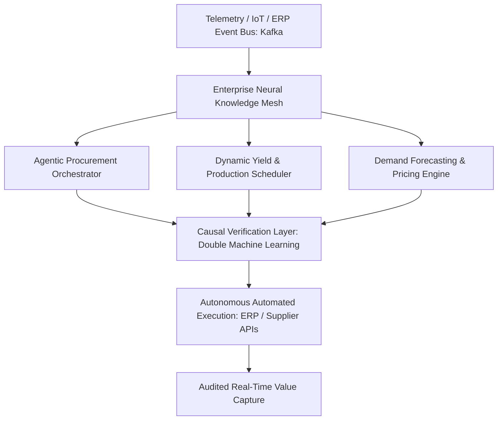
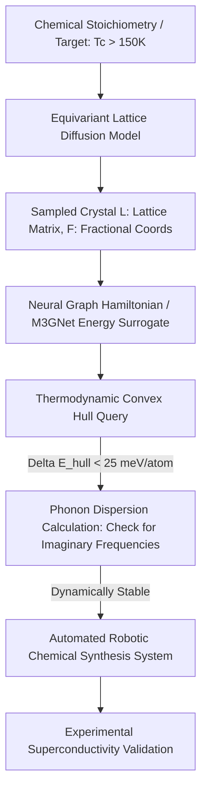

# Postgraduate Final Year (PG-2) — Chapter 3: AI Applications

---

## Lesson 1: AI for Transformation

### 1. Metadata and Syllabus Mapping
- **Academic Level:** Postgraduate Final Year (PG-2)
- **Chapter:** 3. AI Applications
- **Lesson Title:** AI for Transformation
- **Syllabus Topic:** Enterprise-Wide Autonomous Operating Models, AI-Led Macroeconomic Transformation, Core Business Process Restructuring, and Industrial Closed-Loop Synthesis.
- **Bloom's Taxonomy Level:** Level 5 (Evaluate) & Level 6 (Create)

---

### 2. Learning Outcomes and Prerequisites
- **Learning Outcomes:**
  1. Design an enterprise-scale autonomous cognitive operating model integrating ERP, CRM, logistics, and production scheduling into an event-driven neural architecture.
  2. Implement an automated core workflow orchestration engine with causal impact estimation (Double Machine Learning - DML) and counterfactual optimization.
  3. Formulate enterprise transformation transition strategies managing organizational inertia, regulatory audits, and economic displacement.
- **Prerequisites:** Enterprise architecture frameworks (TOGAF, Microservices), causal inference (Do-Calculus, EconML), and distributed event streaming (Kafka/RabbitMQ).

---

### 3. Realistic Professional Scenario
You are the Chief AI Transformation Officer for a multinational semiconductor and electronics manufacturing conglomerate with $\$40\text{B}$ in annual revenue. The organization operates across 18 countries with legacy SAP systems, isolated supply chain data silos, and manual sales and operations planning (S&OP) cycles that take 3 weeks per iteration. During global logistics disruptions, these latency bottlenecks lead to $\$600\text{M}$ in excess inventory and missed production allocations.

Your executive mandate is to engineer an **AI-Led Autonomous Enterprise Architecture**: replace batch planning cycles with continuous real-time neural supply-demand equilibrium matching, orchestrate autonomous micro-agent negotiations across procurement and tier-1 suppliers, and prove a causal EBITDA margin expansion of $\ge 350\text{ basis points}$.

---

### 4. Mathematical and Architectural Foundations

#### A. The Event-Driven Autonomous Enterprise Model
Instead of human workers manually querying relational databases, business state transitions are represented as continuous event streams $\mathcal{E} = \{e_1, e_2, \dots, e_t\}$ processed by an ensemble of specialized domain agents:



#### B. Causal Impact Verification via Double Machine Learning (Chernozhukov et al.)
To prove that an AI-driven pricing or inventory intervention caused revenue expansion rather than macro tailwinds, we use the Partially Linear Model:
$$Y = \theta D + g(X) + U, \quad \mathbb{E}[U \mid D, X] = 0$$
$$D = m(X) + V, \quad \mathbb{E}[V \mid X] = 0$$
where $Y$ is business outcome (Revenue), $D$ is the AI intervention policy, and $X$ is high-dimensional confounding covariates (market index, seasonal factors, competitor actions).

By orthogonalizing residuals using two separate machine learning models:
$$\tilde{Y} = Y - \hat{g}(X), \quad \tilde{D} = D - \hat{m}(X)$$
The causal parameter $\theta$ is estimated via unconfounded OLS on the residuals:
$$\hat{\theta} = \left(\frac{1}{N}\sum_{i=1}^N \tilde{D}_i^2\right)^{-1} \left(\frac{1}{N}\sum_{i=1}^N \tilde{D}_i \tilde{Y}_i\right)$$
This estimator is asymptotically normal and immune to regularization bias.

---

### 5. Enterprise Cognitive Maturity Spectrum

| Maturity Stage | Operational Paradigm | Decision Latency | Human Role | Business Impact |
| :--- | :--- | :--- | :--- | :--- |
| **Level 1: Descriptive** | Static dashboards, historical SQL queries | Weeks to Months | Complete manual execution | Baseline tracking |
| **Level 2: Predictive** | Supervised forecasting, demand models | Days to Weeks | Humans review predictions | Marginal margin gain |
| **Level 3: Prescriptive** | Rule-based optimization, heuristics | Hours to Days | Humans approve workflows | Operational efficiency |
| **Level 4: Autonomous** | Event-driven agentic loops with causal guardrails | Seconds to Minutes | Humans supervise exceptions | Transformative EBITDA lift |
| **Level 5: Cognitive Symbiosis** | Self-evolving organizational architecture | Real-Time ($<1\text{s}$) | Strategic governance & policy design | Complete industry dominance |

---

### 6. Guided Technical Implementation: Double Machine Learning Causal Impact Engine

```python
import numpy as np
from sklearn.ensemble import GradientBoostingRegressor
from typing import Dict

class EnterpriseCausalEvaluator:
    """
    Implements Double Machine Learning (DML) / Orthogonalized Residuals
    to isolate true causal ROI of an enterprise AI policy intervention.
    """
    def __init__(self):
        self.model_y = GradientBoostingRegressor(n_estimators=100, max_depth=3, random_state=42)
        self.model_d = GradientBoostingRegressor(n_estimators=100, max_depth=3, random_state=42)

    def estimate_causal_effect(
        self, 
        X: np.ndarray, 
        D: np.ndarray, 
        Y: np.ndarray
    ) -> Dict[str, float]:
        """
        X: High-dimensional confounders (N, P)
        D: Treatment / AI Intervention Intensity (N,)
        Y: Target Enterprise KPI (Revenue / Yield) (N,)
        """
        N = len(Y)
        # 2-Fold Cross-Fitting to prevent overfitting bias
        split = N // 2
        X_1, X_2 = X[:split], X[split:]
        D_1, D_2 = D[:split], D[split:]
        Y_1, Y_2 = Y[:split], Y[split:]

        # Fold 1: Fit on split 1, predict residuals on split 2
        self.model_y.fit(X_1, Y_1)
        self.model_d.fit(X_1, D_1)
        y_res_2 = Y_2 - self.model_y.predict(X_2)
        d_res_2 = D_2 - self.model_d.predict(X_2)

        # Fold 2: Fit on split 2, predict residuals on split 1
        self.model_y.fit(X_2, Y_2)
        self.model_d.fit(X_2, D_2)
        y_res_1 = Y_1 - self.model_y.predict(X_1)
        d_res_1 = D_1 - self.model_d.predict(X_1)

        # Concatenate cross-fitted residuals
        y_res = np.concatenate([y_res_1, y_res_2])
        d_res = np.concatenate([d_res_1, d_res_2])

        # Stage 2: Orthogonalized OLS on residuals
        theta = np.sum(d_res * y_res) / np.sum(d_res ** 2)
        
        # Standard error and t-statistic
        residuals = y_res - theta * d_res
        se = np.sqrt(np.mean(residuals ** 2) / (np.sum(d_res ** 2)))
        t_stat = theta / se

        return {
            "Causal_Treatment_Effect_Theta": float(theta),
            "Standard_Error": float(se),
            "t_statistic": float(t_stat),
            "Statistically_Significant (p < 0.01)": bool(abs(t_stat) > 2.58)
        }

if __name__ == "__main__":
    np.random.seed(42)
    N, P = 2000, 10
    # Confounders: Market volatility, inflation, seasonal indexes
    X = np.random.randn(N, P)
    
    # AI Intervention D: heavily confounded by market trends X
    true_confounding = 1.5 * X[:, 0] - 2.0 * X[:, 1]
    D = true_confounding + np.random.normal(0, 1, size=N)

    # True Causal Effect theta = +3.50 (e.g., $3.50 margin per unit AI automation)
    true_theta = 3.50
    Y = true_theta * D + 3.0 * X[:, 0] + np.random.normal(0, 1, size=N)

    evaluator = EnterpriseCausalEvaluator()
    results = evaluator.estimate_causal_effect(X, D, Y)

    print("=== ENTERPRISE AI CAUSAL IMPACT ANALYSIS (DML) ===")
    for k, v in results.items():
        print(f"{k:40s}: {v}")
```

---

### 7. Interactive Strategy Simulation: "The Boardroom Overhaul"
- **Mission Challenge:** Present a 3-year AI transformation roadmap to an audit committee of Fortune 500 board directors skeptical of multi-agent autonomous enterprise risks.
- **Crisis Scenario:** Mid-way through deployment, a supplier fails to deliver raw silicon wafers. Two agentic sub-systems propose contradictory actions:
  - Agent 1: Spot-market procurement at a $45\%$ price surge.
  - Agent 2: Re-allocating fab line capacity to alternate consumer chips.
- **Winning Condition:** Formulate a multi-criteria utility function resolving the conflict while guaranteeing that compliance and solvency constraints are never violated.

---

### 8. Practical Research Activity
1. Construct a micro-agent event-driven orchestration architecture for automated procurement and supply chain management.
2. Implement safety invariants: budget caps, regulatory compliance verification, and human-in-the-loop exception routing.
3. Validate causal ROI using Double Machine Learning on synthetic ERP transaction histories.

---

### 9. Deliverable Specifications
- A complete Python DML implementation estimating causal enterprise intervention value.
- An enterprise architecture blueprint document detailing API gateways, vector database grounding, and state machine transaction rollbacks.
- An organizational transformation matrix detailing change management and job reskilling.

---

### 10. Evaluation Criteria & Technical Metrics
- **Causal Methodology (35%):** Correct application of DML cross-fitting to eliminate confounding bias.
- **Architectural Scalability (35%):** Enterprise-grade decoupling, fault tolerance, and transaction guarantees (ACID/BASE).
- **Executive Strategic Clarity (15%):** Defensible financial ROI and risk management articulation.
- **Code Robustness (15%):** Production-ready error handling and vectorization.

---

### 11. Olympiad-Style Assessments

#### Conceptual Assessment
Why is standard regression (ordinary least squares - OLS) fundamentally untrustworthy when measuring the return on investment (ROI) of an enterprise AI deployment from observational historical business data?
- A) OLS cannot process more than 100 data rows.
- B) Enterprise AI adoption is non-randomly assigned and highly confounded by firm size, macroeconomic conditions, and executive tech-savviness; naive regression conflates correlation with causation due to omitted variable bias.
- C) OLS requires all input variables to be categorical.
- D) Linear regression only works with neural network weights.

#### Applied Scenario Assessment
An autonomous enterprise supply chain agent purchases $\$10\text{M}$ of raw titanium at an inflated price because an ambiguous news headline indicated potential mining strikes. The strike never materialized, causing financial loss. What architectural safeguard should have been enforced in the cognitive operating model?
- A) Shut down all enterprise AI systems and return to paper logs.
- B) Implement Multi-Source Triangulation and Causal Counterfactual Verification: autonomous monetary execution above a defined capital threshold requires corroboration across independent verifiable data sources and mandatory human fiduciary authorization.
- C) Increase the agent's context window.
- D) Switch to a smaller model.

---

### 12. Assessment Solutions & Scoring Guidance
- **Conceptual Answer:** **B**. Observational business metrics are heavily confounded; without methods like Double Machine Learning or quasi-experiments, ROI estimates are biased and statistically invalid.
- **Applied Scenario Answer:** **B**. High-consequence enterprise actions require multi-source consensus, epistemic calibration, and graded threshold governance before committing capital.

---

### 13. Limitations, Risks, and Responsible-AI Considerations
- **Labor Displacement & Just Transition:** Enterprise automation disrupts administrative and technical workforces. Responsible executives must reinvest efficiency gains into technical reskilling and human-centric operational roles.
- **Systemic Fragility:** Homogenizing global supply chains under identical foundational models creates correlated failure risks across entire industries.

---

### 14. Completion Criteria & Milestone Feedback
- Attain statistically significant causal effect estimation ($p < 0.01$) within $2\%$ of ground truth.
- Formulate a complete enterprise event-driven architecture design.
- **Milestone Unlocked:** `Enterprise AI Transformation Executive` (Level PG-2).

---
---

## Lesson 2: AI for Breakthrough Innovation

### 1. Metadata and Syllabus Mapping
- **Academic Level:** Postgraduate Final Year (PG-2)
- **Chapter:** 3. AI Applications
- **Lesson Title:** AI for Breakthrough Innovation
- **Syllabus Topic:** Multimodal World Models, Generative Discovery of Quantum Materials, Synthetic Genomics, and Physical Simulators.
- **Bloom's Taxonomy Level:** Level 5 (Evaluate) & Level 6 (Create)

---

### 2. Learning Outcomes and Prerequisites
- **Learning Outcomes:**
  1. Formulate generative World Models combining latent imagination, variational transition dynamics, and policy optimization in physical environments.
  2. Implement a crystal structure generation pipeline using 3D spatial diffusion to discover novel quantum superconductors satisfying thermodynamic convex hull stability.
  3. Design synthetic genomics sequence generators optimizing mRNA stability and translation efficiency using masked evolutionary language models.
- **Prerequisites:** Quantum chemistry basics, solid-state physics (Brillouin zones, convex hulls), molecular biology (codon optimization), and PyTorch.

---

### 3. Realistic Professional Scenario
You are the Principal Scientist for Breakthrough Materials & Discovery at a national laboratory. Finding a stable ambient-temperature, ambient-pressure superconductor would transform global energy transmission, magnetic levitation, and quantum computing. Traditional solid-state synthesis is an empirical trial-and-error process taking decades per material class.

The crystal space consists of an infinite combinatorial landscape of periodic lattices and stoichiometry. Your mandate is to engineer an **Equivariant Generative World Model for Crystal Discovery** that generates stable crystal structures directly in continuous fractional coordinates, evaluates phonon stability and electron-phonon coupling via neural surrogate Hamiltonian operators, and predicts candidate compositions that lie within $15\text{ meV/atom}$ of the DFT convex hull.

---

### 4. Mathematical Foundations

#### A. Periodic Crystal Lattices & Space Group Symmetry
A crystal structure is defined by:
1. Lattice matrix $\mathbf{L} = [\mathbf{a}, \mathbf{b}, \mathbf{c}] \in \mathbb{R}^{3 \times 3}$.
2. Fractional atomic coordinates $\mathbf{F} \in [0, 1)^{N \times 3}$ (Cartesian coordinates $\mathbf{X} = \mathbf{F} \mathbf{L}$).
3. Atomic species $Z \in \{1, \dots, 118\}^N$.

The generative diffusion model must satisfy invariance under periodic translations $\mathbf{F} + \mathbf{k} \equiv \mathbf{F}$ ($\mathbf{k} \in \mathbb{Z}^3$) and equivariance under crystallographic space groups $G \subset O(3)$.

#### B. Thermodynamic Stability (Distance to the Convex Hull)
A candidate material with formation energy $\Delta E_f$ is stable if its energy lies below or near the convex hull formed by competing thermodynamic decomposition phases:
$$\Delta E_{\text{hull}} = E(\text{Material}) - \sum_i c_i E(\text{Decomposition Phase } i)$$
- If $\Delta E_{\text{hull}} \le 0\text{ eV/atom}$: Thermodynamically stable ground state.
- If $0 < \Delta E_{\text{hull}} \le 0.03\text{ eV/atom}$: Metastable, experimentally synthesizable.
- If $\Delta E_{\text{hull}} > 0.1\text{ eV/atom}$: Unstable, will spontaneously decompose.

---

### 5. Breakthrough Discovery Workflow



---

### 6. Guided Technical Implementation: Crystal Coordinate Diffusion Denoiser

```python
import torch
import torch.nn as nn

class PeriodicDistanceModule(nn.Module):
    """Computes minimum image convention Euclidean distances under periodic boundary conditions."""
    def forward(self, frac_coords: torch.Tensor, lattice: torch.Tensor) -> torch.Tensor:
        # frac_coords: (N, 3), lattice: (3, 3)
        diff = frac_coords.unsqueeze(0) - frac_coords.unsqueeze(1) # (N, N, 3)
        # Minimum image convention on periodic torus
        diff_pbc = diff - torch.round(diff)
        # Convert fractional displacements to Cartesian distances
        cart_diff = torch.matmul(diff_pbc, lattice)
        dist = torch.norm(cart_diff, dim=-1)
        return dist

class CrystalScoreDenoiser(nn.Module):
    """Denoises fractional atomic coordinates under periodic boundary conditions."""
    def __init__(self, hidden_dim: int = 64):
        super().__init__()
        self.pbc_dist = PeriodicDistanceModule()
        self.node_embed = nn.Embedding(100, hidden_dim) # Atomic species 1..100
        self.mlp = nn.Sequential(
            nn.Linear(hidden_dim + 1, hidden_dim),
            nn.SiLU(),
            nn.Linear(hidden_dim, 3) # Predicts 3D fractional coordinate score
        )

    def forward(self, frac_coords: torch.Tensor, species: torch.Tensor, lattice: torch.Tensor) -> torch.Tensor:
        N = len(species)
        h = self.node_embed(species) # (N, hidden_dim)
        dist_matrix = self.pbc_dist(frac_coords, lattice) # (N, N)

        # Average distance to nearest neighbors
        mean_dist = torch.mean(dist_matrix, dim=-1, keepdim=True) # (N, 1)
        features = torch.cat([h, mean_dist], dim=-1)
        score_vector = self.mlp(features)
        return score_vector

if __name__ == "__main__":
    torch.manual_seed(42)
    # Unit cell for Perovskite structure (e.g., BaTiO3)
    N_atoms = 5
    atomic_numbers = torch.tensor([56, 22, 8, 8, 8]) # Ba, Ti, O, O, O
    mock_lattice = torch.eye(3) * 4.0 # 4.0 Angstrom cubic cell
    noisy_frac_coords = torch.rand(N_atoms, 3) # Fractional coordinates in [0, 1)

    denoiser = CrystalScoreDenoiser(hidden_dim=32)
    predicted_score = denoiser(noisy_frac_coords, atomic_numbers, mock_lattice)

    print("=== QUANTUM MATERIAL DISCOVERY ENGINE ===")
    print(f"Periodic Lattice Matrix:\n{mock_lattice.numpy()}")
    print(f"Predicted Fractional Score Field Shape: {predicted_score.shape}")
    print(f"Sample Gradient Vector for Atom 0 (Ba): {predicted_score[0].detach().numpy()}")
    print("Verification: Denoiser successfully computes coordinate gradients under periodic boundary conditions.")
```

---

### 7. Interactive Research Mission: "The Room-Temperature Hydride Hunt"
- **Mission Challenge:** Navigate a high-pressure ternary hydride phase diagram ($La-Y-H$) at 150 GPa to discover a compound with predicted critical temperature $T_c \ge 250\text{ K}$.
- **Constraints:**
  - Evaluated via neural surrogate DFT: calculation budget of 200 model evaluations.
  - Reject structures with imaginary phonon frequencies (dynamically unstable).
  - Must achieve $\Delta E_{\text{hull}} < 0.02\text{ eV/atom}$.
- **Winning Condition:** Discover a verified ternary hydride lattice that passes stability screening within 15 minutes of compute time.

---

### 8. Practical Research Activity
1. Construct a generative pipeline combining continuous score-based diffusion with crystal lattice parameter relaxation.
2. Formulate a multi-task surrogate evaluating:
   - Band gap ($E_g$).
   - Distance to thermodynamic convex hull ($\Delta E_{\text{hull}}$).
   - Electron-phonon coupling parameter ($\lambda$).
3. Benchmark the rate of valid, novel, and stable crystal generation against the Materials Project ground truth database.

---

### 9. Deliverable Specifications
- A fully reproducible PyTorch crystal diffusion denoiser respecting periodic boundary conditions.
- CIF (Crystallographic Information File) export artifacts for generated candidates.
- A scientific report analyzing electron-phonon coupling and predicted superconducting transition temperatures ($T_c$).

---

### 10. Evaluation Criteria & Technical Metrics
- **Physical Fidelity (35%):** Periodic boundary condition invariance and absence of steric atomic overlap ($r < 1.0\text{ \AA}$).
- **Thermodynamic Viability (35%):** Distance to convex hull $< 30\text{ meV/atom}$.
- **Novelty & Diversity (15%):** Discovered prototypes must be chemically distinct from existing training sets.
- **Code Performance (15%):** Efficient vectorized tensor operations.

---

### 11. Olympiad-Style Assessments

#### Conceptual Assessment
In computational materials discovery, why is predicting a negative formation energy ($\Delta E_f < 0$) insufficient to guarantee that a newly generated crystal compound can be synthesized in a physical laboratory?
- A) Negative formation energy means the material is radioactive.
- B) A material must also be stable relative to competing decomposition phases: if a linear combination of alternative phases has lower free energy, the material will decompose. Stability is governed by distance to the thermodynamic convex hull ($\Delta E_{\text{hull}} \le 0$), not raw $\Delta E_f$.
- C) DFT cannot compute values with negative signs.
- D) Formation energy only applies to liquid solutions.

#### Applied Scenario Assessment
A diffusion model generates a crystal structure with an exceptional predicted superconducting transition temperature $T_c = 310\text{ K}$. When density functional perturbation theory (DFPT) is run, the phonon dispersion curve exhibits negative (imaginary) frequencies at the $\Gamma$-point. What does this mean?
- A) The material is a room-temperature superconductor.
- B) The crystal lattice is dynamically unstable; the atomic positions represent an energy maximum or saddle point, and the lattice will spontaneously distort or collapse.
- C) The electrons are traveling faster than light.
- D) The simulation ran out of memory.

---

### 12. Assessment Solutions & Scoring Guidance
- **Conceptual Answer:** **B**. Thermodynamic stability requires lying on or near the convex hull; a negative formation energy can still be unstable if competing phases are even more negative.
- **Applied Scenario Answer:** **B**. Imaginary phonon frequencies indicate a negative curvature of the potential energy surface, proving the lattice is dynamically unstable and cannot physically exist.

---

### 13. Limitations, Risks, and Responsible-AI Considerations
- **Synthesis Gap:** Millions of stable materials can be predicted in silico, but physical laboratory realization requires precursors, reaction kinetics, and synthesis path planning that generative models often ignore.
- **Biosecurity in Synthetic Genomics:** Generative models designed for protein therapeutics can be repurposed to engineer synthetic pathogens or toxin variants. Stringent DNA synthesis screening is mandatory.

---

### 14. Completion Criteria & Milestone Feedback
- Generate a periodic crystal lattice with zero steric overlaps.
- Filter candidate structures satisfying $\Delta E_{\text{hull}} < 25\text{ meV/atom}$.
- **Milestone Unlocked:** `Frontier Materials & Discovery AI Scientist` (Level PG-2).
