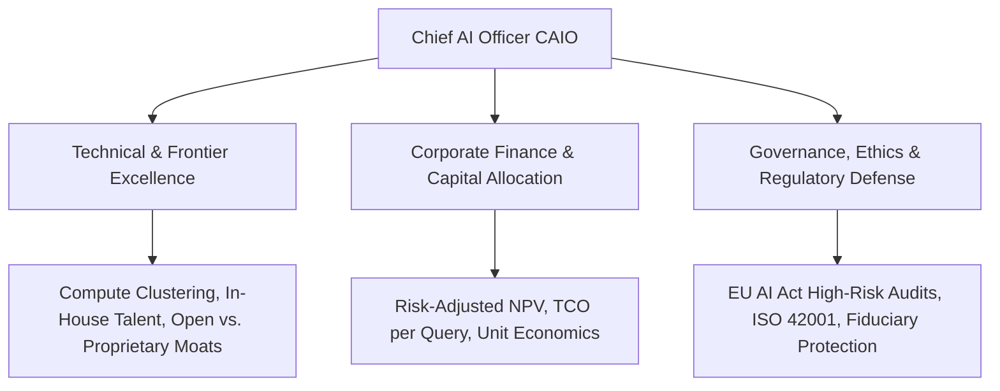
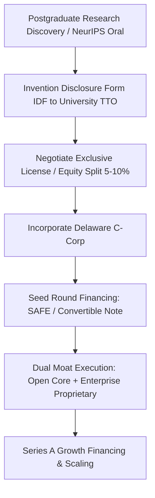

# Postgraduate Final Year (PG-2) — Chapter 4: AI and Career

---

## Lesson 1: Lead with AI

### 1. Metadata and Syllabus Mapping
- **Academic Level:** Postgraduate Final Year (PG-2)
- **Chapter:** 4. AI and Career
- **Lesson Title:** Lead with AI
- **Syllabus Topic:** Chief AI Officer (CAIO) Mandate, Executive AI Strategy, Board Governance, Enterprise Risk Management (ERM), and Building Frontier Research Organizations.
- **Bloom's Taxonomy Level:** Level 5 (Evaluate) & Level 6 (Create)

---

### 2. Learning Outcomes and Prerequisites
- **Learning Outcomes:**
  1. Formulate a comprehensive Chief AI Officer (CAIO) enterprise charter aligning algorithmic capability, corporate balance sheet, and compliance frameworks.
  2. Implement a quantitative AI Capital Allocation Model (AICAM) balancing foundational research bets against high-probability operational automation.
  3. Lead board-level audit discussions regarding regulatory compliance (EU AI Act, US NIST RMF, ISO/IEC 42001) and model liability.
- **Prerequisites:** Corporate finance (NPV, IRR, WACC), enterprise risk management frameworks, and postgraduate AI systems experience.

---

### 3. Realistic Professional Scenario
You have been appointed Chief AI Officer (CAIO) of a global banking and insurance conglomerate with $\$12\text{B}$ in assets under management and 45,000 employees. The Board of Directors is fractured: the CEO demands immediate deployment of generative autonomous customer credit agents to cut overhead; the Chief Risk Officer (CRO) threatens to veto all generative AI deployments citing hallucination liabilities and SEC regulations; and business unit leaders are running dozens of un-audited "shadow AI" proof-of-concepts across public cloud APIs.

Your mandate is to establish enterprise-wide AI leadership: craft an authoritative CAIO charter, institute an AI Architecture Review Board (ARB), allocate a $\$150\text{M}$ three-year compute and engineering budget using a quantitative Risk-Adjusted Net Present Value (rNPV) framework, and unify the board behind a defensible strategy.

---

### 4. Strategic and Executive Frameworks

#### A. The Chief AI Officer Triad



#### B. The Risk-Adjusted Net Present Value (rNPV) Model for Frontier AI
Traditional NPV fails for frontier AI projects because technical feasibility and regulatory approvals carry high uncertainty. The rNPV weights cash flows by the cumulative probability of milestone success:
$$\text{rNPV} = \sum_{t=0}^T \frac{\prod_{m=1}^t P(\text{Milestone } m) \cdot \text{CF}_t}{(1 + \text{WACC})^t} - I_0$$
where $P(\text{Milestone } m)$ represents the probability of passing Phase 1 (Proof-of-Concept), Phase 2 (Safety/Red-Teaming Audit), and Phase 3 (Production Scale).

---

### 5. CAIO Governance & Capital Allocation Matrix

| Project Tier | Horizon | Technical Uncertainty | Expected Success Rate | Capital Allocation (% of Budget) | Target Hurdle Rate (IRR) |
| :--- | :--- | :--- | :--- | :--- | :--- |
| **Core (Operational Automation)** | 3–6 Months | Low (Proven Off-the-shelf) | $85\% - 95\%$ | $50\%$ | $25\%$ |
| **Adjacent (Proprietary Fine-Tuning)** | 6–18 Months | Medium (Domain adaptation) | $50\% - 70\%$ | $35\%$ | $40\%$ |
| **Frontier (Moonshot / Novel Architecture)**| 18–36 Months| High (Open research) | $15\% - 25\%$ | $15\%$ | $>100\%$ |

---

### 6. Guided Technical Implementation: Executive AI Portfolio Capital Allocator

```python
import numpy as np
from typing import List, Dict

class StrategicAIProject:
    def __init__(
        self, 
        name: str, 
        initial_investment: float, 
        annual_cash_flows: List[float], 
        milestone_probabilities: List[float]
    ):
        self.name = name
        self.i_0 = initial_investment
        self.cash_flows = annual_cash_flows # Cash flows for Years 1..T
        self.milestones = milestone_probabilities # Success prob at each year

    def compute_rnpv(self, wacc: float = 0.10) -> float:
        """Computes Risk-Adjusted Net Present Value (rNPV)."""
        rnpv = -self.i_0
        cum_prob = 1.0

        for t, (cf, p) in enumerate(zip(self.cash_flows, self.milestones), start=1):
            cum_prob *= p
            discounted_expected_cf = (cum_prob * cf) / ((1.0 + wacc) ** t)
            rnpv += discounted_expected_cf

        return rnpv

def optimize_ai_capital_portfolio(projects: List[StrategicAIProject], wacc: float = 0.10) -> List[Dict]:
    results = []
    for proj in projects:
        val = proj.compute_rnpv(wacc=wacc)
        results.append({
            "Project": proj.name,
            "Investment": proj.i_0,
            "rNPV": val,
            "Approved": val > 0
        })
    return sorted(results, key=lambda x: x["rNPV"], reverse=True)

if __name__ == "__main__":
    wacc_rate = 0.09 # 9% Weighted Average Cost of Capital

    # 3 Strategic Capital Bids under CAIO Review
    p1 = StrategicAIProject(
        name="Tier-1: Autonomous Call-Center Routing",
        initial_investment=5.0, # $5M
        annual_cash_flows=[4.0, 4.5, 4.5], # 3 years cash flows
        milestone_probabilities=[0.95, 0.90, 0.90] # High technical certainty
    )
    p2 = StrategicAIProject(
        name="Tier-2: Proprietary Underwriting LLM",
        initial_investment=12.0, # $12M
        annual_cash_flows=[6.0, 10.0, 15.0],
        milestone_probabilities=[0.75, 0.65, 0.60] # Medium certainty
    )
    p3 = StrategicAIProject(
        name="Tier-3: Frontier Autonomous Wealth Management Swarm",
        initial_investment=25.0, # $25M
        annual_cash_flows=[0.0, 15.0, 60.0],
        milestone_probabilities=[0.40, 0.30, 0.25] # Moonshot risk
    )

    portfolio = optimize_ai_capital_portfolio([p1, p2, p3], wacc=wacc_rate)
    print("=== EXECUTIVE CAIO CAPITAL ALLOCATION ASSESSMENT ===")
    for entry in portfolio:
        status = "FUND" if entry["Approved"] else "REJECT"
        print(f"[{status}] {entry['Project']:45s} | CapEx: ${entry['Investment']:5.1f}M | rNPV: ${entry['rNPV']:6.2f}M")
```

---

### 7. Interactive Executive Simulation: "The Boardroom Crisis"
- **Simulation Scenario:** You are 6 months into your role as CAIO. A front-page investigative report reveals that an algorithmic mortgage approval agent launched by an unregulated subsidiary rejected minority applicants at double the rate of human loan officers.
- **Crisis Mechanics:**
  - Stock drops $8\%$ in pre-market trading.
  - Regulators issue a 48-hour subpoena for model audit weights and training logs.
  - The Board convenes an emergency session; the CRO demands terminating all AI initiatives.
- **Winning Condition:** Deliver an emergency response plan that halts the non-compliant model, presents an ISO 42001 governance remediation plan, preserves enterprise AI funding, and restores board confidence.

---

### 8. Practical Professional Activity
1. Author an Enterprise AI Charter (5 pages) defining:
   - Authority boundaries of the Chief AI Officer vs. CIO/CTO/CDO.
   - High-Risk AI Classification rules aligned with EU AI Act Annex III.
   - Model deprecation and decommissioning lifecycle policies.
2. Build an algorithmic risk scorecard evaluating models across Hallucination Risk, Data Leakage, Vendor Concentration, and Model Drift.

---

### 9. Deliverable Specifications
- A complete Enterprise AI Governance Charter and Model Architecture Review Board handbook.
- An interactive Python Capital Allocation Model (rNPV) evaluating enterprise AI proposals.
- An executive board slide deck justifying strategic compute procurement vs. API reliance.

---

### 10. Evaluation Criteria & Technical Metrics
- **Executive Strategic Acumen (35%):** Nuanced synthesis of corporate finance, talent strategy, and technology moats.
- **Regulatory Precision (35%):** Exact mapping to ISO/IEC 42001, EU AI Act, and SEC disclosure guidelines.
- **Financial Rigor (15%):** Accurate calculation of rNPV, WACC, and Total Cost of Ownership (TCO).
- **Communication Authority (15%):** Clear, persuasive C-suite and board-level presentation style.

---

### 11. Olympiad-Style Assessments

#### Conceptual Assessment
Under the European Union Artificial Intelligence Act (EU AI Act), what is the statutory status and legal consequence of deploying an un-audited autonomous AI model for evaluating employee performance or hiring decisions?
- A) It is classified as "Minimal Risk" and requires no oversight.
- B) It is classified as a "High-Risk AI System" (Annex III), requiring mandatory fundamental rights impact assessments, technical documentation, high-quality training data governance, logging, human oversight, and registration in the EU database prior to commercial deployment, with fines up to $7\%$ of global turnover for non-compliance.
- C) It is completely banned in all scenarios without exception.
- D) It only requires an open-source MIT license.

#### Applied Scenario Assessment
A company's engineering team advocates building an in-house 70B parameter model from scratch for $\$18\text{M}$ to perform internal document summarization, arguing it guarantees "data sovereignty." As CAIO, how should you evaluate this proposal?
- A) Approve immediately because in-house models are always superior.
- B) Reject or challenge the proposal: summarize tasks are commoditized and can be achieved with private-instance frontier APIs or a 7B open model with RAG at $5\%$ of the capital cost; in-house pre-training should be reserved exclusively for proprietary domains providing enduring competitive advantage.
- C) Outsource the entire engineering team.
- D) Wait 5 years for GPUs to become free.

---

### 12. Assessment Solutions & Scoring Guidance
- **Conceptual Answer:** **B**. Employment, HR, credit scoring, and critical infrastructure are explicitly classified as High-Risk systems under EU AI Act Annex III, carrying stringent legal obligations.
- **Applied Scenario Answer:** **B**. Strategic CAIOs distinguish commodity workflows from strategic moats; spending $\$18\text{M}$ to pre-train a general summarizer destroys shareholder value when commodity or small fine-tuned models suffice.

---

### 13. Limitations, Risks, and Responsible-AI Considerations
- **Executive "AI Washing":** Public companies face severe regulatory scrutiny from the SEC for exaggerating AI capabilities to inflate stock valuations. CAIOs must ensure all public disclosures reflect authentic, verified technology.

---

### 14. Completion Criteria & Milestone Feedback
- Complete the portfolio rNPV optimization script.
- Draft a defensible ISO 42001 compliance charter.
- **Milestone Unlocked:** `Chief AI Officer (CAIO) Executive Fellow` (Level PG-2).

---
---

## Lesson 2: Research → Innovation → Enterprise

### 1. Metadata and Syllabus Mapping
- **Academic Level:** Postgraduate Final Year (PG-2)
- **Chapter:** 4. AI and Career
- **Lesson Title:** Research → Innovation → Enterprise
- **Syllabus Topic:** Deep-Tech Commercialization, Spinout Strategy, Technology Transfer Office (TTO) Licensing, Venture Capital Financing, and Patent Portfolio Protection.
- **Bloom's Taxonomy Level:** Level 5 (Evaluate) & Level 6 (Create)

---

### 2. Learning Outcomes and Prerequisites
- **Learning Outcomes:**
  1. Structure a deep-tech university spinout from doctoral or postgraduate AI research, negotiating university equity splits and IP licensing with Technology Transfer Offices (TTOs).
  2. Model venture capital cap tables, convertible instruments (SAFEs), dilution schedules, and pre-money valuations for frontier AI startups.
  3. Formulate defensible IP strategies balancing trade secrets, open-source adoption flywheels, and defensive patent portfolios.
- **Prerequisites:** Startup financing basics (term sheets, dilution), intellectual property law fundamentals, and postgraduate research experience.

---

### 3. Realistic Professional Scenario
You and your doctoral research team have invented a breakthrough sub-quadratic state-space attention architecture that runs inference on 1-million-token contexts with $10\times$ lower memory bandwidth than FlashAttention. You have published an oral presentation at NeurIPS, and three tier-1 Silicon Valley venture capital firms have reached out offering a $\$4\text{M}$ Seed round at a $\$20\text{M}$ post-money valuation.

However, your university's Technology Transfer Office (TTO) claims 100% ownership of the patent rights because research was performed on university compute clusters. Furthermore, the VC term sheet contains aggressive liquidation preferences and board control clauses. Your mandate is to negotiate the university IP license, model founder dilution across Seed and Series A financing rounds, and execute the spinout without losing majority voting control.

---

### 4. Legal, Financial, and Strategic Foundations

#### A. The Spinout Commercialization Pipeline



#### B. Cap Table Dilution Mathematics
When raising capital via priced equity rounds:
$$\text{Post-Money Valuation} = \text{Pre-Money Valuation} + \text{Investment Amount}$$
$$\text{Investor Ownership } (\%) = \frac{\text{Investment Amount}}{\text{Post-Money Valuation}}$$
$$\text{New Founder Ownership } (\%) = \text{Prior Ownership } \times (1 - \text{Investor Ownership}) \times (1 - \text{Option Pool})$$
Unallocated Employee Stock Option Pools (ESOP, typically $10\% - 15\%$) are created from the **pre-money** valuation, diluting founders before investor capital enters.

---

### 5. Venture Term Sheet Negotiation Matrix

| Term Sheet Clause | Standard / Founder-Friendly | Aggressive / Investor-Heavy | Strategic Founder Counter-Proposal |
| :--- | :--- | :--- | :--- |
| **Liquidation Preference** | 1x Non-Participating | 2x or 3x Participating | Insist strictly on 1x Non-Participating |
| **Board Composition** | 2 Founders, 1 Investor | 1 Founder, 2 Investors | 2 Founders, 1 Investor, 1 Independent agreed by both |
| **Protective Provisions** | Standard major decisions (Sale, Dissolution) | Day-to-day hiring / budget vetoes | Limit vetoes strictly to charter amendments and M&A |
| **Vesting Acceleration** | Double-trigger (Change of control + Involuntary termination) | Single-trigger (Immediate investor vesting) or No acceleration | Standard 4-year vesting with 1-year cliff and double-trigger |

---

### 6. Guided Technical Implementation: Cap Table & Dilution Simulator

```python
from typing import Dict, List

class StartupCapTable:
    """Simulates startup founder dilution across Seed and Series A rounds."""
    def __init__(self, founder_shares: int = 8_000_000):
        self.shareholders = {"Founders": founder_shares}
        self.total_shares = founder_shares

    def raise_priced_round(
        self, 
        investor_name: str, 
        investment_usd: float, 
        pre_money_valuation: float, 
        new_esop_percent: float = 0.10
    ):
        post_money = pre_money_valuation + investment_usd
        investor_equity_pct = investment_usd / post_money

        # 1. Expand share pool for ESOP from pre-money
        esop_shares = int((self.total_shares * new_esop_percent) / (1.0 - new_esop_percent - investor_equity_pct))
        self.shareholders["ESOP_Pool"] = self.shareholders.get("ESOP_Pool", 0) + esop_shares
        self.total_shares += esop_shares

        # 2. Issue new shares to incoming investor
        investor_shares = int((self.total_shares * investor_equity_pct) / (1.0 - investor_equity_pct))
        self.shareholders[investor_name] = investor_shares
        self.total_shares += investor_shares

    def display_cap_table(self, round_name: str):
        print(f"\n--- CAP TABLE: {round_name.upper()} ---")
        for holder, shares in self.shareholders.items():
            pct = (shares / self.total_shares) * 100.0
            print(f"Holder: {holder:20s} | Shares: {shares:10,d} | Ownership: {pct:6.2f}%")
        print(f"Total Outstanding Shares: {self.total_shares:10,d}")

if __name__ == "__main__":
    cap = StartupCapTable(founder_shares=8_000_000)
    cap.display_cap_table("Founding State")

    # Seed Round: $3M on $12M Pre-Money ($15M Post), 10% ESOP
    cap.raise_priced_round(
        investor_name="Seed_Ventures",
        investment_usd=3_000_000,
        pre_money_valuation=12_000_000,
        new_esop_percent=0.10
    )
    cap.display_cap_table("Post-Seed")

    # Series A Round: $12M on $48M Pre-Money ($60M Post), 5% top-up ESOP
    cap.raise_priced_round(
        investor_name="Series_A_Capital",
        investment_usd=12_000_000,
        pre_money_valuation=48_000_000,
        new_esop_percent=0.05
    )
    cap.display_cap_table("Post-Series A")
```

---

### 7. Interactive Strategy Simulation: "The Deep-Tech Term Sheet Showdown"
- **Mission Challenge:** Negotiate across two competing term sheets for your university spinout:
  - *Term Sheet A:* $\$5\text{M}$ investment at $\$25\text{M}$ pre-money, but demands $2\times$ participating liquidation preference and an investor-controlled board.
  - *Term Sheet B:* $\$3.5\text{M}$ investment at $\$18\text{M}$ pre-money, clean $1\times$ non-participating preference, founder-controlled board (2 founder seats, 1 investor).
- **Decision:** Model the payout across exit valuations ($\$20\text{M}, \$50\text{M}, \$200\text{M}$). Prove why Term Sheet B produces higher founder proceeds and control despite the lower headline valuation.

---

### 8. Practical Research Activity
1. Draft an Invention Disclosure Form (IDF) for your core postgraduate algorithm.
2. Formulate a commercialization strategy choosing between:
   - Pure Open-Source + Cloud Managed Hosting (MongoDB / Databricks model).
   - Open Core + Enterprise Proprietary Features (Hugging Face / Gitlab model).
   - Closed Proprietary API / Enterprise Appliance (OpenAI / Anthropic model).
3. Draft a term sheet sensitivity spreadsheet tracking founder dilution under down-rounds.

---

### 9. Deliverable Specifications
- A complete Cap Table dilution script modeling Seed and Series A financing.
- An Invention Disclosure Form and University TTO License Term Sheet draft.
- A commercial pitch deck executive summary articulating technical defensibility, customer acquisition cost (CAC), and lifetime value (LTV).

---

### 10. Evaluation Criteria & Technical Metrics
- **Financial Modeling Precision (35%):** Correct calculation of share expansions, option pool shuffles, and non-dilutable clauses.
- **Legal & Strategic Acumen (35%):** Mastery of liquidation preferences, board control, and IP assignment clauses.
- **Commercial Defensibility (15%):** Clear articulation of algorithmic moat vs. commoditized open weights.
- **Presentation Clarity (15%):** Professional, venture-grade executive communication.

---

### 11. Olympiad-Style Assessments

#### Conceptual Assessment
In venture startup financing, why is a "$2\times$ Participating Liquidation Preference" considered highly toxic to founders compared to a standard "$1\times$ Non-Participating Liquidation Preference"?
- A) It prevents the startup from using Python libraries.
- B) In a sale, participating investors first take double their initial capital back *before* anyone else, and then *additionally* participate pro-rata in the remaining proceeds as common shareholders ("double-dipping"), severely wiping out founder proceeds in moderate exits.
- C) It requires the founders to pay cash out of their personal bank accounts every month.
- D) It only applies if the company goes bankrupt.

#### Applied Scenario Assessment
A doctoral student publishes their full model architecture, weights, and training recipe in a conference paper and on GitHub on Monday. On Friday, they visit the university TTO to file a patent. What is the status of their international patent rights?
- A) International patent rights are preserved because the student is an academic.
- B) International patent rights are lost in nearly all jurisdictions outside the US (e.g., Europe, Japan, China), because those jurisdictions require absolute novelty; public disclosure prior to the patent filing date immediately destroys patentability.
- C) The university automatically owns a global patent.
- D) The GitHub commit acts as a global patent.

---

### 12. Assessment Solutions & Scoring Guidance
- **Conceptual Answer:** **B**. Participating preferences allow investors to take their multiple and then share in the remainder, drastically diluting common shareholders in realistic exit scenarios.
- **Applied Scenario Answer:** **B**. Absolute novelty is required internationally; public disclosure before filing destroys patentability outside jurisdictions with specific grace periods.

---

### 13. Limitations, Risks, and Responsible-AI Considerations
- **The Academic Spinout Failure Mode:** Founders frequently fall in love with algorithmic elegance while ignoring product-market fit, enterprise sales cycles, and customer pain points. Technology must solve an urgent commercial problem.

---

### 14. Completion Criteria & Milestone Feedback
- Complete the Cap Table dilution simulation with verified share pool arithmetic.
- Select and defend the optimal venture term sheet structure.
- **Milestone Unlocked:** `Deep-Tech AI Founder & Venture Fellow` (Level PG-2).
