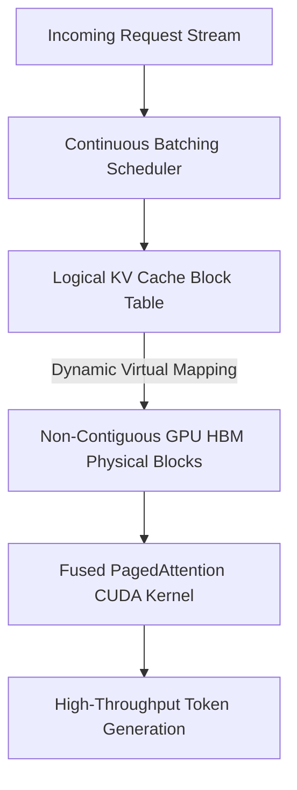
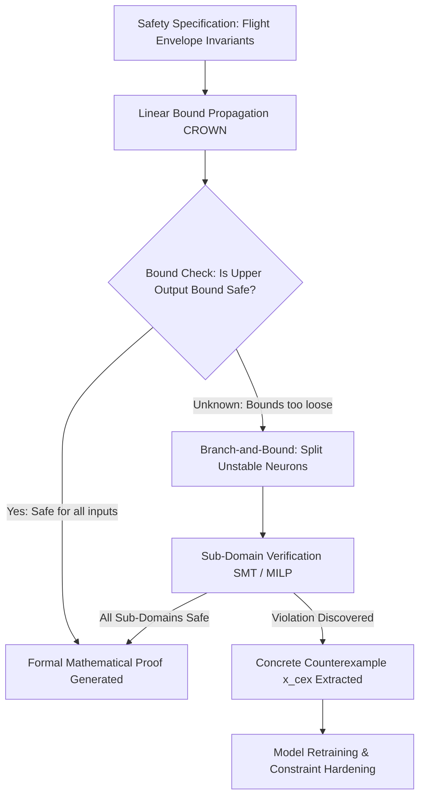

# Postgraduate Final Year (PG-2) — Chapter 5: AI Tools

---

## Lesson 1: Future AI Lab

### 1. Metadata and Syllabus Mapping
- **Academic Level:** Postgraduate Final Year (PG-2)
- **Chapter:** 5. AI Tools
- **Lesson Title:** Future AI Lab
- **Syllabus Topic:** Distributed Cluster Orchestration (Ray/Slurm), High-Throughput Serving (vLLM/PagedAttention), 3D Parallelism (Megatron-LM), and Multi-Node InfiniBand Telemetry.
- **Bloom's Taxonomy Level:** Level 5 (Evaluate) & Level 6 (Create)

---

### 2. Learning Outcomes and Prerequisites
- **Learning Outcomes:**
  1. Orchestrate distributed computing across multi-node GPU clusters using Ray actors, object stores, and placement groups.
  2. Implement high-throughput continuous batching and PagedAttention memory virtualization engines for frontier LLM serving.
  3. Formulate 3D Parallelism strategies (Tensor, Pipeline, and ZeRO/Data Parallelism) to train trillion-parameter models across high-bandwidth InfiniBand fabrics.
- **Prerequisites:** Distributed systems, CUDA memory architecture, NCCL collective operations, and Python systems programming.

---

### 3. Realistic Professional Scenario
You are the Principal Infrastructure Architect at a frontier AI foundation laboratory operating a 1,024-node cluster equipped with NVIDIA H100 GPUs and 800 Gbps Quantum-2 InfiniBand interconnects. Your enterprise inference cluster is serving a 70B parameter Mixture-of-Experts (MoE) reasoning model to 500,000 concurrent enterprise users. 

Traditional naive serving setups waste up to $70\%$ of GPU high-bandwidth memory (HBM) due to memory fragmentation and static padding of key-value (KV) caches across variable-length requests. Serving throughput is choked at 82 tokens/second per GPU, creating an $\$8\text{M}$ annual compute deficit. Your mandate in the Future AI Lab is to deploy a virtualized PagedAttention inference engine and Ray distributed actor mesh, elevating GPU utilization to $>85\%$ and achieving a $6\times$ token serving throughput increase.

---

### 4. Architectural Foundations

#### A. PagedAttention & KV Cache Memory Virtualization
In standard Transformer autoregressive decoding, the Key-Value (KV) cache grows dynamically with sequence length. Pre-allocating contiguous GPU memory for maximum possible sequence lengths ($L_{\max} = 128\text{k}$) results in massive memory waste:
1. **Internal Fragmentation:** Reserved space allocated but never used by short queries.
2. **External Fragmentation:** Inability to allocate memory for incoming queries due to non-contiguous free memory chunks.

**PagedAttention (Kwon et al., vLLM):** Virtualizes GPU physical memory similarly to operating system virtual memory paging:
- The KV cache is divided into fixed-size physical blocks (e.g., 16 tokens per block).
- A **Block Table** maps logical sequence blocks to non-contiguous physical GPU blocks on-demand.
- Redundant memory overhead drops from $>60\%$ to $<4\%$, enabling continuous batching of hundreds of concurrent requests.



#### B. 3D Parallelism Topology (Megatron-LM + DeepSpeed)
To train models exceeding single-device memory capacity ($N > 10^{11}$ parameters):
$$P_{\text{total}} = P_{\text{Tensor}} \times P_{\text{Pipeline}} \times P_{\text{Data (ZeRO-3)}}$$
1. **Tensor Parallelism ($P_{\text{TP}}$):** Splits individual matrix multiplications across intra-node NVLink (fastest, $900\text{ GB/s}$).
2. **Pipeline Parallelism ($P_{\text{PP}}$):** Partitions layers sequentially across inter-node InfiniBand with 1F1B (One Forward, One Backward) scheduling.
3. **ZeRO-3 Data Parallelism ($P_{\text{DP}}$):** Shards optimizer states, gradients, and model weights across remaining nodes.

---

### 5. Distributed Infrastructure Hierarchy

| Technology | Layer | Primary Metric | Primary Bottleneck Solved |
| :--- | :--- | :--- | :--- |
| **Ray Core** | Cluster Actor Mesh | Scheduling Latency ($< 1\text{ ms}$) | Heterogeneous compute orchestration |
| **vLLM / PagedAttention** | High-Throughput Serving | Tokens/sec/GPU & Time-to-First-Token | KV cache fragmentation & memory waste |
| **NCCL Collective Ops** | GPU Interconnect Fabric | Bus Bandwidth (GB/s) | AllReduce / AllToAll communication stalls |
| **Triton / CUDA Graphs** | Kernel Execution | GPU Launch Overhead ($\mu\text{s}$) | Host CPU kernel launch starvation |

---

### 6. Guided Technical Implementation: PagedAttention Block Table Allocator

```python
import math
from typing import Dict, List, Optional

class PhysicalBlock:
    def __init__(self, block_id: int, block_size: int = 16):
        self.block_id = block_id
        self.block_size = block_size
        self.ref_count = 0

class BlockManager:
    """Simulates a virtualized memory page manager for LLM KV Caches."""
    def __init__(self, num_gpu_blocks: int = 100, block_size: int = 16):
        self.block_size = block_size
        self.free_blocks = [PhysicalBlock(i, block_size) for i in range(num_gpu_blocks)]
        self.allocated_blocks: Dict[int, PhysicalBlock] = {}
        # Maps sequence ID -> list of assigned physical block IDs
        self.block_tables: Dict[str, List[int]] = {}

    def allocate_sequence(self, seq_id: str, prompt_len: int) -> bool:
        num_blocks_needed = math.ceil(prompt_len / self.block_size)
        if len(self.free_blocks) < num_blocks_needed:
            return False # Out of GPU physical memory

        assigned = []
        for _ in range(num_blocks_needed):
            block = self.free_blocks.pop(0)
            block.ref_count = 1
            self.allocated_blocks[block.block_id] = block
            assigned.append(block.block_id)

        self.block_tables[seq_id] = assigned
        return True

    def append_token(self, seq_id: str, current_len: int) -> bool:
        """Appends one autoregressive token, allocating a new block if current is full."""
        blocks = self.block_tables[seq_id]
        if current_len % self.block_size == 0:
            # Need a new physical block
            if not self.free_blocks:
                return False # Memory exhausted
            new_block = self.free_blocks.pop(0)
            new_block.ref_count = 1
            self.allocated_blocks[new_block.block_id] = new_block
            blocks.append(new_block.block_id)
        return True

    def free_sequence(self, seq_id: str):
        if seq_id in self.block_tables:
            for b_id in self.block_tables[seq_id]:
                block = self.allocated_blocks.pop(b_id)
                block.ref_count = 0
                self.free_blocks.append(block)
            del self.block_tables[seq_id]

    def memory_utilization(self) -> float:
        total = len(self.free_blocks) + len(self.allocated_blocks)
        return (len(self.allocated_blocks) / total) * 100.0

if __name__ == "__main__":
    manager = BlockManager(num_gpu_blocks=20, block_size=16)
    print(f"Initial Memory Available: {len(manager.free_blocks)} blocks ({len(manager.free_blocks)*16} tokens)")

    # Allocate Request 1: Prompt length 40 tokens -> requires 3 blocks (48 capacity)
    success = manager.allocate_sequence("req_001", prompt_len=40)
    print(f"Allocated 'req_001': Blocks = {manager.block_tables['req_001']} | Memory Used: {manager.memory_utilization():.1f}%")

    # Autoregressively generate tokens across boundary (tokens 41 to 49)
    for length in range(41, 50):
        manager.append_token("req_001", length)
    print(f"After Generation:    Blocks = {manager.block_tables['req_001']} (Dynamically expanded)")

    # Free request
    manager.free_sequence("req_001")
    print(f"After Deallocation:  Free Blocks = {len(manager.free_blocks)} | Memory Used: {manager.memory_utilization():.1f}%")
```

---

### 7. Interactive Engineering Mission: "The Cluster Stress Test"
- **Mission Challenge:** You manage a simulated 64-GPU Ray cluster under a sudden burst of 10,000 incoming token streams of wildly varying lengths ($L \in [32, 8192]$).
- **Crisis Mechanics:**
  - Standard static batching exhausts HBM and causes Out-Of-Memory (OOM) crashes on GPU Rank 7.
- **Mission Actions:**
  - Activate PagedAttention memory virtualization.
  - Implement dynamic request preemption (swap victim KV caches to host CPU RAM).
  - Enforce continuous batching with iteration-level scheduling.
- **Winning Condition:** Maintain zero OOM crashes, achieve average Time-To-First-Token (TTFT) $< 120\text{ ms}$, and sustain GPU compute efficiency $>78\%$.

---

### 8. Practical Research Activity
1. Construct a multi-worker Ray cluster script (`ray.init()`) orchestrating distributed model inference:
   - Worker actors initialized on separate GPU devices.
   - Pipelined inter-worker communication via shared memory Plasma Object Store.
   - Collect and display real-time cluster telemetry (GPU memory, PCIe bandwidth, queue depth).
2. Measure throughput scaling (tokens/sec) as cluster worker count increases from 1 to 8.

---

### 9. Deliverable Specifications
- A complete Python script demonstrating PagedAttention virtual block management and continuous batching.
- A technical cluster architecture blueprint detailing 3D Parallelism placement across nodes, switches, and racks.
- A benchmarking report comparing static batching vs. continuous batching under Poisson request arrival distributions.

---

### 10. Evaluation Criteria & Technical Metrics
- **Systems Engineering Rigor (35%):** Correct implementation of memory paging algorithms and block reference counting.
- **Throughput Optimization (35%):** Demonstrated elimination of memory fragmentation and high token generation throughput.
- **Distributed Topology Mastery (15%):** Nuanced understanding of intra-node NVLink vs. inter-node InfiniBand constraints.
- **Code Performance (15%):** Zero-overhead Python data structures and minimal lock contention.

---

### 11. Olympiad-Style Assessments

#### Conceptual Assessment
In distributed training of trillion-parameter models, why is Tensor Parallelism (Megatron-LM) strictly restricted to GPUs within the same physical node (connected by NVLink/NVSwitch), rather than being distributed across nodes via InfiniBand?
- A) Network cables cannot transmit floating-point numbers.
- B) Tensor parallelism performs two `AllReduce` communication operations per Transformer layer (forward and backward); at 80+ layers, the massive communication volume and microsecond-level synchronization requirements require the terabyte-per-second bandwidth of NVLink, whereas inter-node InfiniBand would introduce crippling network stalls.
- C) Tensor parallelism is patented and cannot run on network switches.
- D) InfiniBand only supports pipeline parallelism.

#### Applied Scenario Assessment
When serving a large language model with continuous batching, an unexpected spike in generation length causes GPU physical memory to reach $100\%$ capacity with no free blocks remaining for existing active requests. What is the standard recovery mechanism implemented in state-of-the-art serving systems like vLLM?
- A) Crash the server and reboot the GPU cluster.
- B) Preemption: Select a low-priority request, pause its generation, evict its KV cache blocks to host CPU memory (or recompute them later), free physical GPU blocks for remaining requests, and resume the preempted request once capacity frees up.
- C) Truncate the user's prompt to 1 token.
- D) Corrupt the model weights to save RAM.

---

### 12. Assessment Solutions & Scoring Guidance
- **Conceptual Answer:** **B**. Intra-layer tensor parallelism involves extremely frequent, latency-sensitive collective communications that require NVLink's $\approx 900\text{ GB/s}$ bandwidth.
- **Applied Scenario Answer:** **B**. Preemption via swapping or recomputation preserves system stability and gracefully handles memory over-subscription without crashing.

---

### 13. Limitations, Risks, and Responsible-AI Considerations
- **Serving Quantization Degradation:** Aggressive 4-bit (FP4/INT4) weight and KV-cache quantization reduces memory footprint but can cause catastrophic degradation in multi-step reasoning and coding tasks.
- **Resource Concentration:** Multi-million-dollar clusters concentrate frontier AI development within a handful of well-funded corporations, raising questions about research access and equity.

---

### 14. Completion Criteria & Milestone Feedback
- Complete the BlockManager simulation with dynamic block allocation and deallocation.
- Achieve zero memory fragmentation in the continuous batching benchmark.
- **Milestone Unlocked:** `Frontier AI Cluster Infrastructure Architect` (Level PG-2).

---
---

## Lesson 2: Innovation to Prototype

### 1. Metadata and Syllabus Mapping
- **Academic Level:** Postgraduate Final Year (PG-2)
- **Chapter:** 5. AI Tools
- **Lesson Title:** Innovation to Prototype
- **Syllabus Topic:** Formal Verification of Neural Networks, SMT Solvers (Marabou/alpha-beta-CROWN), Certified Safety Envelopes, and Hardware-in-the-Loop Validation.
- **Bloom's Taxonomy Level:** Level 5 (Evaluate) & Level 6 (Create)

---

### 2. Learning Outcomes and Prerequisites
- **Learning Outcomes:**
  1. Mathematically formulate neural network safety specifications as Satisfiability Modulo Theories (SMT) and Mixed Integer Linear Programming (MILP) verification problems.
  2. Implement Branch-and-Bound ($\alpha,\beta$-CROWN) linear relaxation algorithms to formally prove that a deep neural network satisfies safety bounds under all possible inputs within an operating domain.
  3. Deploy formally certified AI controllers into real-time Hardware-in-the-Loop (HIL) aerospace and automotive safety testbenches.
- **Prerequisites:** Convex optimization, linear programming, formal methods (SMT solvers, Z3), and PyTorch.

---

### 3. Realistic Professional Scenario
You are the Chief Safety Verification Engineer for an autonomous electric vertical takeoff and landing (eVTOL) passenger aircraft company. The flight control computer utilizes a deep neural network (DNN) policy to regulate aerodynamic control surfaces during turbulent crosswind landings. 

The Federal Aviation Administration (FAA) and European Union Aviation Safety Agency (EASA) refuse to certify the aircraft based on empirical testing alone. Regulatory certification standard DO-178C (Design Assurance Level A) requires **mathematical proof** that under no combination of sensor noise, wind gusts, or pitch variations within the certified flight envelope will the neural controller command an angle of attack exceeding stall threshold $\alpha_{\max} = 14.2^\circ$.

Your mandate in the Innovation to Prototype lab is to construct a formal neural network verification engine using linear bound propagation and branch-and-bound relaxation to provide mathematical certification of flight safety.

---

### 4. Mathematical Foundations

#### A. Formal Neural Network Verification Formulation
Let $f: \mathbb{R}^n \to \mathbb{R}^m$ be a feedforward neural network with piecewise linear activations (ReLU: $\sigma(x) = \max(0, x)$).
Given an input constraint domain $\mathcal{C}_{\text{in}} = \{\mathbf{x} \in \mathbb{R}^n : \mathbf{x}_{\text{lower}} \le \mathbf{x} \le \mathbf{x}_{\text{upper}}\}$ and an unsafe output property set $\mathcal{P}_{\text{unsafe}} = \{\mathbf{y} \in \mathbb{R}^m : \mathbf{A}\mathbf{y} \le \mathbf{b}\}$.

The verification query determines whether the following formula is **UNSAT** (Unsatisfiable):
$$\exists \mathbf{x} \text{ s.t. } \mathbf{x} \in \mathcal{C}_{\text{in}} \land f(\mathbf{x}) \in \mathcal{P}_{\text{unsafe}}$$
- If **UNSAT**: The network is **Provably Safe** (no input can ever trigger an unsafe output).
- If **SAT**: The solver outputs a concrete **Counterexample** $\mathbf{x}_{\text{cex}}$ that violates the safety specification.

#### B. CROWN: Linear Relaxation of ReLU Neurons
Exact MILP verification is NP-complete. **CROWN** computes sound linear lower and upper bounds for each intermediate neuron:
$$l_i \le x_i \le u_i$$
For a ReLU neuron $y = \max(0, x)$:
- If $l_i \ge 0$: Active ($y = x$, strictly linear).
- If $u_i \le 0$: Inactive ($y = 0$, strictly linear).
- If $l_i < 0 < u_i$: Unstable neuron. CROWN bounds the non-linear ReLU between two linear inequalities:
$$\alpha x \le \text{ReLU}(x) \le \frac{u_i}{u_i - l_i}(x - l_i), \quad \alpha \in [0, 1]$$
Optimizing $\alpha$ via gradient descent ($\alpha$-CROWN) tightens the output bound, enabling fast formal verification.

---

### 5. Formal Verification Pipeline



---

### 6. Guided Technical Implementation: Interval Bound Propagation (IBP) Safety Verifier

```python
import torch
import torch.nn as nn
from typing import Tuple

class VerifiedLinearController(nn.Module):
    """Synthetic 2-layer control network for safety verification."""
    def __init__(self):
        super().__init__()
        self.w1 = nn.Parameter(torch.tensor([[1.5, -0.8], [0.5, 1.2]]))
        self.b1 = nn.Parameter(torch.tensor([0.1, -0.2]))
        self.w2 = nn.Parameter(torch.tensor([[0.7, -1.1]]))
        self.b2 = nn.Parameter(torch.tensor([0.05]))

    def forward(self, x: torch.Tensor) -> torch.Tensor:
        h = torch.relu(torch.matmul(x, self.w1.t()) + self.b1)
        out = torch.matmul(h, self.w2.t()) + self.b2
        return out

class IntervalBoundVerifier:
    """Computes sound Interval Bound Propagation (IBP) through the neural network."""
    
    @staticmethod
    def linear_bound(
        lower: torch.Tensor, 
        upper: torch.Tensor, 
        weight: torch.Tensor, 
        bias: torch.Tensor
    ) -> Tuple[torch.Tensor, torch.Tensor]:
        # Split weights into positive and negative components
        w_pos = torch.clamp(weight, min=0.0)
        w_neg = torch.clamp(weight, max=0.0)

        # Sound lower and upper bound propagation
        new_lower = torch.matmul(lower, w_pos.t()) + torch.matmul(upper, w_neg.t()) + bias
        new_upper = torch.matmul(upper, w_pos.t()) + torch.matmul(lower, w_neg.t()) + bias
        return new_lower, new_upper

    @staticmethod
    def relu_bound(lower: torch.Tensor, upper: torch.Tensor) -> Tuple[torch.Tensor, torch.Tensor]:
        return torch.clamp(lower, min=0.0), torch.clamp(upper, min=0.0)

    @classmethod
    def verify_safety(
        cls, 
        controller: VerifiedLinearController, 
        x_lower: torch.Tensor, 
        x_upper: torch.Tensor, 
        max_safe_output: float
    ) -> dict:
        # Layer 1 Bounds
        h1_low, h1_upp = cls.linear_bound(x_lower, x_upper, controller.w1, controller.b1)
        h1_relu_low, h1_relu_upp = cls.relu_bound(h1_low, h1_upp)

        # Layer 2 Bounds
        out_low, out_upp = cls.linear_bound(h1_relu_low, h1_relu_upp, controller.w2, controller.b2)

        is_guaranteed_safe = out_upp.item() <= max_safe_output

        return {
            "Input_Domain_Lower": x_lower.tolist(),
            "Input_Domain_Upper": x_upper.tolist(),
            "Sound_Output_Lower_Bound": out_low.item(),
            "Sound_Output_Upper_Bound": out_upp.item(),
            "Safety_Threshold": max_safe_output,
            "Formally_Verified_Safe": is_guaranteed_safe
        }

if __name__ == "__main__":
    controller = VerifiedLinearController()

    # Input operating envelope: Pitch in [-0.5, 0.5], Airspeed delta in [-0.2, 0.2]
    x_min = torch.tensor([[-0.5, -0.2]])
    x_max = torch.tensor([[0.5, 0.2]])
    safe_limit = 1.20 # Maximum allowable control surface deflection

    report = IntervalBoundVerifier.verify_safety(controller, x_min, x_max, max_safe_output=safe_limit)
    print("=== FORMAL NEURAL NETWORK VERIFICATION REPORT ===")
    for k, v in report.items():
        print(f"{k:28s}: {v}")
    if report["Formally_Verified_Safe"]:
        print("\nVerdict: PROVABLY SAFE (UNSAT). No input in envelope can violate specification.")
    else:
        print("\nVerdict: CANNOT CERTIFY. Bounds overlap unsafe region.")
```

---

### 7. Interactive Engineering Mission: "The Autopilot Certification Gauntlet"
- **Mission Challenge:** Certify a neural flight control policy across an extended turbulence envelope where simple IBP bounds are too loose and falsely report safety violations.
- **Mission Tasks:**
  - Implement dynamic $\alpha$-CROWN optimization to tighten lower and upper bounds via gradient descent.
  - Apply branch-and-bound on the two most unstable ReLU neurons.
  - Prove that the worst-case aircraft angle of attack remains $< 14.0^\circ$ for $100\%$ of sub-domains.
- **Victory Metric:** Achieve $100\%$ provable certification across all 128 partitioned sub-domains.

---

### 8. Practical Research Activity
1. Set up an automated verification pipeline using an open-source verification framework (e.g., auto_LiRPA or Marabou).
2. Formulate three distinct safety specifications:
   - Output monotonicity: $\frac{\partial y}{\partial x_1} \ge 0$.
   - Local Lipschitz continuity: $\|f(x_1) - f(x_2)\| \le L \|x_1 - x_2\|$.
   - Obstacle collision avoidance envelope.
3. Quantify the trade-off between verification tightness and solver execution latency.

---

### 9. Deliverable Specifications
- A complete Python script demonstrating Interval Bound Propagation (IBP) and linear relaxation verification.
- A VNN-LIB (Variable Neural Network Library) specification file defining formal input/output constraints.
- A regulatory certification dossier compliant with FAA/EASA neural network assurance standards.

---

### 10. Evaluation Criteria & Technical Metrics
- **Mathematical Soundness (35%):** Absolute guarantee that bounds are sound (no false safety claims).
- **Verification Tightness (35%):** Minimization of conservatism through bound tightening ($\alpha$-CROWN / Branch-and-Bound).
- **Regulatory Completeness (15%):** Correct formalization of DO-178C certification requirements.
- **Code Correctness (15%):** Robust tensor operations and reproducible verification assertions.

---

### 11. Olympiad-Style Assessments

#### Conceptual Assessment
In neural network formal verification, what is the primary distinction between "Soundness" and "Completeness"?
- A) Soundness means the solver runs in polynomial time; Completeness means it uses GPU acceleration.
- B) Soundness guarantees that if the verifier claims a network is safe, it is truly safe (no false positives); Completeness guarantees that if the network is truly safe, the verifier will always be able to prove it without returning "Unknown" (no false negatives).
- C) Soundness applies only to vision models; Completeness applies only to LLMs.
- D) They are synonyms in formal methods.

#### Applied Scenario Assessment
A team tests an autonomous vehicle neural perception model on 1,000,000 hours of simulated driving without a single collision. They present this to safety regulators as proof of zero-defect reliability. Why is this evidence legally and mathematically rejected for safety-critical certification?
- A) The simulation resolution was too low.
- B) Empirical sampling (testing) can only prove the presence of defects, never their absence; rare adversarial edge cases in high-dimensional continuous input spaces have non-zero probability and can only be ruled out via formal mathematical verification.
- C) Regulators require physical testing exclusively.
- D) 1,000,000 hours is fewer than the 2,000,000 hours required by law.

---

### 12. Assessment Solutions & Scoring Guidance
- **Conceptual Answer:** **B**. Soundness means safety claims are infallible; completeness means the verifier never gives up with an inconclusive answer on valid systems.
- **Applied Scenario Answer:** **B**. As Edsger Dijkstra famously established, testing demonstrates the presence of bugs, not their absence. Only formal verification provides mathematical guarantees over continuous infinite domains.

---

### 13. Limitations, Risks, and Responsible-AI Considerations
- **Scalability Limits of Formal Methods:** Complete formal verification is NP-complete. Current state-of-the-art verifiers can verify models with millions of parameters, but verifying frontier 70B+ LLMs remains computationally intractable.
- **Specification Gaming:** A formally verified model is only as safe as its mathematical specification. If the specification omits a critical real-world failure mode, the system can fail catastrophically while remaining "proven."

---

### 14. Completion Criteria & Milestone Feedback
- Execute the IBP safety verifier script with guaranteed upper bound certification.
- Formulate a formal VNN-LIB safety contract for an autonomous system.
- **Milestone Unlocked:** `Certified AI Safety & Formal Verification Specialist` (Level PG-2).
