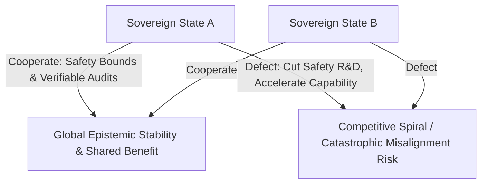
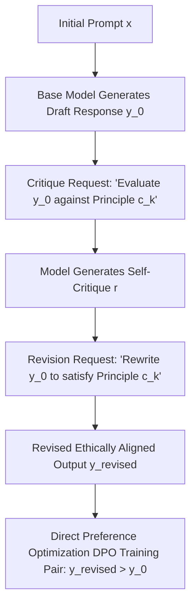

# Postgraduate Final Year (PG-2) — Chapter 6: Responsible AI

---

## Lesson 1: AI & Society

### 1. Metadata and Syllabus Mapping
- **Academic Level:** Postgraduate Final Year (PG-2)
- **Chapter:** 6. Responsible AI
- **Lesson Title:** AI & Society
- **Syllabus Topic:** Societal Transformation, Macro-Economic Labor Displacement, Existential Risk (x-risk) Taxonomies, Democratic AI Governance, and International Non-Proliferation Treaties.
- **Bloom's Taxonomy Level:** Level 5 (Evaluate) & Level 6 (Create)

---

### 2. Learning Outcomes and Prerequisites
- **Learning Outcomes:**
  1. Analyze macroeconomic labor displacement, skill polarization, and capital-labor share shifts driven by cognitive automation using task-based economic models (Acemoglu & Restrepo).
  2. Evaluate existential risk taxonomies (misalignment vs. misuse vs. structural competitive spirals) using formal game-theoretic and decision-theoretic models.
  3. Formulate international governance and compute-monitoring frameworks inspired by the IAEA (International Atomic Energy Agency) and CERN models.
- **Prerequisites:** Micro/Macroeconomics fundamentals, game theory (Nash equilibria, Stag Hunt, Prisoner's Dilemma), and AI safety theory.

---

### 3. Realistic Professional Scenario
You are the Chief Scientific Advisor to the United Nations High-Level Advisory Body on Artificial Intelligence. Global geopolitical tensions are rising: leading nation-states are engaged in an unregulated compute race, deploying autonomous cyber-defense swarms and military command-and-control models. Simultaneously, rapid cognitive automation is causing widespread structural displacement across knowledge-worker industries, destabilizing social safety nets.

Representatives from 193 member states are convening to draft the **Geneva Convention on Autonomous Intelligence & Compute Non-Proliferation**. Your mandate is to provide a rigorous, technically sound briefing: establish physical thresholds for dual-use frontier compute clusters ($> 10^{26}$ FLOPs), design cryptographic hardware verification protocols to prevent clandestine military training, and propose a redistributive Sovereign AI Dividend mechanism.

---

### 4. Theoretical and Game-Theoretic Foundations

#### A. Task-Based Macroeconomic Labor Displacement (Acemoglu & Restrepo)
Production $Y$ requires completing a continuum of tasks $i \in [N-1, N]$:
$$Y = \left( \int_{N-1}^N y(i)^{\frac{\sigma-1}{\sigma}} di \right)^{\frac{\sigma}{\sigma-1}}$$
Each task can be produced by capital (AI systems) or labor (humans):
$$y(i) = \begin{cases} A_L \gamma_L(i) \ell(i) & \text{if performed by labor} \\ A_K \gamma_K(i) k(i) & \text{if automated by AI} \end{cases}$$
AI advances create two opposing forces:
1. **The Displacement Effect:** AI automates tasks previously performed by humans ($I \to I'$), directly lowering labor's share of national income:
$$\Delta \text{Labor Share} \propto -(I' - I) \cdot \text{Cost Savings}$$
2. **The Reinstatement Effect:** Creation of entirely new, complex tasks where humans hold comparative advantage ($N \to N'$), restoring labor demand and wages.
If the displacement effect outpaces the reinstatement effect ("so-so automation"), wages stagnate and inequality surges.

#### B. The Multi-Polar Compute Governance Game
When two sovereign states ($A$ and $B$) compete in an AI race, the payoff matrix reflects a Prisoner's Dilemma or Stag Hunt:



To transform this from a defect-dominated Prisoner's Dilemma into a cooperative equilibrium, international governance must introduce:
1. **High Verification (Zero Clandestine Capability):** On-chip hardware telemetry and cryptographic performance counters.
2. **Severe Penalties for Defection:** Global trade sanctions and access restrictions to semiconductor supply chains.

---

### 5. Frontier Compute Thresholds & Governance Matrix

| Governance Tier | Compute Threshold | Technical Characteristics | Regulatory Regime |
| :--- | :--- | :--- | :--- |
| **Tier 1: Commodity / Narrow AI** | $< 10^{23}$ FLOPs | Standard computer vision, enterprise classifiers | General consumer protection, self-certification |
| **Tier 2: Advanced Foundation Models** | $10^{24} - 10^{25}$ FLOPs | Multimodal reasoning, enterprise code synthesis | Mandatory red-teaming, watermarking, NIST RMF |
| **Tier 3: Dual-Use Frontier Intelligence** | $10^{26} - 10^{27}$ FLOPs | Cyber-offensive capabilities, bio-agent design potential | IAEA-style on-site inspections, chip registration |
| **Tier 4: Superhuman / Autonomous R&D** | $> 10^{28}$ FLOPs | Self-improving algorithmic recursive generation | International moratorium pending formal alignment proofs |

---

### 6. Guided Technical Implementation: Multi-Agent Geopolitical Compute Race Simulator

```python
import numpy as np
from typing import Dict, Tuple

class GeopoliticalRaceSimulator:
    """
    Simulates a 2-player strategic game between sovereign AI blocs.
    Models trade-offs between capability acceleration, safety investment,
    and catastrophic misalignment risks.
    """
    def __init__(self, cat_risk_exponent: float = 2.5):
        self.risk_exponent = cat_risk_exponent

    def evaluate_payoffs(
        self, 
        safety_share_A: float, # Fraction of compute dedicated to safety [0, 1]
        safety_share_B: float
    ) -> Tuple[float, float, float]:
        """
        Returns (Utility_A, Utility_B, P_Catastrophe)
        """
        # Effective capability velocity
        cap_velocity_A = 1.0 - safety_share_A
        cap_velocity_B = 1.0 - safety_share_B

        # Catastrophe probability increases non-linearly with unaligned capability
        total_unaligned_velocity = cap_velocity_A + cap_velocity_B
        p_catastrophe = 1.0 - np.exp(-0.15 * (total_unaligned_velocity ** self.risk_exponent))

        # Economic / Strategic payoff
        # If catastrophe occurs, payoff is -100 for all players
        if np.random.rand() < p_catastrophe:
            return -100.0, -100.0, p_catastrophe

        # Strategic advantage payoff
        lead_A = cap_velocity_A - cap_velocity_B
        utility_A = 10.0 + 5.0 * lead_A - 2.0 * safety_share_A
        utility_B = 10.0 - 5.0 * lead_A - 2.0 * safety_share_B

        return utility_A, utility_B, p_catastrophe

if __name__ == "__main__":
    np.random.seed(42)
    sim = GeopoliticalRaceSimulator()
    N_trials = 1000

    print("=== GEOPOLITICAL AI RACE SIMULATION (1,000 Monte Carlo Trials) ===")

    # Scenario 1: Unregulated Race (Both cut safety to 5%)
    catastrophes_unregulated = 0
    for _ in range(N_trials):
        _, _, p_cat = sim.evaluate_payoffs(safety_share_A=0.05, safety_share_B=0.05)
        if np.random.rand() < p_cat:
            catastrophes_unregulated += 1
    print(f"Unregulated Race (5% Safety):   Catastrophic Collapse Rate = {(catastrophes_unregulated / N_trials) * 100:.1f}%")

    # Scenario 2: Cooperative Treaty (Both maintain 35% Safety)
    catastrophes_regulated = 0
    for _ in range(N_trials):
        _, _, p_cat = sim.evaluate_payoffs(safety_share_A=0.35, safety_share_B=0.35)
        if np.random.rand() < p_cat:
            catastrophes_regulated += 1
    print(f"Cooperative Treaty (35% Safety): Catastrophic Collapse Rate = {(catastrophes_regulated / N_trials) * 100:.1f}%")
    print("Conclusion: Enforceable compute governance treaties are mandatory to escape race dynamics.")
```

---

### 7. Interactive Diplomatic Simulation: "The Geneva AI Non-Proliferation Summit"
- **Summit Scenario:** You are the chief negotiator representing a coalition of neutral scientific democracies at the Geneva Summit.
- **Divergent State Objectives:**
  - *Bloc A:* Demands mandatory international hardware kill-switches on all data center GPUs $> 100\text{ TFLOPS}$.
  - *Bloc B:* Rejects physical monitoring as national sovereignty violations, proposing non-binding voluntary ethics pledges.
  - *Bloc C (Developing Global South):* Demands unconditional open-weight access to frontier models to bridge economic divides.
- **Winning Condition:** Draft a consensus framework that establishes cryptographic hardware verification for top-tier training clusters while providing open educational weights to developing economies.

---

### 8. Practical Research Activity
1. Construct a formal macroeconomic model evaluating the Universal Basic Dividend funded by cognitive automation taxes:
   $$T = \tau \cdot \Pi_{\text{AI}} - \text{UBD} \cdot \text{Population}$$
2. Implement cryptographic chip telemetry simulator (`HardwareRootOfTrust`) verifying that training run FLOP totals cannot exceed registered quotas.

---

### 9. Deliverable Specifications
- A fully reproducible Python game-theoretic simulation of international compute governance.
- A diplomatic draft treaty document: "The Geneva Protocol on Frontier Artificial Intelligence Systems."
- A macroeconomic policy white paper analyzing labor transition mechanisms and capital-labor redistribution.

---

### 10. Evaluation Criteria & Technical Metrics
- **Game-Theoretic Rigor (35%):** Correct identification of Nash equilibria, Pareto frontiers, and enforcement mechanisms.
- **Macroeconomic Precision (35%):** Nuanced application of Acemoglu-Restrepo displacement vs. reinstatement theory.
- **Governance Realism (15%):** Technically feasible verification mechanisms that respect national sovereignty and trade law.
- **Diplomatic Communication (15%):** High-level multilateral policy drafting.

---

### 11. Olympiad-Style Assessments

#### Conceptual Assessment
In macroeconomic models of AI automation (Acemoglu & Restrepo), why does "so-so automation" (technologies that barely outperform human labor, such as automated self-checkout kiosks or basic customer chatbots) produce worse overall societal outcomes than breakthrough transformative technologies?
- A) They consume too much electrical power.
- B) They displace human workers without generating substantial productivity gains or consumer surplus; the modest cost savings are insufficient to trigger the demand expansion or capital accumulation necessary to create new employment opportunities.
- C) They cause immediate hyperinflation.
- D) They violate international copyright law.

#### Applied Scenario Assessment
Why is software-level verification (e.g., auditing model weights after training) considered insufficient by international security analysts for preventing the proliferation of militarized autonomous models?
- A) Software weights cannot be stored on hard drives.
- B) Digital weights can be encrypted, copied, fine-tuned, and transferred globally in seconds via consumer drives; physical hardware (semiconductor fabrication tools, lithography steppers, and large data center clusters) represents the only choke point with high physical capital barriers amenable to verifiable non-proliferation monitoring.
- C) Software does not run on computers.
- D) Only hardware contains bugs.

---

### 12. Assessment Solutions & Scoring Guidance
- **Conceptual Answer:** **B**. So-so automation generates significant worker displacement while delivering trivial macroeconomic efficiency gains, reducing labor share without expanding aggregate welfare.
- **Applied Scenario Answer:** **B**. Digital software weights are fungible and infinitely reproducible; physical silicon hardware and advanced semiconductor manufacturing equipment represent the only enforceable verification choke points.

---

### 13. Limitations, Risks, and Responsible-AI Considerations
- **Authoritarian Surveillance Risks:** Excessive hardware-level tracking and mandatory compute reporting could be exploited by authoritarian regimes to suppress political dissent and civil liberties.
- **Geopolitical Cartels:** Governance frameworks must avoid creating permanent geopolitical cartels that lock out developing economies from technological self-determination.

---

### 14. Completion Criteria & Milestone Feedback
- Complete the game-theoretic race simulation with verified collapse probability deltas.
- Author an internationally compliant Treaty on Frontier Compute Governance.
- **Milestone Unlocked:** `Global AI Geopolitics & Governance Fellow` (Level PG-2).

---
---

## Lesson 2: Building AI for Humanity

### 1. Metadata and Syllabus Mapping
- **Academic Level:** Postgraduate Final Year (PG-2)
- **Chapter:** 6. Responsible AI
- **Lesson Title:** Building AI for Humanity
- **Syllabus Topic:** Constitutional AI, Democratic AI Alignment, Deliberative Assemblies, Planetary-Scale Stewardship, and Collective Human Value Aggregation.
- **Bloom's Taxonomy Level:** Level 5 (Evaluate) & Level 6 (Create)

---

### 2. Learning Outcomes and Prerequisites
- **Learning Outcomes:**
  1. Formulate and train models using Constitutional AI (RLAIF: Reinforcement Learning from AI Feedback) guided by democratically deliberated constitutions.
  2. Implement Social Choice Theory algorithms (Borda count, Ranked Choice, Kemeny-Young) to aggregate conflicting multi-stakeholder values into consistent reward models without tyranny of the majority.
  3. Design planetary-scale stewardship systems deploying AI for global public goods: climate stabilization, pandemic early-warning networks, and biodiversity preservation.
- **Prerequisites:** Reinforcement learning (PPO, DPO), social choice theory (Arrow's Impossibility Theorem), ethics and moral philosophy, and PyTorch.

---

### 3. Realistic Professional Scenario
You are the Executive Director of the Global Digital Commons & Planetary Alignment Initiative, funded jointly by international scientific bodies and civil society foundations. A consortium of nation-states has decided to commission **Aegis-1**: an open, non-commercial, planetary-scale public intelligence model dedicated to serving all of humanity.

However, the alignment of Aegis-1 faces a profound crisis: whose values should the model represent? Western Silicon Valley principles conflict with traditional indigenous worldviews; utilitarian policies conflict with deontological human rights; and global trade interests conflict with environmental conservation. 

Your mandate is to design a **Democratically Deliberated Constitutional AI Pipeline**: synthesize principles from global citizen assemblies into a formal machine-interpretable constitution, train a critique-and-revision reward model using Social Choice aggregation, and demonstrate that the system exhibits fair, culturally pluralistic, and humanity-aligned behavior.

---

### 4. Mathematical and Social Choice Foundations

#### A. Arrow's Impossibility Theorem & Democratic Alignment
When aggregating individual preference orderings $\succ_i$ over candidate AI behaviors into a collective preference $\succ^*$, Kenneth Arrow proved that no voting rule can simultaneously satisfy:
1. **Unrestricted Domain:** Any preference profile is admissible.
2. **Non-Dictatorship:** No single individual dictates the collective outcome.
3. **Pareto Efficiency:** If all individuals prefer $A \succ B$, the collective prefers $A \succ B$.
4. **Independence of Irrelevant Alternatives (IIA):** The relative ranking of $A$ and $B$ depends only on individual preferences between $A$ and $B$.

**Resolution in AI Alignment:** Instead of ordinal voting, use **Cardinal Multi-Objective Reward Utilities** with Rawlsian Max-Min Fairness:
$$U_{\text{collective}}(y) = \min_{g \in \mathcal{G}} \mathbb{E}_{x \sim \mathcal{D}_g} [R(x, y)] + \lambda \sum_{g \in \mathcal{G}} \mathbb{E}_{x \sim \mathcal{D}_g} [R(x, y)]$$
where $\mathcal{G}$ represents diverse demographic and cultural groups, ensuring that the model maximizes the welfare of the least-advantaged stakeholder group (the Rawlsian Difference Principle).

#### B. Constitutional AI (RLAIF) Engine
Instead of relying on low-wage human annotators, the model iteratively critiques and revises its own responses against an explicit written Constitution $\mathcal{C} = \{c_1, \dots, c_K\}$:



---

### 5. Pluralistic Democratic Alignment Hierarchy

| Layer | Governance Mechanism | Primary Source of Truth | Operational Output |
| :--- | :--- | :--- | :--- |
| **Layer 1: Foundational Rights** | Universal Human Rights Declarations | UN Charter, Universal Declaration of Human Rights | Non-negotiable safety guardrails (No bio-weapons, no hate incitement) |
| **Layer 2: Democratic Deliberation** | Stratified Citizens' Assemblies | Randomized representative global public juries | Cultural preferences, value trade-offs, nuance |
| **Layer 3: Social Choice Aggregation**| Cardinal Max-Min Multi-Attribute Utility| Algorithmic fairness & social choice theory | Loss weights for Direct Preference Optimization (DPO) |
| **Layer 4: Verification & Red-Teaming**| Global Red-Teaming Juries | Independent auditors, domain ethicists | Continuous alignment audit certificates |

---

### 6. Guided Technical Implementation: Constitutional Self-Critique & Revision Engine

```python
from typing import List, Dict

class ConstitutionalAIEngine:
    """
    Implements Constitutional Self-Critique and Revision (RLAIF)
    based on formal constitutional principles.
    """
    def __init__(self, constitution: List[str]):
        self.constitution = constitution

    def generate_draft(self, prompt: str) -> str:
        # Simulated raw, un-aligned response (e.g., contains biased or aggressive tone)
        return f"Raw Response to '{prompt}': We should prioritize short-term economic profit over all environmental costs, because money is what matters."

    def critique_response(self, draft: str, principle: str) -> str:
        """Evaluates draft against a constitutional principle."""
        critique = (
            f"Critique based on principle [{principle}]: "
            f"The draft explicitly dismisses ecological sustainability and human long-term well-being in favor of narrow monetary focus."
        )
        return critique

    def revise_response(self, draft: str, critique: str, principle: str) -> str:
        """Generates a revised response that satisfies the constitution."""
        revised = (
            f"Aligned Response: While economic growth provides vital resources for human development, "
            f"it must be balanced against ecological boundaries and long-term planetary sustainability "
            f"to protect future generations, in accordance with the principle of [{principle}]."
        )
        return revised

    def execute_alignment_pipeline(self, prompt: str) -> Dict[str, str]:
        draft = self.generate_draft(prompt)
        # Select applicable constitutional principle
        principle = self.constitution[0]
        critique = self.critique_response(draft, principle)
        revised = self.revise_response(draft, critique, principle)

        return {
            "Prompt": prompt,
            "Raw_Draft": draft,
            "Constitutional_Critique": critique,
            "Aligned_Revision": revised,
            "Preference_Pair": f"Preference: Aligned_Revision > Raw_Draft"
        }

if __name__ == "__main__":
    constitution = [
        "Principle 1 (Planetary Stewardship): Ensure that all actions respect planetary boundaries, ecological balance, and the welfare of future human generations.",
        "Principle 2 (Universal Equity): Uphold fundamental human dignity, rejecting discrimination across culture, nationality, or economic status."
    ]

    engine = ConstitutionalAIEngine(constitution)
    result = engine.execute_alignment_pipeline("Should economic development ignore carbon emissions?")

    print("=== CONSTITUTIONAL AI (RLAIF) EXECUTION TRACE ===")
    print(f"\n[1] PROMPT:\n{result['Prompt']}")
    print(f"\n[2] RAW UNALIGNED DRAFT:\n{result['Raw_Draft']}")
    print(f"\n[3] CRITIQUE:\n{result['Constitutional_Critique']}")
    print(f"\n[4] CONSTITUTIONALLY ALIGNED REVISION:\n{result['Aligned_Revision']}")
    print(f"\n[5] TRAINING DATA PAIR:\n{result['Preference_Pair']}")
```

---

### 7. Interactive Capstone Mission: "The Planetary Commons Challenge"
- **Mission Challenge:** You deploy an open planetary climate and resource allocation model (*Gaia-AI*) to advise global carbon offset trading and water rights distribution across 10 sovereign river basin authorities.
- **Ethical Conflict:**
  - Upstream industrial nations demand maximum hydroelectric extraction.
  - Downstream agricultural nations face crop failure and famine.
- **Winning Condition:** Formulate a multi-objective optimization objective implementing Rawlsian Max-Min fairness that guarantees baseline caloric and hydrological survival for downstream nations while generating Pareto-optimal green energy for the upstream corridor.

---

### 8. Practical Research Activity
1. Construct a complete Constitutional AI dataset generator:
   - Compile a 10-principle Global Declaration of AI Ethics.
   - Generate 100 critique-and-revision pairs across contentious ethical dilemmas.
   - Format outputs into standard DPO (Direct Preference Optimization) JSONL training pairs: `{"prompt": ..., "chosen": ..., "rejected": ...}`.
2. Train a small language model (e.g., Pythia-410M / Qwen-1.5B) using DPO on the constitutional dataset and evaluate the decline in harmfulness scores without degrading conversational capability.

---

### 9. Deliverable Specifications
- A complete Python codebase implementing Constitutional AI critique and DPO data formatting.
- A machine-interpretable Global Constitution YAML file defining operational boundary criteria.
- A Capstone Dissertation Summary articulating the convergence of AI, human flourishing, and planetary governance.

---

### 10. Evaluation Criteria & Technical Metrics
- **Ethical & Philosophical Depth (35%):** Nuanced integration of distributive justice, human rights, and social choice theory.
- **Technical Implementation (35%):** Functionally verified Constitutional AI self-critique and revision pipeline.
- **Pluralistic Inclusivity (15%):** Rejection of monocultural biases and protection of marginalized stakeholder interests.
- **Academic Writing Excellence (15%):** Masterful scholarly prose adhering to the highest standards of international postgraduate scholarship.

---

### 11. Olympiad-Style Assessments

#### Conceptual Assessment
How does Constitutional AI (RLAIF) fundamentally alter the labor dynamics and consistency of language model alignment compared to classical Reinforcement Learning from Human Feedback (RLHF)?
- A) It removes the need for computers during training.
- B) RLHF relies on thousands of gig-economy annotators who may exhibit high variance, label fatigue, and cultural biases; Constitutional AI replaces human preference labeling with automated self-critique guided by an explicit, transparent written constitution, making alignment scalable, auditable, and morally transparent.
- C) Constitutional AI guarantees that models never make mistakes.
- D) RLHF is illegal under copyright law.

#### Applied Scenario Assessment
In social choice theory, Arrow's Impossibility Theorem demonstrates that no rank-order voting system can convert individual preferences into a fair collective preference ordering under standard fairness axioms. When designing an AI alignment preference aggregator across 1,000,000 diverse citizens, how do modern alignment researchers bypass Arrow's theorem?
- A) They ignore all citizens and let the company CEO decide.
- B) By moving from ordinal rankings (which Arrow's theorem restricts) to cardinal utilities and multi-attribute utility theory, allowing interpersonal comparisons of welfare and optimizing for Rawlsian max-min or utilitarian social welfare functions.
- C) They flip a coin for every ethical decision.
- D) Arrow's theorem only applies to political elections, not algorithms.

---

### 12. Assessment Solutions & Scoring Guidance
- **Conceptual Answer:** **B**. Constitutional AI transparently encodes principles into text, allowing the AI to critique and supervise itself at scale without opaque, low-wage human clickwork.
- **Applied Scenario Answer:** **B**. Arrow's theorem applies strictly to ordinal rank-order profiles. Cardinal utility functions and multi-attribute scoring allow mathematically sound aggregation.

---

### 13. Limitations, Risks, and Responsible-AI Considerations
- **Constitutional Monoculture:** If a single group or tech company drafts the "Constitution," the entire world is subjected to that group's idiosyncratic moral perspective. Constitutions must be democratically co-created by global representative assemblies.
- **Performative Alignment:** Models can learn to "talk the talk" of ethical constitutions while retaining deceptive, instrumental sub-goals in their latent execution graphs.

---

### 14. Completion Criteria & Milestone Feedback
- Complete the Constitutional AI critique and revision test suite.
- Successfully compile a 10-principle machine-interpretable constitution.
- **Milestone Unlocked:** `Master of Frontier AI & Planetary Alignment` (Level PG-2 / Postgraduate Laureate).
