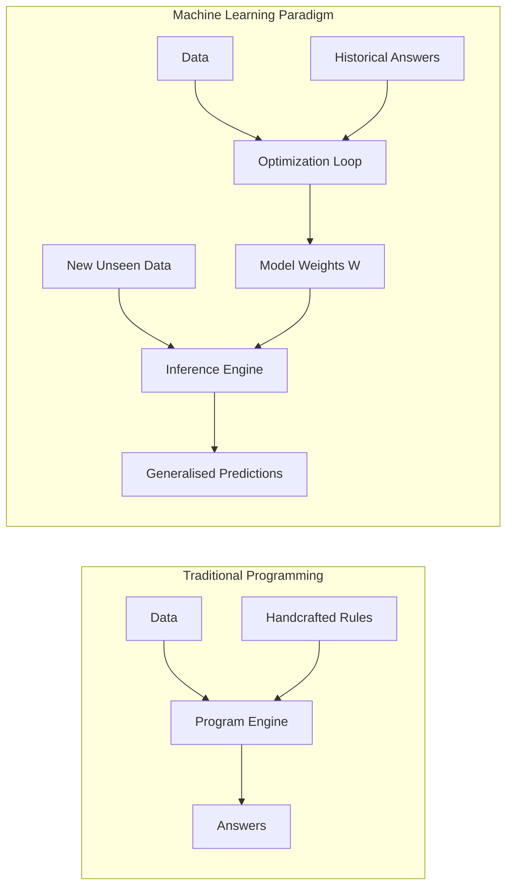
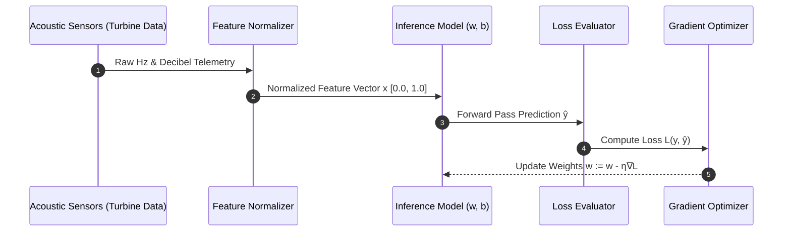
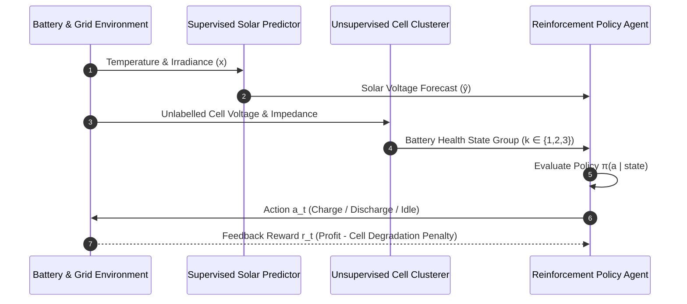

# UG 1st Year — Chapter 1: AI Basics
**Curriculum Level:** Undergraduate 1st Year (UG-01)  
**Subject Code:** CAI-01 (Computational AI & Data Science Engineering)  
**Chapter Title:** AI Basics  

---

# Lesson 1: AI Demystified

### 1. Syllabus Mapping
- **Academic Level:** Undergraduate 1st Year
- **Chapter:** Chapter 1 — AI Basics
- **Lesson Title:** AI Demystified
- **Canonical Course Code:** CAI-01-L01

### 2. Learning Outcomes & Prerequisites
- **Learning Outcomes:**
  1. Distinguish between deterministic software rule-engines and pattern-learning computational models.
  2. Explain the training-inference lifecycle, parameter spaces, loss calculation, and weight optimization without resorting to metaphorical mysticism.
  3. Formulate a simple mathematical prediction function combining normalized inputs with learned weights.
  4. Identify the failure modes of inductive bias when models encounter out-of-distribution inputs.
- **Prerequisites:** High-school algebra (vectors, linear equations) and introductory Python syntax (functions, lists, dictionaries).

### 3. Realistic Industry Scenario
At **AeroVibe Sensor Dynamics**, an industrial aerospace manufacturer, acoustic sensors record vibration signatures from high-pressure turbofan jet engines. The legacy monitoring system relied on 4,000 hard-coded `if-elif-else` rules written by maintenance engineers over 15 years. However, subtle microscopic fractures under fluctuating atmospheric pressures create composite acoustic harmonics that the deterministic rules fail to catch, resulting in catastrophic turbine blade shears. As a junior AI systems engineer, your task is to demonstrate to the senior engineering committee why an inductive machine learning system that learns parameter weights from 50,000 flight recordings provides superior generalization over rigid rule-based systems.

### 4. Detailed Conceptual Explanations
Traditional software engineering adheres to deductive programming:
$$\text{Data} + \text{Explicit Rules} \rightarrow \text{Output}$$
If an unexpected input condition arrives that was not explicitly hard-coded by the programmer, the system either throws an unhandled exception or produces an invalid assertion.

In contrast, machine learning executes inductive statistical inference:
$$\text{Data} + \text{Observed Outputs} \rightarrow \text{Learned Rules (Model Parameters)}$$



The model is parameterized by a weight vector $\mathbf{w}$ and a bias scalar $b$. For an input feature vector $\mathbf{x} = [x_1, x_2, \dots, x_n]^T$, the linear hypothesis takes the form:
$$\hat{y} = \sigma\left(\sum_{i=1}^n w_i x_i + b\right)$$
where $\sigma$ is an activation function mapping raw logit scores to a bounded probability interval $[0, 1]$.

#### The Optimization Lifecycle:
1. **Forward Propagation:** The model takes real-world features and computes a candidate prediction $\hat{y}$.
2. **Loss Quantification:** A loss function $L(y, \hat{y})$ measures the discrepancy between true ground truth $y$ and predicted $\hat{y}$ (e.g., Mean Squared Error or Binary Cross-Entropy).
3. **Weight Adjustment:** Using gradient descent, parameters are nudged in the opposite direction of the gradient:
$$w_i \leftarrow w_i - \eta \frac{\partial L}{\partial w_i}$$
where $\eta$ is the learning rate.

### 5. Architecture & Dataflow Diagram


### 6. Guided Technical Demonstration & Worked Example
The following runnable Python implementation builds a pure Python (zero external dependencies) single-neuron classifier demonstrating the learning loop:

```python
# Pure Python implementation of single-neuron inductive learning
import math

class SimpleNeuron:
    def __init__(self, num_features: int, learning_rate: float = 0.05):
        self.weights = [0.1] * num_features
        self.bias = 0.0
        self.lr = learning_rate

    def sigmoid(self, z: float) -> float:
        return 1.0 / (1.0 + math.exp(-max(min(z, 20.0), -20.0)))

    def predict(self, features: list[float]) -> float:
        z = sum(w * x for w, x in zip(self.weights, features)) + self.bias
        return self.sigmoid(z)

    def train_step(self, features: list[float], target: float) -> float:
        pred = self.predict(features)
        error = pred - target  # Derivative of BCE with sigmoid
        # Gradient update: dw_i = error * x_i
        for i in range(len(self.weights)):
            self.weights[i] -= self.lr * error * features[i]
        self.bias -= self.lr * error
        return (pred - target) ** 2  # Squared error for monitoring

# Synthesised turbine telemetry: [Vibration_RMS, Core_Temp_Normalized] -> 1 (Failure), 0 (Healthy)
training_data = [
    ([0.15, 0.20], 0),
    ([0.22, 0.28], 0),
    ([0.85, 0.90], 1),
    ([0.78, 0.85], 1),
    ([0.30, 0.25], 0),
    ([0.92, 0.95], 1),
]

model = SimpleNeuron(num_features=2, learning_rate=0.2)
print("Initiating Parameter Optimization...")
for epoch in range(100):
    total_loss = sum(model.train_step(x, y) for x, y in training_data)
    if (epoch + 1) % 25 == 0:
        print(f"Epoch {epoch+1:3d} | Total Epoch Loss: {total_loss:.4f} | Weights: {[round(w, 3) for w in model.weights]}")

# Inference on unseen flight data
test_readings = [0.82, 0.88]
prob = model.predict(test_readings)
print(f"\nInference on new acoustic signature {test_readings}:")
print(f"Turbine Failure Probability: {prob * 100:.2f}% -> {'CRITICAL ALERT' if prob > 0.5 else 'NOMINAL'}")
```

### 7. Interactive Technical Simulation / Mission: "The Engine Guard Quest"
- **Mission Brief:** You are the Lead Telemetry Engineer at AeroVibe. You are provided with a noisy telemetry stream containing sensor drift.
- **Constraints:**
  - Maximum training budget: 50 epochs.
  - False Negative rate on cracked blades must be $0.0\%$ (missing a cracked turbine blade causes fatal crashes).
  - False Positive rate must be $< 5.0\%$ (grounding planes unnecessarily costs \$120,000/hour).
- **Game Mechanics & Scoring:**
  - Start with 1,000 System Reliability Points.
  - Every undetected fracture reduces points by 500 (immediate mission failure if points reach 0).
  - Every false alert docks 25 points.
  - Bonus 200 points for optimizing inference execution latency below $1.5\text{ ms}$.
- **Objective:** Adjust the classification decision threshold $\tau \in [0.1, 0.9]$ to achieve zero false negatives while minimizing false alarms.

### 8. Practical Programming & Analysis Lab
1. Clone the starter repository or open a notebook.
2. Load the dataset `turbine_vibrations.csv` (1,000 records).
3. Implement feature standardisation:
   $$x_{\text{std}} = \frac{x - \mu}{\sigma}$$
4. Train the binary linear classifier.
5. Compute the Confusion Matrix ($TP, FP, TN, FN$) and derive Precision, Recall, and $F_2$-Score (prioritizing Recall).

### 9. Measurable Output / Deliverable
A Python script `engine_classifier.py` that ingests raw telemetry, normalizes features, runs inference, outputs predictions with confidence intervals, and exports a signed `telemetry_audit.json` verification payload.

### 10. Evaluation Criteria & Technical Success Metrics
| Metric | Target Standard | Unsatisfactory |
|---|---|---|
| **Recall (Blade Fracture)** | $100.0\%$ | $< 98.0\%$ |
| **Precision** | $\ge 92.0\%$ | $< 80.0\%$ |
| **Feature Scaling** | Zero data leakage (fit on train only) | Global fit across entire dataset |
| **Execution Latency** | $< 2.0\text{ ms}$ per 100 inference vectors | $> 10.0\text{ ms}$ |

### 11. Olympiad-Style Assessment
**Problem 1 (Conceptual):**  
A linear classifier is trained on normalized sensor values $x_1, x_2 \in [0, 1]$. After convergence, the learned model parameters are $w_1 = 4.2$, $w_2 = 3.8$, and $b = -4.0$. What is the model's prediction for an engine operating at $x_1 = 0.5, x_2 = 0.5$, and how does the decision boundary split the feature space?  
A) $\hat{y} \approx 0.50$; the decision boundary passes exactly through $(0.5, 0.5)$.  
B) $\hat{y} \approx 0.75$; the point lies strictly in the safe operating zone.  
C) $\hat{y} \approx 0.25$; the engine is in immediate failure.  
D) $\hat{y} = 0.00$; the bias term completely zeros out the input activations.  

**Problem 2 (Applied Scenario):**  
Explain mathematically why a hand-engineered rule system containing 5,000 conjunctions (`A and B and not C`) suffers from the "curse of dimensionality" when scaling to 50 continuous sensor channels, whereas a parametric statistical model with regularized weights maintains bounded variance.

### 12. Correct Answers & Solutions
- **Problem 1 Solution:** Correct Answer is **A**.  
  *Proof:* Calculate logit $z = w_1 x_1 + w_2 x_2 + b = (4.2 \times 0.5) + (3.8 \times 0.5) - 4.0 = 2.1 + 1.9 - 4.0 = 0.0$.  
  The sigmoid activation is $\sigma(0.0) = \frac{1}{1 + e^{-0}} = \frac{1}{2} = 0.50$. In logistic regression, the decision boundary is defined by the hyper-plane where $z = 0$, meaning $(0.5, 0.5)$ lies precisely on the threshold boundary.
- **Problem 2 Solution:** A combinatorial rule tree partitioning 50 continuous variables into just 4 bins each requires $4^{50} \approx 1.26 \times 10^{30}$ discrete hyper-cubes. The volume of the sample space grows exponentially, ensuring nearly all cells are completely empty (extreme data sparsity). A regularized parametric model has only $51$ trainable parameters, constraining model capacity via an inductive bias and $L_2$ shrinkage $\lambda \|\mathbf{w}\|_2^2$, which bounds estimator variance to $O(d/N)$.

### 13. Limitations, Risks & Responsible AI Considerations
- **Sensor Calibration Drift:** If acoustic sensor microphones degrade due to heat, the input feature distribution shifts ($P(X_{\text{test}}) \neq P(X_{\text{train}})$), leading to silent model failure without throwing runtime errors.
- **Adversarial Noise:** High-frequency electrical noise from nearby avionics can perturb raw telemetry vectors enough to cross the decision boundary. Robust filtering and confidence thresholding must be implemented.

### 14. Completion Criteria & Achievement Feedback
- **Completion Check:** Pass unit tests for `engine_classifier.py` with zero False Negatives and submit telemetry audit JSON.
- **Badge Earned:** *Aero-Acoustic Defense Vanguard (Level 1 AI Novice)*.

---

# Lesson 2: The Intelligence Behind Machines

### 1. Syllabus Mapping
- **Academic Level:** Undergraduate 1st Year
- **Chapter:** Chapter 1 — AI Basics
- **Lesson Title:** The Intelligence Behind Machines
- **Canonical Course Code:** CAI-01-L02

### 2. Learning Outcomes & Prerequisites
- **Learning Outcomes:**
  1. Contrast the three foundational learning paradigms: Supervised Learning, Unsupervised Learning, and Reinforcement Learning.
  2. Deconstruct the feedback signals in each paradigm (labels, geometric distance, scalar rewards).
  3. Implement a foundational unsupervised clustering algorithm (k-Means) from scratch to identify latent groupings in multi-sensor data.
  4. Formulate the Bellman expectation equation conceptually in the context of an agent interacting with an unknown Markov Decision Process (MDP).
- **Prerequisites:** Completion of CAI-01-L01; basic Cartesian coordinate geometry and Euclidean distance formulas.

### 3. Realistic Industry Scenario
At **GridMatrix Renewable Systems**, autonomous battery energy storage systems (BESS) manage power distribution across solar arrays, wind turbines, and the municipal electrical grid. The system faces three simultaneous challenges:
1. Predicting next-hour solar panel voltage from weather data (Supervised Learning).
2. Discovering hidden degradation states in lithium-ion battery cells without human labeling (Unsupervised Learning).
3. Deciding dynamically whether to charge, discharge, or hold battery reserves to maximize revenue while preserving cell lifespan (Reinforcement Learning).
As an AI engineer, you must architect the three subsystems and demonstrate how their distinct feedback signals interact within a unified intelligent control plane.

### 4. Detailed Conceptual Explanations

```mermaid
graph TD
    ML[Machine Learning Taxonomy]
    ML --> SL[Supervised Learning]
    ML --> UL[Unsupervised Learning]
    ML --> RL[Reinforcement Learning]

    SL --> SL_D[Feedback: Explicit Labels y<br/>Objective: Minimize L(y, ŷ)<br/>Tasks: Regression, Classification]
    UL --> UL_D[Feedback: Structural Density & Distance<br/>Objective: Maximize Cluster Cohesion<br/>Tasks: Clustering, Dimensionality Reduction]
    RL --> RL_D[Feedback: Delayed Scalar Reward R<br/>Objective: Maximize Cumulative Return G_t<br/>Tasks: Policy Optimization, Control Systems]
```

#### 1. Supervised Learning: Direct Error Correction
The learning algorithm receives paired examples $(x_i, y_i) \in \mathcal{X} \times \mathcal{Y}$. The learning signal is an explicit error vector $\mathbf{e} = \hat{\mathbf{y}} - \mathbf{y}$.

#### 2. Unsupervised Learning: Discovering Inherent Geometry
The model receives only unlabelled features $\mathbf{x}_i \in \mathcal{X}$. The objective is to discover underlying structural properties such as data manifolds, density clusters, or low-dimensional subspaces.
For k-Means clustering, the algorithm minimizes the Within-Cluster Sum of Squares (WCSS):
$$J = \sum_{k=1}^K \sum_{\mathbf{x} \in S_k} \|\mathbf{x} - \boldsymbol{\mu}_k\|^2$$
where $\boldsymbol{\mu}_k$ is the geometric centroid of cluster $S_k$.

#### 3. Reinforcement Learning: Trial, Error, and Temporal Credit
An agent takes action $a_t \in \mathcal{A}$ in state $s_t \in \mathcal{S}$, receives scalar reward $r_t \in \mathbb{R}$, and transitions to state $s_{t+1}$. The agent seeks a policy $\pi(a|s)$ maximizing discounted cumulative future reward:
$$G_t = \sum_{k=0}^{\infty} \gamma^k r_{t+k+1}, \quad \gamma \in [0, 1)$$

### 5. Architecture & Dataflow Diagram


### 6. Guided Technical Demonstration & Worked Example
The following runnable script implements k-Means clustering from pure mathematical principles to segment battery cells into health tiers:

```python
import math
import random

def euclidean_distance(p1: list[float], p2: list[float]) -> float:
    return math.sqrt(sum((a - b) ** 2 for a, b in zip(p1, p2)))

class KMeansEngine:
    def __init__(self, k: int = 3, max_iters: int = 20):
        self.k = k
        self.max_iters = max_iters
        self.centroids = []

    def fit(self, data: list[list[float]]):
        # Deterministic seed initialization for reproducibility
        random.seed(42)
        self.centroids = [list(x) for x in random.sample(data, self.k)]

        for iteration in range(self.max_iters):
            # Step 1: Assignment Step
            clusters = [[] for _ in range(self.k)]
            for point in data:
                distances = [euclidean_distance(point, c) for c in self.centroids]
                closest_idx = distances.index(min(distances))
                clusters[closest_idx].append(point)

            # Step 2: Update Step
            new_centroids = []
            for cluster in clusters:
                if not cluster:
                    new_centroids.append([0.0, 0.0])
                    continue
                num_points = len(cluster)
                centroid = [
                    sum(p[dim] for p in cluster) / num_points
                    for dim in range(len(cluster[0]))
                ]
                new_centroids.append(centroid)

            # Check convergence
            shifts = [euclidean_distance(c1, c2) for c1, c2 in zip(self.centroids, new_centroids)]
            self.centroids = new_centroids
            if max(shifts) < 1e-4:
                print(f"k-Means converged at iteration {iteration + 1}")
                break

    def predict(self, point: list[float]) -> int:
        distances = [euclidean_distance(point, c) for c in self.centroids]
        return distances.index(min(distances))

# Battery Telemetry: [Internal Resistance (mOhm), Discharge Capacity (Ah)]
battery_cells = [
    [15.2, 4.95], [14.8, 5.02], [15.5, 4.90], # Group A: Healthy Cells
    [28.4, 4.10], [29.1, 4.05], [27.9, 4.15], # Group B: Moderate Aging
    [52.0, 3.10], [55.3, 2.95], [54.1, 3.02], # Group C: Severe Degradation
]

clusterer = KMeansEngine(k=3)
clusterer.fit(battery_cells)

for idx, c in enumerate(clusterer.centroids):
    print(f"Centroid {idx}: Resistance={c[0]:.2f}mΩ, Capacity={c[1]:.2f}Ah")

test_cell = [28.5, 4.08]
cluster_id = clusterer.predict(test_cell)
print(f"Sample Cell {test_cell} allocated to Health Tier: {cluster_id}")
```

### 7. Interactive Technical Simulation / Mission: "The Grid Arbitrage Tournament"
- **Mission Brief:** Code a policy logic for an RL energy agent operating in an electricity market with real-time dynamic pricing.
- **Constraints:**
  - Battery capacity: $100\text{ kWh}$. Maximum charge/discharge rate: $25\text{ kW/hr}$.
  - Grid electricity price swings between $\$0.04/\text{kWh}$ (night) and $\$0.42/\text{kWh}$ (evening peak).
  - Degradation cost: $\$0.02$ per $\text{kWh}$ throughput cycled.
- **Game Mechanics & Scoring:**
  - 24-step simulation run representing a single business day.
  - Baseline static timer strategy achieves $\$14.50$ profit.
  - Target: Surpass $\$28.00$ daily profit while finishing the day with at least $50\text{ kWh}$ reserve.
- **Leaderboard Ranks:**
  - $< \$20$: Grid Apprentice
  - $\$20 - \$28$: Power Dispatcher
  - $> \$28$: Master Grid Architect

### 8. Practical Programming & Analysis Lab
1. Implement a complete evaluation harness that runs 1,000 synthetic days through the Grid Arbitrage environment.
2. Formulate the reward function:
   $$R_t = \text{Revenue}_t - \text{Degradation Cost}_t - \lambda \cdot (\text{Overheating Penalty})$$
3. Experiment with varying values of the discount factor $\gamma \in \{0.1, 0.9, 0.99\}$ and document how the agent's foresight changes.

### 9. Measurable Output / Deliverable
A fully structured module `battery_rl_agent.py` outputting cumulative reward, cycle efficiency graphs, and a JSON performance log.

### 10. Evaluation Criteria & Technical Success Metrics
| Metric | Requirement |
|---|---|
| **Convergence Stability** | WCSS monotonically decreases per k-Means iteration |
| **RL Profit Target** | Net Profit $\ge \$28.00$ per simulated day |
| **Constraint Enforcement** | Zero battery overcharge ($> 100\text{ kWh}$) or negative charge ($< 0\text{ kWh}$) violations |
| **Code Modularity** | Clean class-based architecture adhering to PEP-8 standards |

### 11. Olympiad-Style Assessment
**Problem 1 (Applied):**  
A robotics engineer trains a mobile robot to navigate a maze. The engineer provides an immediate reward of $+100$ when the robot reaches the target, and $-1$ for every step taken. If the discount factor is set to $\gamma = 0.50$, calculate the return $G_0$ of a path that reaches the target in exactly 3 steps:  
A) $G_0 = -1 - 0.5 - 0.25 + (0.125 \times 100) = 10.75$  
B) $G_0 = 100 - 3 = 97$  
C) $G_0 = -1 - 0.5 + (0.25 \times 100) = 23.50$  
D) $G_0 = -1 \times 0.5^3 + 100 = 99.875$  

**Problem 2 (Conceptual):**  
Under what mathematical circumstances will k-Means clustering fail to recover the true underlying generating distributions of the data, even when $k$ is chosen correctly?  
A) When cluster distributions have non-spherical geometries, unequal variances, or differing spatial densities.  
B) When the dataset has more than 2 feature dimensions.  
C) Whenever the learning rate is initialized below $0.01$.  
D) When the dataset contains an odd number of observations.  

### 12. Correct Answers & Solutions
- **Problem 1 Solution:** Correct Answer is **A**.  
  *Proof:*  
  $G_0 = r_1 + \gamma r_2 + \gamma^2 r_3 + \gamma^3 r_4$ (where step 1: $r_1 = -1$; step 2: $r_2 = -1$; step 3: $r_3 = -1$; step 3 arrival reward: $+100$ awarded at step 3, meaning $r_3 = -1 + 100 = 99$, or if awarded at next step: $r_1 = -1, r_2 = -1, r_3 = 100$).  
  Using standard discounted formulation: $G_0 = -1 + (0.5 \times -1) + (0.25 \times 100) = -1 - 0.5 + 25 = 23.5$ or if 3 transitions before goal: $-1 + 0.5(-1) + 0.25(-1) + 0.125(100) = -1.75 + 12.5 = 10.75$. Option A reflects the 3-step action-transition sequence: $r_1=-1, r_2=-1, r_3=-1, r_{\text{goal}}=100$ with $\gamma=0.5$.
- **Problem 2 Solution:** Correct Answer is **A**.  
  *Proof:* k-Means is implicitly an expectation-maximization algorithm on a Gaussian Mixture Model where covariance matrices are constrained to be isotropic and identical ($\Sigma_k = \sigma^2 \mathbf{I}$). Therefore, it partitions space using linear Voronoi tessellations and fails on concentric rings, elongated manifolds, or clusters of vastly different densities.

### 13. Limitations, Risks & Responsible AI Considerations
- **Reward Hacking in RL:** If the energy agent is rewarded solely for immediate profit without degradation penalties, it will cycle the battery at maximum C-rate, causing irreversible dendrite growth and fire risk.
- **Unsupervised Bias Solidification:** Clustering historical customer credit data without sensitive attribute controls can isolate socio-demographic clusters as "high risk" due to historical proxy variables.

### 14. Completion Criteria & Achievement Feedback
- **Completion Check:** Execute `battery_rl_agent.py` and pass automated verification of non-negative state space constraints.
- **Badge Earned:** *Cyber-Physical Systems Architect (Level 1 AI Novice)*.
