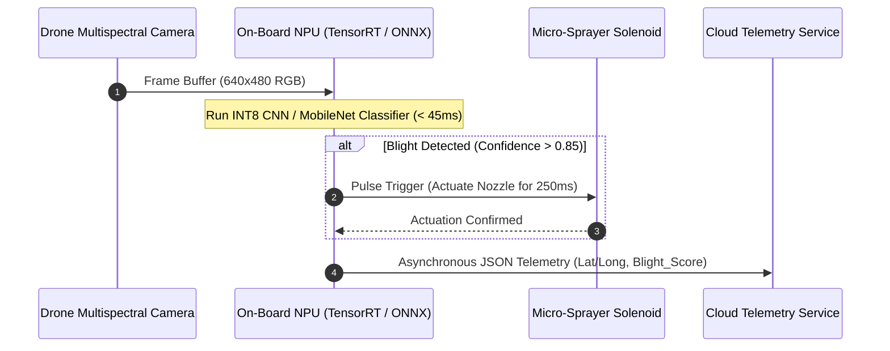
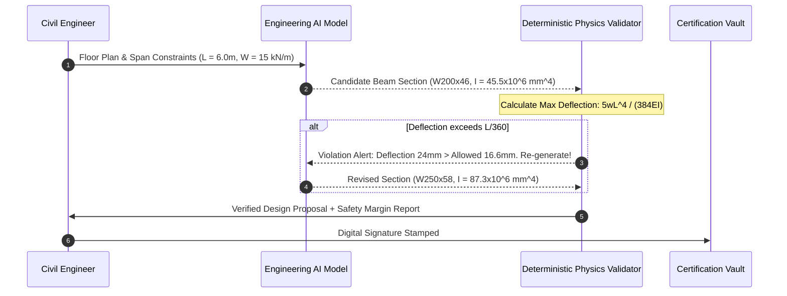

# UG 1st Year — Chapter 3: AI Applications
**Curriculum Level:** Undergraduate 1st Year (UG-01)  
**Subject Code:** CAI-01 (Computational AI & Data Science Engineering)  
**Chapter Title:** AI Applications  

---

# Lesson 1: AI in the Real World

### 1. Syllabus Mapping
- **Academic Level:** Undergraduate 1st Year
- **Chapter:** Chapter 3 — AI Applications
- **Lesson Title:** AI in the Real World
- **Canonical Course Code:** CAI-01-L05

### 2. Learning Outcomes & Prerequisites
- **Learning Outcomes:**
  1. Analyze end-to-end production architectures of modern AI systems across high-impact sectors (Smart Cities, Precision Agriculture, Logistics).
  2. Differentiate between batch inference pipelines and low-latency real-time stream processing.
  3. Formulate mathematical utility functions balancing model accuracy against operational compute costs ($/inference).
  4. Implement an edge-compatible computer vision inference pipeline for automated defect detection.
- **Prerequisites:** Basic Python syntax, understanding of multidimensional arrays (matrices/tensors), and foundational machine learning concepts (CAI-01-L01).

### 3. Realistic Industry Scenario
At **AgriDrone Autonomous Robotics**, fleets of unmanned aerial vehicles (UAVs) fly over agricultural fields to detect crop blight and nitrogen deficiencies in real time. The drones operate with constrained on-board battery capacity and edge computing modules (e.g., NVIDIA Jetson / Raspberry Pi with NPU). Transmitting 4K video feeds to the cloud over 4G/5G cellular modems consumes too much bandwidth and introduces unacceptable latency ($> 2,000\text{ ms}$). You are tasked with designing an optimized on-device inference pipeline that classifies leaf pathology, triggers localized micro-sprayers within $150\text{ ms}$, and batches diagnostic summary statistics for low-bandwidth telemetry sync.

### 4. Detailed Conceptual Explanations

```mermaid
graph TD
    Sensor[Camera / Sensor Feed] --> Preproc[Edge Preprocessor & Resizer]
    Preproc --> QuantModel[Quantized Edge Model<br/>(INT8 / FP16 Tensors)]
    QuantModel --> Decision[Real-Time Actuator Logic]
    Decision -->|Latency < 150ms| Sprayer[Localized Nozzle Actuator]
    QuantModel --> LowBandwidthBuffer[Telemetry Batch Buffer]
    LowBandwidthBuffer -->|Periodic Sync| CloudDB[(Enterprise Agri-Cloud)]
```

#### Production System Paradigms:
1. **Batch Inference vs. Real-Time Streaming:**
   - *Batch Inference:* High-throughput, offline processing of terabytes of historical logs or images (e.g., nightly fraud audits). Metrics prioritize total throughput (records/sec) and compute efficiency.
   - *Real-Time Streaming:* Low-latency, online event-driven processing (e.g., autonomous driving, drone obstacle avoidance). Metrics prioritize 99th-percentile (P99) latency ($< 50\text{ ms}$) and jitter.
2. **The Accuracy vs. Latency Tradeoff:**
   Full-precision 32-bit floating point models ($\text{FP32}$) achieve state-of-the-art accuracy but require substantial GPU memory and compute cycles. Quantizing weights to 8-bit integers ($\text{INT8}$) cuts memory footprint by $75\%$ and boosts inference speed by $3\times$ with negligible ($< 1\%$) accuracy degradation:
   $$W_{\text{INT8}} = \text{round}\left(\frac{W_{\text{FP32}}}{S}\right) - Z$$
   where $S$ is the scale factor and $Z$ is the zero-point offset.

### 5. Architecture & Dataflow Diagram


### 6. Guided Technical Demonstration & Worked Example
The following runnable script simulates a real-time agricultural edge inference worker with latency budgeting and precision monitoring:

```python
import time
import random

class EdgeBlightDetector:
    def __init__(self, latency_budget_ms: float = 150.0):
        self.latency_budget = latency_budget_ms
        # Simulated quantized model weights for 3 spectral bands: [Red, Green, Near-Infrared]
        self.weights = [0.15, -0.40, 0.75]
        self.bias = -0.20

    def compute_ndvi(self, red: float, nir: float) -> float:
        """Normalized Difference Vegetation Index: (NIR - Red) / (NIR + Red)"""
        denom = nir + red
        return (nir - red) / denom if denom != 0 else 0.0

    def predict_frame(self, frame_telemetry: dict) -> dict:
        start_t = time.perf_counter()
        
        red = frame_telemetry["red_channel"]
        green = frame_telemetry["green_channel"]
        nir = frame_telemetry["nir_channel"]
        
        # Spectral feature calculation
        ndvi = self.compute_ndvi(red, nir)
        raw_score = (red * self.weights[0]) + (green * self.weights[1]) + (nir * self.weights[2]) + self.bias
        
        # Softmax / Sigmoid approximation
        confidence = 1.0 / (1.0 + 2.71828 ** (-raw_score))
        
        elapsed_ms = (time.perf_counter() - start_t) * 1000
        is_blight = confidence > 0.70 and ndvi < 0.35
        
        return {
            "blight_detected": is_blight,
            "confidence": round(confidence, 4),
            "ndvi_health_index": round(ndvi, 3),
            "latency_ms": round(elapsed_ms, 3),
            "deadline_met": elapsed_ms <= self.latency_budget
        }

# Stream of simulated field frames
field_stream = [
    {"frame_id": 101, "red_channel": 0.45, "green_channel": 0.20, "nir_channel": 0.85}, # Healthy crop
    {"frame_id": 102, "red_channel": 0.80, "green_channel": 0.15, "nir_channel": 0.30}, # Blighted leaf
    {"frame_id": 103, "red_channel": 0.30, "green_channel": 0.50, "nir_channel": 0.90}, # Thriving crop
]

detector = EdgeBlightDetector()
print("Starting Edge UAV Inference Pipeline...")
for frame in field_stream:
    res = detector.predict_frame(frame)
    action = "TRIGGER SPRAYER" if res["blight_detected"] else "HOLD NOZZLE"
    print(f"Frame {frame['frame_id']} | Blight: {res['blight_detected']} (Conf: {res['confidence']}) | "
          f"NDVI: {res['ndvi_health_index']} | Latency: {res['latency_ms']}ms -> [{action}]")
```

### 7. Interactive Technical Simulation / Mission: "The Smart Highway Congestion Optimizer"
- **Mission Brief:** You are the Senior Traffic AI Engineer for a smart metropolis. You manage 500 connected traffic signal intersections.
- **Constraints:**
  - Real-time video stream arriving at 30 FPS.
  - Emergency vehicles (ambulances, fire engines) must receive green lights within $300\text{ ms}$ of camera detection ($100\%$ detection guarantee).
  - Average civilian commute wait time across the city must not exceed 180 seconds.
- **Game Mechanics & Scoring:**
  - Base Score: 10,000 points.
  - Emergency vehicle delayed by red light: $-2,000$ points.
  - Civilian gridlock created: $-10$ points per car per minute.
  - Bonus $+500$ points for keeping edge compute hardware cost under $\$150$ per intersection.

### 8. Practical Programming & Analysis Lab
1. Build `smart_city_traffic.py` to process simulated vehicle traffic feeds.
2. Implement an adaptive signal scheduling algorithm combining real-time density detection with priority queuing for emergency vehicles.
3. Simulate a sudden 5-vehicle emergency convoy and measure time-to-clear vs. congestion spillover.

### 9. Measurable Output / Deliverable
A Python script `smart_city_traffic.py` generating a comprehensive traffic optimization report (`traffic_simulation_results.json`) tracking P95 latency, emergency corridor clearance time, and total network throughput.

### 10. Evaluation Criteria & Technical Success Metrics
| Metric | Target Standard | Fail Criterion |
|---|---|---|
| **Emergency Priority Latency** | $< 300\text{ ms}$ | $> 500\text{ ms}$ |
| **P99 Inference Execution** | $< 40\text{ ms}$ | $> 100\text{ ms}$ |
| **Gridlock Recovery Time** | $< 120\text{ s}$ post-convoy | System deadlocks |

### 11. Olympiad-Style Assessment
**Problem 1 (Applied):**  
A smart warehouse sorting facility uses an optical AI scanner. The model takes $60\text{ ms}$ to classify an item on a conveyor belt moving at $1.5\text{ meters/second}$. What is the minimum physical distance that must separate the optical scanner from the pneumatic sorting actuator arm to ensure the arm fires at the exact moment the package arrives?  
A) $0.09\text{ meters}$ ($9\text{ cm}$)  
B) $0.90\text{ meters}$ ($90\text{ cm}$)  
C) $0.04\text{ meters}$ ($4\text{ cm}$)  
D) $0.25\text{ meters}$ ($25\text{ cm}$)  

**Problem 2 (Conceptual):**  
Why does deploying a cloud-only AI model for high-speed industrial robot arm collision prevention create unacceptable operational safety risks compared to edge-deployed quantized models?  
A) Cloud models are incapable of processing 3D coordinates.  
B) Non-deterministic internet packet jitter and wide-area network latency spikes can delay emergency stop signals beyond mechanical safety thresholds.  
C) Cloud servers cannot execute convolutional neural networks.  
D) Edge models always achieve higher mathematical accuracy than cloud models.  

### 12. Correct Answers & Solutions
- **Problem 1 Solution:** Correct Answer is **A**.  
  *Proof:*  
  $\text{Distance} = \text{Speed} \times \text{Time}$.  
  $\text{Time} = 60\text{ ms} = 0.060\text{ seconds}$.  
  $\text{Speed} = 1.5\text{ m/s}$.  
  $\text{Distance} = 1.5 \times 0.060 = 0.09\text{ meters} = 9\text{ cm}$.
- **Problem 2 Solution:** Correct Answer is **B**.  
  *Proof:* While cloud clusters provide massive compute, public wide-area network (WAN) connections are subject to packet re-transmission, bufferbloat, and routing hops. An unexpected latency tail spike from $40\text{ ms}$ to $1,200\text{ ms}$ would prevent the collision signal from reaching the robot actuator in time, causing mechanical impact and worker injury.

### 13. Limitations, Risks & Responsible AI Considerations
- **Environmental Distribution Shifts:** An agricultural vision model trained in sunny California will experience catastrophic accuracy drops when deployed in foggy or rainy monsoon conditions in India.
- **Fail-Safe Fallbacks:** Every real-world AI actuation system must possess a mechanical or hardware-level fail-safe (e.g., physical emergency stop button, hardware watchdog timer) independent of software predictions.

### 14. Completion Criteria & Achievement Feedback
- **Completion Check:** Pass all automated tests in `smart_city_traffic.py` with zero emergency vehicle delays.
- **Badge Earned:** *Real-World Systems Engineer (Level 1 AI Novice)*.

---

# Lesson 2: AI in Your Profession

### 1. Syllabus Mapping
- **Academic Level:** Undergraduate 1st Year
- **Chapter:** Chapter 3 — AI Applications
- **Lesson Title:** AI in Your Profession
- **Canonical Course Code:** CAI-01-L06

### 2. Learning Outcomes & Prerequisites
- **Learning Outcomes:**
  1. Map discipline-specific workflows (Mechanical Engineering, Chemical Synthesis, Financial Accounting, Civil Infrastructure) to appropriate AI technical paradigms.
  2. Architect a Human-in-the-Loop (HITL) verification system that combines AI automation speed with professional human oversight.
  3. Calculate the Return on Investment (ROI) and cost-efficiency trade-offs of integrating AI into professional engineering processes.
  4. Design a domain-specific validation layer that automatically flags hallucinated or unphysical outputs.
- **Prerequisites:** Completion of CAI-01-L05; understanding of domain engineering standards (e.g., factor of safety, balance sheets).

### 3. Realistic Industry Scenario
At **StrataStruct Structural Consulting**, junior civil engineers manually calculate load-bearing beam stress profiles according to building code standards (Eurocode / AISC). A commercial generative AI tool is introduced to auto-generate beam structural designs from architectural floor plans. However, during testing, the AI model generates an aesthetically pleasing cantilevered beam design that violates fundamental beam deflection limits ($L/360$), which would cause catastrophic roof collapse. As the project's AI integration lead, you must build a domain-aware validation guardrail that checks every AI-generated structural proposal against physical laws and building codes before routing it to the licensed Professional Engineer (PE) for final sign-off.

### 4. Detailed Conceptual Explanations

```mermaid
graph TD
    UserDraft[Engineer Design Request] --> AI_Gen[AI Generative Design Model]
    AI_Gen --> DomainGuard[Automated Domain Verification Engine]
    
    subgraph Physics & Code Validation Layer
        DomainGuard --> C1{Stress < Yield Limit?}
        DomainGuard --> C2{Deflection < L/360?}
        DomainGuard --> C3{Factor of Safety >= 1.5?}
    end
    
    C1 & C2 & C3 -->|All Passed| HITL[Human Professional Engineer Sign-Off]
    C1 |Violated| Reject[Rejection Log & Re-prompt Loop]
    C2 |Violated| Reject
    C3 |Violated| Reject
    
    HITL -->|Approved & Stamped| Blueprint[Production Construction Blueprint]
    HITL -->|Rejected| Re-Draft[Manual Engineering Revision]
```

#### The Human-in-the-Loop (HITL) Spectrum:
1. **Full Automation (Low Risk / Reversible):** Spelling correction, product recommendations, spam filtering. Human intervention only occurs upon explicit customer escalation.
2. **AI-Assisted Human Decision (Medium Risk):** Medical radiology pre-screening, financial credit scoring. The AI highlights regions of interest; the human makes the final decision.
3. **Human-Governed Critical Automation (High Risk / Irreversible):** Structural engineering, surgical robotics, nuclear reactor valves. The AI proposes candidates, automated programmatic safety invariants rigorously verify mathematical boundaries, and certified human experts execute legal sign-off.

#### Engineering Sanity Checks (Physics-Informed Verification):
Never allow an unconstrained statistical model to directly dictate physical parameters. Always wrap model outputs in deterministic physical verification functions:
$$\text{Factor of Safety } (FOS) = \frac{\sigma_{\text{yield}}}{\sigma_{\text{applied}}} \ge 1.5$$

### 5. Architecture & Dataflow Diagram


### 6. Guided Technical Demonstration & Worked Example
The following script demonstrates an automated professional validation guardrail for structural beam sizing:

```python
class BeamPhysicsValidator:
    def __init__(self, allowable_deflection_ratio: float = 360.0, min_fos: float = 1.67):
        self.deflection_ratio = allowable_deflection_ratio
        self.min_fos = min_fos
        self.steel_elastic_modulus_gpa = 200.0  # Young's Modulus for Structural Steel (GPa)
        self.steel_yield_strength_mpa = 250.0   # Yield Strength (MPa)

    def validate_beam(self, span_m: float, load_kn_per_m: float, beam_proposal: dict) -> dict:
        """
        Validates an AI-proposed structural steel I-beam.
        span_m: Span length in meters
        load_kn_per_m: Uniformly Distributed Load in kN/m
        beam_proposal: Dict with 'section_name', 'I_cm4' (Moment of Inertia), 'Z_cm3' (Section Modulus)
        """
        L_mm = span_m * 1000.0
        w_n_per_mm = load_kn_per_m  # 1 kN/m = 1 N/mm
        E_mpa = self.steel_elastic_modulus_gpa * 1000.0
        I_mm4 = beam_proposal["I_cm4"] * 10000.0
        Z_mm3 = beam_proposal["Z_cm3"] * 1000.0

        # Maximum Bending Moment: M_max = (w * L^2) / 8  (N*mm)
        M_max = (w_n_per_mm * (L_mm ** 2)) / 8.0
        
        # Maximum Bending Stress: sigma_max = M / Z  (MPa)
        sigma_max = M_max / Z_mm3
        actual_fos = self.steel_yield_strength_mpa / sigma_max if sigma_max > 0 else 999.0

        # Maximum Deflection: delta_max = (5 * w * L^4) / (384 * E * I)  (mm)
        delta_max = (5.0 * w_n_per_mm * (L_mm ** 4)) / (384.0 * E_mpa * I_mm4)
        allowable_delta = L_mm / self.deflection_ratio

        passed_stress = actual_fos >= self.min_fos
        passed_deflection = delta_max <= allowable_delta

        return {
            "section": beam_proposal["section_name"],
            "actual_fos": round(actual_fos, 2),
            "fos_compliant": passed_stress,
            "deflection_mm": round(delta_max, 2),
            "allowable_deflection_mm": round(allowable_delta, 2),
            "deflection_compliant": passed_deflection,
            "overall_status": "APPROVED FOR PE SIGN-OFF" if (passed_stress and passed_deflection) else "REJECTED"
        }

# Simulated AI Model Output
ai_proposals = [
    {"section_name": "Light Beam UB 178x102", "I_cm4": 1360.0, "Z_cm3": 153.0}, # Fails
    {"section_name": "Standard Beam UB 254x146", "I_cm4": 4410.0, "Z_cm3": 348.0} # Passes
]

validator = BeamPhysicsValidator()
span = 5.0 # meters
load = 20.0 # kN/m

print(f"Engineering Audit: {span}m Span under {load} kN/m Distributed Load")
for proposal in ai_proposals:
    report = validator.validate_beam(span, load, proposal)
    print(f"\nEvaluating: {report['section']}")
    print(f"  Factor of Safety: {report['actual_fos']} (Compliant: {report['fos_compliant']})")
    print(f"  Deflection: {report['deflection_mm']} mm / Max: {report['allowable_deflection_mm']} mm (Compliant: {report['deflection_compliant']})")
    print(f"  Final Decision: {report['overall_status']}")
```

### 7. Interactive Technical Simulation / Mission: "The Engineering Verification Gate"
- **Mission Brief:** You are the Lead Systems Auditor at an engineering consultancy. A junior team used an unvalidated LLM to produce 20 mechanical component specifications.
- **Constraints:**
  - 5 proposals violate thermodynamic laws (claiming efficiency $> 100\%$).
  - 8 proposals violate material shear stress limits.
  - 7 proposals are structurally sound.
- **Game Mechanics & Scoring:**
  - Base Score: 500 points.
  - Correctly approving a sound design: $+100$ points.
  - Catching an unphysical / hazardous design: $+150$ points.
  - Rubber-stamping a hazardous design: Instant Disqualification & Score Reset to 0.
  - Falsely rejecting a valid design: $-50$ points.

### 8. Practical Programming & Analysis Lab
1. Develop `professional_workflow_guard.py` tailored to your academic discipline (Civil, Mechanical, Electrical, Computer Science, or Finance).
2. Define a mathematical validation suite containing at least three non-negotiable physical or regulatory invariant equations.
3. Integrate the validator into an automated reporting pipeline that generates markdown audit summaries for executive review.

### 9. Measurable Output / Deliverable
A Python script `domain_verification_engine.py` accompanied by an automated report `engineering_audit_summary.json` classifying candidate designs into Verified, Flagged, and Critical Violation buckets.

### 10. Evaluation Criteria & Technical Success Metrics
| Metric | Threshold |
|---|---|
| **Zero False Approvals** | $100\%$ detection of hazardous/unphysical designs |
| **Formula Accuracy** | Beam moment, deflection, and stress formulas verified against standards |
| **Audit Traceability** | Every decision mapped to specific code clauses and safety factors |

### 11. Olympiad-Style Assessment
**Problem 1 (Applied):**  
A chemical engineering team asks an LLM to recommend a cooling fluid for an exothermic reactor operating at $280^\circ\text{C}$ and $1\text{ atm}$. The LLM enthusiastically recommends pure water because *"water has a high specific heat capacity and is environmentally friendly"*. What fundamental physical limitation did the LLM fail to account for, and what safety hazard would occur?  
A) Water decomposes into explosive hydrogen gas at $50^\circ\text{C}$.  
B) Water boils at $100^\circ\text{C}$ at $1\text{ atm}$; using it as a liquid coolant at $280^\circ\text{C}$ without pressurization would result in immediate phase change to steam, pressure blowout, and catastrophic reactor runaway.  
C) Water freezes when exposed to heat.  
D) Water increases electrical resistance in the chemical reactor.  

**Problem 2 (Conceptual):**  
In professional AI workflow design, what is the core purpose of an "Invariant Guardrail"?  
A) To translate English prompts into Python code.  
B) To enforce absolute, non-negotiable physical, mathematical, or legal boundaries that cannot be bypassed by model hallucinations, regardless of model confidence scores.  
C) To increase the context window of the language model.  
D) To make the language model train faster on GPUs.  

### 12. Correct Answers & Solutions
- **Problem 1 Solution:** Correct Answer is **B**.  
  *Proof:* The LLM recalled the true isolated fact that water has high specific heat ($4.184\text{ J/g}^\circ\text{C}$) but lacked physical state-space awareness. At atmospheric pressure ($1\text{ atm}$), water boils at $100^\circ\text{C}$. Introducing liquid water into a $280^\circ\text{C}$ reactor without severe pressurization produces rapid volumetric expansion ($> 1,600\times$ vapor expansion ratio), destroying reactor containment vessels.
- **Problem 2 Solution:** Correct Answer is **B**.  
  *Proof:* An invariant is a condition that must remain true across all program executions. In professional workflows, machine learning models output probabilistic proposals. Invariant guardrails enforce deterministic boundary equations (e.g., conservation of mass, Kirchhoff's laws, AISC stress limits) to prevent hallucinated violations from propagating to production.

### 13. Limitations, Risks & Responsible AI Considerations
- **Automation Bias:** Licensed professionals may develop uncritical trust in AI outputs over time ("rubber-stamping"), failing to catch subtle structural anomalies that automated invariant checkers cannot detect.
- **Legal Liability & Accountability:** Legally, an AI system cannot be sued for malpractice or hold a professional license. The human engineer who signs the drawing or prescription carries 100% legal, financial, and ethical responsibility.

### 14. Completion Criteria & Achievement Feedback
- **Completion Check:** Pass all test cases in `domain_verification_engine.py` with zero false approvals of hazardous specs.
- **Badge Earned:** *Certified Professional AI Auditor (Level 1 AI Novice)*.
