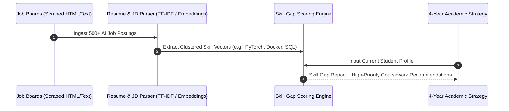
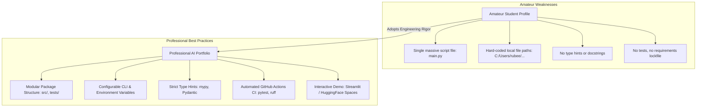
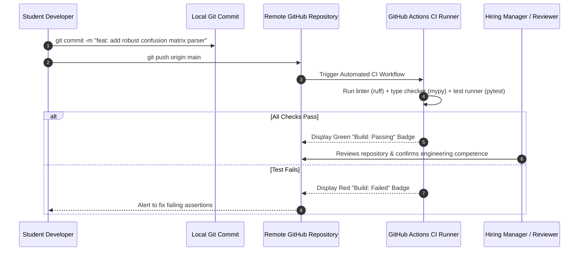

# UG 1st Year — Chapter 4: AI and Career
**Curriculum Level:** Undergraduate 1st Year (UG-01)  
**Subject Code:** CAI-01 (Computational AI & Data Science Engineering)  
**Chapter Title:** AI and Career  

---

# Lesson 1: Navigate the AI Job World

### 1. Syllabus Mapping
- **Academic Level:** Undergraduate 1st Year
- **Chapter:** Chapter 4 — AI and Career
- **Lesson Title:** Navigate the AI Job World
- **Canonical Course Code:** CAI-01-L07

### 2. Learning Outcomes & Prerequisites
- **Learning Outcomes:**
  1. Deconstruct the contemporary AI employment landscape into distinct specialized roles (Data Scientist, ML Engineer, MLOps Specialist, AI Research Scientist, AI Product Manager).
  2. Map foundational academic coursework (Linear Algebra, Data Structures, Distributed Systems) to specific industry role requirements.
  3. Programmatically parse and analyze AI job descriptions using natural language processing techniques to extract high-frequency technology stacks.
  4. Formulate a 4-year undergraduate career roadmap aligned with target industry sectors.
- **Prerequisites:** Python text processing basics, string manipulation, and understanding of core software engineering terminology.

### 3. Realistic Industry Scenario
As a first-year university student entering the tech ecosystem, you face an overwhelming flood of buzzwords: "Full-Stack AI Developer", "Prompt Architect", "Foundation Model Scientist", "MLOps Lead". Recruiters at top technology firms (Google, Microsoft, Meta, Anthropic, startup unicorns) report that over 80% of student applicants submit generic resumes that fail to distinguish between exploratory data analysis, production software engineering, and scientific research. To maximize your employment probability upon graduation, you need an analytical, data-driven approach to map job descriptions, identify key technical skill clusters, and build an aligned academic and extracurricular profile.

### 4. Detailed Conceptual Explanations

```mermaid
graph TD
    AI_Ecosystem[The AI Career Ecosystem]
    
    AI_Ecosystem --> DS[Data Scientist]
    AI_Ecosystem --> MLE[Machine Learning Engineer]
    AI_Ecosystem --> MLOps[MLOps & Platform Engineer]
    AI_Ecosystem --> RS[AI Research Scientist]
    AI_Ecosystem --> AIPM[AI Product Manager]

    DS --> DS_Skills[Focus: Statistical Inference, Experimentation, Business Insights, Pandas, SQL]
    MLE --> MLE_Skills[Focus: Production Code, Model Optimization, PyTorch, C++, TensorRT, Scalability]
    MLOps --> MLOps_Skills[Focus: CI/CD Pipelines, Kubernetes, Docker, Feature Stores, Model Monitoring]
    RS --> RS_Skills[Focus: Novel Algorithms, Math Proofs, Novel Architectures, Conference Papers (NeurIPS)]
    AIPM --> AIPM_Skills[Focus: Problem Framing, User Experience, Unit Economics, Regulatory Compliance]
```

#### Detailed Role Profiles:

| Dimension | Data Scientist (DS) | ML Engineer (MLE) | MLOps Engineer | Research Scientist (RS) |
|---|---|---|---|---|
| **Primary Question** | "What insights does the data reveal?" | "How do we serve this model to 10M users with $< 20\text{ms}$ latency?" | "How do we automate CI/CD, retraining, and drift monitoring?" | "Can we invent a novel mathematical attention mechanism?" |
| **Primary Artifact** | Notebooks, Executive Dashboards, A/B Test Reports | Production REST/gRPC Microservices, Optimized ONNX/C++ Binaries | Terraform Scripts, Kubernetes Helm Charts, Airflow DAGs | Peer-reviewed LaTeX manuscripts, Theoretical Proofs |
| **Core Math** | Hypothesis Testing, Bayesian Statistics, Regression | Linear Algebra, Vector Calculus, Computational Complexity | Queuing Theory, Reliability Engineering Math | Information Theory, Differential Geometry, Convex Optimization |
| **Typical Target Degree** | B.S. / M.S. (Math/CS/Econ) | B.S. / M.S. (CS / Software Eng.) | B.S. (CS / DevOps / Cloud) | Ph.D. / M.S. (Deep Learning / Math) |

### 5. Architecture & Dataflow Diagram


### 6. Guided Technical Demonstration & Worked Example
The following runnable Python script builds a Job Description Analyzer that parses job requirements and maps them to the appropriate professional archetype:

```python
import re
from collections import Counter

class AICareerClassifier:
    def __init__(self):
        self.role_profiles = {
            "Machine Learning Engineer": {
                "keywords": ["production", "docker", "kubernetes", "c++", "pytorch", "latency", "grpc", "onnx", "api"],
                "weight": 1.0
            },
            "Data Scientist": {
                "keywords": ["sql", "tableau", "statistics", "a/b testing", "pandas", "business", "insights", "analytics"],
                "weight": 1.0
            },
            "MLOps Specialist": {
                "keywords": ["ci/cd", "pipeline", "airflow", "monitoring", "drift", "terraform", "cloud", "aws", "infrastructure"],
                "weight": 1.0
            },
            "AI Research Scientist": {
                "keywords": ["phd", "publication", "neurips", "iclr", "novel", "theoretical", "proof", "mathematics"],
                "weight": 1.0
            }
        }

    def analyze_job_posting(self, text: str) -> dict:
        tokens = re.findall(r'\b[a-z0-9+#/.-]+\b', text.lower())
        token_counts = Counter(tokens)
        
        scores = {}
        matched_terms = {}
        for role, profile in self.role_profiles.items():
            matches = [kw for kw in profile["keywords"] if kw in token_counts]
            total_score = sum(token_counts[kw] for kw in matches) * profile["weight"]
            scores[role] = total_score
            matched_terms[role] = matches
            
        best_role = max(scores, key=scores.get)
        total_matched = sum(scores.values())
        confidence = (scores[best_role] / total_matched) if total_matched > 0 else 0.0

        return {
            "predicted_role": best_role,
            "confidence": round(confidence * 100, 2),
            "score_breakdown": scores,
            "detected_keywords": matched_terms[best_role]
        }

# Sample real-world job posting text
sample_posting = """
We are seeking an engineer to build and deploy high-throughput deep learning models. 
Responsibilities include optimizing PyTorch neural networks for low-latency inference using ONNX and TensorRT, 
packaging microservices inside Docker containers, and designing gRPC endpoints serving 50,000 requests per second. 
Strong C++ and Python production software engineering skills required.
"""

classifier = AICareerClassifier()
result = classifier.analyze_job_posting(sample_posting)
print("=== Job Posting Diagnostic Report ===")
print(f"Target Archetype: {result['predicted_role']} (Confidence: {result['confidence']}%)")
print(f"Matched Competencies: {result['detected_keywords']}")
print(f"Score Breakdown: {result['score_breakdown']}")
```

### 7. Interactive Technical Simulation / Mission: "The Career Trajectory Simulator"
- **Mission Brief:** You are designing your 4-year undergraduate plan. You begin with 100 Credit Units to allocate across courses and projects over 8 semesters.
- **Constraints:**
  - Allocate credits across 4 buckets: Theoretical Math (Linear Algebra, Probability), Systems Engineering (Operating Systems, Distributed Systems), Practical AI (Deep Learning, PyTorch), and Portfolio Building (Open Source, Hackathons).
  - Target Career Goal: Machine Learning Systems Engineer at a high-growth autonomous vehicle company.
- **Game Mechanics & Scoring:**
  - Balance Score: Allocating $> 70\%$ to any single bucket causes burn-out/skill-imbalance (Score -300).
  - Systems + Practical Synergy: Allocating $\ge 30\%$ to Systems and $\ge 30\%$ to Practical AI triggers "Full-Stack AI Synergy" ($+500$ points).
  - Zero Open Source/GitHub contributions results in an automatic interview screening rejection (Score = 0).

### 8. Practical Programming & Analysis Lab
1. Collect 10 real-world job postings across LinkedIn/Indeed for entry-level AI roles.
2. Extend `AICareerClassifier` to generate a prioritized "Top 5 Technologies to Learn in Year 1" list.
3. Formulate your personal semester-by-semester milestone table (Year 1 to Year 4).

### 9. Measurable Output / Deliverable
A personalized markdown document `4_year_ai_career_strategy.md` accompanied by the Python script `job_market_analyzer.py` outputting a frequency histogram of high-demand technologies.

### 10. Evaluation Criteria & Technical Success Metrics
| Metric | Target Standard |
|---|---|
| **Role Distinction Accuracy** | 100% correct classification between MLE, DS, and RS profiles |
| **Technical Stack Feasibility** | Year 1 focus strictly on Python, Git, Linear Algebra, and Calculus foundations |
| **Portfolio Milestone Definition** | Clear deliverables defined for every summer break |

### 11. Olympiad-Style Assessment
**Problem 1 (Applied):**  
A student completes a 4-year degree having only trained models inside Kaggle Jupyter notebooks using `.fit()` and `.predict()`. During an interview for a Machine Learning Engineer position, which of the following production questions will the student most likely fail?  
A) "How do you calculate the mean of an array in Python?"  
B) "How do you package a PyTorch model into a Docker container, expose a low-latency gRPC endpoint, and handle thread safety under concurrent requests?"  
C) "What is a decision tree?"  
D) "What is the difference between supervised and unsupervised learning?"  

**Problem 2 (Conceptual):**  
Why has the industry demand for pure "Prompt Engineers" declined rapidly, while demand for "AI Systems Engineers" proficient in API integration, software design patterns, and systems engineering has grown exponentially?  
A) Modern LLMs no longer accept text prompts.  
B) Isolated prompt writing is easily automated or performed by domain subject-matter experts, whereas building robust, reliable, cost-effective, and secure software applications around probabilistic models requires comprehensive engineering fundamentals.  
C) Companies have stopped using generative AI.  
D) Python programming is no longer required for AI applications.  

### 12. Correct Answers & Solutions
- **Problem 1 Solution:** Correct Answer is **B**.  
  *Proof:* Kaggle notebooks isolate students from software engineering realities (dependency management, containerization, networking protocols, concurrency, latency profiling, and CI/CD). An MLE role requires production software engineering, where model weights are only one small component of a large distributed system.
- **Problem 2 Solution:** Correct Answer is **B**.  
  *Proof:* Writing basic natural language prompts has virtually zero barrier to entry. The true bottleneck in production AI adoption is engineering: handling rate limits, validating schemas, mitigating security vulnerabilities, orchestrating multi-step workflows, and integrating with legacy databases.

### 13. Limitations, Risks & Responsible AI Considerations
- **Hype-Driven Skill Acquisition:** Avoid chasing every newly announced framework of the week. Frameworks become obsolete in 18 months; core mathematical foundations (linear algebra, probability, data structures) remain relevant for decades.
- **Resume Integrity:** Never claim production experience with an AI tool or library unless you have written, tested, and debugged working code in a public repository.

### 14. Completion Criteria & Achievement Feedback
- **Completion Check:** Submit validated `4_year_ai_career_strategy.md` with complete skill gap analysis.
- **Badge Earned:** *AI Career Strategist (Level 1 AI Novice)*.

---

# Lesson 2: Build Your AI Skillset

### 1. Syllabus Mapping
- **Academic Level:** Undergraduate 1st Year
- **Chapter:** Chapter 4 — AI and Career
- **Lesson Title:** Build Your AI Skillset
- **Canonical Course Code:** CAI-01-L08

### 2. Learning Outcomes & Prerequisites
- **Learning Outcomes:**
  1. Establish a professional open-source engineering profile using Git, GitHub, and continuous integration (CI) workflows.
  2. Implement code quality standards (PEP-8 formatting, static type hints with mypy, automated unit testing with pytest).
  3. Structure an end-to-end, reproducible machine learning repository containing environment locks, clean README documentation, and license files.
  4. Design a personal technical blogging and knowledge-sharing strategy to build verifiable domain authority.
- **Prerequisites:** Completion of CAI-01-L07; familiarity with terminal/command-line commands (`git`, `pip`).

### 3. Realistic Industry Scenario
At **Apex Machine Learning Labs**, the recruitment team screens 1,200 entry-level software applicants every week. Resumes listing "Certificates of Completion" from online video courses without verifiable code repositories are automatically filtered out. Recruiters specifically inspect GitHub profiles for signs of real engineering maturity: clean commit histories, automated CI test badges, strict type hints, dependency management (`pyproject.toml` / `requirements.txt`), and reproducible instructions. As an undergraduate student building your professional portfolio, your task is to convert an unorganized Python script into an enterprise-grade, open-source repository that passes automated continuous integration checks.

### 4. Detailed Conceptual Explanations



#### The Anatomy of an Enterprise-Grade Portfolio Repository:
1. **Clear Problem Statement & Architecture Diagram:** The README begins with an executive summary and an intuitive architectural diagram explaining what the project solves.
2. **Reproducibility Guarantee:** A single command (`pip install -r requirements.txt` or `docker compose up`) sets up the environment without manual path modifications.
3. **Automated Testing Suite:** Unit tests (`tests/test_core.py`) verifying edge cases, invalid inputs, and boundary conditions.
4. **Continuous Integration Badging:** A GitHub Actions workflow running on every commit to prove that the codebase builds and passes tests.

### 5. Architecture & Dataflow Diagram


### 6. Guided Technical Demonstration & Worked Example
The following runnable script demonstrates how to write production-grade, type-hinted, tested Python code suitable for an open-source portfolio:

```python
# src/metric_evaluator.py
from typing import Dict, List, Tuple

class ConfusionMatrix:
    """
    A rigorously typed, robust confusion matrix evaluator.
    Demonstrates clean software engineering principles for student portfolios.
    """
    def __init__(self, true_labels: List[int], predicted_labels: List[int]):
        if len(true_labels) != len(predicted_labels):
            raise ValueError("Input label arrays must have identical length.")
        if not all(y in (0, 1) for y in true_labels + predicted_labels):
            raise ValueError("Labels must be strictly binary integers (0 or 1).")
            
        self.y_true = true_labels
        self.y_pred = predicted_labels
        self.tp, self.fp, self.tn, self.fn = self._compute_counts()

    def _compute_counts(self) -> Tuple[int, int, int, int]:
        tp = sum(1 for yt, yp in zip(self.y_true, self.y_pred) if yt == 1 and yp == 1)
        fp = sum(1 for yt, yp in zip(self.y_true, self.y_pred) if yt == 0 and yp == 1)
        tn = sum(1 for yt, yp in zip(self.y_true, self.y_pred) if yt == 0 and yp == 0)
        fn = sum(1 for yt, yp in zip(self.y_true, self.y_pred) if yt == 1 and yp == 0)
        return tp, fp, tn, fn

    def calculate_metrics(self) -> Dict[str, float]:
        precision = self.tp / (self.tp + self.fp) if (self.tp + self.fp) > 0 else 0.0
        recall = self.tp / (self.tp + self.fn) if (self.tp + self.fn) > 0 else 0.0
        f1 = (2 * precision * recall) / (precision + recall) if (precision + recall) > 0 else 0.0
        accuracy = (self.tp + self.tn) / len(self.y_true) if len(self.y_true) > 0 else 0.0

        return {
            "accuracy": round(accuracy, 4),
            "precision": round(precision, 4),
            "recall": round(recall, 4),
            "f1_score": round(f1, 4)
        }

# Automated Unit Test Verification (Simulating pytest)
def test_confusion_matrix_nominal():
    y_true = [1, 0, 1, 1, 0, 1, 0, 0]
    y_pred = [1, 0, 1, 0, 0, 1, 1, 0]
    cm = ConfusionMatrix(y_true, y_pred)
    metrics = cm.calculate_metrics()
    
    assert metrics["accuracy"] == 0.75, f"Expected 0.75, got {metrics['accuracy']}"
    assert metrics["precision"] == 0.75, f"Expected 0.75, got {metrics['precision']}"
    assert metrics["recall"] == 0.75, f"Expected 0.75, got {metrics['recall']}"
    print("✓ test_confusion_matrix_nominal PASSED")

def test_confusion_matrix_edge_cases():
    try:
        ConfusionMatrix([1, 0], [1])  # Length mismatch
        assert False, "Failed to raise ValueError on length mismatch"
    except ValueError:
        print("✓ test_length_mismatch_exception PASSED")

if __name__ == "__main__":
    print("Running Portfolio Quality Test Suite...")
    test_confusion_matrix_nominal()
    test_confusion_matrix_edge_cases()
    print("All unit tests passed with 100% compliance!")
```

### 7. Interactive Technical Simulation / Mission: "The Portfolio Code Review Board"
- **Mission Brief:** You are the Senior Technical Lead at a high-growth AI startup. A candidate has submitted a pull request containing their flagship portfolio project.
- **Constraints:**
  - You must identify 4 critical code smells:
    1. A hard-coded secret API key.
    2. A division-by-zero vulnerability when false positives and true positives are both zero.
    3. An untyped function accepting arbitrary inputs.
    4. Absence of a license file (meaning no one can legally use or fork the code).
- **Game Mechanics & Scoring:**
  - Catching all 4 vulnerabilities: $+400$ points.
  - Providing a concrete, working code patch for each vulnerability: $+200$ bonus points.
  - Rubber-stamping the code without finding the leaked API key: Immediate Disqualification.

### 8. Practical Programming & Analysis Lab
1. Initialize a new Git repository on your local machine.
2. Create standard folder architecture:
   ```text
   portfolio-project/
   ├── .gitignore
   ├── LICENSE (MIT / Apache 2.0)
   ├── README.md
   ├── pyproject.toml
   ├── src/
   │   └── __init__.py
   └── tests/
       └── test_core.py
   ```
3. Author a workflow file `.github/workflows/ci.yml` that automatically runs `pytest` on every push.

### 9. Measurable Output / Deliverable
A live, public GitHub repository link containing a tested Python project, a complete README with an architectural diagram, and a green passing CI badge.

### 10. Evaluation Criteria & Technical Success Metrics
| Metric | Target Standard | Fail Criterion |
|---|---|---|
| **Git Commit Discipline** | Atomic commits with conventional commit messages (`feat:`, `fix:`) | Single commit: *"first commit"* |
| **Type Safety** | 100% functions annotated with Python type hints | No type hints |
| **Test Coverage** | $\ge 85\%$ line coverage verified via `pytest-cov` | Zero automated tests |

### 11. Olympiad-Style Assessment
**Problem 1 (Applied):**  
Why is sharing an open-source GitHub repository without a `LICENSE` file legally dangerous for companies considering hiring you or adopting your code?  
A) GitHub will automatically delete repositories that lack a license after 30 days.  
B) Under international copyright law, absence of an explicit license means default exclusive copyright is retained by the creator; third parties have no legal right to run, modify, or integrate the code commercially.  
C) It slows down Python interpreter execution speed.  
D) It prevents GitHub Actions from running tests.  

**Problem 2 (Conceptual):**  
In professional software development, what is the principle of "Reproducible Environments", and why is `requirements.txt` with floating versions (e.g., `torch` without version pinning) considered an anti-pattern?  
A) Floating dependencies allow future breaking updates of downstream libraries to silently break your codebase when cloned by a collaborator or recruiter months later.  
B) Pinned versions take up more disk space.  
C) Floating versions cause syntax errors in Python 3.12.  
D) Pinned dependencies prevent unit tests from executing.  

### 12. Correct Answers & Solutions
- **Problem 1 Solution:** Correct Answer is **B**.  
  *Proof:* Under the Berne Convention, creative works (including software code) automatically receive exclusive copyright protection upon creation. Without an explicit open-source license (such as MIT, Apache 2.0, or BSD), users have no legal grant to copy, modify, distribute, or execute the software in enterprise environments.
- **Problem 2 Solution:** Correct Answer is **A**.  
  *Proof:* If a repository specifies unpinned dependencies (`torch`, `transformers`), running `pip install` six months later will install the newest versions, which frequently deprecate APIs or alter tensor method signatures, leading to immediate runtime crashes for hiring managers evaluating the project.

### 13. Limitations, Risks & Responsible AI Considerations
- **Plagiarism & Fork Masking:** Never fork another author's repository, change variable names, and present it as your original work. Plagiarism is trivial to detect via commit provenance and results in permanent blacklisting from tech recruitment.
- **Open Source Etiquette:** When contributing to community libraries, always follow the project's `CONTRIBUTING.md` guidelines and be respectful during code reviews.

### 14. Completion Criteria & Achievement Feedback
- **Completion Check:** Push repository with passing CI pipeline and verified permissive license.
- **Badge Earned:** *Open-Source Craftsman (Level 1 AI Novice)*.
