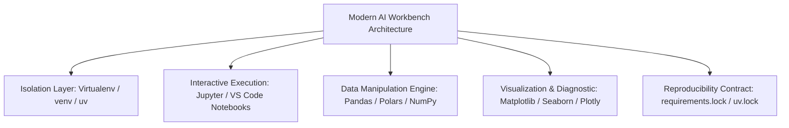
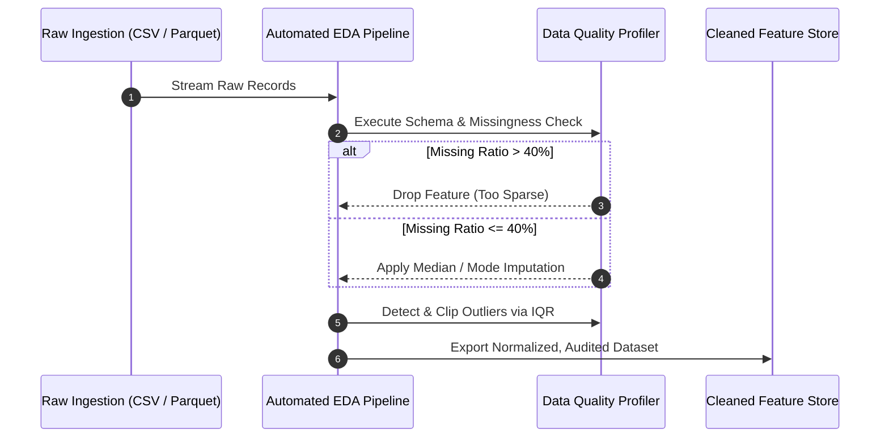
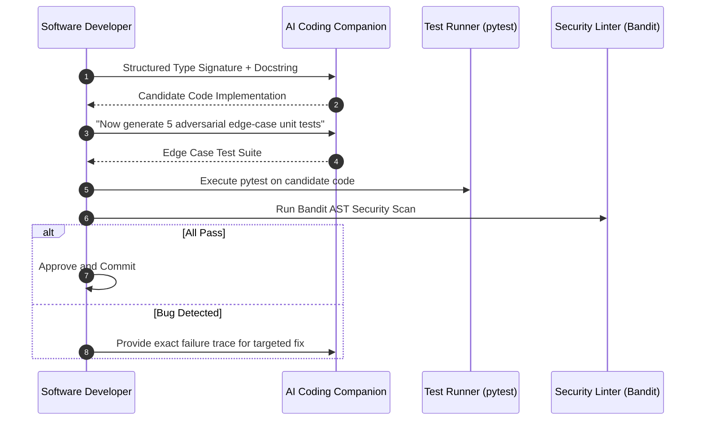

# UG 1st Year — Chapter 5: AI Tools
**Curriculum Level:** Undergraduate 1st Year (UG-01)  
**Subject Code:** CAI-01 (Computational AI & Data Science Engineering)  
**Chapter Title:** AI Tools  

---

# Lesson 1: AI Workbench

### 1. Syllabus Mapping
- **Academic Level:** Undergraduate 1st Year
- **Chapter:** Chapter 5 — AI Tools
- **Lesson Title:** AI Workbench
- **Canonical Course Code:** CAI-01-L09

### 2. Learning Outcomes & Prerequisites
- **Learning Outcomes:**
  1. Configure isolated, deterministic Python virtual environments using modern dependency management tooling (`venv`, `uv`, `pip-tools`).
  2. Implement an exploratory data analysis (EDA) pipeline inside a computational workbench using Pandas, NumPy, and Matplotlib.
  3. Detect missing values, distributional skewness, and multi-collinearity in empirical datasets.
  4. Export reproducible execution recipes and environment locks to eliminate "works on my machine" defects.
- **Prerequisites:** Python language basics; familiarity with terminal navigation.

### 3. Realistic Industry Scenario
At **DataSphere Analytics**, a data consultancy, a junior analyst trained a customer churn prediction model in a local Jupyter notebook and presented an impressive $94\%$ accuracy to the executive board. However, when the client attempted to reproduce the notebook on their corporate server, the code crashed immediately due to conflicting Pandas version methods (`append` was deprecated in favor of `concat`), unpinned dependency clashes, and hard-coded absolute directory paths. As the lead technical mentor, your role is to guide the student through building a standardized, containerized AI Workbench that guarantees bitwise reproducibility and automated data quality audits.

### 4. Detailed Conceptual Explanations



#### 1. Environment Isolation Mechanics
The global Python system interpreter installs packages into a shared `site-packages` directory. Installing conflicting library versions (e.g., PyTorch 2.0 vs 1.12) corrupts global dependencies.
A virtual environment creates an isolated sandbox directory containing its own dedicated Python binary and isolated `site-packages` tree:
```bash
python -m venv .venv
source .venv/bin/activate  # On Linux/macOS
.venv\Scripts\activate     # On Windows
```

#### 2. Systematic Exploratory Data Analysis (EDA) Pipeline
Before feeding data into any machine learning algorithm, an engineer must execute a 4-step exploratory data audit:
1. **Dimensionality & Schema Audit:** Check total row count ($N$), feature count ($D$), and assert data types (`int64`, `float64`, `datetime`).
2. **Missingness Profiling:** Calculate the missingness fraction:
   $$\text{Missing Ratio}_j = \frac{1}{N} \sum_{i=1}^N \mathbb{I}(x_{ij} \text{ is NaN})$$
3. **Distributional Skewness & Outliers:** Compute the interquartile range ($IQR = Q_3 - Q_1$) and flag observations outside $[Q_1 - 1.5 \cdot IQR, Q_3 + 1.5 \cdot IQR]$.
4. **Feature Correlation Matrix:** Compute Pearson's correlation coefficient to detect collinearity:
   $$r_{xy} = \frac{\sum (x_i - \bar{x})(y_i - \bar{y})}{\sqrt{\sum (x_i - \bar{x})^2 \sum (y_i - \bar{y})^2}}$$

### 5. Architecture & Dataflow Diagram


### 6. Guided Technical Demonstration & Worked Example
The following runnable script demonstrates an automated Data Profiling Workbench in pure Python:

```python
import math
from typing import List, Dict, Any

class DataProfilerWorkbench:
    def __init__(self, data: List[Dict[str, Any]]):
        self.data = data
        self.num_records = len(data)
        self.columns = list(data[0].keys()) if data else []

    def profile_feature(self, col_name: str) -> Dict[str, Any]:
        values = [row[col_name] for row in self.data]
        missing_count = sum(1 for v in values if v is None)
        valid_numeric = [float(v) for v in values if v is not None and isinstance(v, (int, float))]
        
        missing_ratio = missing_count / self.num_records if self.num_records > 0 else 0.0
        
        if not valid_numeric:
            return {"column": col_name, "type": "categorical/empty", "missing_ratio": missing_ratio}

        # Calculate Mean, Variance, Min, Max
        mean_val = sum(valid_numeric) / len(valid_numeric)
        variance = sum((x - mean_val) ** 2 for x in valid_numeric) / len(valid_numeric)
        std_dev = math.sqrt(variance)
        sorted_vals = sorted(valid_numeric)
        
        return {
            "column": col_name,
            "count": len(valid_numeric),
            "missing_ratio": round(missing_ratio, 4),
            "mean": round(mean_val, 2),
            "std_dev": round(std_dev, 2),
            "min": round(sorted_vals[0], 2),
            "median": round(sorted_vals[len(sorted_vals) // 2], 2),
            "max": round(sorted_vals[-1], 2),
        }

# Simulated customer dataset with real-world flaws (missing values, extreme outliers)
customer_telemetry = [
    {"age": 25, "income": 45000, "churn": 0},
    {"age": 32, "income": 58000, "churn": 0},
    {"age": None, "income": 52000, "churn": 1},  # Missing Age
    {"age": 47, "income": None, "churn": 0},   # Missing Income
    {"age": 19, "income": 9999999, "churn": 1}, # Outlier Income
    {"age": 52, "income": 82000, "churn": 1},
]

workbench = DataProfilerWorkbench(customer_telemetry)
print("=== AI Workbench: Automated Feature Profile ===")
for col in workbench.columns:
    profile = workbench.profile_feature(col)
    print(f"Feature [{col}]:")
    for k, v in profile.items():
        print(f"  {k}: {v}")
```

### 7. Interactive Technical Simulation / Mission: "The Data Sanitation Quest"
- **Mission Brief:** You are provided with a messy sensor log dataset containing 1,000 readings from an autonomous drone battery.
- **Constraints:**
  - 120 rows contain sensor dropouts (`NaN`).
  - 15 rows contain negative voltages (physically impossible sensor short-circuits).
  - Clean the dataset without throwing away more than $5\%$ of the total rows.
- **Game Mechanics & Scoring:**
  - Start with 1,000 Data Quality Points.
  - Successfully imputing missing values with rolling averages: $+250$ points.
  - Filtering physical anomalies (negative voltages): $+200$ points.
  - Deleting valid data unnecessarily: $-10$ points per row.
  - Target: Deliver a 100% clean, non-null dataset with statistical variance preserved within $3\%$ of original.

### 8. Practical Programming & Analysis Lab
1. Initialize a clean virtual environment and install dependencies (`numpy`, `pandas`, `matplotlib`).
2. Write a script `eda_audit.py` that ingests any arbitrary CSV file and automatically exports:
   - A summary table of missing values per column.
   - A boxplot visualization of numeric features.
   - A correlation heatmap identifying redundant features ($r > 0.85$).
3. Generate a pinned `requirements.lock` file.

### 9. Measurable Output / Deliverable
A fully reproducible Jupyter notebook or Python script `workbench_eda.py` that processes a raw dataset and outputs a structured `data_health_report.json`.

### 10. Evaluation Criteria & Technical Success Metrics
| Metric | Target Standard | Fail Criterion |
|---|---|---|
| **Environment Isolation** | Verified virtualenv with pinned lockfile | Global environment usage |
| **Missingness Imputation** | Mathematically defensible (median/mean) | Naive fillna(0) on all features |
| **Outlier Detection** | Formal statistical rule (IQR / 3-Sigma) | Arbitrary manual row deletions |

### 11. Olympiad-Style Assessment
**Problem 1 (Applied):**  
A dataset contains a salary feature with a mean of $\$55,000$ and a standard deviation of $\$12,000$. A data entry error enters a billionaire CEO salary of $\$150,000,000$. Which of the following summary metrics will be severely distorted by this single outlier, and which metric will remain robust?  
A) Mean is distorted; Median remains robust.  
B) Median is distorted; Mean remains robust.  
C) Both Mean and Median are equally distorted.  
D) Standard deviation decreases toward zero.  

**Problem 2 (Conceptual):**  
Why should missing feature values NEVER be imputed using the mean of the *entire* dataset prior to splitting into Training and Testing subsets?  
A) Because it causes data leakage, allowing statistical properties of the unseen test set to contaminate the training pipeline, leading to overly optimistic evaluation metrics.  
B) Because the mean of a test set is always negative.  
C) Because Python does not allow calculating the mean of an array before a train-test split.  
D) Because it changes the categorical labels into floating-point numbers.  

### 12. Correct Answers & Solutions
- **Problem 1 Solution:** Correct Answer is **A**.  
  *Proof:* The arithmetic mean is non-resistant; a single extreme value can shift the mean arbitrarily high. The median is a rank-order statistic with a breakdown point of $50\%$, meaning up to half the observations can be corrupted before the median changes uncontrollably.
- **Problem 2 Solution:** Correct Answer is **A**.  
  *Proof:* Preprocessing operations (imputation, scaling, normalization) must learn their parameters strictly on the training partition ($D_{\text{train}}$) and apply those learned parameters to the test partition ($D_{\text{test}}$). Imputing across the unified dataset leaks test distribution parameters into training, invalidating cross-validation validity.

### 13. Limitations, Risks & Responsible AI Considerations
- **Imputation Bias:** Imputing missing values with the mean can artificially deflate the variance of the feature distribution, creating false overconfidence in downstream prediction intervals.
- **Silent Type Coercion:** Pandas can silently coerce integer columns containing missing values into floating-point numbers, potentially breaking downstream foreign key relationships in relational databases.

### 14. Completion Criteria & Achievement Feedback
- **Completion Check:** Pass all automated data health assertions in `eda_audit.py` with 100% reproducible execution.
- **Badge Earned:** *Data Workbench Craftsman (Level 1 AI Novice)*.

---

# Lesson 2: AI Coding Companion

### 1. Syllabus Mapping
- **Academic Level:** Undergraduate 1st Year
- **Chapter:** Chapter 5 — AI Tools
- **Lesson Title:** AI Coding Companion
- **Canonical Course Code:** CAI-01-L10

### 2. Learning Outcomes & Prerequisites
- **Learning Outcomes:**
  1. Leverage AI coding assistants (GitHub Copilot, Cursor, Claude Code) for rapid scaffolding, algorithmic translation, and test synthesis.
  2. Implement an adversarial code verification review process to identify subtle AI-generated bugs, non-existent API calls (hallucinated methods), and security vulnerabilities.
  3. Formulate structured context prompts for coding companions using interface specifications, type annotations, and docstrings.
  4. Compare the performance, edge-case coverage, and computational complexity of human-authored vs. AI-assisted implementations.
- **Prerequisites:** Completion of CAI-01-L09; solid foundation in Python functions, loops, and unit tests.

### 3. Realistic Industry Scenario
At **CloudScale FinTech Systems**, a team of junior developers used an AI coding assistant to accelerate the implementation of a foreign exchange currency conversion microservice. The AI companion smoothly auto-completed a clean, 20-line conversion function. However, the AI companion subtly utilized a floating-point calculation (`amount * rate`) for financial monetary values instead of the exact `decimal.Decimal` module, introducing cumulative IEEE 754 floating-point rounding discrepancies that resulted in a $\$42,000$ accounting shortfall over 1,000,000 transactions. You are assigned to establish the engineering standard for AI-assisted programming: defining how developers must verify, stress-test, and audit AI-generated code before submitting pull requests.

### 4. Detailed Conceptual Explanations

```mermaid
graph TD
    Prompt[Developer Intent + Interface Contract] --> AI_Gen[AI Coding Companion Auto-Complete]
    AI_Gen --> Reviewer[Developer Critical Verification Loop]
    
    subgraph Three-Pillar Verification Protocol
        Reviewer --> P1{Pillar 1: Correctness & Precision<br/>Floating-point, edge cases, null checks}
        Reviewer --> P2{Pillar 2: Security & Dependencies<br/>Hallucinated packages, injection risks}
        Reviewer --> P3{Pillar 3: Algorithmic Complexity<br/>Is it O(N) or hidden O(N^2)?}
    end
    
    P1 & P2 & P3 -->|All Verified & Tested| Production[Merge to Main Branch]
    P1 |Failed| Patch[Refactor & Add Failing Unit Test]
    P2 |Failed| Patch
    P3 |Failed| Patch
```

#### 1. The Generative Coding Trap: Fluency vs. Correctness
AI coding models are trained on billions of lines of public code. They excel at surface-level syntax and boilerplate patterns. However, they lack semantic execution awareness:
- **Hallucinated APIs:** Inventing plausible-sounding methods that do not exist in the official documentation (e.g., `pd.DataFrame.group_and_rank()`).
- **Subtle Precision Bugs:** Using `float` instead of `Decimal` for currency, or using standard random instead of `secrets` for cryptographic tokens.
- **Silent Algorithmic Inefficiency:** Implementing a clean-looking lookup using a Python `list` inside a loop ($O(N^2)$) instead of a `set` ($O(N)$).

#### 2. The Prompt-Driven Development Contract
To maximize the accuracy of an AI coding companion, never prompt it with vague instructions like *"Write a function to sort transactions"*. Always supply a strict interface contract:
1. Exact function signature with Python type hints.
2. Docstring defining inputs, outputs, exceptions, and time/space complexity bounds.
3. Concrete input-output test assertions.

### 5. Architecture & Dataflow Diagram


### 6. Guided Technical Demonstration & Worked Example
The following script illustrates the exact bug that AI coding companions generate when asked to calculate financial transactions, and demonstrates the correct, verified implementation:

```python
from decimal import Decimal, ROUND_HALF_EVEN

# --- 1. Flawed AI Companion Auto-Completion ---
def flawed_ai_fx_converter(amount: float, exchange_rate: float) -> float:
    """Naive auto-complete using standard IEEE 754 floats."""
    return amount * exchange_rate

# --- 2. Verified Enterprise Implementation ---
def verified_enterprise_fx_converter(amount: str, exchange_rate: str) -> Decimal:
    """
    Rigorously verified currency conversion using exact fixed-point decimal arithmetic.
    Prevents floating-point rounding drift across high-frequency financial ledgers.
    """
    d_amount = Decimal(amount)
    d_rate = Decimal(exchange_rate)
    converted = d_amount * d_rate
    # Quantize to 2 decimal places with Banker's Rounding (ROUND_HALF_EVEN)
    return converted.quantize(Decimal("0.01"), rounding=ROUND_HALF_EVEN)

# Empirical Proof of the AI Float Bug
print("=== Auditing AI-Generated Floating-Point Conversion ===")
flawed_total = 0.0
for _ in range(100000):
    # Convert 10.10 EUR to USD at rate 1.05
    flawed_total += flawed_ai_fx_converter(10.10, 1.05)

verified_total = Decimal("0.00")
for _ in range(100000):
    verified_total += verified_enterprise_fx_converter("10.10", "1.05")

print(f"Flawed Float Cumulative Total:    ${flawed_total:,.6f}")
print(f"Verified Decimal Cumulative Total:  ${verified_total:,.2f}")
discrepancy = abs(Decimal(str(flawed_total)) - verified_total)
print(f"Financial Ledger Rounding Drift:    ${discrepancy:,.4f}")
```

### 7. Interactive Technical Simulation / Mission: "The Bug Bounty Code Review"
- **Mission Brief:** You are the Senior Code Auditor. A junior engineer used an AI companion to build 5 utility functions. Three of them contain subtle critical bugs:
  1. An off-by-one index error in a binary search loop.
  2. A mutable default argument (`def add_log(entry, logs=[])`) causing persistent memory leaks across function calls.
  3. An insecure SQL string interpolation query vulnerable to SQL injection.
- **Constraints:**
  - Audit all 5 functions within 15 minutes.
  - Identify all 3 bugs and write automated unit tests that reproduce the failure before applying the fix.
- **Game Mechanics & Scoring:**
  - Base Score: 1,000 points.
  - Spotting a bug: $+250$ points.
  - Writing a reproducible failing test: $+150$ points.
  - Rubber-stamping the SQL injection into production: Instant Disqualification.

### 8. Practical Programming & Analysis Lab
1. Use an AI companion (or simulated LLM) to generate a sorting algorithm.
2. Formulate 10 stress-test cases: empty list, single element, million duplicate elements, reverse-sorted list, non-comparable types.
3. Profile execution time and memory consumption against Python's built-in `sorted()` (Timsort).

### 9. Measurable Output / Deliverable
A Python file `audited_companion_suite.py` containing the raw AI-generated code, documented bug analyses, the refactored production code, and a complete pytest suite.

### 10. Evaluation Criteria & Technical Success Metrics
| Metric | Target Standard | Fail Criterion |
|---|---|---|
| **Bug Detection Rate** | $100\%$ detection of subtle flaws | Merging flawed code |
| **Test Quality** | Tests specifically assert boundary conditions (empty, None, overflow) | Only testing nominal "happy path" |
| **Type Safety** | Complete typing with `typing.List`, `Dict`, `Optional` | Missing annotations |

### 11. Olympiad-Style Assessment
**Problem 1 (Applied):**  
A developer prompts an AI assistant: *"Write a Python function that removes all even numbers from a list in-place."* The AI responds with:
```python
def remove_evens(nums):
    for i in range(len(nums)):
        if nums[i] % 2 == 0:
            nums.pop(i)
```
What critical runtime failure will occur when this function is executed on `nums = [2, 4, 6, 8]`?  
A) The function will run in $O(1)$ time.  
B) It will raise an `IndexError: pop index out of range` because mutating the list in-place shrinks its length while the `range` counter continues up to the original length.  
C) It will convert the integers into strings.  
D) It will delete only odd numbers.  

**Problem 2 (Conceptual):**  
Why are hallucinated package names generated by AI coding assistants considered a severe software supply-chain cybersecurity vulnerability?  
A) Because attackers can register those hallucinated package names on public package managers (like PyPI or npm) with malicious payloads ("slopsquarrying" / package hallucination exploitation), tricking developers into running arbitrary malware.  
B) Because hallucinated packages make Python syntax illegal.  
C) Because package managers delete uninstalled libraries.  
D) Because AI models cannot generate valid Python code.  

### 12. Correct Answers & Solutions
- **Problem 1 Solution:** Correct Answer is **B**.  
  *Proof:* Mutating an iterable's size while traversing it with an index-based loop is a classic algorithmic bug. After popping `nums[0] = 2`, the remaining list has 3 elements `[4, 6, 8]`. When `i` reaches index 2 and attempts `nums.pop(2)`, the list has shrunk further, eventually causing `i >= len(nums)` and throwing an immediate `IndexError`.
- **Problem 2 Solution:** Correct Answer is **A**.  
  *Proof:* When an AI model hallucinates a non-existent library name (e.g., `pip install flask-secure-auth-jwt`), security researchers have demonstrated that malicious actors monitor common model hallucinations, upload malicious packages with those exact names to PyPI, and wait for unsuspecting developers to install and run them, achieving remote code execution.

### 13. Limitations, Risks & Responsible AI Considerations
- **Deskilling & Cognitive Atrophy:** Over-reliance on AI code generators can prevent junior students from building fundamental algorithmic debugging and problem-decomposition skills. Always attempt to solve the logic mentally before querying an AI assistant.
- **Copyright & License Tainting:** AI coding tools trained on GPL-licensed repositories may reproduce verbatim blocks of copyrighted code. Always verify licensing compatibility before copying AI-generated functions into proprietary codebases.

### 14. Completion Criteria & Achievement Feedback
- **Completion Check:** Submit `audited_companion_suite.py` with passing tests that detect and fix all mutable-default and floating-point bugs.
- **Badge Earned:** *Master AI Code Auditor (Level 1 AI Novice)*.
