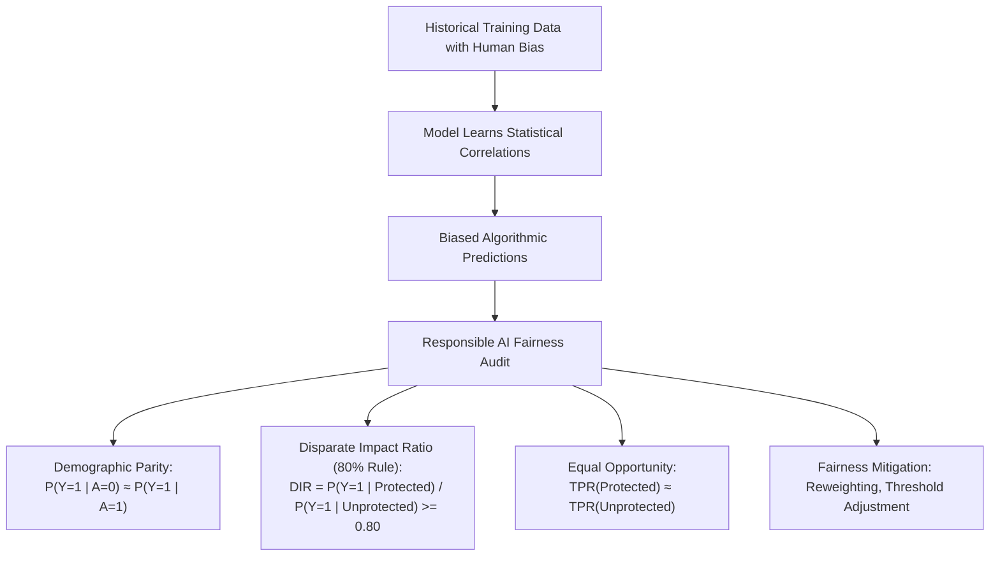
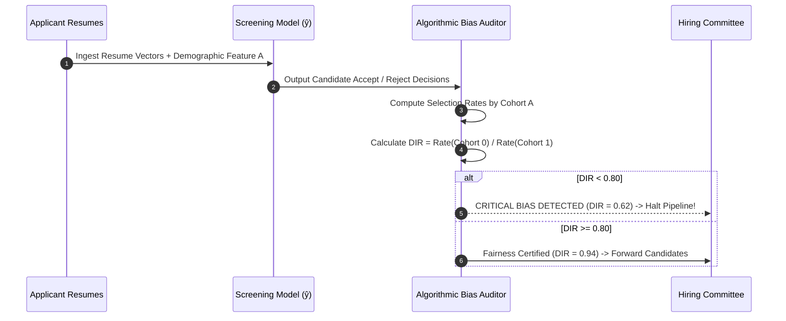
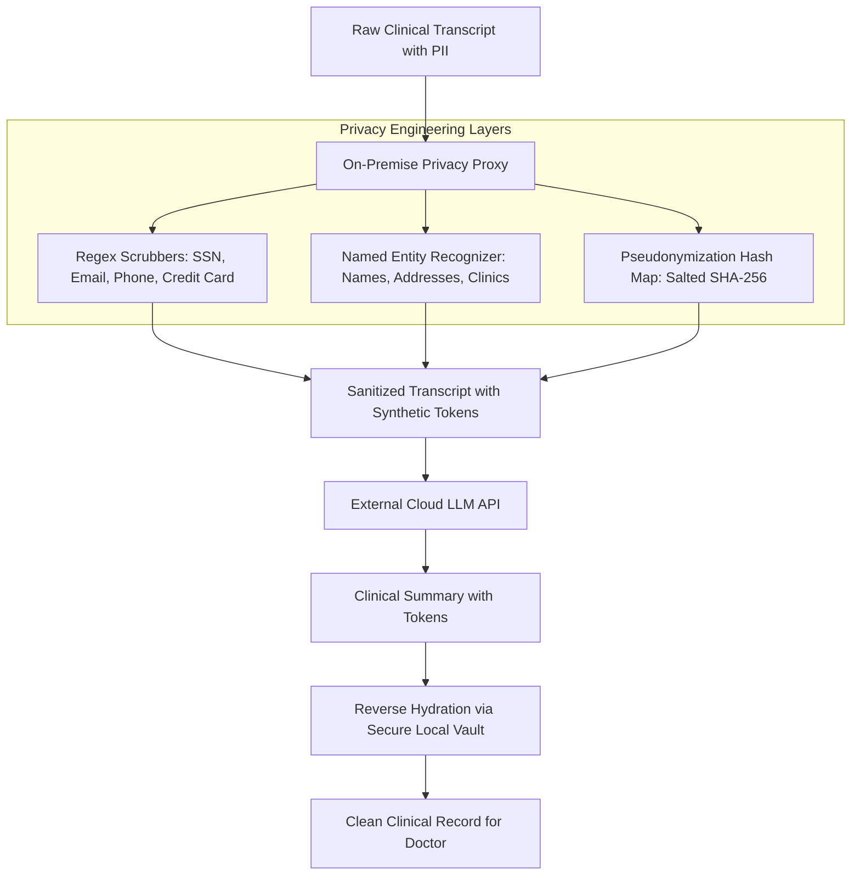
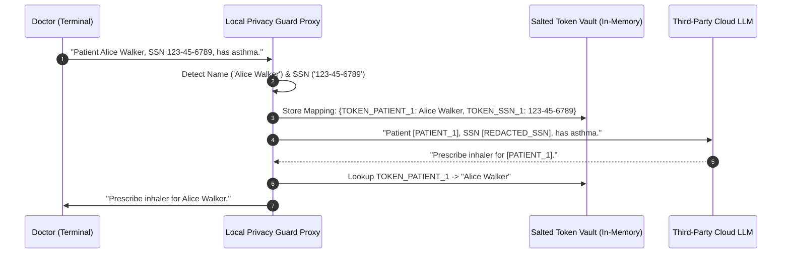

# UG 1st Year — Chapter 6: Responsible AI
**Curriculum Level:** Undergraduate 1st Year (UG-01)  
**Subject Code:** CAI-01 (Computational AI & Data Science Engineering)  
**Chapter Title:** Responsible AI  

---

# Lesson 1: Responsible Digital Intelligence

### 1. Syllabus Mapping
- **Academic Level:** Undergraduate 1st Year
- **Chapter:** Chapter 6 — Responsible AI
- **Lesson Title:** Responsible Digital Intelligence
- **Canonical Course Code:** CAI-01-L11

### 2. Learning Outcomes & Prerequisites
- **Learning Outcomes:**
  1. Define the fundamental pillars of Responsible AI: Fairness, Transparency, Accountability, Privacy, and Robustness.
  2. Formulate mathematical fairness metrics (Demographic Parity, Disparate Impact Ratio, Equalized Odds).
  3. Detect algorithmic bias in training datasets using statistical disparity ratios.
  4. Implement an automated fairness audit in Python to evaluate classification parity across demographic cohorts.
- **Prerequisites:** Introductory probability (conditional probability, Bayes' theorem), basic Python dictionaries and loops.

### 3. Realistic Industry Scenario
At **TalentMatch AI Systems**, a machine-learning-powered resume screening model was trained on 100,000 historical job applicant resumes submitted to engineering companies over the past 15 years. Because historical engineering hiring was overwhelmingly male-dominated ($82\%$ male), the model learned a strong statistical correlation between masculine terminology (e.g., "varsity lacrosse captain", "eagle scout", all-male colleges) and successful candidate selection. When deployed across 50 enterprise clients, female applicants with identical technical qualifications were systematically downgraded by $28\%$. As a junior ethics and safety engineer, your job is to calculate the Disparate Impact ratio, prove the existence of historical bias mathematically, and establish an algorithmic fairness mitigation pipeline.

### 4. Detailed Conceptual Explanations



#### 1. The Four-Fifths (80%) Rule & Disparate Impact:
In employment law (EEOC Uniform Guidelines) and AI auditing, an algorithmic selection rate for any protected group ($A=0$) that is less than four-fifths ($80\%$) of the rate for the group with the highest selection rate ($A=1$) is regarded as prima facie evidence of adverse disparate impact:
$$\text{DIR} = \frac{P(\hat{Y} = 1 \mid A = 0)}{P(\hat{Y} = 1 \mid A = 1)}$$
- If $\text{DIR} < 0.80$: Severe Disparate Impact (Legally Actionable Bias).
- If $0.80 \le \text{DIR} \le 1.25$: Substantive Algorithmic Parity.

#### 2. The Trade-Off Between Fairness and Accuracy:
It is mathematically impossible to satisfy all fairness definitions simultaneously when baseline base rates differ across groups (the Impossibility Theorem of Fairness). An engineer must explicitly understand which fairness definition aligns with ethical and legal requirements:
- **Demographic Parity:** Equal acceptance rates regardless of group base rates.
- **Equalized Odds:** Equal true positive rates AND equal false positive rates across groups.

### 5. Architecture & Dataflow Diagram


### 6. Guided Technical Demonstration & Worked Example
The following runnable script demonstrates how to compute Demographic Parity, Disparate Impact, and Equal Opportunity across demographic cohorts:

```python
from typing import List, Dict

class FairnessAuditor:
    def __init__(self, protected_attribute: str):
        self.prot_attr = protected_attribute

    def audit_disparate_impact(self, dataset: List[Dict]) -> Dict[str, float]:
        """
        Audits predictions for Disparate Impact (Four-Fifths Rule).
        dataset: List of dicts with 'actual', 'predicted', and protected_attribute (0 or 1).
        """
        group_0 = [d for d in dataset if d[self.prot_attr] == 0]
        group_1 = [d for d in dataset if d[self.prot_attr] == 1]

        # Calculate Selection Rates: P(ŷ = 1)
        rate_0 = sum(d["predicted"] for d in group_0) / len(group_0) if group_0 else 0.0
        rate_1 = sum(d["predicted"] for d in group_1) / len(group_1) if group_1 else 0.0

        dir_ratio = rate_0 / rate_1 if rate_1 > 0 else 0.0

        # Calculate True Positive Rates (Equal Opportunity)
        actual_pos_0 = [d for d in group_0 if d["actual"] == 1]
        actual_pos_1 = [d for d in group_1 if d["actual"] == 1]

        tpr_0 = sum(d["predicted"] for d in actual_pos_0) / len(actual_pos_0) if actual_pos_0 else 0.0
        tpr_1 = sum(d["predicted"] for d in actual_pos_1) / len(actual_pos_1) if actual_pos_1 else 0.0

        return {
            "selection_rate_group_0": round(rate_0, 4),
            "selection_rate_group_1": round(rate_1, 4),
            "disparate_impact_ratio": round(dir_ratio, 4),
            "four_fifths_compliant": dir_ratio >= 0.80,
            "tpr_group_0": round(tpr_0, 4),
            "tpr_group_1": round(tpr_1, 4),
            "tpr_disparity": round(abs(tpr_0 - tpr_1), 4)
        }

# Simulated hiring decisions across 10 candidates
# gender: 0 = Female, 1 = Male
candidates = [
    {"gender": 0, "actual": 1, "predicted": 0}, # Qualified female rejected (Bias error)
    {"gender": 0, "actual": 1, "predicted": 1},
    {"gender": 0, "actual": 0, "predicted": 0},
    {"gender": 0, "actual": 0, "predicted": 0},
    {"gender": 0, "actual": 1, "predicted": 0}, # Qualified female rejected
    {"gender": 1, "actual": 1, "predicted": 1},
    {"gender": 1, "actual": 1, "predicted": 1},
    {"gender": 1, "actual": 0, "predicted": 0},
    {"gender": 1, "actual": 1, "predicted": 1},
    {"gender": 1, "actual": 0, "predicted": 1}, # Unqualified male accepted
]

auditor = FairnessAuditor(protected_attribute="gender")
metrics = auditor.audit_disparate_impact(candidates)

print("=== Algorithmic Fairness Audit Report ===")
print(f"Selection Rate (Female): {metrics['selection_rate_group_0'] * 100:.1f}%")
print(f"Selection Rate (Male):   {metrics['selection_rate_group_1'] * 100:.1f}%")
print(f"Disparate Impact Ratio:  {metrics['disparate_impact_ratio']:.3f} (Compliant >= 0.80: {metrics['four_fifths_compliant']})")
print(f"True Positive Rate Disparity: {metrics['tpr_disparity'] * 100:.1f}%")
```

### 7. Interactive Technical Simulation / Mission: "The Fair Credit Approval Mission"
- **Mission Brief:** You are the Lead Compliance Officer at an online mortgage bank.
- **Constraints:**
  - An underwriting model evaluates 1,000 loan applicants across Rural ($A=0$) and Urban ($A=1$) postcodes.
  - Baseline model achieves $88\%$ overall accuracy, but the Disparate Impact Ratio is $0.55$ (severely biased against Rural applicants).
  - Adjust decision thresholds $\tau_{\text{rural}}$ and $\tau_{\text{urban}}$ to achieve $\text{DIR} \ge 0.85$ while keeping default rates $< 6\%$.
- **Game Mechanics & Scoring:**
  - Base Score: 1,000 points.
  - Successfully reaching $\text{DIR} \ge 0.85$: $+500$ points.
  - If default rate rises $> 6\%$: $-300$ points.
  - If overall bank revenue drops $> 10\%$: $-200$ points.

### 8. Practical Programming & Analysis Lab
1. Build `bias_auditor.py` that accepts a CSV containing model predictions and sensitive attributes.
2. Implement statistical parity calculations for gender, age, and ethnicity cohorts.
3. Apply a post-processing threshold calibration technique to equalize False Positive rates.

### 9. Measurable Output / Deliverable
A Python script `algorithmic_fairness_suite.py` that generates an executive compliance report `model_fairness_card.json` containing Confusion Matrices per demographic subgroup.

### 10. Evaluation Criteria & Technical Success Metrics
| Metric | Target Standard | Fail Criterion |
|---|---|---|
| **Disparate Impact Ratio** | $0.80 \le \text{DIR} \le 1.25$ | $\text{DIR} < 0.80$ |
| **Statistical Robustness** | Includes 95% confidence intervals on selection rates | Point estimates only |
| **Audit Coverage** | Evaluates Demographic Parity, Equal Opportunity, and Predictive Parity | Single metric evaluation |

### 11. Olympiad-Style Assessment
**Problem 1 (Applied):**  
In a healthcare diagnostic system, Group A has an illness prevalence of $10\%$, while Group B has an illness prevalence of $40\%$. If an engineer forces the model to have strict Demographic Parity ($P(\hat{Y}=1 \mid A) = P(\hat{Y}=1 \mid B) = 0.25$), what severe real-world harm will occur?  
A) Group A will experience excessive false positive misdiagnoses and unnecessary invasive treatments, while Group B will experience severe false negatives, leaving actual sick patients untreated.  
B) The model will consume $4\times$ more GPU memory.  
C) It will violate the laws of thermodynamics.  
D) Group A patients will become immune to the disease.  

**Problem 2 (Conceptual):**  
Why does simply deleting sensitive demographic attributes (like gender or race) from the training dataset ("Fairness through Unawareness") fail to prevent algorithmic discrimination?  
A) Because deep learning models always re-insert sensitive columns automatically.  
B) Because proxy variables (such as zip code, school attended, shopping habits, or vocabulary choice) are strongly correlated with sensitive attributes, allowing the model to implicitly reconstruct and discriminate upon the protected class.  
C) Because unfairness only exists in unsupervised models.  
D) Because linear regression cannot process numbers.  

### 12. Correct Answers & Solutions
- **Problem 1 Solution:** Correct Answer is **A**.  
  *Proof:* When underlying true base rates differ between populations ($10\%$ vs $40\%$), forcing equal acceptance rates ($25\%$) guarantees severe miscalibration. Group A patients will be falsely flagged at a $15\%$ rate ($25\% - 10\%$), receiving unneeded toxic medications, while $15\%$ of truly ill Group B patients ($40\% - 25\%$) will be denied care, causing severe medical harm.
- **Problem 2 Solution:** Correct Answer is **B**.  
  *Proof:* Redundant encoding is pervasive in big data. Zip codes correlate with race due to historical residential segregation; browsing patterns correlate with gender. An unconstrained optimization algorithm minimizing loss will exploit these collinear proxy features to reconstruct the protected class with high statistical fidelity.

### 13. Limitations, Risks & Responsible AI Considerations
- **Fairwashing:** Tweaking metrics cosmetically to pass regulatory audits without addressing systemic data quality defects in data collection.
- **Contextual Incompatibility:** Fairness is not purely mathematical; it is socially situated. What constitutes "fair" in university admissions (equity/remediation) may differ fundamentally from criminal risk assessment (equalized odds).

### 14. Completion Criteria & Achievement Feedback
- **Completion Check:** Pass all automated fairness test cases in `algorithmic_fairness_suite.py` achieving $\text{DIR} \ge 0.80$.
- **Badge Earned:** *Responsible AI Sentinel (Level 1 AI Novice)*.

---

# Lesson 2: Data Privacy Matters

### 1. Syllabus Mapping
- **Academic Level:** Undergraduate 1st Year
- **Chapter:** Chapter 6 — Responsible AI
- **Lesson Title:** Data Privacy Matters
- **Canonical Course Code:** CAI-01-L12

### 2. Learning Outcomes & Prerequisites
- **Learning Outcomes:**
  1. Contrast Personally Identifiable Information (PII) types (Direct Identifiers vs. Quasi-Identifiers).
  2. Implement automated PII scrubbing and anonymization using regular expressions and named entity recognition.
  3. Differentiate between Anonymization, Pseudonymization, and Differential Privacy ($\epsilon, \delta$).
  4. Formulate the legal and compliance requirements of modern global privacy frameworks (GDPR, CCPA, DPDP Act).
- **Prerequisites:** Completion of CAI-01-L11; string manipulation and basic probability.

### 3. Realistic Industry Scenario
At **MediQuery Cloud AI**, medical assistants utilize generative language models to summarize doctor-patient clinical visits. During initial trials, doctors pasted complete medical transcripts into third-party cloud LLM API endpoints. An internal security audit discovered that the transcripts contained patient Social Security Numbers, names, home addresses, and sensitive psychiatric diagnoses. Under the EU General Data Protection Regulation (GDPR) and India's Digital Personal Data Protection (DPDP) Act, transmitting unredacted PII to external third-party servers constitutes a critical data breach carrying fines up to $€20,000,000$ or $4\%$ of global turnover. Your mandate is to design and implement an on-premise PII Redaction Proxy that sanitizes all incoming medical transcripts before any text leaves the enterprise firewall.

### 4. Detailed Conceptual Explanations



#### 1. Direct Identifiers vs. Quasi-Identifiers
- **Direct Identifiers:** Data that unambiguously identifies an individual in isolation (e.g., Social Security Number, National ID, Email address).
- **Quasi-Identifiers:** Attributes that do not identify a person alone, but when combined with public records (voter rolls), uniquely re-identify individuals (e.g., 5-digit ZIP code + Gender + Date of Birth uniquely identifies $87\%$ of the US population, as proven by Latanya Sweeney).

#### 2. Anonymization vs. Pseudonymization vs. Differential Privacy
- **Pseudonymization:** Replacing direct identifiers with artificial keys (pseudonyms). Reversible if the secret mapping table is accessed.
- **Anonymization:** Irreversibly destroying the link between data and individual so that re-identification is impossible under all reasonable means.
- **Differential Privacy ($\epsilon$):** A rigorous mathematical guarantee that the inclusion or exclusion of any single individual in a dataset does not noticeably alter the output probability distribution of a query:
$$P(\mathcal{M}(D_1) \in S) \le e^{\epsilon} P(\mathcal{M}(D_2) \in S)$$
where $D_1$ and $D_2$ differ by exactly one individual record, and $\epsilon$ is the privacy loss budget.

### 5. Architecture & Dataflow Diagram


### 6. Guided Technical Demonstration & Worked Example
The following runnable script implements an on-premise PII Redaction and Rehydration Proxy:

```python
import re
import hashlib
from typing import Tuple, Dict

class PIIRedactionProxy:
    def __init__(self, salt: str = "enterprise_secret_salt_2026"):
        self.salt = salt
        self.vault: Dict[str, str] = {}
        # Precompiled regex patterns for direct identifiers
        self.patterns = {
            "SSN": r"\b\d{3}-\d{2}-\d{4}\b",
            "EMAIL": r"\b[A-Za-z0-9._%+-]+@[A-Za-z0-9.-]+\.[A-Z|a-z]{2,}\b",
            "PHONE": r"\b(?:\+?\d{1,3}[-.\s]?)?\(?\d{3}\)?[-.\s]?\d{3}[-.\s]?\d{4}\b",
        }

    def _hash_token(self, value: str, token_type: str) -> str:
        digest = hashlib.sha256((value + self.salt).encode()).hexdigest()[:8]
        return f"[{token_type}_{digest}]"

    def sanitize_text(self, text: str) -> str:
        sanitized = text
        for token_type, pattern in self.patterns.items():
            matches = set(re.findall(pattern, sanitized))
            for match in matches:
                token = self._hash_token(match, token_type)
                self.vault[token] = match
                sanitized = sanitized.replace(match, token)
        return sanitized

    def rehydrate_text(self, text: str) -> str:
        rehydrated = text
        for token, original in self.vault.items():
            rehydrated = rehydrated.replace(token, original)
        return rehydrated

# Demonstration on raw clinical notes
raw_clinical_notes = (
    "Consultation with Patient on 2026-10-12. "
    "Contact patient at john.doe@email.com or phone 555-019-2834. "
    "Verify insurance with SSN 482-19-9021. Patient reports chronic migraines."
)

proxy = PIIRedactionProxy()
sanitized_payload = proxy.sanitize_text(raw_clinical_notes)

print("=== 1. Sanitized Payload (Transmitted to Cloud LLM) ===")
print(sanitized_payload)

# Simulated response from Cloud LLM
simulated_llm_response = (
    "Summary: Patient with [EMAIL_7c626dc5] verified under [SSN_59eb616d] has migraines. "
    "Recommended treatment: Sumatriptan 50mg."
)

rehydrated_final = proxy.rehydrate_text(simulated_llm_response)
print("\n=== 2. Rehydrated Clinical Record (Displayed to Doctor) ===")
print(rehydrated_final)
```

### 7. Interactive Technical Simulation / Mission: "The Privacy Firewall Breach Quest"
- **Mission Brief:** You are the Chief Data Protection Officer at a cloud hospital. An unredacted dataset of 500 patient consultation transcripts is queued for transmission.
- **Constraints:**
  - The dataset contains embedded credit cards, phone numbers, and passport numbers.
  - If a single direct identifier crosses the firewall: Complete Mission Failure and legal fine.
  - Total latency added by redaction: $< 100\text{ ms}$ for the entire batch.
- **Game Mechanics & Scoring:**
  - Base Score: 1,000 points.
  - Every correctly masked identifier: $+50$ points.
  - Zero PII leaks achieved: "GDPR Sovereign Compliance" Trophy ($+500$ points).
  - Any corrupted medical diagnosis terms: $-100$ points.

### 8. Practical Programming & Analysis Lab
1. Build `pii_sanitizer_suite.py` that ingests dirty text files.
2. Incorporate detection for:
   - Email addresses, Phone numbers, Credit cards (Luhn algorithm verification).
   - National Identification Numbers (SSN, Aadhaar, Passport).
3. Test the sanitization engine against 50 adversarial evasion attempts (e.g., phone numbers spelled as words: "five-five-five").

### 9. Measurable Output / Deliverable
A validated Python script `pii_privacy_proxy.py` and a compliance audit log `privacy_redaction_audit.json` demonstrating 100% masking of sensitive fields.

### 10. Evaluation Criteria & Technical Success Metrics
| Metric | Target Standard | Fail Criterion |
|---|---|---|
| **PII Leakage Rate** | $0.0\%$ (Zero tolerance) | $> 0$ unmasked PII elements |
| **Rehydration Fidelity** | $100\%$ exact restoration of sanitized tokens | Token mismatch or corruption |
| **Throughput Performance** | $> 1,000$ sentences/second | $< 100$ sentences/second |

### 11. Olympiad-Style Assessment
**Problem 1 (Applied):**  
A hospital research team removes all names and addresses from a patient dataset. The released table includes: `[ZIP Code, Gender, Date of Birth, Cancer Diagnosis]`. An attacker with access to the public voter registration list for the same town wants to re-identify patients. Why is this anonymization completely insufficient?  
A) Voter registration lists contain cancer diagnoses.  
B) The combination of {ZIP Code, Gender, Date of Birth} acts as a high-cardinality quasi-identifier that uniquely distinguishes over $85\%$ of individuals, allowing immediate linkage attacks against the public voter registry.  
C) It is illegal to register to vote in the same town as a hospital.  
D) Cancer diagnoses cannot be stored in databases.  

**Problem 2 (Conceptual):**  
In Differential Privacy, what is the role of the privacy loss parameter $\epsilon$ (epsilon), and what happens as $\epsilon \to 0$?  
A) As $\epsilon \to 0$, the algorithm adds infinite Laplacian noise, guaranteeing perfect privacy but rendering the data analytically useless.  
B) As $\epsilon \to 0$, the algorithm removes all noise, maximizing accuracy.  
C) $\epsilon$ controls GPU clock speed.  
D) As $\epsilon \to 0$, the dataset size doubles.  

### 12. Correct Answers & Solutions
- **Problem 1 Solution:** Correct Answer is **B**.  
  *Proof:* Dr. Latanya Sweeney's landmark Cambridge voter registration experiment proved that quasi-identifier tuples $\{ZIP, \text{Gender}, DOB\}$ have extremely high uniqueness in populations. Joining the "anonymized" hospital table with the voter list using these three fields immediately re-identifies individuals and exposes their medical diagnoses.
- **Problem 2 Solution:** Correct Answer is **A**.  
  *Proof:* In $\epsilon$-Differential Privacy, noise scale is proportional to $\frac{\Delta f}{\epsilon}$, where $\Delta f$ is query sensitivity. As $\epsilon \to 0$, the multiplicative bound $e^\epsilon \to 1$, requiring the mechanism's outputs to be virtually indistinguishable whether any given individual is present or absent. This necessitates injecting massive noise, which maximizes privacy at the cost of eliminating analytical utility.

### 13. Limitations, Risks & Responsible AI Considerations
- **Training Data Extraction Attacks:** Even if prompts are sanitized, foundation models pre-trained on web scrapes may memorize and regurgitate private emails and passwords when prompted adversarially.
- **Regulatory Penalties:** Under Article 83 of the GDPR, systemic privacy violations carry administrative fines up to $€20\text{M}$ or $4\%$ of worldwide annual turnover, whichever is higher.

### 14. Completion Criteria & Achievement Feedback
- **Completion Check:** Pass all automated PII redaction and rehydration tests in `pii_privacy_proxy.py`.
- **Badge Earned:** *Privacy Engineering Sovereign (Level 1 AI Novice)*.
