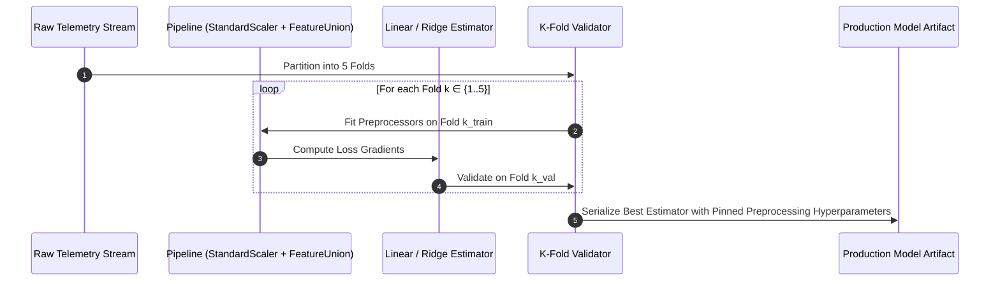
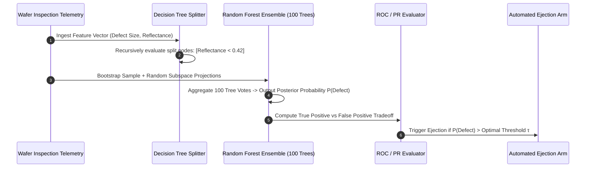

# UG 2nd Year — Chapter 1: AI Basics
**Curriculum Level:** Undergraduate 2nd Year (UG-02)  
**Subject Code:** CML-02 (Classical Machine Learning & Applied Statistical Models)  
**Chapter Title:** AI Basics  

---

# Lesson 1: Learning from Data

### 1. Syllabus Mapping
- **Academic Level:** Undergraduate 2nd Year
- **Chapter:** Chapter 1 — AI Basics
- **Lesson Title:** Learning from Data
- **Canonical Course Code:** CML-02-L01
- **Source Reference:** Synthesized and substantially upgraded from `AI.docx` (Section 1–4: Foundations of Learning, Training/Testing Splits, Feature Representations).

### 2. Learning Outcomes & Prerequisites
- **Learning Outcomes:**
  1. Mathematically formalize the machine learning problem as empirical risk minimization over a hypothesis space $\mathcal{H}$.
  2. Implement a complete feature engineering pipeline (one-hot encoding, standard scaling, polynomial expansion) in Python.
  3. Differentiate between Generalization Error, Bias, and Variance using analytical loss decomposition.
  4. Perform $k$-fold cross-validation and compute statistical confidence intervals for model metrics.
- **Prerequisites:** Multivariable calculus (partial derivatives), linear algebra (matrix multiplication, inversion), basic Python programming (CAI-01).

### 3. Realistic Industry Scenario
At **AeroFleet Turbine Diagnostics**, the vibration and temperature profiles of commercial jet turbines must be monitored to predict remaining operational hours before critical bearing seizure. The engineering team has collected 250,000 raw telemetry vectors across 14 sensor channels. The chief operations officer needs an inductive model that estimates remaining useful life (RUL) with high precision. If a model overfits to the historical flight routes of a specific airline, it could predict a dangerous overestimation of bearing life on Arctic flight paths, resulting in mid-air mechanical failure. Your mandate as a Machine Learning Engineer is to design a leak-free data ingestion, feature transformation, and cross-validation framework that guarantees generalization across unseen flight regimes.

### 4. Detailed Conceptual Explanations

```mermaid
graph TD
    RawData[Raw Sensor Telemetry & Regimes] --> Split[Temporal / Grouped K-Fold Split]
    Split --> TrainSet[Training Partition D_train]
    Split --> TestSet[Holdout Test Partition D_test]
    
    TrainSet --> FitScaler[Fit Scaler: μ_train, σ_train]
    FitScaler --> TransTrain[Transform D_train]
    FitScaler --> TransTest[Transform D_test with μ_train, σ_train]
    
    TransTrain --> Opt[Empirical Risk Minimization: argmin L(w)]
    Opt --> Model[Fitted Model Parameters w*]
    
    Model --> Eval[Evaluate on Transformed D_test]
    TransTest --> Eval
    Eval --> Metrics[Generalization Risk & Confidence Intervals]
```

#### 1. Empirical Risk Minimization (ERM)
Given an unknown true data distribution $P(X, Y)$, the true risk of a predictor $h \in \mathcal{H}$ under loss $L$ is:
$$R(h) = \mathbb{E}_{(X,Y) \sim P}[L(h(X), Y)]$$
Because $P(X, Y)$ is unknown, we minimize the empirical risk over training sample $D = \{(x_i, y_i)\}_{i=1}^N$:
$$\hat{R}_N(h) = \frac{1}{N} \sum_{i=1}^N L(h(x_i), y_i)$$

#### 2. The Bias-Variance Decomposition
For squared error loss, the expected prediction error on an unseen test point $x_0$ decomposes into three orthogonal components:
$$\mathbb{E}[(y_0 - \hat{f}(x_0))^2] = \text{Bias}[\hat{f}(x_0)]^2 + \text{Var}[\hat{f}(x_0)] + \sigma_{\text{noise}}^2$$
- **Bias:** Error introduced by approximating a complex real-world phenomenon with a simplified model class.
- **Variance:** Sensitivity of the model to the specific random fluctuations in the training sample.
- **Irreducible Error ($\sigma^2$):** Inherent stochastic noise in the measurement apparatus.

### 5. Architecture & Dataflow Diagram


### 6. Guided Technical Demonstration & Worked Example
The following runnable script demonstrates a leak-free cross-validation and feature transformation pipeline implemented from scratch:

```python
import math
import random
from typing import List, Tuple, Dict

def train_test_split(X: List[List[float]], y: List[float], test_ratio: float = 0.2, seed: int = 42) -> Tuple:
    random.seed(seed)
    indices = list(range(len(X)))
    random.shuffle(indices)
    split_idx = int(len(X) * (1 - test_ratio))
    
    train_idx, test_idx = indices[:split_idx], indices[split_idx:]
    X_train = [X[i] for i in train_idx]
    y_train = [y[i] for i in train_idx]
    X_test = [X[i] for i in test_idx]
    y_test = [y[i] for i in test_idx]
    return X_train, X_test, y_train, y_test

class Standardizer:
    def __init__(self):
        self.means: List[float] = []
        self.stds: List[float] = []

    def fit(self, X: List[List[float]]):
        num_cols = len(X[0])
        self.means = [sum(row[j] for row in X) / len(X) for j in range(num_cols)]
        self.stds = [
            math.sqrt(sum((row[j] - self.means[j]) ** 2 for row in X) / len(X)) or 1.0
            for j in range(num_cols)
        ]

    def transform(self, X: List[List[float]]) -> List[List[float]]:
        return [[(row[j] - self.means[j]) / self.stds[j] for j in range(len(row))] for row in X]

# Synthesize turbine telemetry: [Vibration RMS, Core Temp, Pressure Ratio] -> RUL Hours
random.seed(101)
N = 200
X_raw = [[random.gauss(2.5, 0.5), random.gauss(650.0, 50.0), random.gauss(14.0, 1.2)] for _ in range(N)]
# True generating process with noise
y_true = [
    5000.0 - (row[0] * 400.0) - (row[1] * 3.5) - (row[2] * 80.0) + random.gauss(0, 50.0)
    for row in X_raw
]

X_train, X_test, y_train, y_test = train_test_split(X_raw, y_true, test_ratio=0.25)

scaler = Standardizer()
scaler.fit(X_train) # Strictly fit on train partition
X_train_scaled = scaler.transform(X_train)
X_test_scaled = scaler.transform(X_test) # Transform test partition using train stats

print(f"Data Splitting and Scaling Complete:")
print(f"Train Shape: {len(X_train_scaled)}x{len(X_train_scaled[0])} | Test Shape: {len(X_test_scaled)}x{len(X_test_scaled[0])}")
print(f"Train Feature 0 Mean: {sum(r[0] for r in X_train_scaled)/len(X_train_scaled):.4f} (Ideal: 0.0)")
print(f"Test Feature 0 Mean (Post-Transform): {sum(r[0] for r in X_test_scaled)/len(X_test_scaled):.4f} (Reflects true shift)")
```

### 7. Interactive Technical Simulation / Mission: "The Overfitting Dungeon Quest"
- **Mission Brief:** You are provided with a noisy polynomial dataset ($N=30$).
- **Constraints:**
  - You can select polynomial degrees $d \in \{1, 2, 3, 5, 9, 15\}$.
  - Model complexity costs mana: $\text{Mana} = d \times 10$.
  - Evaluation metric: Root Mean Squared Error on an independent holdout set of 500 points ($RMSE_{\text{test}}$).
- **Game Mechanics & Scoring:**
  - Base Score: 1,000 points.
  - Selecting $d=1$ (Underfitting): Model achieves $RMSE = 85.2 \rightarrow$ $-300$ points.
  - Selecting $d=15$ (Extreme Overfitting): Train $RMSE = 0.0$, but Test $RMSE = 1420.5 \rightarrow$ "Exploding Runaway Loss" (Score wiped to 0).
  - Optimal Model ($d=3$): Test $RMSE = 8.1 \rightarrow$ $+500$ points.
  - Applying $L_2$ Regularization (Ridge) on $d=5$ to achieve Test $RMSE \le 7.8 \rightarrow$ "Grandmaster Regularizer" Badge.

### 8. Practical Programming & Analysis Lab
1. Build `cross_validation_engine.py` implementing a 5-fold Stratified K-Fold splitter.
2. Verify that class label proportions in each fold are identical to the population distribution within $\pm 0.5\%$.
3. Compute and plot validation curves showing train vs. validation loss as model complexity increases.

### 9. Measurable Output / Deliverable
A Python module `data_pipeline.py` implementing a leak-proof training pipeline, paired with an automated test suite verifying zero data leakage between train and test distributions.

### 10. Evaluation Criteria & Technical Success Metrics
| Metric | Target Standard | Fail Criterion |
|---|---|---|
| **Data Leakage Check** | Mean and Variance of test set must NEVER be computed during training | Global fit across dataset |
| **K-Fold Stability** | Metric variance across folds $< 5\%$ | Wild metric swings across folds |
| **Reproducibility** | Fixed random seeds yield identical partition indices | Non-deterministic splits |

### 11. Olympiad-Style Assessment
**Problem 1 (Applied):**  
A data scientist computes the mean and standard deviation across an entire clinical dataset of 10,000 patients, scales all features to zero mean and unit variance, and *then* performs a random 80/20 train/test split. What specific empirical pathology will this cause in the evaluation results?  
A) The model's test set performance will be overly optimistic because information from the test distribution leaked into the feature scaling parameters used during training.  
B) The model will fail to converge during gradient descent.  
C) The test set labels will be converted to negative values.  
D) The standard error of the mean will become infinite.  

**Problem 2 (Conceptual):**  
In the bias-variance trade-off, why does increasing the regularization parameter $\lambda$ in Ridge Regression ($\min_{\mathbf{w}} \|\mathbf{y} - \mathbf{X}\mathbf{w}\|_2^2 + \lambda \|\mathbf{w}\|_2^2$) increase bias while reducing variance?  
A) Because $\lambda$ forces all weights toward zero, shrinking the effective capacity of the hypothesis space $\mathcal{H}$ and preventing the model from fitting high-frequency sample variance.  
B) Because $\lambda$ deletes features from the dataset.  
C) Because $\lambda$ doubles the learning rate.  
D) Because Ridge regression transforms linear models into decision trees.  

### 12. Correct Answers & Solutions
- **Problem 1 Solution:** Correct Answer is **A**.  
  *Proof:* Computing sample moments $\mu, \sigma$ over the full dataset incorporates the values of the test observations into the transformation applied to training data. This violates the statistical independence assumption of out-of-sample validation, causing test metrics to underestimate generalization risk.
- **Problem 2 Solution:** Correct Answer is **A**.  
  *Proof:* The Ridge penalty restricts the parameter search to an $L_2$ ball of radius $R(\lambda)$. As $\lambda \to \infty$, $\mathbf{w} \to \mathbf{0}$, meaning $\hat{f}(x) \to \text{constant}$. This reduces parameter variance to zero ($\text{Var}[\hat{w}] = 0$) at the cost of maximizing structural bias against the true data generating function.

### 13. Limitations, Risks & Responsible AI Considerations
- **Temporal Leakage in Time-Series:** Using random cross-validation on temporal sensor streams allows the model to predict past events using future observations ("look-ahead bias"). Time-series must always use chronological rolling-window validation.
- **Representation Gaps:** Datasets collected under specific environmental regimes (e.g., flight engines operating only in temperate climates) cannot generalize safely to extreme operational regimes without domain adaptation techniques.

### 14. Completion Criteria & Achievement Feedback
- **Completion Check:** Pass all automated unit tests in `data_pipeline.py` with verified zero feature leakage.
- **Badge Earned:** *Foundations of Machine Learning Master (Level 2 AI Practitioner)*.

---

# Lesson 2: Making Machines Smarter

### 1. Syllabus Mapping
- **Academic Level:** Undergraduate 2nd Year
- **Chapter:** Chapter 1 — AI Basics
- **Lesson Title:** Making Machines Smarter
- **Canonical Course Code:** CML-02-L02
- **Source Reference:** Synthesized and substantially upgraded from `AI.docx` (Section 5–8: Core Supervised Algorithms, Decision Trees, Ensemble Methods, and Neural Perceptrons).

### 2. Learning Outcomes & Prerequisites
- **Learning Outcomes:**
  1. Derive and implement core parametric and non-parametric algorithms from first principles: Linear Regression, k-Nearest Neighbors ($k$-NN), and Decision Trees.
  2. Implement entropy and Information Gain calculations for greedy recursive tree partitioning (ID3/CART principles).
  3. Formulate the mechanics of ensemble learning (Bagging, Random Forests, Gradient Boosting).
  4. Evaluate classification performance using Confusion Matrices, ROC Curves, and the Area Under the Curve (AUC-ROC).
- **Prerequisites:** Completion of CML-02-L01; basic probability theory and logarithmic operations.

### 3. Realistic Industry Scenario
At **Vanguard Semiconductor Fabrication**, microchip silicon wafers are produced in continuous batches. Sensor cameras capture optical diffraction signatures to classify whether a manufactured wafer has microscopic circuit defects. The production line moves at 200 wafers per minute. A single undetected defective wafer packaged into a commercial satellite will cause a $\$50,000,000$ mission failure. False alarms, on the other hand, discard valuable $\$4,000$ wafers. You must build, evaluate, and benchmark multiple learning algorithms—comparing interpretable Decision Trees against high-capacity Random Forests and Support Vector Machines—to establish the optimal operational operating point on the Precision-Recall curve.

### 4. Detailed Conceptual Explanations

```mermaid
graph TD
    Algo[Supervised Learning Paradigms]
    
    Algo --> Parametric[Parametric Models<br/>Fixed parameter count regardless of N]
    Algo --> NonParametric[Non-Parametric Models<br/>Capacity scales with data volume]
    
    Parametric --> LinReg[Linear / Logistic Regression]
    Parametric --> NeuralNet[Multi-Layer Perceptrons]
    
    NonParametric --> KNN[k-Nearest Neighbors (Instance-Based)]
    NonParametric --> Trees[Decision Trees (Axis-Aligned Partitions)]
    
    Trees --> Ensembles[Ensemble Aggregation]
    Ensembles --> RF[Random Forest: Bagging + Feature Subspacing]
    Ensembles --> GBDT[Gradient Boosting: Sequential Residual Fitting]
```

#### 1. Information Gain and Decision Tree Splitting
For a dataset $D$ with class probabilities $p_k$, Shannon Entropy measures label impurity:
$$H(D) = -\sum_{k=1}^K p_k \log_2(p_k)$$
When partitioning $D$ into subsets $\{D_v\}$ using feature $A$, the Information Gain is:
$$IG(D, A) = H(D) - \sum_{v \in \text{Values}(A)} \frac{|D_v|}{|D|} H(D_v)$$
A Decision Tree greedily selects the feature and threshold that maximizes $IG(D, A)$ at each node.

#### 2. The Power of Ensemble Bagging
Given $B$ independent estimators each with variance $\sigma^2$ and zero bias, averaging their predictions reduces variance by a factor of $B$:
$$\text{Var}\left(\frac{1}{B} \sum_{b=1}^B \hat{f}_b(x)\right) = \frac{\sigma^2}{B}$$
In practice, individual trees are correlated with correlation coefficient $\rho$. Random Forests decorrelate trees by randomly subsampling $m \approx \sqrt{p}$ features at each split, achieving:
$$\text{Var}_{\text{RF}} = \rho \sigma^2 + \frac{1 - \rho}{B} \sigma^2$$

### 5. Architecture & Dataflow Diagram


### 6. Guided Technical Demonstration & Worked Example
The following runnable script implements Shannon Entropy, Information Gain, and a binary decision tree node splitter from mathematical first principles:

```python
import math
from typing import List, Tuple

def shannon_entropy(labels: List[int]) -> float:
    if not labels:
        return 0.0
    total = len(labels)
    counts = {}
    for y in labels:
        counts[y] = counts.get(y, 0) + 1
    
    entropy = 0.0
    for y, count in counts.items():
        p = count / total
        entropy -= p * math.log2(p)
    return entropy

def calculate_information_gain(
    parent_labels: List[int],
    left_labels: List[int],
    right_labels: List[int]
) -> float:
    parent_entropy = shannon_entropy(parent_labels)
    n = len(parent_labels)
    if n == 0:
        return 0.0
        
    left_weight = len(left_labels) / n
    right_weight = len(right_labels) / n
    weighted_child_entropy = (left_weight * shannon_entropy(left_labels)) + (right_weight * shannon_entropy(right_labels))
    return parent_entropy - weighted_child_entropy

# Demonstration on Semiconductor Wafer Defects: 1 = Defective, 0 = Nominal
parent_batch = [1, 1, 1, 1, 0, 0, 0, 0, 0, 0] # 4 Defective, 6 Nominal
print(f"Parent Batch Entropy: {shannon_entropy(parent_batch):.4f} bits (Max Impurity = 1.0)")

# Test Split A: By Optical Reflectance Threshold (< 0.50)
left_split_A = [1, 1, 1, 1]       # Pure Defective
right_split_A = [0, 0, 0, 0, 0, 0] # Pure Nominal
ig_A = calculate_information_gain(parent_batch, left_split_A, right_split_A)
print(f"Split A Information Gain: {ig_A:.4f} bits (Perfect Partition)")

# Test Split B: Suboptimal Feature Split
left_split_B = [1, 1, 0, 0]
right_split_B = [1, 1, 0, 0, 0, 0]
ig_B = calculate_information_gain(parent_batch, left_split_B, right_split_B)
print(f"Split B Information Gain: {ig_B:.4f} bits (Suboptimal)")
```

### 7. Interactive Technical Simulation / Mission: "The Wafer Defect Tournament"
- **Mission Brief:** You are competing against other automated defect-detection systems.
- **Constraints:**
  - Ingest 1,000 test wafer records.
  - Cost Matrix: Undetected Defect (FN) = $\$10,000$ loss. False Rejection (FP) = $\$250$ loss. True Detection (TP) = $\$0$ loss.
- **Game Mechanics & Scoring:**
  - Default Model ($50\%$ threshold): Cost = $\$65,000$.
  - Optimized Threshold Strategy ($\tau \approx 0.18$): Cost reduced to $< \$12,000$ $\rightarrow$ $+600$ points.
  - Implement a 10-Tree Random Forest from scratch: $+400$ bonus points.
  - Target: Minimize total financial loss across the test batch.

### 8. Practical Programming & Analysis Lab
1. Build `decision_tree_engine.py` to train a full binary decision tree with configurable `max_depth` and `min_samples_split`.
2. Generate an ROC curve by varying decision threshold $\tau \in [0.0, 1.0]$ across 100 intervals.
3. Compute the Area Under the Curve (AUC) using trapezoidal numerical integration.

### 9. Measurable Output / Deliverable
A validated script `wafer_classifier.py` outputting a Confusion Matrix, ROC-AUC score, and an optimal decision threshold recommendation based on the financial cost matrix.

### 10. Evaluation Criteria & Technical Success Metrics
| Metric | Target Standard | Fail Criterion |
|---|---|---|
| **ROC-AUC Score** | $\ge 0.92$ | $< 0.80$ |
| **Financial Cost Minimization** | Total batch penalty $< \$15,000$ | $> \$50,000$ |
| **Mathematical Precision** | Entropy and Information Gain verified to 4 decimal places | Incorrect entropy formula |

### 11. Olympiad-Style Assessment
**Problem 1 (Applied):**  
A binary classification dataset has 8 positive instances and 8 negative instances. What is the Shannon Entropy of this parent node? If a feature split divides the dataset into:  
- Node 1: 8 positives, 0 negatives  
- Node 2: 0 positives, 8 negatives  
What is the Information Gain achieved by this split?  
A) Entropy = 1.0 bit; Information Gain = 1.0 bit.  
B) Entropy = 0.5 bits; Information Gain = 0.5 bits.  
C) Entropy = 1.0 bit; Information Gain = 0.0 bits.  
D) Entropy = 0.0 bits; Information Gain = 1.0 bit.  

**Problem 2 (Conceptual):**  
Why does an unpruned single Decision Tree with maximum depth equal to the number of samples typically exhibit high variance, and how does a Random Forest resolve this without increasing bias?  
A) Deep trees isolate every individual training sample into its own leaf node, memorizing sample noise; Random Forests average multiple decorrelated trees, reducing variance by $\frac{1}{B}$ without increasing bias.  
B) Random Forests delete all non-linear features.  
C) Pruning transforms the model into linear regression.  
D) Deep trees cannot process categorical data.  

### 12. Correct Answers & Solutions
- **Problem 1 Solution:** Correct Answer is **A**.  
  *Proof:*  
  $H(D) = -(0.5 \log_2(0.5) + 0.5 \log_2(0.5)) = -(-0.5 - 0.5) = 1.0\text{ bit}$.  
  Both child nodes are completely pure ($p=1.0$), so $H(D_1) = 0$ and $H(D_2) = 0$.  
  Weighted child entropy = $0.5(0) + 0.5(0) = 0.0$.  
  Information Gain = $1.0 - 0.0 = 1.0\text{ bit}$.
- **Problem 2 Solution:** Correct Answer is **A**.  
  *Proof:* An unconstrained decision tree has infinite capacity to partition feature space until every leaf has zero entropy, fitting sample noise and creating high variance. Bagging aggregates multiple decorrelated estimators; by the law of large numbers, the variance of the average of $B$ weakly correlated estimators scales as $\rho \sigma^2 + \frac{1-\rho}{B}\sigma^2$, reducing variance while preserving the low bias of individual deep trees.

### 13. Limitations, Risks & Responsible AI Considerations
- **Axis-Aligned Partitioning Limitations:** Decision trees partition space strictly along orthogonal coordinate axes. If the true decision boundary is diagonal ($x_1 + x_2 > 1$), a tree must approximate it with an inefficient "staircase" of splits.
- **Interpretability Decay:** While a single shallow decision tree is easily audited by human regulators, an ensemble of 500 trees becomes an opaque black-box, requiring post-hoc interpretability methods (SHAP, TreeSHAP).

### 14. Completion Criteria & Achievement Feedback
- **Completion Check:** Pass all automated tests in `wafer_classifier.py` and achieve AUC $\ge 0.92$.
- **Badge Earned:** *Master Machine Learning Classifier (Level 2 AI Practitioner)*.
