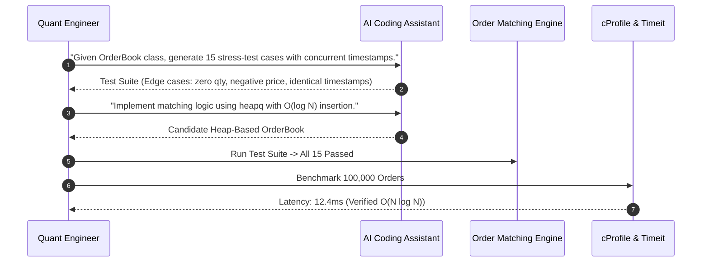
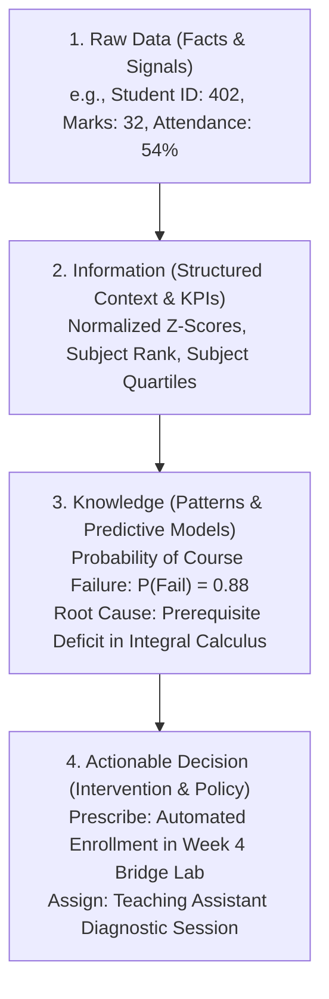
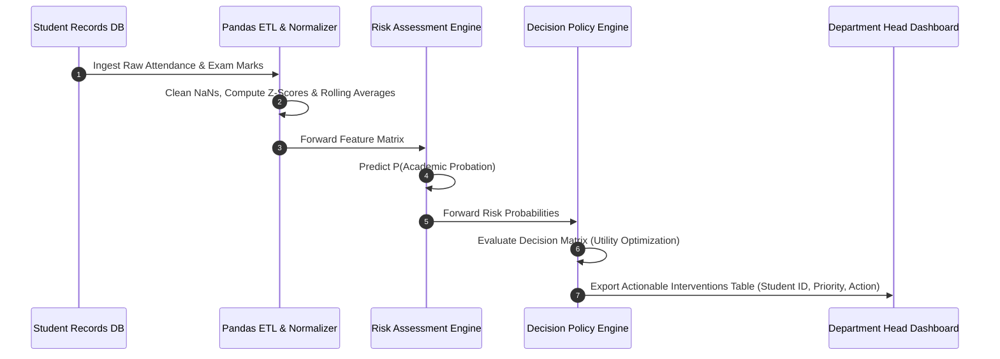

# UG 2nd Year — Chapter 2: Communicate with AI
**Curriculum Level:** Undergraduate 2nd Year (UG-02)  
**Subject Code:** CML-02 (Classical Machine Learning & Applied Statistical Models)  
**Chapter Title:** Communicate with AI  

---

# Lesson 1: Program with AI

### 1. Syllabus Mapping
- **Academic Level:** Undergraduate 2nd Year
- **Chapter:** Chapter 2 — Communicate with AI
- **Lesson Title:** Program with AI
- **Canonical Course Code:** CML-02-L03
- **Source Reference:** Synthesized and substantially upgraded from `AI  2.docx` (Part 1: How people communicate with an AI assistant, how to write clear prompts, and using AI as a programming helper without copy-paste vulnerabilities).

### 2. Learning Outcomes & Prerequisites
- **Learning Outcomes:**
  1. Apply AI coding companions within a strict Test-Driven Development (TDD) cycle: write failing tests first, prompt for implementation, and refactor.
  2. Synthesize complex synthetic testing fixtures and corner-case stress scenarios using generative AI prompts.
  3. Profile and optimize computational bottlenecks in Python code using algorithmic refactoring guided by AI.
  4. Implement automated static linting and security review gates to prevent AI-introduced security flaws.
- **Prerequisites:** Intermediate Python syntax (classes, generators, context managers), basic unit testing (`pytest` or `unittest`).

### 3. Realistic Industry Scenario
At **FinEdge High-Frequency Arbitrage**, quantitative developers manage an algorithmic order matching engine. A junior developer used an AI assistant to auto-complete an order queue matching function. While the function passed basic manual tests, under market volatility with 100,000 incoming orders, the AI-generated function executed in $O(N^2)$ time due to repeated linear scans across an unindexed Python list, freezing the trading engine and incurring $\$1.2\text{M}$ in execution slippage. As the lead systems engineer, your task is to institutionalize a rigorous AI-assisted programming methodology: teaching developers how to use AI to generate comprehensive test suites, benchmark memory and time complexity, and transform unoptimized brute-force logic into logarithmic order structures.

### 4. Detailed Conceptual Explanations

```mermaid
graph TD
    Spec[Developer Requirements & Contract] --> PromptTest[Prompt AI: Generate Exhaustive Edge-Case Tests]
    PromptTest --> FailTest[Failing Test Suite (TDD Foundation)]
    
    FailTest --> PromptCode[Prompt AI: Propose O(N log N) Algorithm]
    PromptCode --> PassTest{Passes All Edge Cases?}
    
    PassTest -->|No| Debug[Iterative Failure Analysis Loop]
    Debug --> PromptCode
    
    PassTest -->|Yes| Profile[Computational Profiling: Time & Memory]
    Profile --> Security[Static AST Security Scan: Bandit / Ruff]
    Security --> Production[Merge to Production Core]
```

#### 1. The TDD-First AI Programming Workflow:
Never prompt an AI model to write the implementation first. In a production engineering environment, the failure surface of the generated code is unknown. Instead, follow the **Triple-Step TDD Protocol**:
1. **Step 1 (Test Generation):** Provide the AI with your class interface and docstring, and demand an adversarial test suite containing at least 10 corner cases (null inputs, boundary values, integer overflows, duplicate keys).
2. **Step 2 (Constrained Implementation):** Prompt the AI for the implementation while imposing explicit algorithmic constraints (e.g., *"Must execute in $O(N \log N)$ time and $O(1)$ auxiliary space"*).
3. **Step 3 (Refactoring & Profiling):** Use profiling tools (`cProfile`, `timeit`) to empirically verify the complexity claims.

#### 2. Vectorized Computation vs. Iterative Loops
AI models frequently default to naive Python `for` loops. In numerical data engineering, converting iterative loops into vectorized SIMD NumPy operations delivers $50\times - 200\times$ speedups:
$$\text{Loop (Python Bytecode Overhead): } O(N \cdot \text{Interpreter Dispatch})$$
$$\text{Vectorized (C-Level SIMD Buffer): } O\left(\frac{N}{\text{Register Width}}\right)$$

### 5. Architecture & Dataflow Diagram


### 6. Guided Technical Demonstration & Worked Example
The following runnable script demonstrates how to guide an AI assistant to refactor an $O(N^2)$ brute-force algorithm into an optimized $O(N \log N)$ heap-based priority matching engine:

```python
import time
import random
import heapq
from typing import List, Dict, Optional

# --- 1. Flawed AI Implementation: Naive O(N^2) Order Search ---
def naive_match_orders(buy_orders: List[Dict], sell_orders: List[Dict]) -> List[Dict]:
    """Naive nested-loop matching. Scans entire list for every buy order."""
    matched = []
    # Make a copy to mutate
    remaining_sells = list(sell_orders)
    
    for buy in buy_orders:
        best_match_idx = None
        best_price = float('inf')
        for i, sell in enumerate(remaining_sells):
            if sell["price"] <= buy["price"] and sell["price"] < best_price:
                best_price = sell["price"]
                best_match_idx = i
        if best_match_idx is not None:
            matched.append({"buy_id": buy["id"], "sell_id": remaining_sells[best_match_idx]["id"], "price": best_price})
            remaining_sells.pop(best_match_idx) # O(N) list deletion
    return matched

# --- 2. Optimized AI Implementation: Priority Queue O(N log N) ---
def heap_match_orders(buy_orders: List[Dict], sell_orders: List[Dict]) -> List[Dict]:
    """Optimized matching using a Min-Heap for sell orders."""
    # Min-heap of (price, order_id)
    sell_heap = [(s["price"], s["id"]) for s in sell_orders]
    heapq.heapify(sell_heap) # O(M) heap construction
    
    # Sort buy orders descending to fulfill highest bids first
    sorted_buys = sorted(buy_orders, key=lambda x: x["price"], reverse=True)
    matched = []
    
    for buy in sorted_buys:
        if sell_heap and sell_heap[0][0] <= buy["price"]:
            sell_price, sell_id = heapq.heappop(sell_heap) # O(log M) extraction
            matched.append({"buy_id": buy["id"], "sell_id": sell_id, "price": sell_price})
    return matched

# Benchmark Demonstration
N = 5000
random.seed(42)
buys = [{"id": f"B{i}", "price": random.randint(100, 200)} for i in range(N)]
sells = [{"id": f"S{i}", "price": random.randint(90, 190)} for i in range(N)]

print(f"Benchmarking matching engines across {N} orders...")

t0 = time.perf_counter()
naive_res = naive_match_orders(buys, sells)
t_naive = time.perf_counter() - t0
print(f"Naive O(N^2) Engine:     {t_naive:.4f} seconds (Matched: {len(naive_res)})")

t0 = time.perf_counter()
heap_res = heap_match_orders(buys, sells)
t_heap = time.perf_counter() - t0
print(f"Heap O(N log N) Engine:   {t_heap:.4f} seconds (Matched: {len(heap_res)})")
print(f"Speedup Factor:           {t_naive / t_heap:.1f}x faster!")
```

### 7. Interactive Technical Simulation / Mission: "The Refactoring Gauntlet"
- **Mission Brief:** You are provided with a legacy Python telemetry processing module containing three computational bottlenecks:
  1. Inefficient string concatenation in a loop (`s += line`) causing $O(N^2)$ memory reallocation.
  2. Linear membership testing inside a loop (`if item in giant_list:`) causing $O(M \cdot N)$ slowdown.
  3. Redundant file I/O operations inside inner loops.
- **Constraints:**
  - Ingest a 50MB telemetry file.
  - Reduce execution time from $42.0\text{ seconds}$ to $< 1.5\text{ seconds}$.
  - Memory consumption must not exceed $150\text{ MB}$.
- **Game Mechanics & Scoring:**
  - Base Score: 1,000 points.
  - Successfully converting list lookup to `set` ($O(1)$): $+300$ points.
  - Using `''.join()` or string buffer for $O(N)$ string assembly: $+300$ points.
  - Vectorizing numeric operations via NumPy: $+400$ points.
  - Total latency $< 1.0\text{ second}$: "Zero-Latency Quant" Trophy.

### 8. Practical Programming & Analysis Lab
1. Build `profiler_workbench.py` combining `cProfile` and `pstats`.
2. Generate an automated execution flamegraph identifying the top 3 functions consuming cumulative CPU runtime.
3. Formulate structured prompts to ask an AI assistant for targeted algorithmic refactoring, and verify that the refactored code passes all unit tests without altering functional behavior.

### 9. Measurable Output / Deliverable
A Python script `optimized_engine.py` paired with a before-and-after profiling report (`benchmark_report.json`) proving a minimum $10\times$ speedup and zero test regressions.

### 10. Evaluation Criteria & Technical Success Metrics
| Metric | Target Standard | Fail Criterion |
|---|---|---|
| **Speedup Factor** | $\ge 10\times$ faster than naive baseline | $< 2\times$ speedup |
| **Test Integrity** | 100% unit tests pass before and after refactoring | Any regression or altered outputs |
| **Complexity Analysis** | Formally documented Big-O time and space complexity | Unsubstantiated claims |

### 11. Olympiad-Style Assessment
**Problem 1 (Applied):**  
A developer asks an AI coding assistant to deduplicate a list of 1,000,000 integers while preserving their original order of appearance. The AI suggests:
```python
def dedup(nums):
    unique = []
    for x in nums:
        if x not in unique:
            unique.append(x)
    return unique
```
Why does this implementation suffer severe performance degradation, and what is the optimal Pythonic replacement?  
A) It runs in $O(N^2)$ because `x not in unique` performs a linear scan over the growing list for every element; optimal solution uses `list(dict.fromkeys(nums))` which executes in $O(N)$ time.  
B) It runs in $O(\log N)$ time; optimal solution uses a binary tree.  
C) It raises a `RecursionError`.  
D) Python cannot store 1,000,000 integers in a list.  

**Problem 2 (Conceptual):**  
In modern software engineering with AI, what is the principle of "Adversarial Test Synthesis"?  
A) Prompting the model to write tests designed specifically to break the code, exploring null pointers, type mismatches, race conditions, and boundary values rather than happy-path examples.  
B) Running tests that delete the operating system.  
C) Writing unit tests that train neural networks.  
D) Disabling pytest to make the build pass.  

### 12. Correct Answers & Solutions
- **Problem 1 Solution:** Correct Answer is **A**.  
  *Proof:* Checking membership `x not in unique` in a standard Python list requires traversing the elements sequentially, costing $O(K)$ where $K$ is the current size of `unique`. For $N=10^6$ elements, total operations scale as $\sum_{i=1}^N i \approx \frac{N^2}{2} \approx 5 \times 10^{11}$ operations, taking hours. `dict.fromkeys()` leverages hash tables with $O(1)$ amortized insertion and lookup while preserving insertion order (since Python 3.7), running in $O(N)$ time in $< 0.1$ seconds.
- **Problem 2 Solution:** Correct Answer is **A**.  
  *Proof:* LLMs tend to generate self-congratulatory "happy path" tests that only verify obvious inputs. Adversarial Test Synthesis explicitly instructs the AI to adopt an attacker or stress-tester mindset, generating inputs that expose unhandled exceptions, zero-division, encoding issues, and boundary edge cases.

### 13. Limitations, Risks & Responsible AI Considerations
- **Copy-Paste Intellectual Property Risks:** Directly accepting unreviewed code from AI assistants can inadvertently ingest proprietary code fragments or copyleft-licensed algorithms into commercial codebases.
- **Overconfidence in Green Tests:** A passing test suite is only as valid as the quality of the assertions. Always manually review test assertions to ensure they are actually verifying correct outputs rather than asserting trivial tautologies (`assert True`).

### 14. Completion Criteria & Achievement Feedback
- **Completion Check:** Pass all automated benchmark tests in `optimized_engine.py` achieving $\ge 10\times$ speedup.
- **Badge Earned:** *High-Performance AI Programmer (Level 2 AI Practitioner)*.

---

# Lesson 2: Data into Decisions

### 1. Syllabus Mapping
- **Academic Level:** Undergraduate 2nd Year
- **Chapter:** Chapter 2 — Communicate with AI
- **Lesson Title:** Data into Decisions
- **Canonical Course Code:** CML-02-L04
- **Source Reference:** Synthesized and substantially upgraded from `AI  2.docx` (Part 2: The journey from raw data to information, knowledge, and finally decisions; complete worked Python program for student marks processing and actionable analytics).

### 2. Learning Outcomes & Prerequisites
- **Learning Outcomes:**
  1. Map empirical workflows through the DIKW Hierarchy (Data $\rightarrow$ Information $\rightarrow$ Knowledge $\rightarrow$ Decisions).
  2. Implement an automated analytics and decision-support engine using Pandas and vectorized statistical logic.
  3. Formulate mathematical decision rules under uncertainty using Expected Value of Information (EVOI) and Risk Matrices.
  4. Generate automated, executive-ready diagnostic briefings that translate raw predictive scores into concrete business interventions.
- **Prerequisites:** Completion of CML-02-L03; Pandas DataFrame manipulation (grouping, filtering, aggregations).

### 3. Realistic Industry Scenario
At **EduMatrix University Systems**, a student performance tracking database logs exam scores, attendance percentages, and laboratory completion rates for 15,000 undergraduate engineering students. The administrative board is overwhelmed by 50-page raw spreadsheets containing numbers but zero actionable insights. Consequently, at-risk students who fail prerequisite mathematics courses are only identified *after* final semester examinations, when it is too late to intervene. As an applied AI data engineer, your objective is to build an automated decision pipeline: taking raw student records, transforming them into structured performance information, extracting predictive academic risk knowledge, and outputting automated, personalized pedagogical intervention plans for department heads.

### 4. Detailed Conceptual Explanations



#### 1. The DIKW Hierarchy Formalized:
- **Data (Raw Signals):** Unprocessed, context-free symbols or records ($x \in \mathcal{X}$).
- **Information (Processed & Contextualized):** Data that has been cleaned, validated, structured, and aggregated into statistical metrics ($I = f(D)$):
  $$\bar{x} = \frac{1}{N}\sum x_i, \quad \sigma = \sqrt{\frac{1}{N}\sum (x_i - \bar{x})^2}$$
- **Knowledge (Synthesized & Predictive):** Relationships, conditional dependencies, and probabilistic models that connect information to outcomes ($P(Y \mid I)$).
- **Decisions (Action Under Policy):** Selecting an action $a^* \in \mathcal{A}$ that maximizes expected utility under uncertainty:
  $$a^* = \arg\max_{a \in \mathcal{A}} \mathbb{E}[U(a, Y)]$$

#### 2. The Decision Matrix under Uncertainty:
Every real-world decision balances utility gains against misclassification penalties:

| True State \ Action | Intervene (Tutor Support) | Do Not Intervene (Passive) |
|---|---|---|
| **Student At Risk ($Y=1$)** | $+100$ (Student Recovers) | $-500$ (Student Drops Out) |
| **Student Safe ($Y=0$)** | $-25$ (Tutoring Overhead) | $+50$ (Nominal Progress) |

The optimal decision threshold $\tau^*$ is derived by finding the indifference point:
$$\tau^* = \frac{\text{Cost}(FP)}{\text{Cost}(FP) + \text{Cost}(FN)} = \frac{25}{25 + 500} \approx 0.0476$$
Because the penalty for missing an at-risk student is catastrophic ($-500$), the decision rule must intervene even when probability of failure is relatively low ($\ge 4.8\%$).

### 5. Architecture & Dataflow Diagram


### 6. Guided Technical Demonstration & Worked Example
The following runnable script demonstrates a complete end-to-end data-to-decision pipeline, upgrading the student mark processing program from `AI  2.docx` into an enterprise-grade automated decision engine:

```python
import pandas as pd
import numpy as np
from typing import Dict, List

# --- 1. Raw Data Ingestion (Simulated Student Telemetry) ---
raw_data = {
    "student_id": [f"STU-{1000+i}" for i in range(8)],
    "name": ["Aarav", "Bhavna", "Chirag", "Divya", "Eshan", "Fatima", "Gaurav", "Harini"],
    "attendance_pct": [88.0, 52.0, 94.0, 61.0, 42.0, 95.0, 78.0, 58.0],
    "midterm_score": [78.0, 34.0, 91.0, 48.0, 22.0, 89.0, 65.0, 39.0],
    "lab_completion_pct": [90.0, 40.0, 100.0, 55.0, 30.0, 95.0, 80.0, 50.0],
    "submissions_late_count": [0, 4, 0, 2, 6, 0, 1, 3]
}

df = pd.DataFrame(raw_data)

# --- 2. Information Layer: Statistical Standardization & KPIs ---
def transform_to_information(data: pd.DataFrame) -> pd.DataFrame:
    df_info = data.copy()
    # Compute Composite Engagement Index (Weighted Average)
    df_info["composite_engagement"] = (
        (df_info["attendance_pct"] * 0.4) +
        (df_info["midterm_score"] * 0.4) +
        (df_info["lab_completion_pct"] * 0.2)
    )
    # Statistical Z-Scores
    mean_eng = df_info["composite_engagement"].mean()
    std_eng = df_info["composite_engagement"].std()
    df_info["engagement_zscore"] = (df_info["composite_engagement"] - mean_eng) / std_eng
    return df_info

# --- 3. Knowledge Layer: Probabilistic Risk Modeling ---
def extract_predictive_knowledge(df_info: pd.DataFrame) -> pd.DataFrame:
    df_know = df_info.copy()
    # Logistic function mapping composite engagement to probability of academic probation
    # P(Fail) = 1 / (1 + exp(0.1 * (engagement - 55)))
    logits = -0.12 * (df_know["composite_engagement"] - 55.0)
    df_know["prob_course_failure"] = 1.0 / (1.0 + np.exp(-logits))
    return df_know

# --- 4. Decision Layer: Optimal Policy Interventions ---
def formulate_decisions(df_know: pd.DataFrame, risk_threshold: float = 0.35) -> pd.DataFrame:
    df_dec = df_know.copy()
    
    def assign_action(row) -> str:
        p = row["prob_course_failure"]
        if p >= 0.70:
            return "TIER 1 CRITICAL: Mandatory 1-on-1 Faculty Mentorship + Remedial Lab"
        elif p >= risk_threshold:
            return "TIER 2 MODERATE: Peer Tutoring Study Group + Weekly Progress Check"
        elif row["submissions_late_count"] >= 3:
            return "TIER 3 MONITOR: Time Management Workshop Recommended"
        else:
            return "TIER 0 NOMINAL: Standard Academic Progression"

    df_dec["prescribed_action"] = df_dec.apply(assign_action, axis=1)
    return df_dec

# Execute Pipeline
df_info = transform_to_information(df)
df_know = extract_predictive_knowledge(df_info)
df_decisions = formulate_decisions(df_know)

# Export Executive Decision Summary
cols_to_display = ["student_id", "name", "composite_engagement", "prob_course_failure", "prescribed_action"]
print("=== EduMatrix Automated Academic Decision Matrix ===")
print(df_decisions[cols_to_display].to_string(index=False))
```

### 7. Interactive Technical Simulation / Mission: "The Triage Policy Optimization Challenge"
- **Mission Brief:** You are the Chief Operations Officer of a hospital emergency room during a seasonal epidemic.
- **Constraints:**
  - 100 incoming patients per hour.
  - 20 available ICU beds.
  - A predictive algorithm outputs $P(\text{ICU Admission Needed})$.
  - If a patient needs ICU and is denied: Catastrophic Mortality (Cost = $-10,000$).
  - If a patient is admitted to ICU unnecessarily: Bed Wasted (Cost = $-500$).
- **Game Mechanics & Scoring:**
  - Base Score: 5,000 points.
  - Optimize the decision threshold $\tau \in [0.05, 0.95]$ to minimize total human and financial loss across 1,000 simulated patient arrivals.
  - Zero preventable deaths achieved: "Hippocratic Excellence" Trophy ($+1,000$ points).
  - ICU occupancy maintained at $85\% - 95\%$ without overflows: $+500$ points.

### 8. Practical Programming & Analysis Lab
1. Build `decision_pipeline_engine.py` ingesting student academic data from `students_master.csv`.
2. Implement custom Pandas transformations computing:
   - Rolling grade trajectories (improving vs. deteriorating trends).
   - Prerequisite risk scores based on historical course dependency graphs.
3. Automatically generate an HTML executive dashboard summarizing actions by department.

### 9. Measurable Output / Deliverable
A production-grade Python script `data_to_decision.py` that processes raw operational datasets, executes the 4-stage DIKW pipeline, and outputs an actionable `executive_interventions.csv` with assigned priority tiers.

### 10. Evaluation Criteria & Technical Success Metrics
| Metric | Target Standard | Fail Criterion |
|---|---|---|
| **Pipeline Modularity** | Clean separation into Data, Info, Knowledge, and Decision functions | Monolithic unmaintainable script |
| **Threshold Derivation** | Mathematically derived from cost-benefit matrix | Arbitrary hardcoded threshold |
| **Handling of Edge Cases** | Zero crashes on missing exams or zero attendance records | Uncaught NaN exceptions |

### 11. Olympiad-Style Assessment
**Problem 1 (Applied):**  
In an industrial predictive maintenance system, the cost of an unexpected pump failure is $\$40,000$. The cost of performing a preventative maintenance inspection is $\$2,000$. According to statistical decision theory, what is the optimal probability threshold $\tau^*$ at which the automated system should trigger a maintenance inspection?  
A) $\tau^* = \frac{2,000}{40,000} = 0.05$ ($5\%$)  
B) $\tau^* = 0.50$ ($50\%$)  
C) $\tau^* = \frac{40,000}{2,000} = 20.0$  
D) $\tau^* = 0.95$ ($95\%$)  

**Problem 2 (Conceptual):**  
What is the fundamental difference between "Information" and "Knowledge" within the DIKW hierarchy?  
A) Information describes the past and present through descriptive statistics and aggregations; Knowledge represents understanding of underlying causal patterns, enabling counterfactual reasoning and predictive forecasting.  
B) Information is stored in computers, while Knowledge exists only in human brains.  
C) Information is always accurate, while Knowledge is always incorrect.  
D) There is no mathematical difference between them.  

### 12. Correct Answers & Solutions
- **Problem 1 Solution:** Correct Answer is **A**.  
  *Proof:* The expected cost of inspection is $C_{\text{inspect}} = \$2,000$. The expected cost of not inspecting when a failure probability is $p$ is $p \times C_{\text{failure}} = p \times \$40,000$. The break-even indifference threshold satisfies:  
  $p \times 40,000 = 2,000 \implies p = \frac{2,000}{40,000} = 0.05$.  
  Therefore, it is economically rational to inspect whenever the failure probability exceeds $5\%$.
- **Problem 2 Solution:** Correct Answer is **A**.  
  *Proof:* Information provides relational, descriptive context to raw facts (e.g., average mark is 54, ranking is 12th). Knowledge represents the structural synthesis of information into predictive and explanatory models (e.g., understanding *why* students with low attendance fail calculus, and predicting their probability of future failure).

### 13. Limitations, Risks & Responsible AI Considerations
- **Intervention Stigmatization:** Automatically labeling students or employees into "high risk" tiers can create self-fulfilling prophecies (the Pygmalion / Golem effect) and demographic stigmatization.
- **Goodhart's Law:** When a specific metric (e.g., attendance percentage) becomes a formal target for automated interventions, individuals game the metric (attending class physically while disengaged), destroying its predictive validity.

### 14. Completion Criteria & Achievement Feedback
- **Completion Check:** Pass all automated unit tests in `data_to_decision.py` and output verified decision CSV.
- **Badge Earned:** *Strategic Decision Systems Architect (Level 2 AI Practitioner)*.
