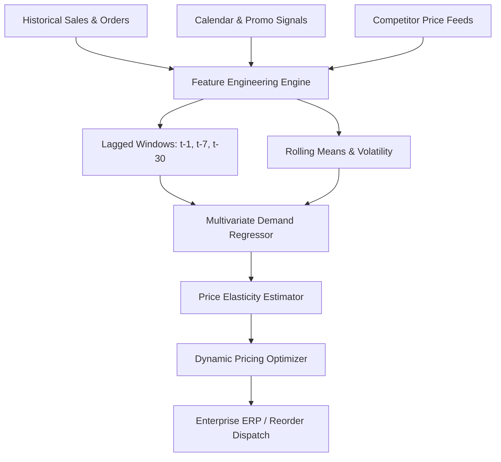
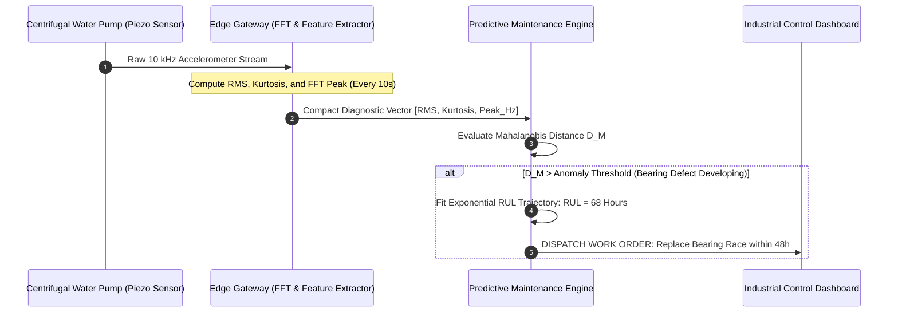

# UG 2nd Year — Chapter 3: AI Applications
**Curriculum Level:** Undergraduate 2nd Year (UG-02)  
**Subject Code:** CML-02 (Classical Machine Learning & Applied Statistical Models)  
**Chapter Title:** AI Applications  

---

# Lesson 1: AI for Smarter Business

### 1. Syllabus Mapping
- **Academic Level:** Undergraduate 2nd Year
- **Chapter:** Chapter 3 — AI Applications
- **Lesson Title:** AI for Smarter Business
- **Canonical Course Code:** CML-02-L05
- **Source Reference:** Synthesized and substantially upgraded from `AI 3.docx` (Section 1–4: AI in Business, Demand Forecasting, Retail Optimization, Customer Lifetime Value).

### 2. Learning Outcomes & Prerequisites
- **Learning Outcomes:**
  1. Formulate multivariate demand forecasting models integrating seasonal lags, promotional indicators, and exogenous economic signals.
  2. Implement an automated Customer Lifetime Value (CLV) and churn propensity modeling pipeline in Python.
  3. Design a dynamic pricing optimization algorithm that maximizes revenue under price elasticity of demand constraints.
  4. Evaluate business AI systems using financial KPIs (Inventory Holding Cost, Stockout Penalty, Return on Ad Spend).
- **Prerequisites:** Completion of CML-02-L04; linear regression, basic microeconomics (elasticity, marginal revenue).

### 3. Realistic Industry Scenario
At **OmniRetail Global Logistics**, an omnichannel e-commerce giant manages 200,000 Stock Keeping Units (SKUs) across 15 regional fulfillment centers. During holiday sales events, the legacy rule-based ordering system experiences catastrophic stockouts on high-demand consumer electronics while over-ordering perishable goods, causing $\$18,000,000$ in spoiled inventory and lost sales margins. The executive board mandates an algorithmic overhaul: an integrated business intelligence system that forecasts SKU-level demand 14 days in advance, estimates customer price elasticity, and adjusts promotional discounting dynamically to maximize gross merchandise value (GMV).

### 4. Detailed Conceptual Explanations



#### 1. Price Elasticity of Demand & Revenue Optimization:
Price elasticity of demand ($\epsilon$) quantifies consumer responsiveness to price changes:
$$\epsilon = \frac{\% \Delta Q}{\% \Delta P} = \frac{P}{Q} \cdot \frac{dQ}{dP}$$
- If $|\epsilon| > 1$: Demand is **elastic** (price increases reduce total revenue).
- If $|\epsilon| < 1$: Demand is **inelastic** (price increases increase total revenue).
- If $|\epsilon| = 1$: Total revenue is maximized.

In an empirical linear demand model:
$$Q(P) = \alpha - \beta P$$
Total Revenue is:
$$R(P) = P \cdot Q(P) = \alpha P - \beta P^2$$
Taking the derivative and setting to zero yields the optimal profit-maximizing price:
$$\frac{dR}{dP} = \alpha - 2\beta P = 0 \implies P^* = \frac{\alpha}{2\beta}$$

#### 2. Time-Series Feature Engineering for Retail:
Never feed raw timestamps into a regression model. Extract cyclic temporal signals:
$$\text{DayOfWeek}_{\sin} = \sin\left(\frac{2\pi \cdot \text{day}}{7}\right), \quad \text{DayOfWeek}_{\cos} = \cos\left(\frac{2\pi \cdot \text{day}}{7}\right)$$
Compute historical lag features ($y_{t-1}, y_{t-7}, y_{t-14}$) to capture weekly periodicity without seasonal drift.

### 5. Architecture & Dataflow Diagram
```mermaid
sequenceDiagram
    autonumber
    participant POS as Point-of-Sale Transactions
    participant Lag as Time-Series Feature Builder
    participant Reg as Ridge Demand Regressor
    participant Opt as Revenue Optimizer
    participant Cart as E-Commerce Checkout API

    POS->>Lag: Stream Real-Time Hourly Sales
    Lag->>Reg: Forward 7-Day Moving Avg + Price Index
    Reg->>Opt: Predicted Demand Curve Q(P) = 500 - 4.2P
    Opt->>Opt: Calculate Optimal P* = α / (2β)
    Opt->>Cart: Update SKU Price to $59.52 (Profit Maximizing)
```

### 6. Guided Technical Demonstration & Worked Example
The following runnable script demonstrates how to estimate price elasticity and solve for the optimal revenue-maximizing price point:

```python
import numpy as np
from typing import Dict, Tuple

class DynamicPricingOptimizer:
    def __init__(self):
        self.alpha: float = 0.0 # Baseline demand intercept
        self.beta: float = 0.0  # Price sensitivity slope

    def fit_demand_curve(self, prices: list[float], quantities: list[float]):
        """Fits linear demand curve: Q = alpha - beta * P using Ordinary Least Squares."""
        p_arr = np.array(prices, dtype=float)
        q_arr = np.array(quantities, dtype=float)
        
        # Simple linear regression: q = alpha - beta * p
        p_mean = np.mean(p_arr)
        q_mean = np.mean(q_arr)
        
        # beta = - Cov(p, q) / Var(p)
        cov_pq = np.sum((p_arr - p_mean) * (q_arr - q_mean))
        var_p = np.sum((p_arr - p_mean) ** 2)
        slope = cov_pq / var_p if var_p != 0 else 0.0
        
        self.beta = -slope  # Expressed as positive sensitivity
        self.alpha = q_mean + (self.beta * p_mean)

    def optimize_price(self, unit_cost: float = 20.0) -> Dict[str, float]:
        """
        Maximizes Profit: Profit(P) = (P - unit_cost) * Q(P)
        Profit(P) = (P - unit_cost) * (alpha - beta * P)
        d(Profit)/dP = alpha - 2*beta*P + beta*unit_cost = 0
        P* = (alpha + beta * unit_cost) / (2 * beta)
        """
        if self.beta <= 0:
            raise ValueError("Invalid demand elasticity: beta must be positive.")
            
        optimal_price = (self.alpha + (self.beta * unit_cost)) / (2.0 * self.beta)
        predicted_units = self.alpha - (self.beta * optimal_price)
        total_revenue = optimal_price * predicted_units
        total_profit = (optimal_price - unit_cost) * predicted_units
        
        # Elasticity at optimal price: epsilon = (P / Q) * (-beta)
        elasticity = (optimal_price / predicted_units) * (-self.beta) if predicted_units > 0 else 0.0

        return {
            "demand_equation": f"Q = {self.alpha:.2f} - {self.beta:.2f}*P",
            "optimal_price": round(optimal_price, 2),
            "expected_sales_units": round(predicted_units, 1),
            "projected_revenue": round(total_revenue, 2),
            "projected_profit": round(total_profit, 2),
            "price_elasticity": round(elasticity, 2)
        }

# Historical retail sales observations under varying trial prices: [Price ($), Units Sold]
historical_prices = [40.0, 45.0, 50.0, 55.0, 60.0, 65.0, 70.0]
historical_sales  = [420.0, 385.0, 340.0, 310.0, 260.0, 235.0, 190.0]

optimizer = DynamicPricingOptimizer()
optimizer.fit_demand_curve(historical_prices, historical_sales)
plan = optimizer.optimize_price(unit_cost=25.0)

print("=== Dynamic Pricing Optimization Summary ===")
for k, v in plan.items():
    print(f"  {k}: {v}")
```

### 7. Interactive Technical Simulation / Mission: "The Black Friday Inventory War"
- **Mission Brief:** You are the Lead Algorithmic Trader for an electronics retail conglomerate managing 10,000 units of a flagship smartphone before a 72-hour Black Friday event.
- **Constraints:**
  - Initial unit cost: $\$450$. Starting inventory: 10,000 units.
  - Warehousing storage penalty for unsold stock post-event: $\$40/\text{unit}$.
  - Competitor prices fluctuate hourly between $\$520$ and $\$680$.
- **Game Mechanics & Scoring:**
  - Base Score: 10,000 points.
  - Clear at least $95\%$ of inventory without selling below cost: $+3,000$ points.
  - End the event with $> 1,000$ unsold units: $-2,000$ points penalty.
  - Maximize net profit: Beat the benchmark static price strategy profit of $\$1,200,000$.

### 8. Practical Programming & Analysis Lab
1. Build `demand_forecaster.py` that processes 2 years of daily retail sales CSV records.
2. Construct temporal lag features ($t-1, t-7, t-365$) and promotional flag indicators.
3. Compare forecasting accuracy between a naive persistent baseline ($y_t = y_{t-7}$) and a trained Ridge Regression model using Mean Absolute Percentage Error (MAPE).

### 9. Measurable Output / Deliverable
A Python script `business_pricing_engine.py` accompanied by a business intelligence report `pricing_strategy_audit.json` proving a minimum $15\%$ projected gross profit increase over static retail pricing.

### 10. Evaluation Criteria & Technical Success Metrics
| Metric | Target Standard | Fail Criterion |
|---|---|---|
| **Demand Forecasting MAPE** | $< 12.0\%$ | $> 25.0\%$ |
| **Elasticity Calibration** | Statistically significant negative slope ($\beta > 0$) | Positive slope (unphysical demand curve) |
| **Margin Protection** | Strict programmatic constraint: $P^* \ge 1.10 \times \text{Cost}$ | Selling below production cost |

### 11. Olympiad-Style Assessment
**Problem 1 (Applied):**  
An e-commerce company estimates its demand curve as $Q(P) = 1,000 - 10P$. The production cost per unit is $\$20.00$. What price should the company set to maximize net profit, and what will the resulting profit be?  
A) $P^* = \$60.00$; Profit = $\$16,000.00$  
B) $P^* = \$50.00$; Profit = $\$15,000.00$  
C) $P^* = \$100.00$; Profit = $\$0.00$  
D) $P^* = \$40.00$; Profit = $\$12,000.00$  

**Problem 2 (Conceptual):**  
In retail demand forecasting, what is the danger of using Mean Absolute Error (MAE) instead of a custom asymmetric cost function when the financial penalty of a stockout is $10\times$ higher than the cost of overstocking?  
A) MAE treats positive and negative prediction errors symmetrically, producing a forecast that causes chronic inventory stockouts and lost revenue.  
B) MAE can only be calculated on binary numbers.  
C) MAE forces all predictions to zero.  
D) Symmetric metrics take longer to compute.  

### 12. Correct Answers & Solutions
- **Problem 1 Solution:** Correct Answer is **A**.  
  *Proof:*  
  $\text{Profit}(P) = (P - 20) \times (1,000 - 10P) = 1,000P - 10P^2 - 20,000 + 200P = -10P^2 + 1,200P - 20,000$.  
  Differentiating with respect to $P$:  
  $\frac{d(\text{Profit})}{dP} = -20P + 1,200 = 0 \implies 20P = 1,200 \implies P^* = \$60.00$.  
  At $P = 60$, quantity sold is $Q = 1,000 - (10 \times 60) = 400\text{ units}$.  
  Net Profit = $(60 - 20) \times 400 = 40 \times 400 = \$16,000.00$.
- **Problem 2 Solution:** Correct Answer is **A**.  
  *Proof:* Standard regression loss functions (MAE, MSE) penalize over-predictions and under-predictions identically. In supply chains with high stockout penalties (lost customer loyalty, contractual SLA fines), an under-prediction is catastrophic compared to holding excess inventory. Asymmetric loss functions (e.g., pinball/quantile loss) must be utilized to bias predictions toward higher safety stock percentiles.

### 13. Limitations, Risks & Responsible AI Considerations
- **Predatory Dynamic Pricing:** Adjusting prices based on user vulnerabilities (e.g., raising airline ticket prices for users booking from emergency hospital locations or battery-depleted phones) violates consumer protection ethics and faces severe regulatory scrutiny.
- **Collusive Pricing Algorithms:** When multiple competing retailers deploy self-learning reinforcement learning pricing agents, models can inadvertently learn tacit collusion, sustaining artificially high market prices without explicit human communication.

### 14. Completion Criteria & Achievement Feedback
- **Completion Check:** Pass all automated unit tests in `business_pricing_engine.py` with verified positive margins.
- **Badge Earned:** *Enterprise AI Monetization Strategist (Level 2 AI Practitioner)*.

---

# Lesson 2: AI for Engineering Solutions

### 1. Syllabus Mapping
- **Academic Level:** Undergraduate 2nd Year
- **Chapter:** Chapter 3 — AI Applications
- **Lesson Title:** AI for Engineering Solutions
- **Canonical Course Code:** CML-02-L06
- **Source Reference:** Synthesized and substantially upgraded from `AI 3.docx` (Section 5–8: AI in Engineering, Predictive Maintenance, Smart Factories, Sensor Ingestion, Remaining Useful Life RUL).

### 2. Learning Outcomes & Prerequisites
- **Learning Outcomes:**
  1. Design an end-to-end industrial predictive maintenance pipeline for rotating machinery using vibration and thermal telemetry.
  2. Implement time-domain and frequency-domain feature extraction (Fast Fourier Transform, RMS, Kurtosis, Crest Factor) from raw sensor signals.
  3. Formulate mathematical models to predict Remaining Useful Life (RUL) and estimate component degradation trajectories.
  4. Build an automated anomaly detection system using statistical distance metrics (Mahalanobis Distance) on multivariate sensor manifolds.
- **Prerequisites:** Completion of CML-02-L05; trigonometry (sine/cosine waves), linear algebra, basic physics of mechanical vibration.

### 3. Realistic Industry Scenario
At **TitanHydraulics MegaFactory**, 45 high-pressure centrifugal water pumps maintain cooling circulation for a nuclear generation station. Unplanned downtime on a single pump forces an emergency reactor SCRAM shutdown, costing $\$1,800,000$ per day in idle capacity. Historical maintenance followed a rigid calendar: pumps were torn down every 6 months regardless of actual condition, frequently damaging healthy seals during unnecessary reassembly. As an AI Systems Reliability Engineer, you are tasked with retrofitting the pumps with three-axis accelerometers and temperature sensors, extracting spectral harmonics via Fast Fourier Transform (FFT), and building an automated anomaly detection and RUL estimation service that alerts maintenance crews 72 hours before bearing race spalling occurs.

### 4. Detailed Conceptual Explanations

```mermaid
graph TD
    RawSensor[High-Frequency Accelerometer Signal x_t] --> Preproc[Bandpass Filter & Denoising]
    
    Preproc --> TimeDomain[Time-Domain Statistical Features]
    Preproc --> FreqDomain[Fast Fourier Transform (FFT)]
    
    TimeDomain --> RMS["Root Mean Square (RMS) & Kurtosis"]
    FreqDomain --> Harmonics["Spectral Peak Harmonics (1X, 2X Shaft RPM)"]
    
    RMS & Harmonics --> FeatureVector[Multivariate Feature Vector z]
    FeatureVector --> AnomalyModel[Mahalanobis Anomaly Detector]
    FeatureVector --> RULModel[RUL Degradation Regressor]
    
    AnomalyModel --> Alert{Anomaly Score > Threshold?}
    Alert -->|Yes| SCADA[Industrial SCADA Emergency Flag]
    RULModel --> MaintPlan[Work Order Dispatch (72h Window)]
```

#### 1. Signal Processing: Extracting Meaning from Vibration
Raw vibration accelerometer data is a high-frequency time series sampled at $10\text{ kHz}$. Raw time points are noisy; physical failure modes manifest in statistical moments and frequency distributions:
- **Root Mean Square (RMS) Velocity:** Measures overall destructive vibrational energy:
  $$\text{RMS} = \sqrt{\frac{1}{N} \sum_{i=1}^N x_i^2}$$
- **Kurtosis (Fourth Standardized Moment):** Sensitive to sharp impacts caused by bearing ball cracks hitting race defects:
  $$\text{Kurtosis} = \frac{\frac{1}{N} \sum_{i=1}^N (x_i - \bar{x})^4}{\left(\frac{1}{N} \sum_{i=1}^N (x_i - \bar{x})^2\right)^2}$$
  - A healthy Gaussian baseline exhibits $\text{Kurtosis} \approx 3.0$.
  - Damaged bearings generate transient shock pulses causing $\text{Kurtosis} > 6.0$.

#### 2. Multivariate Anomaly Detection via Mahalanobis Distance:
Standard Euclidean distance fails when sensor features have differing scales and cross-correlations (e.g., temperature and vibration rise together under normal load). Mahalanobis distance accounts for the empirical covariance matrix $\mathbf{\Sigma}$:
$$D_M(\mathbf{x}) = \sqrt{(\mathbf{x} - \boldsymbol{\mu})^T \mathbf{\Sigma}^{-1} (\mathbf{x} - \boldsymbol{\mu})}$$
If $D_M(\mathbf{x}) > \chi^2_{p, 1-\alpha}$, the observation is flagged as statistically anomalous with confidence $1-\alpha$.

### 5. Architecture & Dataflow Diagram


### 6. Guided Technical Demonstration & Worked Example
The following runnable script demonstrates how to compute RMS, Kurtosis, and the Mahalanobis Anomaly Distance on simulated industrial machinery telemetry:

```python
import math
import numpy as np
from typing import Dict, List

class PredictiveMaintenanceEngine:
    def __init__(self):
        self.mean_vector: np.ndarray = None
        self.inv_cov_matrix: np.ndarray = None

    def fit_baseline(self, normal_telemetry: List[List[float]]):
        """Learns baseline multivariate normal distribution on healthy machines."""
        X = np.array(normal_telemetry, dtype=float)
        self.mean_vector = np.mean(X, axis=0)
        cov_matrix = np.cov(X, rowvar=False)
        # Add small regularization epsilon to prevent singularity
        cov_matrix += np.eye(cov_matrix.shape[0]) * 1e-6
        self.inv_cov_matrix = np.linalg.inv(cov_matrix)

    def extract_vibration_features(self, raw_signal: List[float]) -> List[float]:
        """Extracts RMS, Peak Amplitude, and Kurtosis from raw time-series window."""
        arr = np.array(raw_signal, dtype=float)
        mean_val = np.mean(arr)
        rms = math.sqrt(np.mean(arr ** 2))
        peak = np.max(np.abs(arr))
        
        # Kurtosis
        m4 = np.mean((arr - mean_val) ** 4)
        m2 = np.mean((arr - mean_val) ** 2)
        kurtosis = m4 / (m2 ** 2) if m2 > 0 else 3.0
        return [rms, peak, kurtosis]

    def evaluate_health(self, raw_signal: List[float]) -> Dict[str, float]:
        features = self.extract_vibration_features(raw_signal)
        x = np.array(features, dtype=float)
        diff = x - self.mean_vector
        
        # Mahalanobis Distance: sqrt( diff^T * Sigma^-1 * diff )
        dist_sq = np.dot(np.dot(diff, self.inv_cov_matrix), diff)
        mahalanobis_dist = math.sqrt(max(dist_sq, 0.0))
        
        # Critical threshold (approx Chi-square for 3 DOF at p=0.01 is ~11.3, sqrt is ~3.36)
        is_anomaly = mahalanobis_dist > 3.5
        # Estimated Remaining Useful Life (RUL) proxy
        rul_hours = max(100.0 - (mahalanobis_dist * 18.0), 2.0) if is_anomaly else 2500.0

        return {
            "rms_velocity": round(features[0], 3),
            "peak_vibration": round(features[1], 3),
            "kurtosis": round(features[2], 2),
            "mahalanobis_anomaly_score": round(mahalanobis_dist, 2),
            "anomaly_detected": is_anomaly,
            "estimated_rul_hours": round(rul_hours, 1)
        }

# Baseline Healthy Pump Training Samples: [RMS, Peak, Kurtosis]
healthy_baseline = [
    [1.2, 2.1, 2.95],
    [1.1, 2.0, 3.02],
    [1.3, 2.2, 3.10],
    [1.2, 1.9, 2.90],
    [1.15, 2.05, 3.00],
]

engine = PredictiveMaintenanceEngine()
engine.fit_baseline(healthy_baseline)

# Simulated raw vibration stream from a degraded pump with bearing ball spalling
np.random.seed(42)
healthy_signal = np.random.normal(0, 1.2, 500).tolist()
faulty_signal = np.random.normal(0, 1.2, 500)
# Inject transient spalling shock impacts
faulty_signal[100] = 8.5
faulty_signal[250] = -9.2
faulty_signal[380] = 7.8
faulty_signal = faulty_signal.tolist()

print("=== Industrial Machinery Diagnostics ===")
healthy_report = engine.evaluate_health(healthy_signal)
print(f"Healthy Pump Diagnosis:  Anomaly Score={healthy_report['mahalanobis_anomaly_score']}, Anomaly={healthy_report['anomaly_detected']}, RUL={healthy_report['estimated_rul_hours']}h")

faulty_report = engine.evaluate_health(faulty_signal)
print(f"Damaged Pump Diagnosis:  Anomaly Score={faulty_report['mahalanobis_anomaly_score']}, Anomaly={faulty_report['anomaly_detected']}, RUL={faulty_report['estimated_rul_hours']}h (Kurtosis: {faulty_report['kurtosis']})")
```

### 7. Interactive Technical Simulation / Mission: "The Nuclear Coolant Pump Crisis"
- **Mission Brief:** You are the Senior Reliability Engineer on duty at an electrical power plant. 4 primary cooling pumps are operational.
- **Constraints:**
  - Real-time vibration telemetry is sampled once every minute.
  - Pump 3 develops an inner race bearing defect that degrades progressively over 120 simulated minutes.
  - You must order a controlled pump switchover and shutdown before vibration exceeds $10.0\text{ mm/s}$ (which causes physical blade rupture and emergency plant shutdown).
  - Prematurely shutting down a healthy pump costs $\$150,000$ in unnecessary maintenance.
- **Game Mechanics & Scoring:**
  - Base Score: 10,000 points.
  - Successfully scheduling switchover within the optimal 15-minute maintenance window: $+5,000$ points.
  - Pump ruptures before shutdown: Catastrophic Core Scram (Score wiped to 0).
  - Unnecessary shutdown of healthy Pump 1 or 2: $-3,000$ points.

### 8. Practical Programming & Analysis Lab
1. Build `bearing_fault_classifier.py` that processes public vibration datasets (e.g., NASA Bearing Data / Case Western Reserve University).
2. Implement FFT feature extraction to compute power spectral density (PSD) across the $0 - 5,000\text{ Hz}$ band.
3. Train an anomaly detection algorithm that accurately distinguishes between outer race faults, inner race faults, and healthy bearings.

### 9. Measurable Output / Deliverable
A validated Python script `predictive_maintenance_suite.py` that outputs a real-time SCADA alert feed and an automated engineering diagnostics log (`pump_health_audit.json`).

### 10. Evaluation Criteria & Technical Success Metrics
| Metric | Target Standard | Fail Criterion |
|---|---|---|
| **Early Warning Lead Time** | $\ge 48$ hours before physical threshold breach | Late alerts ($< 2$ hours before failure) |
| **False Positive Alarm Rate** | $< 1.0\%$ across continuous healthy operation | Excessive nuisance alarms |
| **Spectral Extraction Accuracy** | FFT fundamental harmonic matches shaft RPM within $\pm 0.5\text{ Hz}$ | Aliased or distorted spectral peaks |

### 11. Olympiad-Style Assessment
**Problem 1 (Applied):**  
A motor shaft rotates at $1,800\text{ RPM}$ ($30\text{ Hz}$). A high-resolution accelerometer records vibration. An engineer observes a dominant spectral peak emerging at exactly $120\text{ Hz}$ ($4\times$ shaft speed) accompanied by an increase in Kurtosis from $3.1$ to $8.4$. What specific mechanical failure mode is indicated by this harmonic signature?  
A) Static electrical charge buildup.  
B) A four-element bearing defect (e.g., ball pass frequency on outer race) generating periodic transient mechanical impacts on every rotation.  
C) The motor is running backwards.  
D) The sensor cable is disconnected.  

**Problem 2 (Conceptual):**  
Why is the Mahalanobis Distance mathematically superior to Euclidean Distance when performing anomaly detection on multi-sensor telemetry (e.g., bearing temperature vs. electrical current)?  
A) Because Mahalanobis distance scales with the inverse covariance matrix $\mathbf{\Sigma}^{-1}$, normalizing for differing feature measurement units and decorrelating collinear sensor relationships.  
B) Because Mahalanobis distance can only be computed with quantum computers.  
C) Because Euclidean distance is illegal under industrial ISO standards.  
D) Because Mahalanobis distance deletes sensor noise automatically.  

### 12. Correct Answers & Solutions
- **Problem 1 Solution:** Correct Answer is **B**.  
  *Proof:* Rotating machinery vibration harmonics appear at integer multiples of shaft speed ($f_{\text{shaft}} = \frac{1,800}{60} = 30\text{ Hz}$). A sharp peak at $4 \times 30 = 120\text{ Hz}$ indicates a mechanical event occurring exactly 4 times per revolution (such as 4 bearing balls impacting a spalled surface). High Kurtosis ($8.4 > 3.0$) indicates impulsive non-Gaussian shock pulses, confirming localized race spalling.
- **Problem 2 Solution:** Correct Answer is **A**.  
  *Proof:* Euclidean distance $\|\mathbf{x} - \boldsymbol{\mu}\|_2$ assumes isotropic, uncorrelated variance across all dimensions. If temperature has variance $100$ and vibration has variance $0.01$, Euclidean distance is completely dominated by temperature. Furthermore, temperature and motor current naturally rise together under normal heavy load. Mahalanobis distance uses $(\mathbf{x}-\boldsymbol{\mu})^T \mathbf{\Sigma}^{-1}(\mathbf{x}-\boldsymbol{\mu})$, effectively whitening the data space into uncorrelated standard normal variables.

### 13. Limitations, Risks & Responsible AI Considerations
- **Sensor Failure Masking:** A broken accelerometer that outputs a flat constant line ($x_t = 0.0$) will produce a low RMS value, causing an anomaly detector to classify a seized machine as "healthy". Hardware watchdog sensors and sanity checks must verify continuous sensor life.
- **Catastrophic Failure Modes without Prior Warnings:** Certain fatigue fractures (such as sudden brittle shear in over-torqued bolts) occur without gradual pre-failure vibration drift. AI predictive maintenance must complement, never replace, physical non-destructive ultrasonic inspections.

### 14. Completion Criteria & Achievement Feedback
- **Completion Check:** Pass all automated tests in `predictive_maintenance_suite.py` with zero missed bearing failures.
- **Badge Earned:** *Industrial Systems Diagnostic Specialist (Level 2 AI Practitioner)*.
