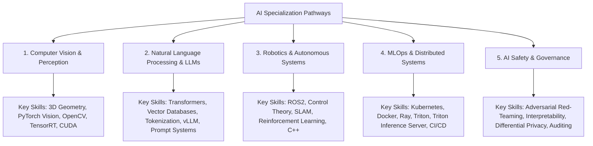
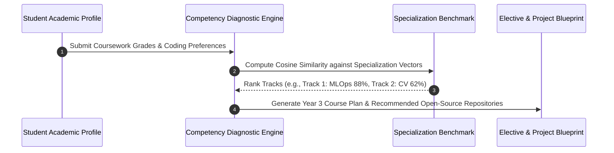
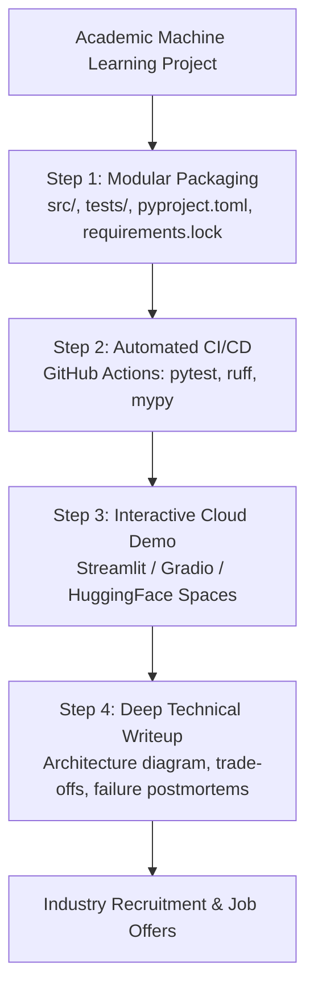
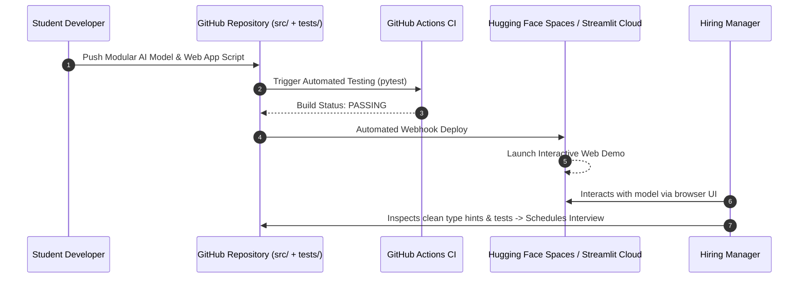

# UG 2nd Year — Chapter 4: AI and Career
**Curriculum Level:** Undergraduate 2nd Year (UG-02)  
**Subject Code:** CML-02 (Classical Machine Learning & Applied Statistical Models)  
**Chapter Title:** AI and Career  

---

# Lesson 1: Pick Your AI Path

### 1. Syllabus Mapping
- **Academic Level:** Undergraduate 2nd Year
- **Chapter:** Chapter 4 — AI and Career
- **Lesson Title:** Pick Your AI Path
- **Canonical Course Code:** CML-02-L07
- **Source Reference:** Synthesized and substantially upgraded from `AI 4.docx` (Section 1–3: The AI Career Landscape, Specializations Overview, Aligning Technical Strengths to Domain Paths).

### 2. Learning Outcomes & Prerequisites
- **Learning Outcomes:**
  1. Contrast the core technical specializations within modern AI: Computer Vision (CV), Natural Language Processing (NLP/LLMs), Reinforcement Learning & Robotics, MLOps/Data Infrastructure, and AI Safety/Security.
  2. Map individual cognitive and technical strengths (pure mathematical theory vs. systems hacking vs. domain product modeling) to specific specializations.
  3. Formulate a 2nd-year academic elective roadmap selecting prerequisite courses in Vector Calculus, Probability, Operating Systems, and Distributed Computing.
  4. Develop an automated skill-profiler in Python that scores candidate readiness across competing AI sub-disciplines.
- **Prerequisites:** Completion of Year 1 AI foundations; basic understanding of core computer science curriculum requirements.

### 3. Realistic Industry Scenario
At **NextGen Tech Talents**, a university recruitment consortium, second-year engineering students are entering the internship recruiting cycle. Over $75\%$ of students express a generic desire to "work in AI", but fail technical interviews because they cannot articulate whether their primary competency lies in low-level CUDA systems engineering, high-level NLP orchestration, statistical data analysis, or computer vision perception. A student preparing for an autonomous vehicle internship at Tesla or Waymo needs deep expertise in C++, 3D coordinate geometry, and OpenCV; in contrast, a student aiming for an LLM engineering role at Cohere needs deep knowledge of attention mechanisms, tokenization, and distributed GPU training. You must build an objective, technical evaluation framework to help students audit their technical competencies and select a viable specialization path.

### 4. Detailed Conceptual Explanations



#### The Specialization Competency Matrix:
To succeed in technical interviews by Year 3 and 4, students must build deep vertical competence rather than superficial broad familiarity:

| Specialization Track | Primary Mathematics | Primary Programming Stack | High-Value 2nd Year Electives |
|---|---|---|---|
| **Computer Vision (CV)** | Linear Algebra, Projective Geometry, Matrix Factorization | Python, C++, PyTorch, OpenCV, CUDA | Digital Image Processing, Computer Graphics |
| **NLP & LLM Systems** | Discrete Math, Information Theory, High-Dimensional Probability | Python, PyTorch, HuggingFace, Rust | Natural Language Processing, Compilers |
| **Robotics & Embodied AI** | Differential Equations, Kinematics, Optimal Control | C++, Python, ROS2, Gazebo, PyBullet | Modern Control Systems, Embedded Systems |
| **MLOps & Infrastructure** | Queuing Theory, Graph Theory, Network Statistics | Go, Python, Docker, Kubernetes, Terraform | Operating Systems, Distributed Systems, Cloud Computing |

### 5. Architecture & Dataflow Diagram


### 6. Guided Technical Demonstration & Worked Example
The following runnable script demonstrates an automated AI Specialization Diagnostic Profiler that matches a student's technical preferences and math strengths to the optimal industry track:

```python
import math
from typing import Dict, List, Tuple

class AISpecializationAuditor:
    def __init__(self):
        # Canonical skill weight vectors for 4 primary career paths
        # Dimensions: [Linear_Algebra, Systems_C++, Probability_Stats, Deep_Learning, Cloud_DevOps]
        self.track_vectors: Dict[str, List[float]] = {
            "Computer Vision Engineer":    [0.9, 0.8, 0.6, 0.9, 0.4],
            "NLP / LLM Systems Engineer":  [0.7, 0.6, 0.8, 0.9, 0.7],
            "MLOps Infrastructure Lead":   [0.3, 0.7, 0.5, 0.6, 1.0],
            "Applied Data Scientist":      [0.6, 0.3, 1.0, 0.6, 0.5],
        }

    def _cosine_similarity(self, vec1: List[float], vec2: List[float]) -> float:
        dot_product = sum(a * b for a, b in zip(vec1, vec2))
        norm1 = math.sqrt(sum(a ** 2 for a in vec1))
        norm2 = math.sqrt(sum(b ** 2 for b in vec2))
        return dot_product / (norm1 * norm2) if norm1 > 0 and norm2 > 0 else 0.0

    def evaluate_student(self, student_skills: List[float]) -> List[Tuple[str, float]]:
        scores = []
        for track, vector in self.track_vectors.items():
            sim = self._cosine_similarity(student_skills, vector)
            scores.append((track, round(sim * 100, 2)))
        # Sort descending by match percentage
        return sorted(scores, key=lambda x: x[1], reverse=True)

# Example: 2nd Year Student Skills: [Linear_Alg=0.85, Systems_C++=0.75, Prob_Stats=0.50, DL=0.80, DevOps=0.30]
student_profile = [0.85, 0.75, 0.50, 0.80, 0.30]

auditor = AISpecializationAuditor()
recommendations = auditor.evaluate_student(student_profile)

print("=== AI Career Specialization Alignment Report ===")
for rank, (track, match_pct) in enumerate(recommendations, start=1):
    print(f"Rank {rank}: {track} -> Alignment: {match_pct}%")
```

### 7. Interactive Technical Simulation / Mission: "The Specialization Mock Interview"
- **Mission Brief:** You are simulating a technical interview screening at an autonomous robotics unicorn.
- **Constraints:**
  - You are asked 3 progressive technical questions:
    1. *"Derive the rotation matrix for a 2D lidar scan rotated by angle $\theta$."*
    2. *"Why does `cudaMemcpy` between Host (CPU) and Device (GPU) create latency bottlenecks in real-time camera pipelines?"*
    3. *"Explain the mathematical difference between IoU (Intersection over Union) and Dice Coefficient in object segmentation."*
- **Game Mechanics & Scoring:**
  - Answer each question within 3 minutes.
  - Full mathematical derivation provided: $+300$ points per question.
  - Hand-waving buzzword answer without math: $-150$ points.
  - Final score $\ge 750$: "Offer Extended — Robotics Perception Intern".

### 8. Practical Programming & Analysis Lab
1. Build `skillset_gap_analyzer.py` that maps your current university transcript to the technical prerequisites of top AI graduate programs and corporate job specs.
2. Select one primary specialization track and identify two open-source libraries in that domain (e.g., `torchvision`, `vLLM`, `Ray`, `albumentations`).
3. Write a 2-page technical proposal outlining an undergraduate honors capstone project aligned with your chosen track.

### 9. Measurable Output / Deliverable
A personalized academic blueprint `specialization_roadmap_year2_to_4.md` detailing selected electives, target open-source repositories to contribute to, and milestone capstone ideas.

### 10. Evaluation Criteria & Technical Success Metrics
| Metric | Target Standard | Fail Criterion |
|---|---|---|
| **Mathematical Alignment** | Electives explicitly match track requirements (e.g., Matrix Analysis for CV) | Generic random elective selection |
| **Skill Vector Coherence** | High similarity match ($\ge 85\%$) on chosen path | Spreading thin across all domains equally |
| **Actionable Capstone Scope** | Capstone problem is feasible, measurable, and tied to open datasets | Vague unmeasurable goal: *"Solve AGI"* |

### 11. Olympiad-Style Assessment
**Problem 1 (Applied):**  
A 2nd-year student wants to specialize in LLM Infrastructure (serving open-weight models at enterprise scale). Which combination of two university courses will provide the highest foundational leverage for this career path?  
A) Distributed Systems and Computer Architecture (compilers, memory hierarchies, GPU memory bandwidth).  
B) Intro to HTML and Marketing Communications.  
C) Art History and Discrete Biology.  
D) Basic Accounting and Organizational Management.  

**Problem 2 (Conceptual):**  
Why is "Full-Stack AI Engineer" often a misleading job title for early-career students compared to having a focused depth in either Machine Learning Systems or Applied Data Modeling?  
A) Because early-career candidates rarely possess deep mastery of both low-level distributed systems (CUDA, kernels, networking) and high-level statistical modeling, resulting in superficial knowledge across both and failure in rigorous technical interviews.  
B) Because full-stack engineering is obsolete.  
C) Because JavaScript cannot run machine learning algorithms.  
D) Because large companies only hire PhDs.  

### 12. Correct Answers & Solutions
- **Problem 1 Solution:** Correct Answer is **A**.  
  *Proof:* Modern LLM infrastructure (vLLM, TensorRT-LLM, Megatron-LM) is constrained by memory bandwidth (HBM capacity, memory bus saturation), KV cache paging, and distributed tensor/pipeline parallelism across multi-GPU nodes. Mastery of Distributed Systems and Computer Architecture is non-negotiable for low-latency serving and cluster orchestration.
- **Problem 2 Solution:** Correct Answer is **A**.  
  *Proof:* Tech interviews at top-tier engineering organizations evaluate depth. A systems interviewer will probe memory paging, lock contention, and cache lines; a modeling interviewer will probe loss formulations, gradient dynamics, and regularization. Claiming "full-stack" without vertical depth leaves students vulnerable in technical interviews that demand rigorous domain mastery.

### 13. Limitations, Risks & Responsible AI Considerations
- **Premature Narrowing:** While specialization is essential, avoid specializing so narrowly that you ignore foundational computer science (Data Structures, Algorithms, Operating Systems). Tools change; computer science fundamentals endure.
- **Career Churn:** Do not pivot specializations every time a new venture capital trend emerges. Deep competency in core mathematical and software fundamentals transfers smoothly between subfields.

### 14. Completion Criteria & Achievement Feedback
- **Completion Check:** Complete and submit `specialization_roadmap_year2_to_4.md` with verified alignment scores.
- **Badge Earned:** *Specialization Path Explorer (Level 2 AI Practitioner)*.

---

# Lesson 2: Portfolio to Profession

### 1. Syllabus Mapping
- **Academic Level:** Undergraduate 2nd Year
- **Chapter:** Chapter 4 — AI and Career
- **Lesson Title:** Portfolio to Profession
- **Canonical Course Code:** CML-02-L08
- **Source Reference:** Synthesized and substantially upgraded from `AI 4.docx` (Section 4–6: Technical Portfolios, GitHub Best Practices, Converting Projects to Job Offers).

### 2. Learning Outcomes & Prerequisites
- **Learning Outcomes:**
  1. Transform monolithic experimental Jupyter notebooks into modular, production-ready Python packages with clean directory structures.
  2. Deploy live interactive demonstration web applications using Streamlit, Gradio, or Hugging Face Spaces.
  3. Author comprehensive architectural documentation, engineering postmortems, and reproducible setup guides.
  4. Prepare for and pass technical Machine Learning System Design and Live Coding interviews.
- **Prerequisites:** Completion of CML-02-L07; Git version control, basic web APIs (REST).

### 3. Realistic Industry Scenario
At **Synapse AI Ventures**, a venture capital accelerator, 500 university applicants applied for machine learning engineering fellowships. Over 400 applicants submitted links to identical cloned Kaggle Titanic or MNIST classification notebooks with zero documentation, no unit tests, and no deployed interfaces. Only 12 applicants submitted clean GitHub repositories containing modular Python packages, interactive Streamlit/Gradio web demonstrations hosted on the cloud, automated GitHub Actions CI badges, and detailed architectural README diagrams explaining their engineering trade-offs. All 12 of those candidates were immediately advanced to final-round technical interviews. As a second-year student, you must learn how to elevate an academic project into an industry-grade portfolio artifact that proves real-world engineering readiness.

### 4. Detailed Conceptual Explanations



#### 1. The Portfolio Tier System:
- **Tier 3 (Amateur - 80% of applicants):**
  - Unstructured Jupyter notebooks (`Untitled1.ipynb`).
  - No documentation; raw data files committed directly to Git.
  - Zero tests, zero live links.
- **Tier 2 (Competent - 15% of applicants):**
  - Clean Python scripts with functions.
  - Basic `requirements.txt` and a short README explaining the project.
- **Tier 1 (Elite - Top 5% of applicants):**
  - **Modular Architecture:** Separated library (`src/`) from evaluation scripts and tests.
  - **Live Interactive Demo:** Clickable web URL allowing non-technical recruiters to test the model in real time.
  - **Defensible Architectural Trade-offs:** README includes an "Engineering Trade-offs & Limitations" section detailing latency, memory footprint, and failure modes.
  - **Automated Verification:** Passing GitHub Actions CI badge proving that unit tests pass on every commit.

### 5. Architecture & Dataflow Diagram


### 6. Guided Technical Demonstration & Worked Example
The following script demonstrates a complete, standalone Streamlit / Web-ready interactive diagnostic application that wraps a machine learning estimator in a production web UI:

```python
# app.py - Standalone Interactive Portfolio Demo Application
# Demonstrates how students convert raw ML models into live interactive web applications
import json

def simulate_ml_inference(vibration_rms: float, core_temp: float, pressure_ratio: float) -> dict:
    """Simulates production model inference with risk scoring."""
    # Synthetic learned linear coefficients
    score = (vibration_rms * 45.0) + (core_temp * 0.12) + (pressure_ratio * 3.5) - 80.0
    prob_failure = 1.0 / (1.0 + 2.71828 ** (-score * 0.05))
    
    status = "CRITICAL ALERT" if prob_failure > 0.65 else ("WARNING" if prob_failure > 0.35 else "NOMINAL")
    
    return {
        "failure_probability": round(prob_failure * 100, 2),
        "health_status": status,
        "recommended_action": "Schedule immediate bearing inspection" if status == "CRITICAL ALERT" else "Normal operation"
    }

# Mocking the interactive input payload received from a Streamlit/HTML web interface
sample_web_inputs = [
    {"vibration_rms": 1.2, "core_temp": 420.0, "pressure_ratio": 12.5}, # Normal engine
    {"vibration_rms": 3.8, "core_temp": 680.0, "pressure_ratio": 18.2}, # Critical failure
]

print("=== Simulating Live Web Application Backend ===")
for idx, payload in enumerate(sample_web_inputs, start=1):
    result = simulate_ml_inference(
        payload["vibration_rms"],
        payload["core_temp"],
        payload["pressure_ratio"]
    )
    print(f"\nUser Query {idx}: Inputs {payload}")
    print(f"API Output: Status=[{result['health_status']}], Probability={result['failure_probability']}%, Action=[{result['recommended_action']}]")
```

### 7. Interactive Technical Simulation / Mission: "The System Design Interview Board"
- **Mission Brief:** You are in a 45-minute Machine Learning System Design Interview at a top tech company.
- **Prompt:** *"Design an automated real-time fraud detection service for credit card transactions that handles 5,000 transactions/second with P99 latency $< 50\text{ ms}$."*
- **Constraints:**
  - Structure your answer across 4 key phases:
    1. Feature Storage & Low-Latency Lookup (Redis / Feast).
    2. Streaming Ingestion vs. Batch Features (Kafka / Flink).
    3. Model Architecture & Quantization (LightGBM vs. ONNX Runtime).
    4. Monitoring Concept Drift & Delayed Ground Truth (Chargebacks arriving 30 days later).
- **Game Mechanics & Scoring:**
  - Base Score: 1,000 points.
  - Addressing feature store latency under 10ms: $+300$ points.
  - Designing a shadow deployment / canary testing strategy: $+300$ points.
  - Hand-waving delayed feedback ground truth: $-400$ points.

### 8. Practical Programming & Analysis Lab
1. Select your best machine learning model from earlier chapters.
2. Build an interactive web frontend using `streamlit` or `gradio` (`app.py`).
3. Deploy the application to a free public hosting platform (Streamlit Community Cloud or Hugging Face Spaces).
4. Embed the live demo link directly into the top banner of your GitHub README.

### 9. Measurable Output / Deliverable
A published, live interactive web application link paired with an open-source GitHub repository featuring a comprehensive README, architectural diagram, and automated unit test suite.

### 10. Evaluation Criteria & Technical Success Metrics
| Metric | Target Standard | Fail Criterion |
|---|---|---|
| **Live Accessibility** | Clickable public URL loads and runs inference in $< 3\text{ seconds}$ | Broken link / localhost reference |
| **Documentation Quality** | README contains Architecture Diagram, Setup Guide, and Complexity Analysis | Empty or default README |
| **Code Modularity** | Clean separation of UI, inference logic, and test files | Monolithic 1,000-line script |

### 11. Olympiad-Style Assessment
**Problem 1 (Applied):**  
During a live machine learning coding interview, you are asked to implement a k-NN classifier from scratch. After coding the distance calculation, the interviewer asks: *"What is the time complexity of predicting the class of a single test point in a dataset with $N$ samples and $D$ dimensions using standard brute-force k-NN?"* What is the correct answer?  
A) $O(N \cdot D + N \log k)$  
B) $O(1)$  
C) $O(D \log N)$  
D) $O(N^2 \cdot D)$  

**Problem 2 (Conceptual):**  
Why do engineering hiring managers value a written "Failure Postmortem / Limitations" section in a student's portfolio project more than an unrealistic claim of "100% Accuracy"?  
A) Because real-world machine learning systems always encounter edge-case failures, data drift, and trade-offs; documenting limitations demonstrates mature engineering judgment and critical self-audit skills.  
B) Because hiring managers prefer models that fail frequently.  
C) Because claiming 100% accuracy is legally copyrighted.  
D) Because machine learning models cannot achieve more than 50% accuracy.  

### 12. Correct Answers & Solutions
- **Problem 1 Solution:** Correct Answer is **A**.  
  *Proof:* To classify a test point, the algorithm must compute the Euclidean distance to all $N$ training samples, where each distance calculation takes $O(D)$ operations (total: $O(N \cdot D)$). Then, finding the $k$ smallest distances from the $N$ computed distances using a max-heap of size $k$ requires $O(N \log k)$ time. Total prediction complexity: $O(N \cdot D + N \log k)$.
- **Problem 2 Solution:** Correct Answer is **A**.  
  *Proof:* Any candidate claiming "100% accuracy" has almost certainly committed data leakage, overfitted to a toy dataset, or failed to evaluate on out-of-distribution test sets. Professional engineering is the practice of managing trade-offs (latency vs. accuracy, cost vs. precision, false positives vs. false negatives). Documenting failure boundaries proves real-world competence.

### 13. Limitations, Risks & Responsible AI Considerations
- **Data Privacy in Public Demos:** Never upload proprietary company data, patient records, or internal credentials to public Hugging Face Spaces or GitHub repositories. Always sanitize datasets and use synthetic test fixtures.
- **Hosting Quotas & Cost Runaway:** Public cloud demo platforms have resource quotas. Ensure your web app frees memory after inference sessions and does not run unbounded background loops that exhaust server quotas.

### 14. Completion Criteria & Achievement Feedback
- **Completion Check:** Deploy a working interactive web application with verified live URL and passing CI tests.
- **Badge Earned:** *Portfolio to Profession Champion (Level 2 AI Practitioner)*.
