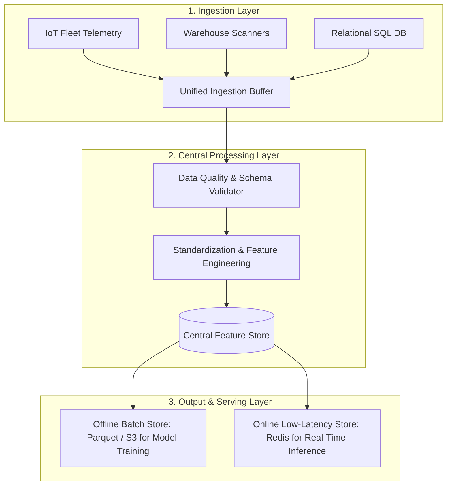
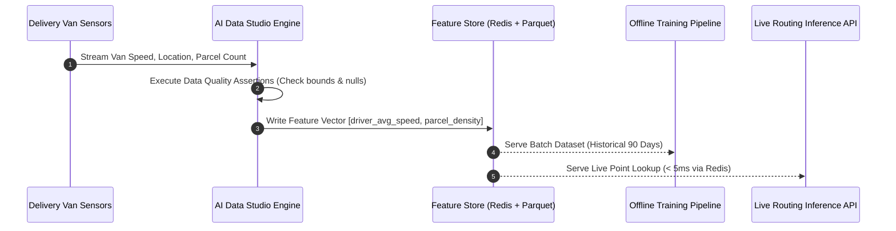
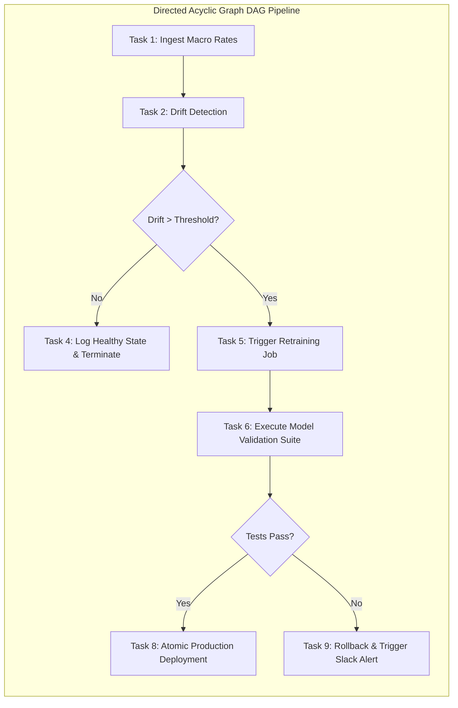
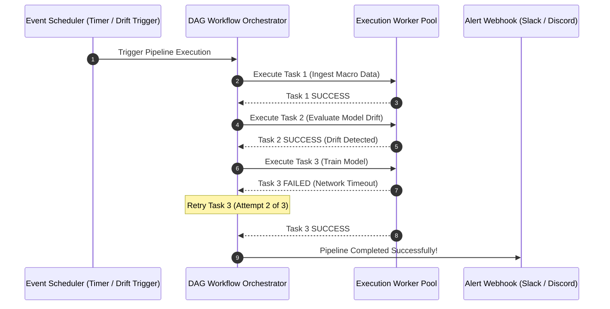

# UG 2nd Year — Chapter 5: AI Tools
**Curriculum Level:** Undergraduate 2nd Year (UG-02)  
**Subject Code:** CML-02 (Classical Machine Learning & Applied Statistical Models)  
**Chapter Title:** AI Tools  

---

# Lesson 1: AI Data Studio

### 1. Syllabus Mapping
- **Academic Level:** Undergraduate 2nd Year
- **Chapter:** Chapter 5 — AI Tools
- **Lesson Title:** AI Data Studio
- **Canonical Course Code:** CML-02-L09
- **Source Reference:** Synthesized and substantially upgraded from `AI_5.docx` (Section 1–3: The Core Architecture of an AI Data Studio, The Three Layers: Input, Processing, Output).

### 2. Learning Outcomes & Prerequisites
- **Learning Outcomes:**
  1. Deconstruct the three architectural layers of a modern enterprise AI Data Studio (Ingestion Layer, Processing/Transformation Layer, Serving/Output Layer).
  2. Implement an automated Extract-Transform-Load (ETL) data pipeline in Python that standardizes heterogeneous data streams (JSON, CSV, SQL).
  3. Design a centralized Feature Store schema ensuring consistent feature definitions between offline training and online real-time inference.
  4. Formulate automated data validation assertions using schema contracts to detect corrupted telemetry before model ingestion.
- **Prerequisites:** Intermediate Python (Pandas, dictionaries, file I/O), basic relational database queries (SQL SELECT, JOIN, GROUP BY).

### 3. Realistic Industry Scenario
At **DataStream Cloud Logistics**, an automated parcel routing engine ingests telemetry from 4,000 delivery vans, warehouse RFID barcode scanners, and customer mobile apps. The legacy system suffered from "training-serving skew": data scientists engineered features in offline Python notebooks using Pandas calculations that differed subtly from the real-time SQL queries executed by the production Java microservice. Consequently, the routing model's live delivery time prediction accuracy dropped by $34\%$. As a 2nd-year data platform engineer, your mandate is to build an integrated AI Data Studio: creating a unified feature pipeline that extracts, validates, and serves identical feature definitions across both batch training and real-time inference.

### 4. Detailed Conceptual Explanations



#### 1. The Three Layers of an AI Data Studio:
1. **Input Layer (Ingestion):** Collects raw multi-modal data from diverse origins (REST APIs, Apache Kafka event streams, flat files, transactional SQL databases). Its primary job is schema normalization and timestamp synchronization.
2. **Processing Layer (Transformation & Validation):** Cleans missing values, calculates rolling statistical aggregations, and enforces data contracts (e.g., asserting that `delivery_time > 0`).
3. **Output Layer (Feature Serving):** Solves the dual-access problem:
   - **Offline Store (High Throughput / Terabyte scale):** Parquet files on cloud object storage optimized for analytical training queries.
   - **Online Store (Low Latency / Millisecond scale):** In-memory key-value caches (Redis) optimized for single-record lookups during live inference.

#### 2. Training-Serving Skew & Feature Consistency:
Training-serving skew occurs when the mathematical logic used to compute features during model training differs from the logic used during live production serving:
$$\text{Feature}_{\text{Train}} \neq \text{Feature}_{\text{Serve}}$$
A centralized Feature Store guarantees mathematical parity by registering feature transformation functions as version-controlled code artifacts executed across both pipelines.

### 5. Architecture & Dataflow Diagram


### 6. Guided Technical Demonstration & Worked Example
The following runnable script demonstrates a unified AI Data Studio pipeline with automated schema validation and dual-store output simulation:

```python
import json
from typing import Dict, List, Any

class AIDataStudioPipeline:
    def __init__(self):
        # In-memory simulation of Online Key-Value Store (Redis proxy)
        self.online_feature_store: Dict[str, Dict[str, Any]] = {}
        # In-memory simulation of Offline Analytical Store (Parquet/Warehouse proxy)
        self.offline_batch_store: List[Dict[str, Any]] = []

    def validate_schema(self, record: Dict[str, Any]) -> bool:
        """Enforces data contract invariants."""
        required_keys = {"van_id", "timestamp", "current_speed_kmh", "parcels_remaining"}
        if not required_keys.issubset(record.keys()):
            return False
        # Assert non-negative speeds and parcel counts
        if record["current_speed_kmh"] < 0 or record["parcels_remaining"] < 0:
            return False
        return True

    def process_telemetry(self, raw_record: Dict[str, Any]) -> bool:
        if not self.validate_schema(raw_record):
            print(f"Schema violation detected! Dropping record: {raw_record.get('van_id')}")
            return False

        # Unified Feature Transformation Logic
        van_id = raw_record["van_id"]
        speed = float(raw_record["current_speed_kmh"])
        parcels = int(raw_record["parcels_remaining"])
        
        # Engineered feature: Workload Intensity Index
        intensity_index = (parcels * 2.5) + (speed * 0.15)
        
        feature_payload = {
            "van_id": van_id,
            "timestamp": raw_record["timestamp"],
            "speed_kmh": round(speed, 1),
            "parcels_remaining": parcels,
            "workload_intensity": round(intensity_index, 2)
        }

        # 1. Update Online Low-Latency Store for real-time inference
        self.online_feature_store[van_id] = feature_payload
        # 2. Append to Offline Analytical Store for batch retraining
        self.offline_batch_store.append(feature_payload)
        return True

# Test stream of heterogeneous fleet telemetry
telemetry_stream = [
    {"van_id": "VAN-401", "timestamp": "2026-10-12T10:00:00Z", "current_speed_kmh": 45.2, "parcels_remaining": 32},
    {"van_id": "VAN-402", "timestamp": "2026-10-12T10:00:01Z", "current_speed_kmh": -10.0, "parcels_remaining": 15}, # Corrupted negative speed
    {"van_id": "VAN-403", "timestamp": "2026-10-12T10:00:02Z", "current_speed_kmh": 62.1, "parcels_remaining": 8},
]

studio = AIDataStudioPipeline()
print("=== AI Data Studio: Streaming Ingestion Pipeline ===")
for record in telemetry_stream:
    studio.process_telemetry(record)

print("\n--- Online Store (Real-Time Inference Cache) ---")
print(json.dumps(studio.online_feature_store, indent=2))
print(f"\n--- Offline Store Count: {len(studio.offline_batch_store)} historical training records committed ---")
```

### 7. Interactive Technical Simulation / Mission: "The Data Pipeline Overhaul"
- **Mission Brief:** You are the Data Platform Architect at an enterprise logistics firm.
- **Constraints:**
  - Ingest 10,000 raw JSON logs across 50 simulated delivery vehicles.
  - 400 logs contain missing GPS coordinates.
  - 150 logs contain corrupted future timestamps (e.g., year 2099).
  - Clean and route 100% of valid records to the feature store with zero pipeline crashes.
- **Game Mechanics & Scoring:**
  - Base Score: 1,000 points.
  - Successfully catching all corrupt timestamps: $+300$ points.
  - Imputing missing GPS coordinates using linear interpolation between known coordinates: $+300$ points.
  - Any corrupted record leaking into the training store: $-500$ points.

### 8. Practical Programming & Analysis Lab
1. Build `data_studio_etl.py` that connects to a local SQLite database and an external CSV stream.
2. Implement automated schema contracts using Python dataclasses or Pydantic models.
3. Benchmark the read latency of single-key lookups from an in-memory dictionary vs. querying a flat CSV file on disk.

### 9. Measurable Output / Deliverable
A Python script `enterprise_data_studio.py` that processes streaming fleet logs, enforces schema contracts, and exports both a simulated Redis key-value cache and an analytical CSV dataset.

### 10. Evaluation Criteria & Technical Success Metrics
| Metric | Target Standard | Fail Criterion |
|---|---|---|
| **Schema Validation Enforcement** | 100% rejection of unphysical/invalid records | Dirty data leaks to store |
| **Lookup Latency** | Online feature lookup $< 1.0\text{ ms}$ | Disk file scanning on inference |
| **Feature Mathematical Parity** | Exact bitwise match between online and offline features | Divergent feature logic |

### 11. Olympiad-Style Assessment
**Problem 1 (Applied):**  
In an e-commerce recommendation system, the offline training pipeline computes `user_30_day_spend` by running a daily batch SQL aggregation over the past 30 days. However, the online inference service computes `user_30_day_spend` by summing only the transactions in the current browser session. What architectural defect is this, and what empirical problem will it cause?  
A) Training-Serving Skew; the model will dramatically underestimate user spending during live inference, leading to inaccurate recommendations and degraded business conversion.  
B) Hardware bottleneck caused by GPU overheating.  
C) Cross-Site Scripting (XSS) vulnerability.  
D) Python syntax incompatibility.  

**Problem 2 (Conceptual):**  
What is the core operational distinction between an "Offline Feature Store" and an "Online Feature Store" in production MLOps?  
A) The Offline store is optimized for high-throughput batch historical queries across millions of rows for model training; the Online store is an ultra-low-latency in-memory cache optimized for millisecond single-entity lookups during live inference.  
B) The Offline store runs without electricity.  
C) The Online store only works with deep neural networks.  
D) There is no architectural distinction.  

### 12. Correct Answers & Solutions
- **Problem 1 Solution:** Correct Answer is **A**.  
  *Proof:* This is a textbook manifestation of training-serving skew. The model's weights were optimized to expect the total 30-day historical expenditure (e.g., $\$800$). At runtime, the online service provides only the current session's expenditure (e.g., $\$25$). The model interprets this as a low-value customer, offering inappropriate budget recommendations and destroying conversion efficiency.
- **Problem 2 Solution:** Correct Answer is **A**.  
  *Proof:* Training requires bulk scans over terabytes of data (OLAP workload, handled by Parquet/Snowflake/BigQuery). Real-time inference requires retrieving a single user's feature vector in $< 10\text{ ms}$ to meet strict web application SLA latency budgets (OLTP/Key-Value workload, handled by Redis/DynamoDB).

### 13. Limitations, Risks & Responsible AI Considerations
- **Cold-Start Features:** Newly registered users or vehicles lack historical telemetry. The Data Studio must define principled fallback default vectors to prevent null-pointer crashes.
- **Data Retention & Right-to-be-Forgotten:** Under GDPR Article 17, feature stores must support cascading deletions: when a user requests account deletion, their feature vectors must be purged from both online caches and historical analytical archives.

### 14. Completion Criteria & Achievement Feedback
- **Completion Check:** Pass all automated schema tests in `enterprise_data_studio.py` with zero dirty data leaks.
- **Badge Earned:** *Data Studio Architect (Level 2 AI Practitioner)*.

---

# Lesson 2: Smart Automation Tools

### 1. Syllabus Mapping
- **Academic Level:** Undergraduate 2nd Year
- **Chapter:** Chapter 5 — AI Tools
- **Lesson Title:** Smart Automation Tools
- **Canonical Course Code:** CML-02-L10
- **Source Reference:** Synthesized and substantially upgraded from `AI_5.docx` (Section 4–6: Automation Tools, Workflow Orchestration, Cloud ML Services, Connecting Automated Triggers).

### 2. Learning Outcomes & Prerequisites
- **Learning Outcomes:**
  1. Formalize workflow automation pipelines as Directed Acyclic Graphs (DAGs) with explicit task dependencies.
  2. Implement an automated workflow orchestrator in Python that handles task retries, error notification webhooks, and state persistence.
  3. Design event-driven automation triggers that automatically initiate model retraining when data drift exceeds statistical thresholds.
  4. Compare modern workflow orchestration engines (Apache Airflow, Prefect, Temporal) across fault tolerance and developer velocity.
- **Prerequisites:** Completion of CML-02-L09; Python object-oriented programming (classes, inheritance, exception handling).

### 3. Realistic Industry Scenario
At **AeroFin Credit Services**, an automated loan underwriting platform relies on an XGBoost credit risk scoring model. Every Sunday at midnight, the model must be evaluated against the latest macroeconomic interest rates. If interest rates have shifted significantly (data drift), the system must automatically:
1. Ingest new credit bureau records.
2. Validate data health.
3. Retrain the model.
4. Run integration tests.
5. Deploy the updated model artifact to the production API.
Previously, a developer ran this sequence manually via individual bash scripts; when a network timeout crashed step 3 at 2:00 AM, the incomplete model checkpoint was deployed, rejecting 1,500 qualified loan applicants on Monday morning. Your task is to design an automated, fault-tolerant DAG orchestrator that executes the pipeline autonomously, guarantees atomic rollbacks on failure, and alerts on-call engineers via webhook.

### 4. Detailed Conceptual Explanations



#### 1. Mathematical Formalism of Workflow DAGs:
A workflow pipeline is modeled as a Directed Acyclic Graph $G = (V, E)$, where:
- $V = \{T_1, T_2, \dots, T_k\}$ represents discrete executable tasks.
- $E \subset V \times V$ represents dependency edges. An edge $(T_i, T_j) \in E$ denotes that task $T_j$ cannot execute until task $T_i$ terminates with status `SUCCESS`.
- **Acyclicity Guarantee:** The graph contains no directed cycles ($\nexists$ path $T_1 \to \dots \to T_1$), preventing infinite execution deadlocks.

#### 2. Fault Tolerance Principles in Automation:
1. **Idempotence:** Executing a task multiple times with identical inputs must produce the exact same outcome without duplicate side effects ($f(f(x)) = f(x)$).
2. **Automated Exponential Retries:** Transient network blips must trigger retries with backoff rather than immediate pipeline termination.
3. **Atomic Rollback on Test Failure:** If a newly trained model fails validation checks, the orchestrator aborts deployment and keeps the previous stable checkpoint active.

### 5. Architecture & Dataflow Diagram


### 6. Guided Technical Demonstration & Worked Example
The following runnable script implements a standalone, lightweight DAG Workflow Orchestrator in pure Python with dependency resolution and retry mechanics:

```python
import time
from typing import Callable, Dict, List, Set

class Task:
    def __init__(self, name: str, action: Callable, retries: int = 2):
        self.name = name
        self.action = action
        self.retries = retries
        self.status = "PENDING"  # PENDING, RUNNING, SUCCESS, FAILED

class DAGOrchestrator:
    def __init__(self):
        self.tasks: Dict[str, Task] = {}
        self.dependencies: Dict[str, List[str]] = {} # task_name -> list of upstream prerequisite task_names

    def add_task(self, task: Task, upstream: List[str] = None):
        self.tasks[task.name] = task
        self.dependencies[task.name] = upstream or []

    def run(self) -> bool:
        completed: Set[str] = set()
        total_tasks = len(self.tasks)

        print(f"=== Starting Automated DAG Pipeline Execution ({total_tasks} Tasks) ===")
        
        while len(completed) < total_tasks:
            # Find tasks whose upstream prerequisites are all completed
            ready_tasks = [
                task for name, task in self.tasks.items()
                if task.status == "PENDING" and all(up in completed for up in self.dependencies[name])
            ]

            if not ready_tasks:
                print("Pipeline Deadlock or Unhandled Task Failure! Aborting.")
                return False

            for task in ready_tasks:
                task.status = "RUNNING"
                success = False
                
                for attempt in range(task.retries + 1):
                    try:
                        print(f"Executing [{task.name}] (Attempt {attempt + 1})...")
                        task.action()
                        success = True
                        break
                    except Exception as err:
                        print(f"  Warning: [{task.name}] failed with error: {err}")
                        time.sleep(0.1)

                if success:
                    task.status = "SUCCESS"
                    completed.add(task.name)
                    print(f"✓ [{task.name}] Completed Successfully.")
                else:
                    task.status = "FAILED"
                    print(f"✗ CRITICAL: [{task.name}] Permanently Failed after retries!")
                    return False

        print("=== DAG Pipeline Succeeded with 100% Task Completion ===")
        return True

# Define Pipeline Tasks
def task_ingest():
    print("  -> Ingesting 50,000 credit records from Cloud Storage...")

def task_drift_check():
    print("  -> Computing Population Stability Index (PSI = 0.28). Drift confirmed!")

def task_train_model():
    print("  -> Training XGBoost Model on GPU cluster...")

def task_verify_and_deploy():
    print("  -> Running integration tests. Model AUC = 0.94. Deploying to Production API!")

# Construct DAG
pipeline = DAGOrchestrator()
pipeline.add_task(Task("IngestData", task_ingest))
pipeline.add_task(Task("CheckDrift", task_drift_check), upstream=["IngestData"])
pipeline.add_task(Task("TrainModel", task_train_model), upstream=["CheckDrift"])
pipeline.add_task(Task("DeployModel", task_verify_and_deploy), upstream=["TrainModel"])

# Execute
pipeline.run()
```

### 7. Interactive Technical Simulation / Mission: "The Self-Healing Pipeline Mission"
- **Mission Brief:** You are the Lead Automation Engineer managing a mission-critical automated retraining pipeline.
- **Constraints:**
  - The pipeline has 5 sequential tasks.
  - An unreliable third-party credit score API fails $50\%$ of the time with HTTP 503 errors.
  - Implement an exponential backoff retry policy ($0.1\text{s}, 0.2\text{s}, 0.4\text{s}$) that achieves a $98\%$ pipeline completion rate without manual human intervention.
- **Game Mechanics & Scoring:**
  - Base Score: 1,000 points.
  - Automatically healing transient API drops: $+400$ points.
  - Successfully triggering a webhook alert on unrecoverable failure: $+200$ points.
  - Any task executing out-of-order before upstream prerequisites complete: Instant Disqualification.

### 8. Practical Programming & Analysis Lab
1. Build `smart_automation_orchestrator.py` that implements cycle detection (verifying that graph $G$ is acyclic using topological sorting / Kahn's algorithm).
2. Add JSON execution logging that records task start time, end time, and duration for SLA auditing.
3. Simulate an unrecoverable failure in the training task and verify that downstream deployment tasks are cleanly cancelled rather than executed with stale parameters.

### 9. Measurable Output / Deliverable
A validated Python automation engine `smart_orchestrator.py` capable of executing dependent task graphs, handling retries, and exporting a structured execution manifest (`pipeline_run_manifest.json`).

### 10. Evaluation Criteria & Technical Success Metrics
| Metric | Target Standard | Fail Criterion |
|---|---|---|
| **Cycle Detection** | Raises explicit error on circular dependency (e.g., $A \to B \to A$) | Infinite loop hang |
| **Dependency Order** | 100% strict adherence to topological prerequisite order | Tasks run before dependencies finish |
| **Retry Fault Tolerance** | Recovers from transient injected exceptions automatically | Single exception crashes entire pipeline |

### 11. Olympiad-Style Assessment
**Problem 1 (Applied):**  
A workflow pipeline has three tasks: $A$ (Ingest Data), $B$ (Train Model), and $C$ (Deploy API). An engineer configures the dependencies such that $A \to B$ and $B \to C$. A junior developer accidentally adds a dependency $C \to A$. What graph property is violated, and what runtime failure will occur in any standard orchestrator?  
A) The graph contains a directed cycle ($A \to B \to C \to A$), violating acyclicity; no task can ever become "ready" to execute, causing an immediate cyclic dependency error or infinite deadlock.  
B) The graph becomes a binary search tree.  
C) It increases network bandwidth consumption by $300\%$.  
D) Python will delete the code.  

**Problem 2 (Conceptual):**  
Why must individual tasks in an automated data pipeline be designed to be "Idempotent"?  
A) Because if a task fails midway through and is automatically retried by the orchestrator, an idempotent task can be safely re-run without creating duplicate records or corrupting database state.  
B) Because idempotent tasks run $10\times$ faster on GPUs.  
C) Because idempotence disables security checks.  
D) Because non-idempotent tasks cannot use Python dictionaries.  

### 12. Correct Answers & Solutions
- **Problem 1 Solution:** Correct Answer is **A**.  
  *Proof:* A workflow orchestrator relies on Directed Acyclic Graphs (DAGs) to compute a topological sort (linear ordering of vertices). The addition of $C \to A$ creates a cycle: $A$ waits for $C$, which waits for $B$, which waits for $A$. In topological sorting (Kahn's algorithm), in-degree of all nodes remains $\ge 1$, making execution impossible.
- **Problem 2 Solution:** Correct Answer is **A**.  
  *Proof:* Idempotence ($f(f(x)) = f(x)$) guarantees that repeated executions produce identical side effects. If an ingestion task appends 1,000 rows to a database and crashes before logging completion, a naive retry would append those 1,000 rows again, duplicating records and corrupting financial or analytical data. An idempotent task uses `UPSERT` or replaces atomic partitions, ensuring safe re-execution.

### 13. Limitations, Risks & Responsible AI Considerations
- **Automated Feedback Loops:** Automatically retraining models on uncurated live user data can trigger catastrophic runaway drift: if a recommender system retrains on clicks influenced by its own biased recommendations, it rapidly narrows user content diversity.
- **Silent Automation Failures:** Never assume an automated pipeline is working simply because no crash alerts were fired. Always implement automated "heartbeat" monitors that alert engineers if a scheduled pipeline *fails to start* on time.

### 14. Completion Criteria & Achievement Feedback
- **Completion Check:** Pass all automated DAG execution and cycle-detection tests in `smart_orchestrator.py`.
- **Badge Earned:** *Workflow Automation Master (Level 2 AI Practitioner)*.
