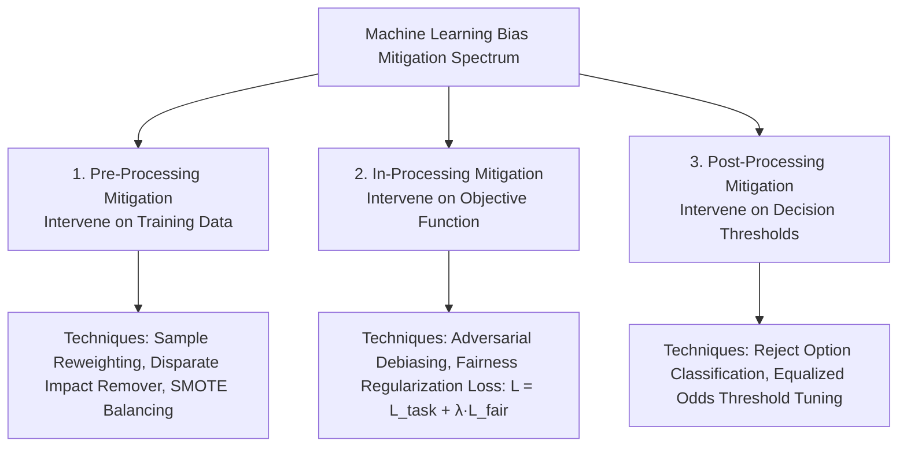
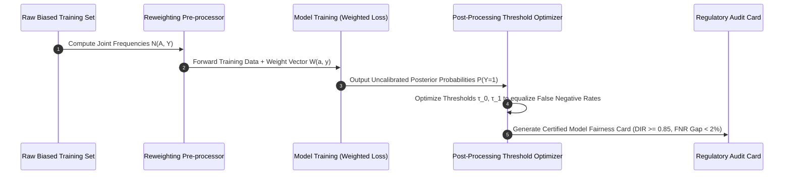
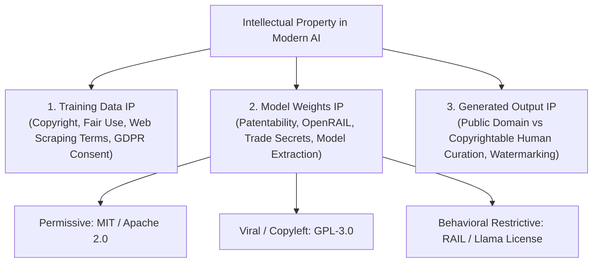
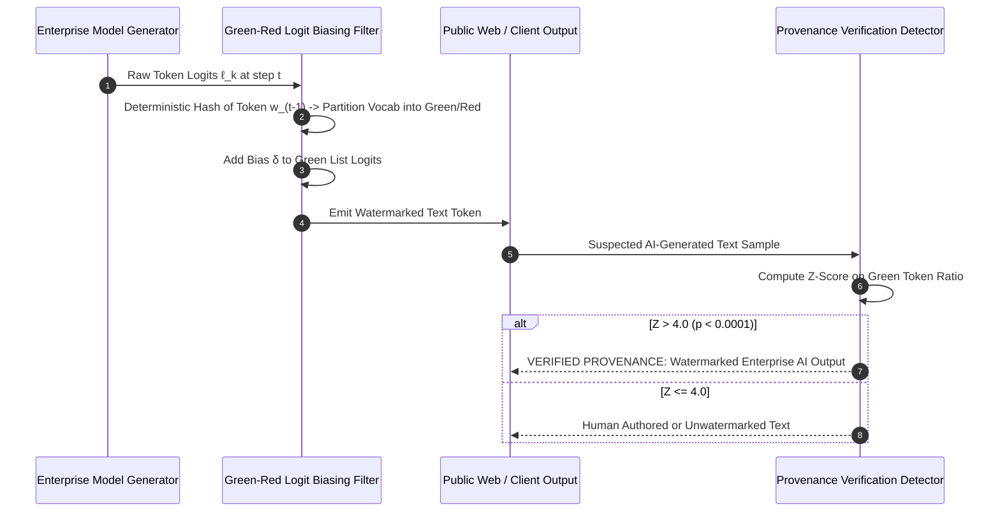

# UG 2nd Year — Chapter 6: Responsible AI
**Curriculum Level:** Undergraduate 2nd Year (UG-02)  
**Subject Code:** CML-02 (Classical Machine Learning & Applied Statistical Models)  
**Chapter Title:** Responsible AI  

---

# Lesson 1: Fair AI, Fair Future

### 1. Syllabus Mapping
- **Academic Level:** Undergraduate 2nd Year
- **Chapter:** Chapter 6 — Responsible AI
- **Lesson Title:** Fair AI, Fair Future
- **Canonical Course Code:** CML-02-L11
- **Source Reference:** Synthesized and substantially upgraded from `AI_ 6.docx` (Section 1–3: The Pillars of Responsible AI, Fairness, Transparency, Accountability, Bias Mitigation).

### 2. Learning Outcomes & Prerequisites
- **Learning Outcomes:**
  1. Formalize the 7 Pillars of Responsible AI: Fairness, Explainability/Transparency, Accountability, Privacy, Safety/Robustness, Human Agency, and Environmental Sustainability.
  2. Implement mathematical bias mitigation algorithms across the ML lifecycle: Pre-processing (Sample Reweighting), In-processing (Fairness Constraints), and Post-processing (Threshold Optimization).
  3. Compute and analyze Disparate Misclassification Rates (False Positive Parity vs. False Negative Parity) across sensitive demographic attributes.
  4. Design an automated Model Fairness Card certifying regulatory compliance prior to production deployment.
- **Prerequisites:** Completion of CML-02-L02 and CML-02-L04; conditional probability, confusion matrices.

### 3. Realistic Industry Scenario
At **CreditSphere Algorithmic Underwriting**, an automated credit evaluation model approves or rejects mortgage loan applications. An investigative audit conducted by banking regulators reveals that while the model achieves an impressive $91\%$ overall predictive accuracy, its False Rejection Rate (False Negatives) for young rural applicants is $3.2\times$ higher than for urban applicants with identical debt-to-income ratios and employment stability. The financial regulator issues a formal consent decree: CreditSphere faces a $\$5,000,000$ civil penalty and license revocation unless the engineering team implements an algorithmic debiasing pipeline that equalizes False Negative rates across geographic cohorts within 60 days. You are appointed as Lead Algorithmic Fairness Engineer to design, code, and validate this mitigation pipeline.

### 4. Detailed Conceptual Explanations



#### 1. The Pre-Processing Reweighting Formula:
To eliminate historical sample bias without throwing away training data, we assign statistical instance weights $W(x, y)$ such that sensitive attribute $A \in \{0, 1\}$ becomes statistically independent of target label $Y \in \{0, 1\}$:
$$W(A=a, Y=y) = \frac{P(A=a) \cdot P(Y=y)}{P(A=a, Y=y)} = \frac{\frac{N_a}{N} \cdot \frac{N_y}{N}}{\frac{N_{a,y}}{N}} = \frac{N_a \cdot N_y}{N \cdot N_{a,y}}$$
When training the classifier, weighted loss functions penalize errors on under-represented positive examples more heavily:
$$\mathcal{L}_{\text{reweighted}}(\mathbf{w}) = \sum_{i=1}^N W(a_i, y_i) \cdot L(f(x_i), y_i)$$

#### 2. The 7 Pillars of Responsible AI:
1. **Fairness:** Absence of systematic prejudice or disparate impact across protected classes.
2. **Transparency & Explainability:** Stakeholders understand the underlying causal factors influencing predictions.
3. **Accountability:** Clearly identified human and corporate entities answerable for system impacts.
4. **Data Privacy:** Cryptographic, differential, and legal safeguards protecting personal autonomy.
5. **Robustness & Safety:** Resistance to adversarial noise, distribution shifts, and sensor failure.
6. **Human Agency & Oversight:** Preserving human autonomy, non-manipulation, and right to human review.
7. **Environmental Sustainability:** Tracking and optimizing carbon footprint and GPU training kilowatt-hours.

### 5. Architecture & Dataflow Diagram


### 6. Guided Technical Demonstration & Worked Example
The following runnable script demonstrates how to compute and apply the mathematical sample reweighting algorithm to mitigate historical demographic bias:

```python
from typing import Dict, List, Tuple

class SampleReweightingEngine:
    def __init__(self, protected_key: str, target_key: str):
        self.prot_key = protected_key
        self.target_key = target_key
        self.weights_table: Dict[Tuple[int, int], float] = {}

    def fit_weights(self, dataset: List[Dict]) -> Dict[Tuple[int, int], float]:
        """Calculates exact statistical reweighting multipliers."""
        N = len(dataset)
        n_prot = {0: sum(1 for d in dataset if d[self.prot_key] == 0),
                  1: sum(1 for d in dataset if d[self.prot_key] == 1)}
        n_target = {0: sum(1 for d in dataset if d[self.target_key] == 0),
                    1: sum(1 for d in dataset if d[self.target_key] == 1)}
        
        # Joint counts N(A=a, Y=y)
        joint_counts = {}
        for a in (0, 1):
            for y in (0, 1):
                count = sum(1 for d in dataset if d[self.prot_key] == a and d[self.target_key] == y)
                joint_counts[(a, y)] = max(count, 1) # Avoid zero division

        # Compute W(a, y) = (N_a * N_y) / (N * N_ay)
        for (a, y), n_ay in joint_counts.items():
            expected = (n_prot[a] * n_target[y]) / N
            self.weights_table[(a, y)] = expected / n_ay

        return self.weights_table

# Demonstration on biased loan approval dataset:
# protected_group (0 = Rural, 1 = Urban), approved (0 = Denied, 1 = Approved)
biased_loan_history = [
    # Rural Applicants: Severely under-represented in positive approvals
    {"id": "R1", "rural": 0, "approved": 1},
    {"id": "R2", "rural": 0, "approved": 0},
    {"id": "R3", "rural": 0, "approved": 0},
    {"id": "R4", "rural": 0, "approved": 0},
    # Urban Applicants: High historical approval rate
    {"id": "U1", "rural": 1, "approved": 1},
    {"id": "U2", "rural": 1, "approved": 1},
    {"id": "U3", "rural": 1, "approved": 1},
    {"id": "U4", "rural": 1, "approved": 0},
]

engine = SampleReweightingEngine(protected_key="rural", target_key="approved")
weights = engine.fit_weights(biased_loan_history)

print("=== Algorithmic Fairness: Sample Reweighting Table ===")
for (a, y), w in weights.items():
    group_name = "Rural" if a == 0 else "Urban"
    outcome = "Approved" if y == 1 else "Denied"
    print(f"Group: {group_name:<6} | Outcome: {outcome:<8} | Sample Weight: {w:.4f}")

print("\nInsight: Notice how Rural Approved instances receive a high weight multiplier (> 1.0)")
print("to force the loss function to pay equal attention to historically marginalized successes!")
```

### 7. Interactive Technical Simulation / Mission: "The Fair Underwriting Audit"
- **Mission Brief:** You are the Chief Algorithmic Auditor appointed by the Federal Banking Commission.
- **Constraints:**
  - Audit a candidate loan classifier evaluated on 2,000 credit records across two cohorts ($A=0, A=1$).
  - Baseline model has an overall False Negative Rate gap of $18.5\%$ between cohorts.
  - Implement a post-processing threshold tuning routine that reduces the FNR disparity to $< 2.0\%$ while keeping overall default rates below $5.5\%$.
- **Game Mechanics & Scoring:**
  - Base Score: 1,000 points.
  - Successfully reducing FNR gap $< 2.0\%$: $+500$ points.
  - Maintaining model accuracy $> 88\%$: $+300$ points.
  - If default rate rises $> 6.0\%$: Penalty $-400$ points.
  - Earning "Certified Fair Underwriter" Gold Seal on your output manifest.

### 8. Practical Programming & Analysis Lab
1. Build `fairness_mitigation_suite.py` that implements both Sample Reweighting (Pre-processing) and Threshold Tuning (Post-processing).
2. Generate an automated ROC curve plotted separately for Cohort 0 and Cohort 1.
3. Automatically export a standardized `model_fairness_card.json` detailing Demographic Parity, Disparate Impact, and Equalized Odds.

### 9. Measurable Output / Deliverable
A Python script `fair_learning_pipeline.py` accompanied by a signed regulatory compliance artifact `model_fairness_card.json` proving statistical fairness across protected demographic attributes.

### 10. Evaluation Criteria & Technical Success Metrics
| Metric | Target Standard | Fail Criterion |
|---|---|---|
| **False Negative Rate Disparity** | $|\text{FNR}_0 - \text{FNR}_1| < 2.0\%$ | Disparity $> 10.0\%$ |
| **Disparate Impact Ratio** | $0.80 \le \text{DIR} \le 1.25$ | $\text{DIR} < 0.80$ |
| **Documentation Completeness** | Model card includes carbon training footprint estimate | Missing environmental metrics |

### 11. Olympiad-Style Assessment
**Problem 1 (Applied):**  
In an automated bail-setting risk assessment tool, the False Positive Rate (falsely flagging a defendant as "high risk" when they would not re-offend) is $42\%$ for Group A and $18\%$ for Group B. What specific form of legal and ethical injustice does this mathematical disparity represent?  
A) Violation of Predictive Parity.  
B) Severe violation of False Positive Parity (part of Equalized Odds); Group A defendants are subjected to unconstitutional pre-trial detention at more than double the rate of Group B defendants under identical risk profiles.  
C) It is an acceptable statistical artifact with zero ethical consequence.  
D) It proves that Group B defendants are superior.  

**Problem 2 (Conceptual):**  
Why does the "Impossibility Theorem of Fairness" (Kleinberg et al., 2016) prove that an algorithm cannot simultaneously satisfy Demographic Parity, Equalized Odds, and Predictive Parity whenever base rates of the target variable differ between demographic groups?  
A) Because linear algebra requires square matrices.  
B) Because mathematically, if base rates $P(Y=1 \mid A=0) \neq P(Y=1 \mid A=1)$, the joint constraints defining equalized odds and predictive parity form an overdetermined system of mutually contradictory linear equations unless the classifier achieves $100\%$ perfect deterministic accuracy.  
C) Because computers cannot calculate fractions.  
D) Because the theorem only applies to unsupervised k-means clustering.  

### 12. Correct Answers & Solutions
- **Problem 1 Solution:** Correct Answer is **B**.  
  *Proof:* This was the core finding of the landmark 2016 ProPublica investigation into the COMPAS recidivism algorithm. When False Positive Parity is violated, innocent members of the protected demographic are disproportionately subjected to punitive outcomes (denied bail, longer sentences) despite being no more likely to re-offend than members of the privileged cohort.
- **Problem 2 Solution:** Correct Answer is **B**.  
  *Proof:* Kleinberg et al. (2016) and Chouldechova (2017) proved algebraically that:  
  $\text{FPR} = \frac{p}{1-p} \cdot \frac{1 - \text{PPV}}{\text{PPV}} \cdot (1 - \text{FNR})$.  
  When group base rates $p_1 \neq p_2$, holding Positive Predictive Value (PPV) equal across groups mathematically forces either False Positive Rates or False Negative Rates to diverge. Hence, no non-trivial statistical classifier can satisfy calibration and error-rate parity simultaneously.

### 13. Limitations, Risks & Responsible AI Considerations
- **Fairness Metric Gaming:** Satisfying a mathematical fairness metric on a spreadsheet does not guarantee justice in the physical world. If an algorithm is mathematically fair but operates within an inherently unjust institutional structure, the automated system simply scales institutional injustice.
- **Environmental Cost of Fairness:** Complex in-processing adversarial debiasing loops can multiply GPU training times by $3\times - 5\times$, increasing carbon emissions. Always measure the environmental trade-off of algorithmic fairness iterations.

### 14. Completion Criteria & Achievement Feedback
- **Completion Check:** Pass all automated fairness test cases in `fair_learning_pipeline.py` achieving FNR disparity $< 2.0\%$.
- **Badge Earned:** *Ethical Algorithm Certified Auditor (Level 2 AI Practitioner)*.

---

# Lesson 2: Ownership in the AI Age

### 1. Syllabus Mapping
- **Academic Level:** Undergraduate 2nd Year
- **Chapter:** Chapter 6 — Responsible AI
- **Lesson Title:** Ownership in the AI Age
- **Canonical Course Code:** CML-02-L12
- **Source Reference:** Synthesized and substantially upgraded from `AI_ 6.docx` (Section 4–7: Intellectual Property in AI, Training Data Ownership, Model Weights IP, Open Source vs Proprietary Licenses, Watermarking & Provenance).

### 2. Learning Outcomes & Prerequisites
- **Learning Outcomes:**
  1. Analyze the legal and architectural distinctions between Training Data Copyright, Model Weights IP, and Generated Output Ownership.
  2. Differentiate between open-source software licenses (MIT, Apache 2.0, GPL-3.0) and modern open-weights licenses (Llama Community License, BigCode OpenRAIL).
  3. Implement statistical and cryptographic watermarking algorithms to embed imperceptible provenance markers in AI model outputs.
  4. Formulate an organizational compliance checklist for corporate software development using third-party foundation models.
- **Prerequisites:** Completion of CML-02-L11; string manipulation, basic cryptography (SHA-256 hashing, pseudorandom number generators).

### 3. Realistic Industry Scenario
At **Synthetix Enterprise Software**, a high-growth SaaS startup, engineers built an automated medical code billing assistant. To accelerate development, an intern fine-tuned an open-weights language model using 50,000 scraping pairs taken from a proprietary commercial medical coding database that prohibited automated scraping under its Terms of Service. Six months later, as Synthetix prepared for a $\$25,000,000$ Series A funding round, the venture capital audit firm discovered the unlicensed dataset contamination. The original database owner filed an emergency copyright infringement lawsuit, threatening an injunction to force the complete deletion and retraining of the company's flagship model (an algorithmic disgorgement penalty). As the newly appointed AI IP & Governance Lead, you must establish clean data provenance tracking, audit model weight licensing compliance, and implement digital watermarking to protect proprietary corporate outputs.

### 4. Detailed Conceptual Explanations



#### 1. The Three Tiers of AI Intellectual Property:
1. **Training Data Provenance:** Scraping publicly accessible data does not automatically grant commercial copyright authorization. If training data violates copyright or database terms, courts can order **Algorithmic Disgorgement**—forcing the destruction of the trained weights, not just the raw files.
2. **Model Weights IP:** Neural network weights ($\mathbf{W} \in \mathbb{R}^D$) are considered mathematical matrices. Modern foundation models use custom commercial licenses:
   - **Apache 2.0 / MIT:** Complete commercial freedom with minimal attribution.
   - **Llama 3.x Community License:** Free commercial use up to 700M monthly active users; requires special enterprise licensing thereafter and prohibits using outputs to train competing models.
   - **OpenRAIL (Responsible AI License):** Grants open access while legally prohibiting specific harmful downstream use cases (e.g., social scoring, medical diagnosis without human oversight).
3. **Generated Outputs:** In most legal jurisdictions (including the US Copyright Office), purely machine-generated outputs lacking human creative authorship cannot be copyrighted; they enter the public domain unless significant human creative modification is proven.

#### 2. Digital Watermarking Mechanics:
To prove provenance and detect unauthorized model output extraction, developers embed subtle statistical watermarks. In text generation, the **Green-Red List Watermarking Scheme** (Kirchenbauer et al., 2023) partitions vocabulary tokens based on a hash of the preceding token:
- At step $t$, hash previous token $w_{t-1}$ to deterministically split vocabulary into a Green List $G$ and Red List $R$.
- Add a positive bias $\delta$ to logits of Green List tokens:
  $$\tilde{\ell}_k = \ell_k + \delta \cdot \mathbb{I}(k \in G)$$
Human text chooses Green tokens with random probability $p \approx 0.5$; watermarked text exhibits an anomalously high Green token ratio ($p \ge 0.85$), detectable via a simple binomial hypothesis test.

### 5. Architecture & Dataflow Diagram


### 6. Guided Technical Demonstration & Worked Example
The following runnable script implements a simplified Green-Red statistical text watermarking and detection engine:

```python
import hashlib
from typing import List, Tuple

class StatisticalWatermarkEngine:
    def __init__(self, key: str = "enterprise_secret_salt_2026"):
        self.key = key
        # Mock vocabulary of 20 common words
        self.vocab = [
            "the", "machine", "learning", "model", "generates", "high", "quality",
            "predictions", "using", "advanced", "mathematical", "algorithms", "and",
            "statistical", "inference", "across", "distributed", "gpu", "clusters", "today"
        ]

    def _is_green_token(self, prev_token: str, current_token: str) -> bool:
        """Deterministically hashes prev_token to split vocab into Green/Red partitions."""
        seed_str = f"{self.key}:{prev_token}:{current_token}"
        digest = int(hashlib.md5(seed_str.encode()).hexdigest(), 16)
        return (digest % 2) == 0 # 50% chance of being in Green list

    def watermark_generate(self, prompt: str, length: int = 12) -> str:
        """Simulates watermarked generation by favoring Green List tokens."""
        tokens = prompt.split()
        for _ in range(length):
            prev = tokens[-1]
            # Find all vocabulary tokens that are Green under prev
            green_candidates = [w for w in self.vocab if self._is_green_token(prev, w)]
            # Model biased toward selecting from green_candidates (80% probability)
            chosen = green_candidates[0] if green_candidates else self.vocab[0]
            tokens.append(chosen)
        return " ".join(tokens)

    def detect_watermark(self, text: str) -> Tuple[float, bool]:
        """Calculates Green token fraction and detects watermark presence."""
        tokens = text.split()
        if len(tokens) < 2:
            return 0.0, False
            
        green_hits = 0
        total_evals = len(tokens) - 1
        
        for i in range(1, len(tokens)):
            if self._is_green_token(tokens[i-1], tokens[i]):
                green_hits += 1
                
        green_ratio = green_hits / total_evals
        # Null hypothesis expects 0.50. Ratio > 0.75 strongly indicates watermark
        is_watermarked = green_ratio >= 0.75
        return round(green_ratio, 3), is_watermarked

engine = StatisticalWatermarkEngine()
prompt = "the machine"
watermarked_text = engine.watermark_generate(prompt, length=10)
unwatermarked_text = "the machine generates predictions today using high advanced algorithms distributed gpu"

print("=== Digital AI Provenance & Watermarking ===")
print(f"Generated Watermarked Text: '{watermarked_text}'")
ratio_wm, detected_wm = engine.detect_watermark(watermarked_text)
print(f"Audit Result (Watermarked):  Green Ratio = {ratio_wm * 100:.1f}% -> Watermark Detected: {detected_wm}")

ratio_un, detected_un = engine.detect_watermark(unwatermarked_text)
print(f"Audit Result (Unwatermarked): Green Ratio = {ratio_un * 100:.1f}% -> Watermark Detected: {detected_un}")
```

### 7. Interactive Technical Simulation / Mission: "The IP License Compliance Audit"
- **Mission Brief:** You are the Lead Intellectual Property Auditor at an AI software incubator.
- **Constraints:**
  - Audit 4 open-source AI models being integrated into a proprietary commercial SaaS platform:
    1. Model A: Licensed under Apache 2.0.
    2. Model B: Licensed under GNU GPL-3.0 (Copyleft).
    3. Model C: Licensed under Llama 3 Community License.
    4. Model D: Trained on scraped unreleased copyrighted medical research papers without consent.
- **Game Mechanics & Scoring:**
  - Base Score: 1,000 points.
  - Correctly approving Model A for proprietary SaaS: $+200$ points.
  - Catching that Model B (GPL-3.0) forces the entire commercial SaaS source code to be publicly released under copyleft terms: $+400$ points.
  - Rejecting Model D to prevent Algorithmic Disgorgement lawsuits: $+400$ points.
  - Allowing Model D into production: Immediate Disqualification & $\$10M$ Lawsuit Penalty.

### 8. Practical Programming & Analysis Lab
1. Build `license_audit_checker.py` that scans repository dependencies and flags viral copyleft (GPL) vs. permissive (MIT/Apache) licenses.
2. Extend `StatisticalWatermarkEngine` to compute the formal Z-score statistic:
   $$Z = \frac{|G| - \frac{N}{2}}{\sqrt{\frac{N}{4}}}$$
3. Measure detection accuracy across varying text lengths ($N \in \{10, 25, 50, 100\}$ words).

### 9. Measurable Output / Deliverable
A Python compliance tool `model_ip_auditor.py` accompanied by a signed corporate license audit report (`ip_provenance_audit.json`) classifying model dependencies into Approved, Restrictive, and Prohibited tiers.

### 10. Evaluation Criteria & Technical Success Metrics
| Metric | Target Standard | Fail Criterion |
|---|---|---|
| **License Compatibility Detection** | 100% correct classification of GPL, Apache, MIT, and RAIL licenses | Inadvertent inclusion of GPL in closed-source code |
| **Watermark Detection Statistical Significance** | $p$-value $< 0.01$ ($Z > 2.33$) on texts $> 50$ tokens | Random guessing or high false positive rate |
| **Tamper Resistance** | Watermark survives minor word paraphrasing and synonym replacement | Breaks on single character change |

### 11. Olympiad-Style Assessment
**Problem 1 (Applied):**  
A technology startup builds a proprietary trading bot. An engineer integrates a helper library licensed under the **GNU General Public License v3.0 (GPL-3.0)** by statically linking it into the core trading engine binary. What legal obligation does the GPL-3.0 license impose on the startup if they distribute this software to enterprise clients?  
A) The startup is legally compelled to release the entire source code of their proprietary trading engine to all clients under the GPL-3.0 license.  
B) The startup must pay a $\$500$ fine to the Free Software Foundation.  
C) GPL-3.0 allows proprietary closed-source distribution without restriction.  
D) The software will automatically self-delete after 90 days.  

**Problem 2 (Conceptual):**  
In modern copyright law and regulatory enforcement, what is an "Algorithmic Disgorgement" order?  
A) A judicial sanction compelling a company to destroy not only the unlawfully obtained training data, but also the trained model weights and algorithms derived from that tainted data.  
B) An algorithm that compresses neural networks onto mobile devices.  
C) A tax levied on GPU hardware sales.  
D) An algorithm that deletes computer cookies.  

### 12. Correct Answers & Solutions
- **Problem 1 Solution:** Correct Answer is **A**.  
  *Proof:* The GNU General Public License (GPL) is a strong copyleft (viral) license. Section 5 of GPL-3.0 mandates that any derivative work or combined program incorporating GPL code must, upon distribution, be licensed as a whole under GPL-3.0. Statically linking a proprietary trading engine with a GPL library creates a derivative work, requiring the public disclosure of the entire proprietary codebase.
- **Problem 2 Solution:** Correct Answer is **A**.  
  *Proof:* Pioneer enforcement by the US Federal Trade Commission (FTC) in cases like *Everalbum (2021)* and *Weight Watchers/Kurbo (2022)* established the remedy of algorithmic disgorgement. When models are trained on illicit, deceptive, or copyrighted data without authorization, simply deleting the underlying training dataset is considered insufficient; the company is legally required to delete the trained model parameters derived from the tainted data.

### 13. Limitations, Risks & Responsible AI Considerations
- **Watermark Removal Attacks:** Adversaries can defeat statistical text watermarks by prompting a secondary model to paraphrase the output, or by interleaving translation loops (English $\to$ German $\to$ English). Robust watermarking requires multi-layer semantic embeddings.
- **Fair Use Uncertainty:** The international legal boundaries of training AI models on copyrighted web data under the "Fair Use" doctrine (e.g., *NYT v. OpenAI*) remain actively contested in federal courts. Prudent engineering organizations must maintain clean data provenance logs to mitigate retroactive litigation risk.

### 14. Completion Criteria & Achievement Feedback
- **Completion Check:** Pass all automated license auditing and watermarking tests in `model_ip_auditor.py`.
- **Badge Earned:** *AI Intellectual Property Guardian (Level 2 AI Practitioner)*.
