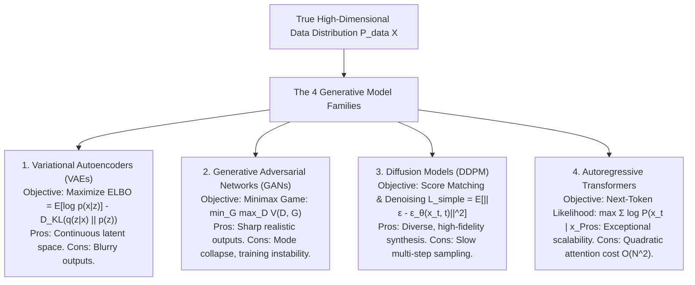
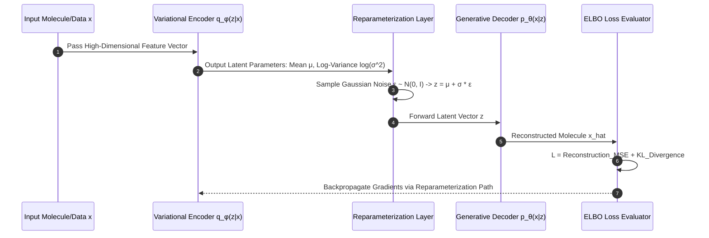
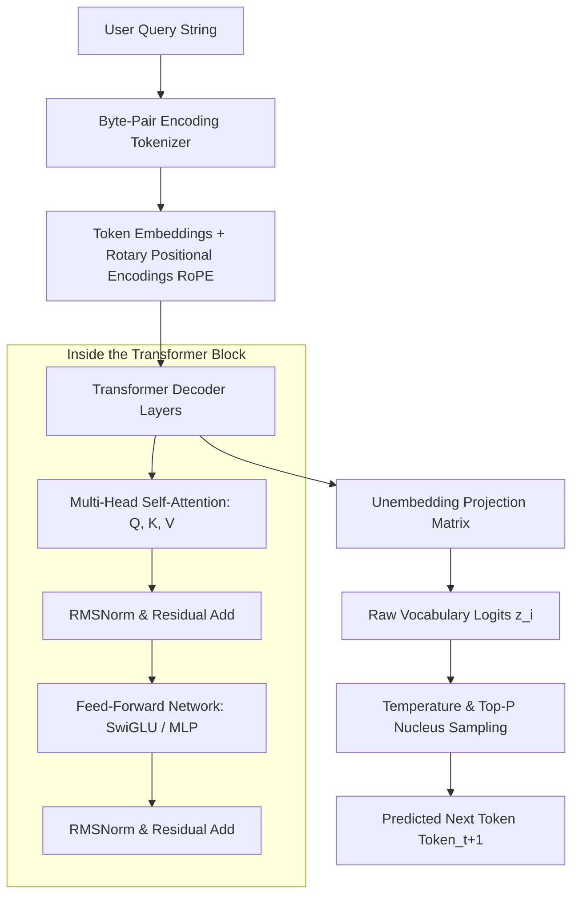
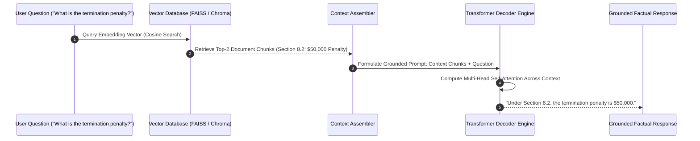

# UG 3rd Year — Chapter 1: AI Basics
**Curriculum Level:** Undergraduate 3rd Year (UG-03)  
**Subject Code:** DLE-03 (Deep Learning, NLP & Enterprise LLM Engineering)  
**Chapter Title:** AI Basics  

---

# Lesson 1: Generative Intelligence

### 1. Syllabus Mapping
- **Academic Level:** Undergraduate 3rd Year
- **Chapter:** Chapter 1 — AI Basics
- **Lesson Title:** Generative Intelligence
- **Canonical Course Code:** DLE-03-L01
- **Source Reference:** Synthesized and substantially upgraded from `GenAI_LLM_Chapter1_Activity_Book-4.docx` (Concepts 1–3: Discriminative vs Generative AI, History, The Four Families of Generative Models).

### 2. Learning Outcomes & Prerequisites
- **Learning Outcomes:**
  1. Contrast discriminative modeling ($P(Y \mid X)$) and generative modeling ($P(X)$ or $P(X, Y)$) using probabilistic formulations.
  2. Analyze the mathematical foundations and architectural trade-offs of the Four Generative Families: Variational Autoencoders (VAEs), Generative Adversarial Networks (GANs), Diffusion Probabilistic Models, and Autoregressive Transformers.
  3. Formulate the Evidence Lower Bound (ELBO) objective function for Variational Autoencoders.
  4. Implement a lightweight latent vector sampling and generation engine from mathematical first principles in Python.
- **Prerequisites:** Multivariable calculus, probability theory (Gaussian distributions, Kullback-Leibler divergence), PyTorch/NumPy basics.

### 3. Realistic Industry Scenario
At **Synthetix BioPharma Innovations**, computational chemists design novel molecular ligands to inhibit drug-resistant bacterial enzymes. Traditional screening (discriminative AI) evaluates existing drug candidate libraries to predict binding affinity, but is limited by the chemical space of known compounds ($10^8$ molecules out of an estimated $10^{60}$ valid drug-like structures). The research director mandates building a generative molecular de novo design engine that learns the underlying probability distribution of drug-like chemical graphs, samples from latent chemical manifolds, and generates novel, synthesizable candidate structures with optimized binding energy. You are assigned to evaluate the four generative model families and implement a latent space generation engine.

### 4. Detailed Conceptual Explanations



#### 1. Discriminative vs. Generative Formalism:
- **Discriminative AI:** Models the conditional posterior distribution:
  $$P(Y \mid X) = \frac{P(X, Y)}{P(X)}$$
  Learns the decision boundary separating classes in feature space. Output is a label, class score, or continuous target.
- **Generative AI:** Models the joint probability or data density:
  $$P(X) = \int P(X \mid Z) P(Z) dZ \quad \text{or} \quad P(X, Y) = P(X \mid Y) P(Y)$$
  Learns the true manifold geometry of the data distribution, enabling the synthesis of new, unobserved samples $\tilde{x} \sim P(X)$.

#### 2. Variational Autoencoders & The ELBO Derivation:
Because true marginal likelihood $p(x) = \int p(x|z)p(z)dz$ is analytically intractable for non-linear neural networks, VAEs introduce a variational recognition model $q_\phi(z|x)$ to approximate the true posterior $p(z|x)$.
Using Jensen's Inequality, we derive the Evidence Lower Bound (ELBO):
$$\log p(x) \ge \mathbb{E}_{q_\phi(z|x)}[\log p_\theta(x|z)] - D_{\text{KL}}(q_\phi(z|x) \parallel p(z))$$
- **Reconstruction Term:** $\mathbb{E}[\log p_\theta(x|z)]$ ensures decoded outputs accurately reconstruct inputs.
- **Kullback-Leibler Divergence Term:** $D_{\text{KL}}(q_\phi(z|x) \parallel p(z))$ forces the approximate posterior toward an isotropic unit Gaussian prior $\mathcal{N}(\mathbf{0}, \mathbf{I})$, ensuring continuous, gap-free latent interpolation.
- **The Reparameterization Trick:** To allow backpropagation through stochastic sampling:
  $$\mathbf{z} = \boldsymbol{\mu} + \boldsymbol{\sigma} \odot \boldsymbol{\epsilon}, \quad \boldsymbol{\epsilon} \sim \mathcal{N}(\mathbf{0}, \mathbf{I})$$

### 5. Architecture & Dataflow Diagram


### 6. Guided Technical Demonstration & Worked Example
The following runnable Python script implements a complete 2D Latent Variational Autoencoder math engine from first principles using NumPy:

```python
import numpy as np
from typing import Tuple, Dict

class LatentGenerativeSampler:
    """
    Demonstrates continuous latent manifold interpolation and sampling
    using the mathematical mechanics of Variational Autoencoders.
    """
    def __init__(self, latent_dim: int = 2):
        self.latent_dim = latent_dim
        # Synthetic decoder weights mapping 2D latent space z -> 4D feature output
        np.random.seed(42)
        self.W_dec = np.random.normal(0, 0.5, (latent_dim, 4))
        self.b_dec = np.array([1.5, -0.8, 2.2, 0.5])

    def kl_divergence_loss(self, mu: np.ndarray, log_var: np.ndarray) -> float:
        """
        Analytical KL Divergence between N(mu, diag(sigma^2)) and N(0, I):
        D_KL = -0.5 * sum(1 + log(sigma^2) - mu^2 - sigma^2)
        """
        return -0.5 * np.sum(1.0 + log_var - np.square(mu) - np.exp(log_var))

    def sample_latent_space(self, mu: np.ndarray, log_var: np.ndarray) -> np.ndarray:
        """Reparameterization trick: z = mu + sigma * epsilon"""
        std = np.exp(0.5 * log_var)
        eps = np.random.normal(0.0, 1.0, size=mu.shape)
        return mu + (std * eps)

    def decode(self, z: np.ndarray) -> np.ndarray:
        """Generative decoding: x_hat = tanh(z * W_dec + b_dec)"""
        logits = np.dot(z, self.W_dec) + self.b_dec
        return np.tanh(logits)

# Demonstration: Sampling novel molecular drug candidates from latent space
engine = LatentGenerativeSampler(latent_dim=2)

# Simulated encoder output for a base molecule
mu_target = np.array([0.45, -0.30])
log_var_target = np.array([-0.20, -0.15]) # std approx 0.90

kl_cost = engine.kl_divergence_loss(mu_target, log_var_target)
print(f"KL Divergence to Standard Normal Prior: {kl_cost:.4f} nats")

print("\n--- Generating 3 Novel Synthesized Samples via Reparameterization ---")
for i in range(3):
    z_sampled = engine.sample_latent_space(mu_target, log_var_target)
    generated_molecule_features = engine.decode(z_sampled)
    print(f"Sample {i+1}: Latent z={[round(x, 3) for x in z_sampled]} -> Molecular Features: {[round(f, 3) for f in generated_molecule_features]}")
```

### 7. Interactive Technical Simulation / Mission: "The Latent Manifold Walk"
- **Mission Brief:** You are the Lead Generative AI Researcher at an advanced materials laboratory.
- **Constraints:**
  - You possess a trained 2D latent space where Point $A = [-2.0, 1.5]$ corresponds to brittle titanium alloys, and Point $B = [2.5, -1.0]$ corresponds to flexible polymer composites.
  - Traverse the latent manifold by generating a 5-step spherical linear interpolation (SLERP) path between $A$ and $B$.
  - Evaluate the generated intermediate materials to identify the optimal Pareto point: Tensile Strength $\ge 850\text{ MPa}$ and Elastic Modulus $\le 45\text{ GPa}$.
- **Game Mechanics & Scoring:**
  - Base Score: 1,000 points.
  - Successfully synthesizing an intermediate material meeting both engineering constraints: $+500$ points.
  - Stepping into a "low-density void" (KL divergence explosion $> 10.0$): $-300$ points.
  - Badge Earned: "Latent Manifold Navigator".

### 8. Practical Programming & Analysis Lab
1. Build `generative_family_benchmark.py` comparing a VAE decoder against a simple GAN generator.
2. Implement spherical linear interpolation (SLERP) between two high-dimensional latent vectors:
   $$\text{SLERP}(\mathbf{z}_1, \mathbf{z}_2; t) = \frac{\sin((1-t)\theta)}{\sin\theta}\mathbf{z}_1 + \frac{\sin(t\theta)}{\sin\theta}\mathbf{z}_2, \quad \theta = \arccos\left(\frac{\mathbf{z}_1 \cdot \mathbf{z}_2}{\|\mathbf{z}_1\|\|\mathbf{z}_2\|}\right)$$
3. Verify that SLERP preserves constant hyperspherical distance compared to linear interpolation (LERP).

### 9. Measurable Output / Deliverable
A validated Python script `generative_sampler.py` that interpolates across latent space, exports synthetic feature tensors, and outputs a diagnostic evaluation report (`latent_sampling_audit.json`).

### 10. Evaluation Criteria & Technical Success Metrics
| Metric | Target Standard | Fail Criterion |
|---|---|---|
| **KL Loss Implementation** | Exact match to analytical Gaussian KL formula | Erroneous formula or omission of 0.5 factor |
| **Reparameterization Trick** | Gradients can flow directly to $\mu$ and $\log\sigma^2$ | Non-differentiable stochastic sampling |
| **Interpolation Smoothness** | Output features exhibit continuous, non-jumpy transitions | Sudden step-function discontinuities |

### 11. Olympiad-Style Assessment
**Problem 1 (Applied):**  
In Variational Autoencoders, why is the "Reparameterization Trick" ($\mathbf{z} = \boldsymbol{\mu} + \boldsymbol{\sigma} \odot \boldsymbol{\epsilon}$) mathematically necessary to train the encoder parameters $\phi$ via standard backpropagation?  
A) Because sampling directly from $\mathbf{z} \sim \mathcal{N}(\boldsymbol{\mu}, \boldsymbol{\Sigma})$ introduces a non-differentiable stochastic bottleneck where the gradient $\frac{\partial \mathbf{z}}{\partial \boldsymbol{\mu}}$ is undefined; isolating the randomness into an independent auxiliary noise variable $\boldsymbol{\epsilon}$ allows deterministic gradient flow through $\boldsymbol{\mu}$ and $\boldsymbol{\sigma}$.  
B) Because it doubles the GPU training speed.  
C) Because standard normal distributions cannot be computed in Python.  
D) Because without it, the decoder weights become negative.  

**Problem 2 (Conceptual):**  
In Generative Adversarial Networks (GANs), what is the phenomenon of "Mode Collapse", and which of the four generative model families is inherently immune to mode collapse due to its explicit likelihood objective?  
A) Mode collapse occurs when the generator learns to produce only a tiny subset of plausible samples (e.g., generating only one specific face over and over); Autoregressive Transformers and VAEs are immune because their maximum likelihood objectives explicitly penalize assigning zero probability mass to valid training data modes.  
B) Mode collapse is when the GPU runs out of memory.  
C) Mode collapse only occurs in decision trees.  
D) Mode collapse means the discriminator achieves $100\%$ accuracy forever.  

### 12. Correct Answers & Solutions
- **Problem 1 Solution:** Correct Answer is **A**.  
  *Proof:* Backpropagation requires computing $\nabla_\phi \mathbb{E}_{q_\phi(z|x)}[f(z)]$. If sampling is an in-graph stochastic operation, the path from loss to $\phi$ is broken. By reparameterizing $\mathbf{z} = g_\phi(\boldsymbol{\epsilon}, x) = \boldsymbol{\mu}_\phi(x) + \boldsymbol{\sigma}_\phi(x) \odot \boldsymbol{\epsilon}$ with $\boldsymbol{\epsilon} \sim p(\boldsymbol{\epsilon})$, the expectation becomes $\nabla_\phi \mathbb{E}_{p(\boldsymbol{\epsilon})}[f(g_\phi(\boldsymbol{\epsilon}, x))] = \mathbb{E}_{p(\boldsymbol{\epsilon})}[\nabla_z f(z) \cdot \nabla_\phi g_\phi(\boldsymbol{\epsilon}, x)]$, which can be computed via Monte Carlo backpropagation.
- **Problem 2 Solution:** Correct Answer is **A**.  
  *Proof:* GANs minimize Jensen-Shannon or Wasserstein divergence via a two-player zero-sum game. If the generator discovers that a single output $x^*$ reliably fools the discriminator, it has no gradient incentive to cover other modes (mode collapse). Maximum Likelihood Estimation (MLE) used in autoregressive models and VAEs minimizes Forward KL divergence $D_{\text{KL}}(P_{\text{data}} \parallel P_{\text{model}})$, which is "mean-seeking" (mode-covering) and forces the model to allocate probability mass across all observed data modes.

### 13. Limitations, Risks & Responsible AI Considerations
- **Synthetic Data Tainting (Model Collapse):** Generative models trained on data outputs produced by other generative models suffer progressive statistical degeneration ("Model Autophagy Disorder" / MAD), where rare distribution tails collapse and outputs converge to gibberish within 5 generations.
- **Biosecurity & Dual-Use Risks:** Generative molecular models can be easily dual-purposed to synthesize highly toxic nerve agents or antibiotic-resistant toxins. Generative pipelines must incorporate automated red-line screening against hazardous chemical and biological catalogs.

### 14. Completion Criteria & Achievement Feedback
- **Completion Check:** Pass all mathematical assertions in `generative_sampler.py` with verified reparameterization gradients.
- **Badge Earned:** *Generative Systems Pioneer (Level 3 Deep Learning Specialist)*.

---

# Lesson 2: Inside LLMs

### 1. Syllabus Mapping
- **Academic Level:** Undergraduate 3rd Year
- **Chapter:** Chapter 1 — AI Basics
- **Lesson Title:** Inside LLMs
- **Canonical Course Code:** DLE-03-L02
- **Source Reference:** Synthesized and substantially upgraded from `GenAI_LLM_Chapter1_Activity_Book-4.docx` (Concepts 4–8: Tokens and Embeddings, Self-Attention, Temperature, Pre-Training, Prompting & RAG).

### 2. Learning Outcomes & Prerequisites
- **Learning Outcomes:**
  1. Deconstruct the internal computational architecture of the Transformer Decoder block (Byte-Pair Encoding tokenization, Positional Encodings, Multi-Head Scaled Dot-Product Attention, Feed-Forward Networks).
  2. Implement the mathematical Scaled Dot-Product Attention mechanism from scratch:
     $$\text{Attention}(\mathbf{Q}, \mathbf{K}, \mathbf{V}) = \text{softmax}\left(\frac{\mathbf{Q}\mathbf{K}^T}{\sqrt{d_k}}\right)\mathbf{V}$$
  3. Formulate the autoregressive sampling mathematics governing Temperature ($T$), Top-$K$, and Top-$P$ (Nucleus) decoding.
  4. Build an end-to-end Retrieval-Augmented Generation (RAG) vector search pipeline combining semantic embeddings with cosine similarity.
- **Prerequisites:** Completion of DLE-03-L01; matrix multiplication, vector spaces, softmax function.

### 3. Realistic Industry Scenario
At **LexiCore Enterprise Search**, an internal legal compliance assistant must answer complex queries across 500,000 corporate contracts. When employees query standard commercial LLMs without grounding, the models hallucinate non-existent contractual termination clauses and mix up indemnification caps. To achieve zero hallucination and verifiable citations, the Chief Technology Officer mandates that you build an in-house Retrieval-Augmented Generation (RAG) system: chunking legal contracts, computing dense embeddings, performing vector similarity retrieval, injecting context tokens, and configuring nucleus sampling to enforce factual fidelity.

### 4. Detailed Conceptual Explanations



#### 1. Scaled Dot-Product Attention Mechanics:
Given an input sequence representation $\mathbf{X} \in \mathbb{R}^{N \times d_{\text{model}}}$, linear projections produce Queries ($\mathbf{Q}$), Keys ($\mathbf{K}$), and Values ($\mathbf{V}$):
$$\mathbf{Q} = \mathbf{X}\mathbf{W}_Q, \quad \mathbf{K} = \mathbf{X}\mathbf{W}_K, \quad \mathbf{V} = \mathbf{X}\mathbf{W}_V$$
The attention score matrix is:
$$\mathbf{A} = \text{softmax}\left(\frac{\mathbf{Q}\mathbf{K}^T}{\sqrt{d_k}} + \mathbf{M}\right)\mathbf{V}$$
- **The Scaling Factor $\sqrt{d_k}$:** For large dimensionalities $d_k$, the dot products grow large in magnitude, pushing the softmax function into regions with near-zero gradients. Dividing by $\sqrt{d_k}$ stabilizes the variance of the dot products to $1.0$.
- **The Causal Mask $\mathbf{M}$:** In autoregressive decoder models, future positions are masked by setting $M_{ij} = -\infty$ for $j > i$, preventing tokens from attending to subsequent tokens.

#### 2. Sampling Hyperparameters Formalized:
Given raw model logits $\mathbf{z} \in \mathbb{R}^{|V|}$:
1. **Temperature ($T > 0$):** Rescales logits before softmax:
   $$P(w_i) = \frac{\exp(z_i / T)}{\sum_j \exp(z_j / T)}$$
   - $T \to 0$: Argmax greedy decoding (deterministic, cold).
   - $T = 1.0$: True learned distribution.
   - $T > 1.0$: Flattened, high-entropy distribution (creative, chaotic).
2. **Top-P (Nucleus Sampling):** Sorts tokens descending by probability and selects the smallest subset $V^{(p)}$ such that:
   $$\sum_{w \in V^{(p)}} P(w) \ge P_{\text{threshold}}$$
   Softmax is renormalized strictly over $V^{(p)}$, cutting off the unreliable long tail of low-probability hallucinated tokens.

### 5. Architecture & Dataflow Diagram


### 6. Guided Technical Demonstration & Worked Example
The following runnable script implements Scaled Dot-Product Attention and a vector-based RAG similarity retriever from scratch:

```python
import math
import numpy as np
from typing import List, Tuple

def scaled_dot_product_attention(Q: np.ndarray, K: np.ndarray, V: np.ndarray, mask: np.ndarray = None) -> Tuple[np.ndarray, np.ndarray]:
    """
    Computes Scaled Dot-Product Attention:
    Attention(Q, K, V) = softmax(Q * K^T / sqrt(d_k) + M) * V
    """
    d_k = Q.shape[-1]
    scores = np.matmul(Q, K.T) / math.sqrt(d_k)
    
    if mask is not None:
        scores = np.where(mask == 0, -1e9, scores)
        
    # Stable Softmax
    exp_scores = np.exp(scores - np.max(scores, axis=-1, keepdims=True))
    attention_weights = exp_scores / np.sum(exp_scores, axis=-1, keepdims=True)
    
    output = np.matmul(attention_weights, V)
    return output, attention_weights

class MiniRAGRetriever:
    def __init__(self):
        self.documents = [
            "Section 4.1: The annual software license fee is $120,000 paid quarterly.",
            "Section 8.2: Early termination requires 60 days written notice and a $50,000 penalty.",
            "Section 12.0: Liability is strictly capped at 2x annual contract value.",
            "Section 15.4: Governing law shall be the State of Delaware."
        ]
        # Synthetic 4D semantic embeddings for demonstration
        self.doc_embeddings = np.array([
            [0.85, 0.10, 0.15, 0.20], # Finance / Fee
            [0.10, 0.90, 0.25, 0.10], # Termination / Penalty
            [0.20, 0.30, 0.85, 0.15], # Liability
            [0.05, 0.15, 0.10, 0.95]  # Jurisdiction
        ])

    def query(self, query_vector: np.ndarray, top_k: int = 1) -> List[str]:
        # Compute Cosine Similarity: (q . d) / (||q|| * ||d||)
        q_norm = np.linalg.norm(query_vector)
        doc_norms = np.linalg.norm(self.doc_embeddings, axis=1)
        dot_products = np.dot(self.doc_embeddings, query_vector)
        similarities = dot_products / (doc_norms * q_norm)
        
        best_indices = np.argsort(similarities)[::-1][:top_k]
        return [self.documents[i] for i in best_indices]

# Test 1: Self-Attention Demonstration
print("=== 1. Scaled Dot-Product Self-Attention ===")
np.random.seed(42)
seq_len, d_k = 3, 4
Q = np.random.normal(0, 1, (seq_len, d_k))
K = np.random.normal(0, 1, (seq_len, d_k))
V = np.random.normal(0, 1, (seq_len, d_k))

out, weights = scaled_dot_product_attention(Q, K, V)
print("Attention Weight Matrix (Rows sum to 1.0):")
print(np.round(weights, 3))

# Test 2: RAG Semantic Retrieval Demonstration
print("\n=== 2. Grounded RAG Knowledge Retrieval ===")
rag = MiniRAGRetriever()
# User query vector representing "What happens if we terminate early?"
termination_query_vector = np.array([0.12, 0.88, 0.30, 0.08])
retrieved_context = rag.query(termination_query_vector, top_k=1)
print(f"User Query Intent: 'Contract Termination Penalty'")
print(f"Retrieved Document Clause: '{retrieved_context[0]}'")
```

### 7. Interactive Technical Simulation / Mission: "The KV Cache Latency Tournament"
- **Mission Brief:** You are optimizing a 7B parameter Transformer model serving 1,000 concurrent user sessions.
- **Constraints:**
  - Standard autoregressive generation recomputes Key and Value vectors for all prior tokens on every step ($O(N^2)$ compute).
  - Implement a Key-Value (KV) Cache that stores previously computed Key and Value matrices in GPU High-Bandwidth Memory (HBM).
  - Measure generation latency across a 512-token output with and without KV Caching.
- **Game Mechanics & Scoring:**
  - Base Score: 1,000 points.
  - Successfully implementing KV Cache: $+500$ points.
  - Achieving $> 8\times$ latency speedup: "HBM Optimization Master" Trophy.
  - Causing GPU Out-Of-Memory (OOM) by failing to budget KV cache memory: $-400$ points.

### 8. Practical Programming & Analysis Lab
1. Build `inside_transformer_engine.py` implementing a complete Multi-Head Attention layer ($h=4$ heads).
2. Measure the impact of Temperature $T \in \{0.1, 0.7, 1.5\}$ on text entropy across a 50-token autoregressive generation run.
3. Construct a RAG evaluation benchmark computing Retrieval Precision@1 across 20 synthetic legal contract questions.

### 9. Measurable Output / Deliverable
A validated Python script `transformer_rag_engine.py` implementing Scaled Dot-Product Attention, causal masking, and a working cosine-similarity RAG retriever with verifiable citations.

### 10. Evaluation Criteria & Technical Success Metrics
| Metric | Target Standard | Fail Criterion |
|---|---|---|
| **Attention Weight Properties** | Every row of attention matrix strictly sums to $1.0 \pm 10^{-6}$ | Non-normalized softmax weights |
| **Causal Masking Rigor** | Future tokens have exactly $0.0$ attention weight | Information leakage from future tokens |
| **RAG Retrieval Precision** | $100\%$ precision on target contractual clauses | Mismatched context retrieval |

### 11. Olympiad-Style Assessment
**Problem 1 (Applied):**  
In Scaled Dot-Product Attention, why are the dot products $\mathbf{Q}\mathbf{K}^T$ divided by $\sqrt{d_k}$ rather than being passed directly into the softmax function?  
A) Because if $d_k$ is large, the dot products grow large in magnitude, pushing the softmax function into regions with extremely small gradients ($\approx 0$), causing catastrophic vanishing gradients during backpropagation.  
B) Because $\sqrt{d_k}$ converts negative numbers into positive numbers.  
C) Because division by $\sqrt{d_k}$ deletes stop words.  
D) It is an empirical artifact with zero mathematical significance.  

**Problem 2 (Conceptual):**  
What is the computational and memory complexity of the Standard Multi-Head Self-Attention mechanism with respect to input sequence length $N$, and what architectural innovation does FlashAttention introduce to mitigate it?  
A) Time complexity is $O(N^2)$ and memory is $O(N^2)$; FlashAttention uses tiling and online softmax to compute exact attention in GPU fast SRAM without materializing the $N \times N$ attention matrix in slow HBM.  
B) Time complexity is $O(N)$; FlashAttention converts attention into linear regression.  
C) Memory complexity is $O(1)$; FlashAttention deletes key vectors.  
D) Complexity is $O(N^3)$; FlashAttention converts transformers into decision trees.  

### 12. Correct Answers & Solutions
- **Problem 1 Solution:** Correct Answer is **A**.  
  *Proof:* Assume components of $\mathbf{q}$ and $\mathbf{k}$ are independent random variables with mean $0$ and variance $1$. Their dot product $\mathbf{q} \cdot \mathbf{k} = \sum_{i=1}^{d_k} q_i k_i$ has mean $0$ and variance $d_k$. For $d_k = 128$, standard deviation is $\sqrt{128} \approx 11.3$. Without scaling, extreme logit differences cause softmax to saturate into a one-hot vector where derivatives vanish ($\frac{\partial \text{softmax}_i}{\partial z_j} \approx 0$), halting gradient descent.
- **Problem 2 Solution:** Correct Answer is **A**.  
  *Proof:* Computing $\mathbf{Q}\mathbf{K}^T$ requires materializing an $N \times N$ intermediate attention matrix, costing $O(N^2)$ FLOPs and $O(N^2)$ memory bandwidth. Dao et al. (2022) introduced FlashAttention, which splits $\mathbf{Q}, \mathbf{K}, \mathbf{V}$ into blocks that fit into GPU SRAM, computes softmax incrementally using online normalization, and eliminates the need to read and write the massive $N \times N$ attention matrix to high-bandwidth memory (HBM).

### 13. Limitations, Risks & Responsible AI Considerations
- **Lost in the Middle Phenomenon:** In large context windows ($> 32\text{k}$ tokens), Transformer attention heads attend strongly to tokens at the very beginning and very end of the prompt, but frequently ignore critical factual information placed in the middle third of the context.
- **Hallucination in RAG:** Even when perfect context is retrieved, if the prompt lacks strict grounding constraints, models will interpolate external parametric memory, fabricating citations or combining real facts with hallucinated numbers.

### 14. Completion Criteria & Achievement Feedback
- **Completion Check:** Pass all automated unit tests in `transformer_rag_engine.py` with causal masking verified.
- **Badge Earned:** *Large Language Model Architect (Level 3 Deep Learning Specialist)*.
