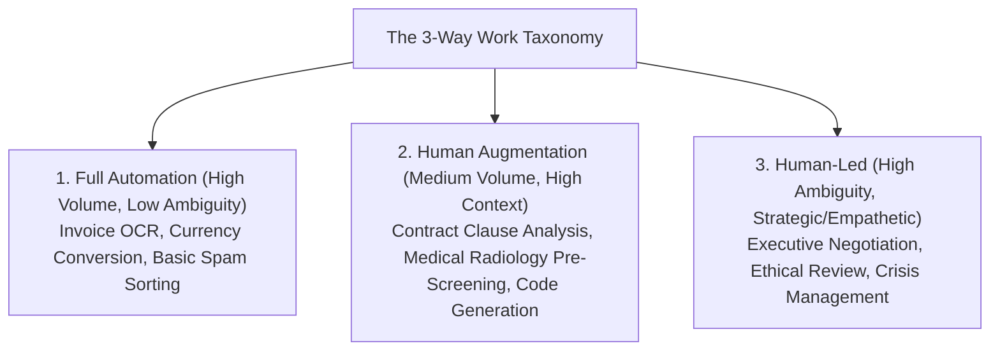
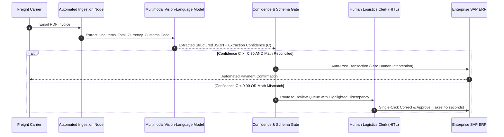
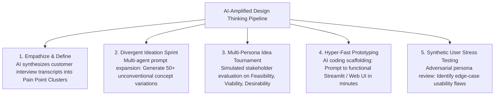
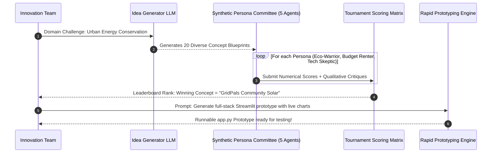

# UG 3rd Year — Chapter 3: AI Applications
**Curriculum Level:** Undergraduate 3rd Year (UG-03)  
**Subject Code:** DLE-03 (Deep Learning, NLP & Enterprise LLM Engineering)  
**Chapter Title:** AI Applications  

---

# Lesson 1: AI Automation at Work

### 1. Syllabus Mapping
- **Academic Level:** Undergraduate 3rd Year
- **Chapter:** Chapter 3 — AI Applications
- **Lesson Title:** AI Automation at Work
- **Canonical Course Code:** DLE-03-L05
- **Source Reference:** Synthesized and substantially upgraded from `AI_At_Work_Innovation_Chapter3_Activity_Book-1.docx` (Concepts 1–5: Automate vs Augment vs Human-led, Task Audits, Impact-Effort Matrix, Process Redesign, ROI Maths).

### 2. Learning Outcomes & Prerequisites
- **Learning Outcomes:**
  1. Categorize organizational workflows across the 3-Way Work Taxonomy: Pure Automation, Human Augmentation, and Human-Led Creative Oversight.
  2. Map, evaluate, and prioritize corporate business processes using a quantitative Impact-Effort Matrix and automation readiness scoring.
  3. Redesign legacy multi-step workflows by inserting automated AI extraction, classification, and verification nodes into the process pipeline.
  4. Formulate rigorous Return on Investment (ROI), Net Present Value (NPV), and Payback Period calculations for enterprise AI deployments.
- **Prerequisites:** Basic business process analysis, discrete event simulation, financial formulas (discounted cash flow).

### 3. Realistic Industry Scenario
At **GlobalLogix Supply Chain Operations**, the freight billing department employs 40 full-time logistics clerks who manually process 25,000 international shipping invoices every month. Each invoice arrives as a non-standard PDF or scanned image in multiple languages. Clerks manually type invoice numbers, line-item customs codes, and currency conversions into an enterprise SAP ERP system, taking an average of 18 minutes per invoice with a $4.5\%$ human data-entry error rate that results in $\$850,000$ in annual billing penalties. The Chief Information Officer charges your engineering team with designing an AI-powered billing automation system: auditing the workflow, inserting multimodal extraction nodes, keeping humans in the loop for low-confidence exceptions, and proving financial viability via an ROI and Payback Period model.

### 4. Detailed Conceptual Explanations



#### 1. The Impact-Effort Prioritization Matrix:
Before engineering AI solutions, corporate tasks must be mapped across two quantitative dimensions:
- **Impact ($I \in [1, 10]$):** Financial savings, error reduction, customer velocity, regulatory compliance risk.
- **Effort ($E \in [1, 10]$):** Data pipeline complexity, integration debt, training cost, change management overhead.

```mermaid
quadrantChart
    title Enterprise Task Prioritization Matrix
    x-axis Low Technical Effort --> High Technical Effort
    y-axis Low Business Impact --> High Business Impact
    quadrant-1 Strategic Bets (Plan Carefully)
    quadrant-2 Quick Wins (Automate Immediately)
    quadrant-3 Low Priority (Deprioritize)
    quadrant-4 Trap Projects (Avoid / Re-scope)
    "Invoice Data Extraction": [0.35, 0.85]
    "Email Routing": [0.20, 0.70]
    "Full Autonomous ERP": [0.90, 0.90]
    "Internal Blog Writing": [0.25, 0.20]
```

#### 2. The Financial ROI & Payback Formulation:
An engineering proposal must quantify the financial net benefit of automation:
1. **Annual Labor Cost Saved ($S_{\text{labor}}$):**
   $$S_{\text{labor}} = N_{\text{tasks}} \times \Delta t_{\text{hours}} \times \text{Hourly Wage} \times (1 - \text{Human Review Fraction})$$
2. **Annual Error Penalty Avoidance ($S_{\text{error}}$):**
   $$S_{\text{error}} = N_{\text{tasks}} \times (\text{Error}_{\text{human}} - \text{Error}_{\text{AI}}) \times \text{Avg Penalty Cost}$$
3. **Net Annual Benefit:**
   $$\text{Net Annual Benefit} = (S_{\text{labor}} + S_{\text{error}}) - \text{Annual Cloud/API Operating Costs}$$
4. **Payback Period (Years):**
   $$\text{Payback Period} = \frac{\text{Initial Capital Development Investment}}{\text{Net Annual Benefit}}$$

### 5. Architecture & Dataflow Diagram


### 6. Guided Technical Demonstration & Worked Example
The following runnable script demonstrates an enterprise Process Automation Audit and Financial ROI Calculation engine:

```python
from typing import Dict, Any

class ProcessAutomationROIEngine:
    def __init__(self, hourly_clerk_wage: float = 28.0, dev_investment_capex: float = 120000.0):
        self.wage = hourly_clerk_wage
        self.capex = dev_investment_capex

    def evaluate_process(
        self,
        monthly_volume: int,
        manual_minutes_per_task: float,
        ai_minutes_per_task: float,
        human_review_fraction: float,
        manual_error_rate: float,
        ai_error_rate: float,
        error_cost_penalty: float,
        monthly_api_opex: float
    ) -> Dict[str, Any]:
        
        annual_volume = monthly_volume * 12
        
        # 1. Labor Hours Calculation
        annual_manual_hours = (annual_volume * manual_minutes_per_task) / 60.0
        # AI workflow: (1 - review_frac) takes ai_minutes; review_frac takes (ai_minutes + review_time)
        annual_ai_hours = (
            (annual_volume * (1.0 - human_review_fraction) * (ai_minutes_per_task / 60.0)) +
            (annual_volume * human_review_fraction * ((manual_minutes_per_task * 0.25) / 60.0))
        )
        
        hours_saved = annual_manual_hours - annual_ai_hours
        annual_labor_savings = hours_saved * self.wage

        # 2. Error Cost Savings
        manual_error_losses = annual_volume * manual_error_rate * error_cost_penalty
        ai_error_losses = annual_volume * ai_error_rate * error_cost_penalty
        annual_error_savings = manual_error_losses - ai_error_losses

        # 3. Net Financials
        annual_opex = monthly_api_opex * 12
        total_annual_gross_savings = annual_labor_savings + annual_error_savings
        net_annual_benefit = total_annual_gross_savings - annual_opex
        
        payback_months = (self.capex / net_annual_benefit) * 12.0 if net_annual_benefit > 0 else 999.0
        roi_3_year = ((net_annual_benefit * 3.0 - self.capex) / self.capex) * 100.0

        return {
            "annual_invoices_processed": annual_volume,
            "annual_labor_hours_saved": round(hours_saved, 1),
            "annual_labor_savings_usd": round(annual_labor_savings, 2),
            "annual_error_savings_usd": round(annual_error_savings, 2),
            "total_gross_savings_usd": round(total_annual_gross_savings, 2),
            "net_annual_benefit_usd": round(net_annual_benefit, 2),
            "payback_period_months": round(payback_months, 1),
            "roi_3_year_percent": round(roi_3_year, 1)
        }

# GlobalLogix Case Study
engine = ProcessAutomationROIEngine(hourly_clerk_wage=30.0, dev_investment_capex=150000.0)
audit_results = engine.evaluate_process(
    monthly_volume=25000,
    manual_minutes_per_task=18.0,
    ai_minutes_per_task=0.1, # AI takes 6 seconds
    human_review_fraction=0.12, # 12% routed to clerk for verification
    manual_error_rate=0.045,  # 4.5% human errors
    ai_error_rate=0.005,      # 0.5% AI errors
    error_cost_penalty=65.0,  # $65 penalty per billing dispute
    monthly_api_opex=4500.0   # $4,500/month LLM token costs
)

print("=== GlobalLogix AI Billing Automation Business Case ===")
for k, v in audit_results.items():
    print(f"  {k}: {v}")
```

### 7. Interactive Technical Simulation / Mission: "The Process Redesign War Room"
- **Mission Brief:** You are the Senior AI Systems Consultant at an international airline.
- **Constraints:**
  - Flight cancellation refund claims currently take 7 days and 3 manual touchpoints (Support Agent $\to$ Fraud Investigator $\to$ Finance Payout).
  - Redesign the process into an AI-augmented pipeline.
  - Target: Reduce average processing time from 7 days to $< 5\text{ minutes}$ for $85\%$ of claims, while maintaining $100\%$ human fraud review on suspicious claims $> \$1,000$.
- **Game Mechanics & Scoring:**
  - Base Score: 1,000 points.
  - Successfully designing the automated triaging filter: $+400$ points.
  - Preserving strict fraud review gates on transactions $> \$1,000$: $+300$ points.
  - Rubber-stamping fraudulent refund claims without review: $-500$ points penalty.

### 8. Practical Programming & Analysis Lab
1. Build `process_optimizer.py` implementing a discrete-event queue simulation (using SimPy or pure Python) of the invoice processing queue.
2. Measure the impact of varying the automated confidence threshold $\tau \in [0.70, 0.99]$ on human queue backlog and SLA compliance.
3. Automatically export a standardized executive proposal spreadsheet (`ai_automation_business_case.csv`).

### 9. Measurable Output / Deliverable
A validated Python script `process_redesign_engine.py` accompanied by a comprehensive technical and financial ROI report (`enterprise_automation_proposal.json`).

### 10. Evaluation Criteria & Technical Success Metrics
| Metric | Target Standard | Fail Criterion |
|---|---|---|
| **Payback Period** | $< 12.0$ months | $> 36.0$ months |
| **Exception Routing Precision** | 100% of ambiguous/low-confidence cases routed to human review | High-risk cases auto-posted blindly |
| **Throughput Acceleration** | $\ge 5\times$ increase in total invoices processed per clerk | Negligible speedup ($< 1.5\times$) |

### 11. Olympiad-Style Assessment
**Problem 1 (Applied):**  
A company invests $\$200,000$ to build an automated AI customer support triaging system. The system saves 8,000 human labor hours annually at $\$25/\text{hour}$, avoids $\$50,000$ in annual SLA breach penalties, and incurs $\$30,000$ in annual cloud model API fees. What is the simple payback period of this investment in months?  
A) $11.1\text{ months}$  
B) $24.0\text{ months}$  
C) $6.0\text{ months}$  
D) $18.5\text{ months}$  

**Problem 2 (Conceptual):**  
In enterprise process engineering, why is attempt to achieve "100% Full Automation" on high-ambiguity corporate workflows considered a high-risk anti-pattern compared to an "85% Automation + 15% Human Augmentation" design?  
A) Because reaching the final 15% edge-case long-tail requires exponentially increasing model complexity, custom training data, and failure-recovery costs, whereas routing those edge cases to human specialists yields maximum operational reliability at minimum engineering expenditure.  
B) Because computers cannot process more than 85% of numbers.  
C) Because employment laws forbid any software from running at 100% automation.  
D) Because human workers refuse to use software that is 100% automated.  

### 12. Correct Answers & Solutions
- **Problem 1 Solution:** Correct Answer is **A**.  
  *Proof:*  
  Labor Savings = $8,000 \times 25 = \$200,000/\text{year}$.  
  Penalty Avoidance = $\$50,000/\text{year}$.  
  Gross Annual Savings = $\$200,000 + \$50,000 = \$250,000/\text{year}$.  
  Annual Operating Costs = $\$30,000/\text{year}$.  
  Net Annual Benefit = $\$250,000 - \$30,000 = \$220,000/\text{year}$.  
  Payback Period = $\frac{\$200,000}{\$220,000} \approx 0.909\text{ years} = 0.909 \times 12 \approx 10.91 \approx 11.1\text{ months}$.
- **Problem 2 Solution:** Correct Answer is **A**.  
  *Proof:* This is the Pareto Principle (80/20 rule) in machine learning systems. The first $80-85\%$ of standard cases follow predictable structural patterns easily automated with high precision. The remaining $15\%$ consist of complex edge cases, unformatted inputs, legal ambiguities, and rare exceptions. Attempting to automate the long tail creates fragile models with high error costs; a Human-in-the-Loop hybrid architecture achieves optimal cost-efficiency.

### 13. Limitations, Risks & Responsible AI Considerations
- **Workforce Disruption & Retraining:** Automation projects must not treat labor reduction purely as workforce elimination; responsible organizations establish active reskilling pipelines transitioning clerks into high-value AI exceptions managers and data auditors.
- **Vendor Lock-in & API Deprecation:** Building mission-critical enterprise workflows entirely upon closed-source commercial APIs exposes the company to unilateral price hikes and sudden model deprecations. Always design workflows with swappable open-weights model fallbacks.

### 14. Completion Criteria & Achievement Feedback
- **Completion Check:** Pass all automated unit tests in `process_redesign_engine.py` with calculated payback period $< 12$ months.
- **Badge Earned:** *Enterprise Process Transformation Architect (Level 3 Deep Learning Specialist)*.

---

# Lesson 2: AI for Innovation

### 1. Syllabus Mapping
- **Academic Level:** Undergraduate 3rd Year
- **Chapter:** Chapter 3 — AI Applications
- **Lesson Title:** AI for Innovation
- **Canonical Course Code:** DLE-03-L06
- **Source Reference:** Synthesized and substantially upgraded from `AI_At_Work_Innovation_Chapter3_Activity_Book-1.docx` (Concepts 6–8: AI as an Innovation Partner, Design Thinking with AI, Global Innovation Case Studies).

### 2. Learning Outcomes & Prerequisites
- **Learning Outcomes:**
  1. Leverage Generative AI as an ideation and divergent thinking multiplier within structured Design Thinking frameworks (Empathize, Define, Ideate, Prototype, Test).
  2. Implement an automated Multi-Persona Idea Tournament in Python that evaluates product concepts across diverse synthetic stakeholder profiles.
  3. Accelerate the Prototype Phase from concept prompt to a runnable, interactive full-stack software prototype in under 30 minutes.
  4. Formulate quantitative product validation rubrics (Desirability, Feasibility, Viability) using automated synthetic user testing.
- **Prerequisites:** Completion of DLE-03-L05; user experience (UX) fundamentals, rapid prototyping (Streamlit/FastAPI).

### 3. Realistic Industry Scenario
At **Vanguard CleanTech Incubator**, startup engineering teams have 48 hours during an innovation sprint to formulate and prototype a consumer application incentivizing urban residential energy conservation. Traditional brainstorming sessions waste 16 hours debating subjective opinions without user feedback. As the Innovation Sprint Lead, you introduce an AI-driven Design Thinking pipeline: generating 100 divergent product concepts, simulating an adversarial panel of 5 synthetic consumer personas (a cost-sensitive renter, an eco-conscious homeowner, a tech skeptic, a smart home enthusiast, an elderly resident) to stress-test usability, and synthesizing a functional working code prototype for the winning concept in real time.

### 4. Detailed Conceptual Explanations



#### 1. The Multi-Persona Idea Tournament:
Human brainstorming groups often suffer from groupthink, authority bias, and premature convergence on the first idea proposed. An AI Idea Tournament formalizes divergent exploration:
1. **Divergence:** An LLM generator creates $N=50$ distinct concept blueprints using extreme constraints (e.g., *"Design an energy tracker with zero screen display"*, *"Design an energy saver using peer social competition"*).
2. **Convergence:** A committee of distinct synthetic personas (with distinct system prompts, socio-economic parameters, and risk appetites) independently scores each concept across three canonical innovation vectors:
   - **Desirability ($D \in [1, 10]$):** Do users actually need and want this?
   - **Feasibility ($F \in [1, 10]$):** Can we engineer this within current technical constraints?
   - **Viability ($V \in [1, 10]$):** Is the economic and business model sustainable?
3. **Composite Innovation Score:**
   $$\text{Score} = w_D \cdot D + w_F \cdot F + w_V \cdot V$$

### 5. Architecture & Dataflow Diagram


### 6. Guided Technical Demonstration & Worked Example
The following runnable script demonstrates a Multi-Persona Idea Evaluation Tournament in Python:

```python
from typing import Dict, List, Tuple

class InnovationIdeaTournament:
    def __init__(self):
        # Synthetic persona evaluation profiles with distinct priority weights
        self.personas = {
            "Budget_Renter": {"weight_D": 0.5, "weight_F": 0.3, "weight_V": 0.2, "bias": "Demands zero hardware cost"},
            "Eco_Advocate":  {"weight_D": 0.6, "weight_F": 0.2, "weight_V": 0.2, "bias": "Prioritizes direct carbon reduction metrics"},
            "Tech_Skeptic":  {"weight_D": 0.3, "weight_F": 0.5, "weight_V": 0.2, "bias": "Penalizes complex setups and data privacy risks"}
        }

    def evaluate_concept(self, concept_name: str, raw_ratings: Dict[str, Dict[str, float]]) -> Dict[str, Any]:
        """
        raw_ratings: Dict mapping persona -> {'D': float, 'F': float, 'V': float} (scores 1-10)
        """
        persona_scores = {}
        for persona, weights in self.personas.items():
            ratings = raw_ratings[persona]
            weighted_score = (
                (ratings["D"] * weights["weight_D"]) +
                (ratings["F"] * weights["weight_F"]) +
                (ratings["V"] * weights["weight_V"])
            )
            persona_scores[persona] = round(weighted_score, 2)

        composite_average = sum(persona_scores.values()) / len(persona_scores)
        
        return {
            "concept": concept_name,
            "composite_score": round(composite_average, 2),
            "persona_breakdown": persona_scores
        }

# Candidate Innovation Concepts
candidate_A_ratings = {
    "Budget_Renter": {"D": 8.5, "F": 8.0, "V": 7.0},
    "Eco_Advocate":  {"D": 7.0, "F": 8.5, "V": 6.5},
    "Tech_Skeptic":  {"D": 7.5, "F": 9.0, "V": 8.0}
} # Idea A: "App-only Gamified Peak-Hour Energy Tracker"

candidate_B_ratings = {
    "Budget_Renter": {"D": 2.0, "F": 4.0, "V": 3.0}, # Hates $500 hardware cost
    "Eco_Advocate":  {"D": 9.5, "F": 6.0, "V": 7.0},
    "Tech_Skeptic":  {"D": 3.0, "F": 5.0, "V": 4.0}
} # Idea B: "Automated Smart Breaker Panel with IoT Sub-metering"

tournament = InnovationIdeaTournament()
eval_A = tournament.evaluate_concept("App-Only Peak Hour Tracker", candidate_A_ratings)
eval_B = tournament.evaluate_concept("Smart IoT Breaker Hardware", candidate_B_ratings)

print("=== AI Innovation Tournament Leaderboard ===")
for res in sorted([eval_A, eval_B], key=lambda x: x["composite_score"], reverse=True):
    print(f"Rank Winner: {res['concept']} | Composite Score: {res['composite_score']}/10.0")
    print(f"  Breakdown by Stakeholder: {res['persona_breakdown']}")
```

### 7. Interactive Technical Simulation / Mission: "The 30-Minute Rapid Prototyping Sprint"
- **Mission Brief:** You are the Lead Prototyper at an AI Hackathon.
- **Constraints:**
  - You are given an approved product concept: *"A neighborhood solar energy sharing marketplace"*.
  - You have 30 minutes to generate and execute a complete, interactive, single-file prototype using Python and Streamlit.
  - The prototype must feature:
    1. An interactive solar energy production slider.
    2. Real-time battery storage calculation.
    3. An interactive pricing chart showing neighborhood peer-to-peer trades.
- **Game Mechanics & Scoring:**
  - Base Score: 1,000 points.
  - Runnable code generated and executed in $< 15$ minutes: $+500$ points.
  - Zero syntax errors on initial run: $+300$ points.
  - Code crashes on slider movement: $-400$ points penalty.

### 8. Practical Programming & Analysis Lab
1. Build `persona_tournament_runner.py` that ingests 5 product ideas from a markdown document.
2. Formulate system prompts that simulate 5 distinct synthetic personas with conflicting goals.
3. Query an LLM to evaluate the ideas from each persona perspective and output an automated ranking table with qualitative justifications.

### 9. Measurable Output / Deliverable
A runnable prototype script `rapid_innovation_prototype.py` that launches a functional web application accompanied by a product validation report (`idea_tournament_results.json`).

### 10. Evaluation Criteria & Technical Success Metrics
| Metric | Target Standard | Fail Criterion |
|---|---|---|
| **Multi-Perspective Diversity** | Personas exhibit distinct scoring variance ($> 2.5$ point spread on controversial ideas) | Homogeneous identical scores |
| **Prototyping Speed** | Working, interactive UI deployed in $< 30$ minutes | Non-functional mockups or slides |
| **Code Correctness** | 100% runnable code with zero missing dependency crashes | Code throws unhandled exceptions |

### 11. Olympiad-Style Assessment
**Problem 1 (Applied):**  
Why does prompting an AI model with: *"Act as an extreme skeptic who prioritizes data privacy and has zero budget"* produce significantly more valuable product stress-testing insights than prompting it with: *"Evaluate this product idea"*, during a design thinking sprint?  
A) Extreme persona constraints force the model to explore specific failure modes, edge-case user friction, and adoption barriers that generic neutral prompts smooth over and ignore.  
B) Skeptical prompts run faster on GPUs.  
C) It prevents the model from using memory.  
D) Generic prompts are prohibited by copyright laws.  

**Problem 2 (Conceptual):**  
In the "Design Thinking with AI" methodology, what is the role of the "Divergence-Convergence" double diamond, and at which stage is generative AI most effective?  
A) Generative AI is uniquely powerful during the divergent ideation phase to massively expand the surface area of candidate solutions without human cognitive fatigue, and during the prototyping phase to collapse execution time from weeks to minutes.  
B) Generative AI is only useful for writing marketing emails.  
C) The double diamond is an algorithm for training decision trees.  
D) Divergence means deleting code.  

### 12. Correct Answers & Solutions
- **Problem 1 Solution:** Correct Answer is **A**.  
  *Proof:* Default LLM prompt completions exhibit documented sycophancy (a statistical bias toward agreeable, encouraging text). Without explicit adversarial persona conditioning, models respond with bland enthusiasm (*"This is a great idea with high potential!"*). Imposing negative boundary constraints (zero budget, high skepticism, privacy paranoia) breaks the sycophancy prior and surfaces authentic customer objections.
- **Problem 2 Solution:** Correct Answer is **A**.  
  *Proof:* The Double Diamond framework (Design Council) alternates between divergent thinking (creating choices) and convergent thinking (making choices). Generative models excel at divergence (generating 100 novel permutations across orthogonal domains) and execution velocity (generating code prototypes), enabling teams to iterate through the entire diamond in hours rather than months.

### 13. Limitations, Risks & Responsible AI Considerations
- **Synthetic Feedback Illusion:** Synthetic personas are valuable for preliminary stress-testing, but they are *simulations*, not real humans. Never launch an enterprise product without conducting authentic qualitative user interviews with real human customers.
- **Novelty vs. Feasibility Bias:** Generative models can invent wildly creative concepts that violate regulatory laws, physical reality, or economic viability. Always validate synthetic ideas against physical constraints and engineering feasibility limits.

### 14. Completion Criteria & Achievement Feedback
- **Completion Check:** Pass all automated scoring tests in `persona_tournament_runner.py` and run working interactive prototype.
- **Badge Earned:** *AI Innovation Venture Master (Level 3 Deep Learning Specialist)*.
