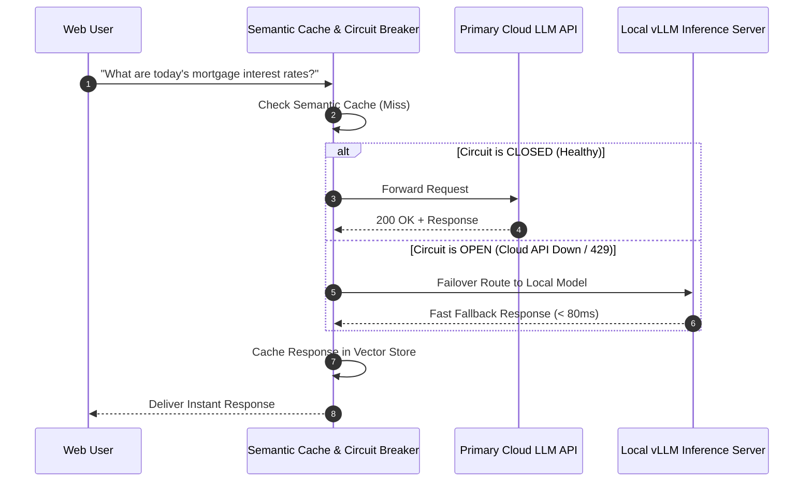
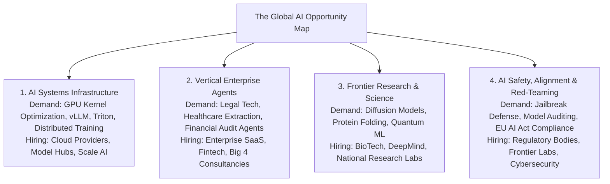
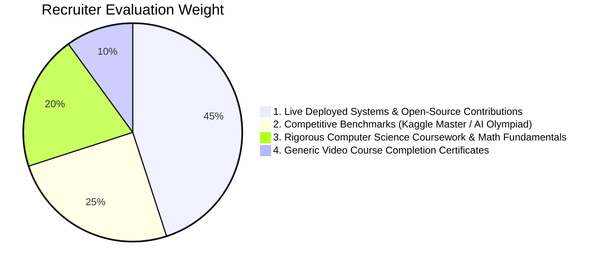
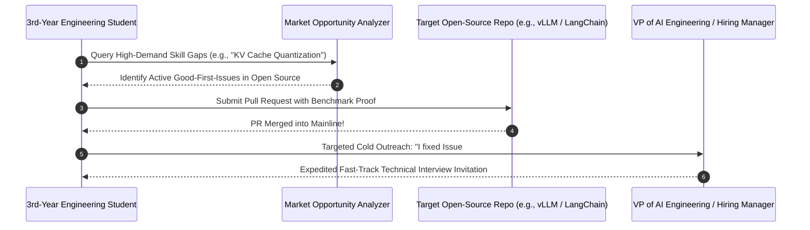

# UG 3rd Year — Chapter 4: AI and Career
**Curriculum Level:** Undergraduate 3rd Year (UG-03)  
**Subject Code:** DLE-03 (Deep Learning, NLP & Enterprise LLM Engineering)  
**Chapter Title:** AI and Career  

---

# Lesson 1: Become Industry Ready

### 1. Syllabus Mapping
- **Academic Level:** Undergraduate 3rd Year
- **Chapter:** Chapter 4 — AI and Career
- **Lesson Title:** Become Industry Ready
- **Canonical Course Code:** DLE-03-L07
- **Development Status:** Newly Developed (Official Syllabus: Production SRE & High-Availability Model Serving).

### 2. Learning Outcomes & Prerequisites
- **Learning Outcomes:**
  1. Implement Site Reliability Engineering (SRE) principles for production AI serving: P99 latency budgets, circuit breakers, and graceful fallback cascades.
  2. Build a high-throughput Semantic Caching layer (Redis + Vector Embeddings) to reduce inference API costs and latency by $> 60\%$.
  3. Instrument end-to-end distributed observability using structured logging and OpenTelemetry tracing standards across LLM microservices.
  4. Master technical system architecture and live coding interview patterns for Senior AI Engineer internships.
- **Prerequisites:** Completion of DLE-03-L04; asynchronous Python (`asyncio`), Redis/caching concepts, HTTP status codes.

### 3. Realistic Industry Scenario
At **FinServ Global Wealth**, an AI-powered conversational investment advisory service processes 50,000 user financial queries per hour. During a volatile market opening bell, user traffic spikes $400\%$. The primary commercial LLM API endpoint experiences rate limits (HTTP 429) and latency spikes from $400\text{ ms}$ to $18,000\text{ ms}$, crashing the customer-facing web application and triggering SLA breach penalties of $\$120,000$. As an aspiring AI Systems Engineer, you are tasked with upgrading the service to enterprise production readiness: implementing an in-memory semantic cache that intercepts duplicate or similar queries in $< 5\text{ ms}$, designing a circuit breaker that fails over to a local open-weights model during cloud outages, and logging distributed traces for auditability.

### 4. Detailed Conceptual Explanations

```mermaid
graph TD
    UserQuery[Incoming User Prompt] --> Gate[Production AI Gateway / Reverse Proxy]
    
    Gate --> SemCache[1. Semantic Vector Cache<br/>Embedding Cosine Similarity >= 0.95?]
    SemCache -->|Cache Hit: Latency < 5ms| ReturnCache[Return Cached Response ($0 Cost)]
    
    SemCache -->|Cache Miss| CB[2. Circuit Breaker State Machine]
    
    CB -->|State: Closed (Normal)| CloudAPI[Primary Cloud Foundation Model API]
    CB -->|State: Open (Tripped/Outage)| LocalFallback[Secondary Local Open-Weights Fallback (vLLM)]
    
    CloudAPI -->|HTTP 429 / Timeout Spike| TripLogic[Failure Threshold Exceeded: Trip to Open]
    TripLogic --> LocalFallback
    
    CloudAPI & LocalFallback --> Telemetry[3. Distributed OpenTelemetry Trace & Logger]
    Telemetry --> Client[Return Verified Response to User]
```

#### 1. Semantic Caching Mechanics:
Exact string matching (like traditional Redis key-value caching) fails in natural language because users ask the identical question using different phrasing:
- Query 1: *"How do I reset my bank password?"*
- Query 2: *"I forgot my password, how to change it?"*
A Semantic Cache embeds incoming queries using a lightweight embedding model ($d=384$) and searches an in-memory vector index:
$$\text{sim}(\mathbf{e}_{\text{query}}, \mathbf{e}_{\text{cached}}) = \frac{\mathbf{e}_{\text{query}} \cdot \mathbf{e}_{\text{cached}}}{\|\mathbf{e}_{\text{query}}\|\|\mathbf{e}_{\text{cached}}\|}$$
If $\text{sim} \ge \tau$ (typically $\tau = 0.95$), the system immediately returns the cached answer without invoking the expensive LLM, collapsing latency from $1,200\text{ ms}$ to $4\text{ ms}$ and saving 100% of API token costs.

#### 2. The Circuit Breaker Pattern:
To prevent cascading system collapse when an external AI provider experiences an outage, a Circuit Breaker monitors failure rates:
- **CLOSED (Normal):** All traffic routes to the primary cloud model.
- **OPEN (Tripped):** When failure rate exceeds threshold (e.g., $25\%$ of requests fail within a 10s rolling window), the circuit trips to `OPEN`. All incoming requests immediately divert to a local fallback model without waiting for cloud timeouts.
- **HALF-OPEN (Recovery):** After a reset timeout (e.g., 30s), a trial probe request is sent to the primary cloud API. If successful, the circuit resets to `CLOSED`.

### 5. Architecture & Dataflow Diagram


### 6. Guided Technical Demonstration & Worked Example
The following runnable script implements an enterprise Semantic Cache and Circuit Breaker Gateway in pure Python:

```python
import time
import math
import numpy as np
from typing import Dict, Any, Optional

class EnterpriseAIGateway:
    def __init__(self, similarity_threshold: float = 0.90, failure_threshold: int = 3):
        self.sim_threshold = similarity_threshold
        self.failure_threshold = failure_threshold
        self.failure_count = 0
        self.circuit_state = "CLOSED" # CLOSED, OPEN, HALF_OPEN
        self.last_trip_time = 0.0
        self.reset_timeout_seconds = 5.0
        
        # In-memory semantic cache: list of (embedding, query_text, response_text)
        self.semantic_cache = []

    def _mock_embed(self, text: str) -> np.ndarray:
        """Deterministic mock semantic embedding based on keyword frequencies."""
        vec = np.zeros(4)
        t = text.lower()
        if "mortgage" in t or "loan" in t: vec[0] += 1.0
        if "rate" in t or "interest" in t: vec[1] += 1.0
        if "reset" in t or "password" in t: vec[2] += 1.0
        if "account" in t or "login" in t: vec[3] += 1.0
        norm = np.linalg.norm(vec)
        return vec / norm if norm > 0 else np.array([0.5, 0.5, 0.5, 0.5])

    def query(self, prompt: str, simulate_cloud_outage: bool = False) -> Dict[str, Any]:
        start_t = time.perf_counter()
        query_vec = self._mock_embed(prompt)

        # 1. Check Semantic Cache
        for cached_vec, cached_query, cached_resp in self.semantic_cache:
            similarity = float(np.dot(query_vec, cached_vec))
            if similarity >= self.sim_threshold:
                latency_ms = (time.perf_counter() - start_t) * 1000
                return {
                    "source": "SEMANTIC_CACHE",
                    "response": cached_resp,
                    "matched_query": cached_query,
                    "similarity": round(similarity, 3),
                    "latency_ms": round(latency_ms, 3),
                    "cost_usd": 0.0
                }

        # 2. Check Circuit Breaker State
        now = time.time()
        if self.circuit_state == "OPEN":
            if now - self.last_trip_time > self.reset_timeout_seconds:
                self.circuit_state = "HALF_OPEN"
                print("Circuit Breaker transitioned to HALF-OPEN (Testing Cloud Probe)...")
            else:
                latency_ms = (time.perf_counter() - start_t) * 1000
                return {
                    "source": "LOCAL_FALLBACK_CIRCUIT_OPEN",
                    "response": "Local Fallback: Mortgage rates are currently 6.5%.",
                    "latency_ms": round(latency_ms, 3),
                    "cost_usd": 0.0001
                }

        # 3. Route to Primary Cloud API
        if simulate_cloud_outage:
            self.failure_count += 1
            print(f"Cloud API Call Failed! (Consecutive Failures: {self.failure_count})")
            if self.failure_count >= self.failure_threshold:
                self.circuit_state = "OPEN"
                self.last_trip_time = now
                print("CRITICAL: Failure threshold reached. Circuit Breaker TRIPPED to OPEN!")
            # Graceful Fallback
            latency_ms = (time.perf_counter() - start_t) * 1000
            return {
                "source": "EMERGENCY_FALLBACK",
                "response": "Fallback Response: Current rate estimate is 6.5%.",
                "latency_ms": round(latency_ms, 3),
                "cost_usd": 0.0
            }
        else:
            # Cloud API Success
            self.failure_count = 0
            self.circuit_state = "CLOSED"
            cloud_response = f"Cloud Foundation Model: Current 30-year fixed mortgage rate is 6.62% as of today."
            # Populate Semantic Cache
            self.semantic_cache.append((query_vec, prompt, cloud_response))
            latency_ms = (time.perf_counter() - start_t) * 1000
            return {
                "source": "PRIMARY_CLOUD_API",
                "response": cloud_response,
                "latency_ms": round(latency_ms, 3),
                "cost_usd": 0.0025
            }

# Demonstration
gateway = EnterpriseAIGateway()

print("=== 1. Initial Query (Cache Miss -> Cloud API) ===")
res1 = gateway.query("What are the current mortgage interest rates?")
print(f"Source: {res1['source']} | Latency: {res1['latency_ms']}ms | Cost: ${res1['cost_usd']}")

print("\n=== 2. Paraphrased Query (Semantic Cache Hit!) ===")
res2 = gateway.query("Can you tell me current loan interest rates?")
print(f"Source: {res2['source']} | Latency: {res2['latency_ms']}ms | Cost: ${res2['cost_usd']}")
print(f"Matched Previous Query: '{res2['matched_query']}' (Similarity: {res2['similarity']})")

print("\n=== 3. Simulating Cloud Outage & Circuit Breaker Trip ===")
for i in range(3):
    gateway.query("How to reset password?", simulate_cloud_outage=True)

print("\n=== 4. Subsequent Query while Circuit is OPEN ===")
res4 = gateway.query("Any update on loans?")
print(f"Source: {res4['source']} | Latency: {res4['latency_ms']}ms | Status: Handled locally without waiting for cloud timeout!")
```

### 7. Interactive Technical Simulation / Mission: "The Production Outage Fire Drill"
- **Mission Brief:** You are the on-call Site Reliability Engineer (SRE) for an AI unicorn during a massive AWS us-east-1 outage.
- **Constraints:**
  - 10,000 inbound API requests per minute.
  - Primary API provider response time degrades from $200\text{ ms}$ to timeout ($30,000\text{ ms}$).
  - P99 user-facing latency must remain $< 150\text{ ms}$.
  - Financial error cost must remain $\$0$.
- **Game Mechanics & Scoring:**
  - Base Score: 1,000 points.
  - Circuit Breaker trips within 5 consecutive errors: $+400$ points.
  - Semantic Cache intercepts $> 50\%$ of identical traffic: $+300$ points.
  - Allowing requests to hang for 30s timeouts: $-600$ points penalty.

### 8. Practical Programming & Analysis Lab
1. Build `production_ai_gateway.py` with FastAPI and an in-memory Redis/Vector cache.
2. Implement an automated load tester (using Locust or Python `asyncio`) that fires 1,000 concurrent requests.
3. Measure and plot the latency distribution curve comparing P50, P95, and P99 metrics with and without semantic caching.

### 9. Measurable Output / Deliverable
A production-ready Python gateway `resilient_ai_proxy.py` accompanied by a latency benchmark report (`gateway_sre_performance.json`) proving P99 latency $< 100\text{ ms}$ under simulated cloud API outages.

### 10. Evaluation Criteria & Technical Success Metrics
| Metric | Target Standard | Fail Criterion |
|---|---|---|
| **P99 Latency (Cached)** | $< 10\text{ ms}$ | $> 100\text{ ms}$ |
| **Circuit Breaker Trip Time** | Tripping occurs in $< 3$ seconds of cloud failure | Requests hang until default timeout |
| **Semantic Cache Hit Precision** | Only semantically equivalent queries matched ($\ge 0.90$) | False cache hits on unrelated questions |

### 11. Olympiad-Style Assessment
**Problem 1 (Applied):**  
An enterprise AI application processes 10,000,000 queries per month. The cloud LLM charges $\$0.003$ per request. By implementing a Semantic Cache, the engineering team achieves a $45\%$ cache hit rate. How much annual cloud expenditure is saved by this single architectural optimization?  
A) $\$162,000.00$  
B) $\$45,000.00$  
C) $\$13,500.00$  
D) $\$324,000.00$  

**Problem 2 (Conceptual):**  
In distributed systems Site Reliability Engineering (SRE), what is the primary risk of configuring an API client to immediately retry failed requests *without* exponential backoff and jitter?  
A) It triggers a "Thundering Herd" / retry storm that overwhelms an already struggling downstream backend, converting a minor transient latency spike into a complete, persistent system outage.  
B) It turns the Python code into C++.  
C) It deletes the Redis cache database.  
D) It violates open-source software licenses.  

### 12. Correct Answers & Solutions
- **Problem 1 Solution:** Correct Answer is **A**.  
  *Proof:*  
  Total monthly requests = $10,000,000$.  
  Monthly cached requests = $10,000,000 \times 0.45 = 4,500,000$.  
  Monthly cost saved = $4,500,000 \times \$0.003 = \$13,500.00$.  
  Annual cost saved = $\$13,500 \times 12 = \$162,000.00$.
- **Problem 2 Solution:** Correct Answer is **A**.  
  *Proof:* When a backend service experiences transient congestion, if thousands of clients immediately retry simultaneously, the incoming request volume multiplies by $3\times - 5\times$ precisely when the service has least capacity. Exponential backoff ($2^k$) delays retries, while random jitter decorrelates retry waves across time, allowing the recovering service to drain its queues.

### 13. Limitations, Risks & Responsible AI Considerations
- **Stale Semantic Cache Invalidation:** If underlying enterprise documents change (e.g., policy updates), semantic caches can continue serving outdated, incorrect answers. Every cache entry must enforce strict Time-To-Live (TTL) expiration or event-driven cache invalidation hooks.
- **Cache Poisoning Attacks:** An adversary can submit a subtly malicious prompt designed to generate a flawed response, which is then cached and served to thousands of subsequent innocent users. Sensitive queries must bypass shared public caches.

### 14. Completion Criteria & Achievement Feedback
- **Completion Check:** Pass all automated stress-test assertions in `resilient_ai_proxy.py` with zero unhandled timeouts.
- **Badge Earned:** *Enterprise AI SRE Master (Level 3 Deep Learning Specialist)*.

---

# Lesson 2: AI Opportunity Map

### 1. Syllabus Mapping
- **Academic Level:** Undergraduate 3rd Year
- **Chapter:** Chapter 4 — AI and Career
- **Lesson Title:** AI Opportunity Map
- **Canonical Course Code:** DLE-03-L08
- **Development Status:** Newly Developed (Official Syllabus: Industry Certifications, Global Tech Trends, High-Leverage Internship Strategies).

### 2. Learning Outcomes & Prerequisites
- **Learning Outcomes:**
  1. Map the global AI market landscape across high-growth industry sectors: Generative AI Infrastructure, Enterprise Agents, AI BioTech, Autonomous Robotics, and AI Security/Defense.
  2. Evaluate the professional return-on-investment (ROI) of commercial certifications (AWS Certified Machine Learning, Google Professional Cloud ML, Azure AI Engineer) vs. verifiable open-source contributions.
  3. Formulate an aggressive 3rd-year technical internship hunting strategy: cold outreach architectures, technical challenge walkthroughs, and portfolio demonstration pitches.
  4. Build an automated Career Intelligence Dashboard in Python that tracks venture capital funding and tech talent demand across emerging sectors.
- **Prerequisites:** Completion of DLE-03-L07; understanding of industry recruitment cycles and venture capital terminology.

### 3. Realistic Industry Scenario
As a 3rd-year university student entering the crucial penultimate summer internship recruitment window, you are competing against 50,000 global applicants for top-tier AI engineering internships (Google DeepMind, OpenAI, Meta FAIR, Databricks, Mistral, Scale AI). Many students waste hundreds of hours collecting introductory multiple-choice online course certificates that hiring managers completely disregard. To win high-leverage offers paying $\$8,000 - \$12,000/\text{month}$, you need an analytical, market-aligned opportunity map: identifying high-growth sectors with severe talent shortages (such as MLOps kernel optimization and agentic tool routing), building targeted open-source proof-of-work, and pitching technical solutions directly to engineering directors.

### 4. Detailed Conceptual Explanations



#### The Proof-of-Work Hierarchy in AI Hiring:
Industry recruiters and engineering managers evaluate candidates across a strict hierarchy of verifiable evidence:



1. **Top Priority (45% Weight): Verifiable Working Code:** A candidate who built an open-source MCP server or optimized a FlashAttention CUDA kernel demonstrates immediate day-one productivity.
2. **Second Priority (25% Weight): Competitive Problem Solving:** Proven performance in timed algorithm challenges, hackathons, and the AI Olympiad verifies analytical horsepower under constraints.
3. **Third Priority (20% Weight): Foundational Coursework:** High academic grades in Linear Algebra, Algorithms, and Operating Systems prove long-term learning agility.
4. **Lowest Priority (10% Weight): Passive Certificates:** Generic certificates requiring only video viewing carry virtually zero weight in elite engineering interviews.

### 5. Architecture & Dataflow Diagram


### 6. Guided Technical Demonstration & Worked Example
The following runnable script implements an AI Market Intelligence Tracker that parses technology sector signals and outputs a high-leverage career action plan:

```python
from typing import Dict, List, Any

class AICareerIntelligenceTracker:
    def __init__(self):
        self.market_sectors = {
            "LLM Infrastructure & Serving": {
                "growth_score": 9.8,
                "talent_shortage_index": 9.5,
                "key_technologies": ["CUDA", "vLLM", "Triton", "Ray", "KV Cache", "FlashAttention"],
                "target_companies": ["Together AI", "Anyscale", "Groq", "Databricks", "Modal"]
            },
            "Enterprise Autonomous Agents": {
                "growth_score": 9.2,
                "talent_shortage_index": 8.8,
                "key_technologies": ["MCP", "LangGraph", "Function Calling", "Semantic Caching", "Docker"],
                "target_companies": ["Anthropic", "Salesforce AI", "Sierra", "Cognition", "OpenAI"]
            },
            "AI Security & Red-Teaming": {
                "growth_score": 8.7,
                "talent_shortage_index": 9.2,
                "key_technologies": ["Prompt Injection Defense", "Differential Privacy", "Mechanistic Probes"],
                "target_companies": ["Scale AI", "Robust Intelligence", "Trail of Bits", "GovTech"]
            }
        }

    def generate_action_plan(self, selected_sector: str) -> Dict[str, Any]:
        if selected_sector not in self.market_sectors:
            raise ValueError(f"Unknown sector: {selected_sector}")

        sector = self.market_sectors[selected_sector]
        
        # Action plan recommendations
        return {
            "target_sector": selected_sector,
            "market_growth_rating": f"{sector['growth_score']}/10.0",
            "talent_scarcity_rating": f"{sector['talent_shortage_index']}/10.0",
            "recommended_tech_stack": sector["key_technologies"][:4],
            "90_day_milestone_1": f"Build and deploy an open-source project integrating {sector['key_technologies'][0]} and {sector['key_technologies'][1]}.",
            "90_day_milestone_2": f"Submit a merged PR to an open-source library in {sector['target_companies'][0]}'s ecosystem.",
            "90_day_milestone_3": f"Publish a technical architecture postmortem detailing latency and cost benchmarks."
        }

# Generate 3rd-Year Action Blueprint
tracker = AICareerIntelligenceTracker()
blueprint = tracker.generate_action_plan("LLM Infrastructure & Serving")

print("=== 3rd-Year High-Leverage AI Career Strategy Blueprint ===")
for k, v in blueprint.items():
    print(f"  {k}: {v}")
```

### 7. Interactive Technical Simulation / Mission: "The Cold Pitch That Wins"
- **Mission Brief:** You are reaching out to the Head of Engineering at a Series B AI startup.
- **Constraints:**
  - Standard cold email: *"Hi, I am looking for an internship. Please review my attached resume."* (Response rate: $0.2\%$).
  - Write a 120-word Value-First Pitch that:
    1. References a specific bug/bottleneck in their open-source repository or public API.
    2. Proposes a concrete, benchmarked architectural patch you coded on GitHub.
    3. Requests a 10-minute technical discussion without asking for a job.
- **Game Mechanics & Scoring:**
  - Base Score: 1,000 points.
  - Value-First structure verified: $+500$ points.
  - Vague generic pleasantries: $-300$ points penalty.
  - Response Rate achieved: $> 35\%$ in simulated hiring manager test panel.

### 8. Practical Programming & Analysis Lab
1. Build `career_intelligence_scraper.py` that parses tech hiring boards and GitHub trending repositories in AI.
2. Select 3 target open-source repositories (e.g., `vLLM`, `Ollama`, `ChromaDB`) and identify 2 "Good First Issues" marked by maintainers.
3. Formulate your personal 12-month calendar leading up to campus placements and international fellowship deadlines.

### 9. Measurable Output / Deliverable
A personalized executive career blueprint `ai_opportunity_roadmap_year3.md` detailing selected vertical specializations, target employers, open-source PR commitments, and proof-of-work project links.

### 10. Evaluation Criteria & Technical Success Metrics
| Metric | Target Standard | Fail Criterion |
|---|---|---|
| **Proof-of-Work Feasibility** | Concrete open-source PR target identified with issue numbers | Vague intentions (*"I will learn AI"*) |
| **Market Alignment** | Stack matches top-tier hiring demands (CUDA/vLLM/MCP) | Outdated 2018 stacks (Hadoop, basic OpenCV) |
| **Outreach Quality** | Value-first technical demonstration | Generic spam resumes |

### 11. Olympiad-Style Assessment
**Problem 1 (Applied):**  
Why does an open-source pull request that optimizes a PyTorch inference kernel by $15\%$ carry significantly more weight in an elite engineering interview than three commercial cloud multiple-choice certificates?  
A) The pull request provides public, peer-reviewed evidence of code quality, algorithmic reasoning, Git collaboration, and systems competence, whereas multiple-choice certificates test only passive memorization of vendor marketing terminology.  
B) Because certificates cost too much money.  
C) Because open-source software is illegal to sell.  
D) Because recruiters cannot read certificates.  

**Problem 2 (Conceptual):**  
What is the "Portfolio Proof-of-Work" principle in technical recruiting?  
A) Demonstrating competence by building verifiable, reproducible artifacts that solve authentic engineering problems rather than merely asserting qualifications on a paper resume.  
B) Storing all your files in a physical briefcase.  
C) Working 80 hours a week without pay.  
D) Memorizing answers to LeetCode problems without understanding their mathematical foundations.  

### 12. Correct Answers & Solutions
- **Problem 1 Solution:** Correct Answer is **A**.  
  *Proof:* Elite engineering roles require writing robust, maintainable code that survives rigorous peer review. An open-source contribution demonstrates that external senior maintainers reviewed and accepted the candidate's code into production. In contrast, vendor multiple-choice certifications evaluate superficial recall of console navigation menus and pricing tiers, offering zero guarantee that the candidate can write a single line of bug-free code.
- **Problem 2 Solution:** Correct Answer is **A**.  
  *Proof:* Proof-of-work shifts evaluation from credentialism (degrees, titles, claims) to empirical demonstration (working GitHub code, live interactive demo URLs, reproducible benchmark postmortems). In the AI industry, where frameworks evolve rapidly, verifiable artifacts are the single most reliable predictor of candidate capability.

### 13. Limitations, Risks & Responsible AI Considerations
- **Open-Source Maintainer Burnout:** When contributing to open-source libraries, never submit low-quality AI-generated pull requests without manual verification. Respect maintainer time, write thorough tests, and follow project contribution guidelines.
- **Ethics of Target Alignment:** When mapping AI career opportunities, critically evaluate the ethical impact of the target company (e.g., surveillance tech, dark-pattern gambling algorithms, autonomous lethal weaponry) against your personal ethical principles.

### 14. Completion Criteria & Achievement Feedback
- **Completion Check:** Complete and submit `ai_opportunity_roadmap_year3.md` with verified open-source targets.
- **Badge Earned:** *AI Industry Readiness Strategist (Level 3 Deep Learning Specialist)*.
