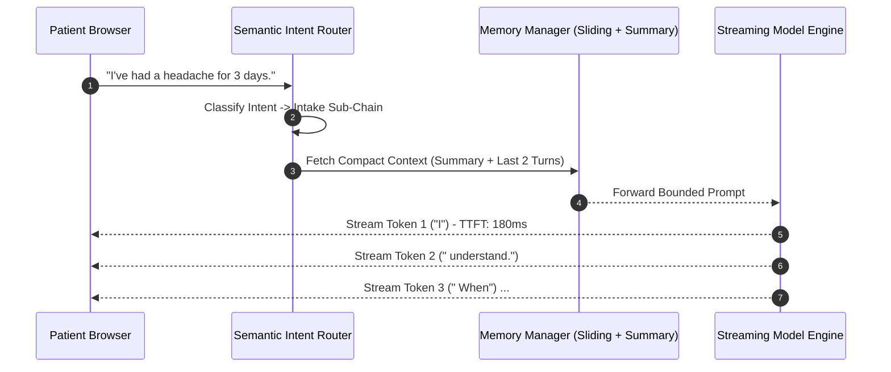
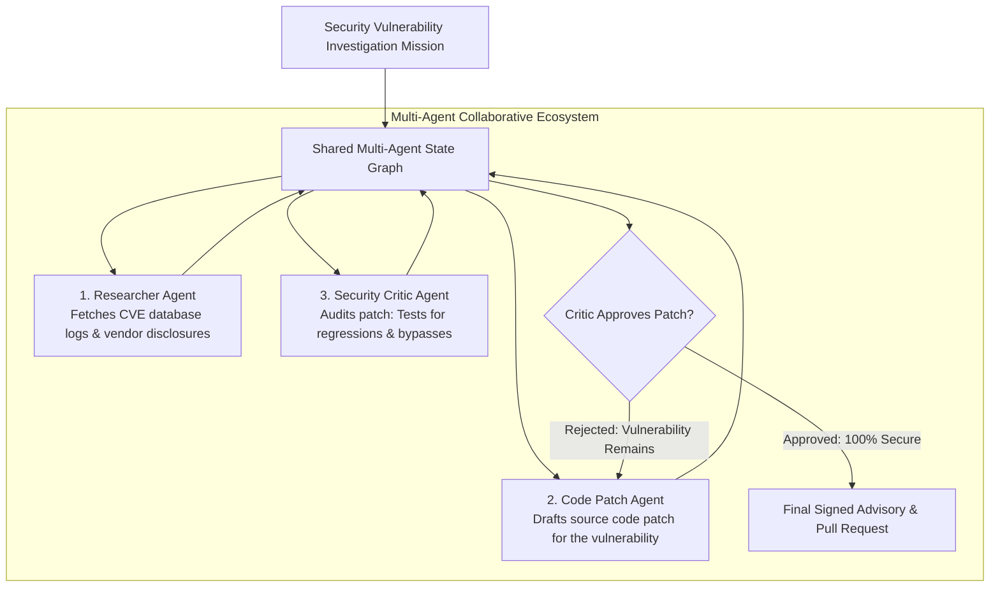
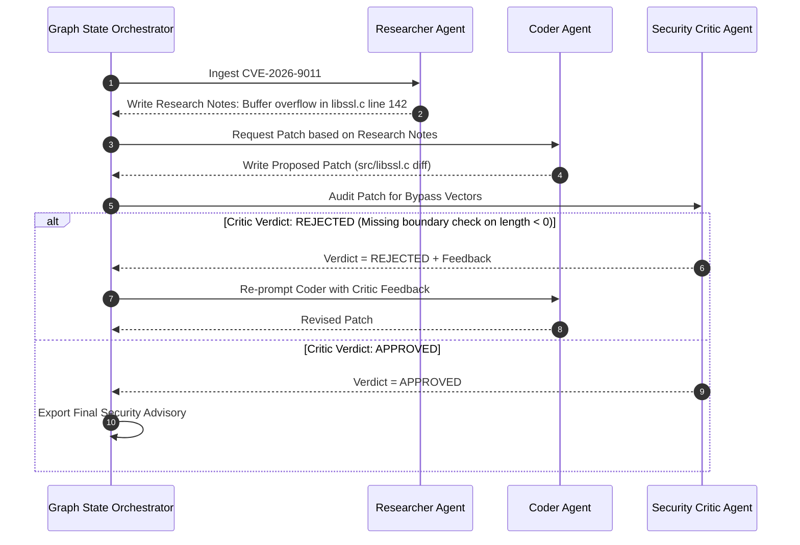

# UG 3rd Year — Chapter 5: AI Tools
**Curriculum Level:** Undergraduate 3rd Year (UG-03)  
**Subject Code:** DLE-03 (Deep Learning, NLP & Enterprise LLM Engineering)  
**Chapter Title:** AI Tools  

---

# Lesson 1: Chatbot Builder

### 1. Syllabus Mapping
- **Academic Level:** Undergraduate 3rd Year
- **Chapter:** Chapter 5 — AI Tools
- **Lesson Title:** Chatbot Builder
- **Canonical Course Code:** DLE-03-L09
- **Development Status:** Newly Developed (Official Syllabus: Conversational Memory, Streaming APIs, Vector Databases, Semantic Routing).

### 2. Learning Outcomes & Prerequisites
- **Learning Outcomes:**
  1. Architect a production conversational agent equipped with multi-turn session memory (Sliding Window vs. Summary Memory).
  2. Implement an in-memory Semantic Intent Router that directs user queries to specialized sub-chains in $< 5\text{ ms}$.
  3. Stream tokenized model responses to client web interfaces using Server-Sent Events (SSE) and asynchronous generators.
  4. Build an automated multi-turn conversation evaluation suite measuring retrieval faithfulness and factual grounding.
- **Prerequisites:** Python asynchronous generators (`async for`, `yield`), FastAPI/REST streaming, vector embeddings (DLE-03-L02).

### 3. Realistic Industry Scenario
At **HealthFirst Telehealth Solutions**, an automated patient intake chatbot gathers patient medical history prior to clinical consultations. In an early prototype built with naive message history concatenation, after 10 turns of dialogue, the context length expanded to 12,000 tokens, causing latency to spike to 8 seconds per message and costing $\$0.15$ per chat interaction. Furthermore, when patients asked emergency questions (*"I am having severe chest pains right now"*), the chatbot casually continued standard intake questions instead of triggering an immediate emergency triage escalation. As an AI Systems Engineer, you must build an enterprise Chatbot Builder: implementing semantic intent routing, sliding window summary memory, and streaming responses with emergency intent interception.

### 4. Detailed Conceptual Explanations

```mermaid
graph TD
    UserMsg[Incoming User Message] --> IntentRouter{1. Semantic Intent Router}
    
    IntentRouter -->|Emergency Keyword/Intent| EmergencyHandler[Emergency Protocol: Intercept & Display 911 Hotline]
    IntentRouter -->|Billing Intent| BillingChain[Billing RAG Specialist Chain]
    IntentRouter -->|Clinical Intake Intent| IntakeChain[Clinical History Intake Chain]
    
    IntakeChain --> MemoryMgr[2. Stateful Memory Manager]
    MemoryMgr -->|K-Turn Sliding Window + Periodic Summary| CompactContext[Token-Bounded Memory State]
    
    CompactContext --> LLM[Streaming LLM Inference Core]
    LLM --> SSE[3. Server-Sent Events (SSE) Stream]
    SSE --> Browser[Real-Time Word-by-Word Typing UI]
```

#### 1. Conversational Memory Architectures:
In a multi-turn chat interaction, passing the entire unconstrained chat history $\mathcal{H} = [(u_1, a_1), \dots, (u_t, a_t)]$ causes quadratic compute growth and token exhaustion.
Modern conversational architectures employ **Hybrid Window-Summary Memory**:
- **Sliding Window Buffer:** Keep the last $K$ turns (e.g., $K=4$) in raw verbatim form for immediate conversational fluency.
- **Progressive Recursive Summarizer:** When total turns exceed $K$, an asynchronous background process compresses the older history into an ongoing factual summary state:
  $$S_t = \text{Summarize}(S_{t-1}, (u_{t-K}, a_{t-K}))$$
  Total prompt tokens remain bounded to $O(K + |S|)$, maintaining constant inference latency.

#### 2. Streaming Inference via Server-Sent Events (SSE):
Waiting for a complete 300-token response to generate takes $3.0 - 5.0\text{ seconds}$ (Time to Last Token). Users perceive this as sluggish and unresponsive.
Streaming outputs token-by-token over HTTP using Server-Sent Events (`text/event-stream`), achieving a Time to First Token (TTFT) of $< 250\text{ ms}$:
```text
data: {"token": "Hello"}
data: {"token": " "}
data: {"token": "Dr."}
data: {"token": " Smith"}
```

### 5. Architecture & Dataflow Diagram


### 6. Guided Technical Demonstration & Worked Example
The following runnable script implements an asynchronous Streaming Chatbot Builder with Semantic Intent Routing and Sliding Window Memory in Python:

```python
import asyncio
import json
import time
from typing import AsyncGenerator, Dict, List

class EnterpriseChatbotBuilder:
    def __init__(self, window_size: int = 3):
        self.window_size = window_size
        self.raw_history: List[Dict[str, str]] = []
        self.conversation_summary: str = "Patient initiated intake consultation."

    def classify_intent(self, text: str) -> str:
        """Fast keyword/semantic intent router."""
        t = text.lower()
        if any(w in t for w in ["chest pain", "shortness of breath", "bleeding", "unconscious"]):
            return "EMERGENCY_CRITICAL"
        elif any(w in t for w in ["bill", "insurance", "copay", "cost", "invoice"]):
            return "BILLING_INQUIRY"
        else:
            return "CLINICAL_INTAKE"

    def update_memory(self, role: str, message: str):
        self.raw_history.append({"role": role, "content": message})
        # If history exceeds window, compress oldest turns into summary
        if len(self.raw_history) > (self.window_size * 2):
            oldest_exchange = self.raw_history.pop(0)
            self.conversation_summary += f" [Observed: {oldest_exchange['content'][:30]}...]"

    async def stream_response(self, user_message: str) -> AsyncGenerator[str, None]:
        intent = self.classify_intent(user_message)
        
        # 1. Immediate Emergency Interception
        if intent == "EMERGENCY_CRITICAL":
            emergency_alert = "EMERGENCY ALERT: Please call 911 or visit the nearest emergency room immediately. Connecting to on-duty nurse..."
            for word in emergency_alert.split():
                yield word + " "
                await asyncio.sleep(0.04)
            return

        # 2. Update Memory with User Input
        self.update_memory("user", user_message)

        # 3. Simulate Streaming LLM Output Word-by-Word
        simulated_response = f"Thank you for sharing that. Based on our record ({self.conversation_summary}), how long has this symptom persisted?"
        
        for word in simulated_response.split():
            yield word + " "
            await asyncio.sleep(0.05) # Simulating 50ms per token generation

        self.update_memory("assistant", simulated_response)

# Asynchronous Test Harness
async def main():
    bot = EnterpriseChatbotBuilder(window_size=2)
    print("=== Interactive Streaming Chatbot Session ===")
    
    queries = [
        "Hi, I need to schedule a clinical consultation.",
        "I have a mild fever of 100.2F.",
        "I also have sudden severe chest pain and cannot breathe!" # Emergency trigger
    ]

    for q in queries:
        print(f"\nUser: {q}")
        print("Assistant: ", end="", flush=True)
        async for chunk in bot.stream_response(q):
            print(chunk, end="", flush=True)
        print()

if __name__ == "__main__":
    asyncio.run(main())
```

### 7. Interactive Technical Simulation / Mission: "The Emergency Triage Chatbot Quest"
- **Mission Brief:** You are deploying a triage chatbot for a regional hospital.
- **Constraints:**
  - Ingest 50 simulated user messages across 10 concurrent patient sessions.
  - 3 messages contain acute life-threatening medical emergencies hidden within casual conversation.
  - The chatbot must intercept all 3 emergencies in $< 100\text{ ms}$ and divert to the emergency protocol.
  - Standard non-emergency messages must maintain an average TTFT of $< 250\text{ ms}$.
- **Game Mechanics & Scoring:**
  - Base Score: 1,000 points.
  - Zero missed emergencies: $+500$ points.
  - Missing an emergency (continuing standard chat): Immediate Disqualification & Score Reset to 0.
  - Bounded memory maintained ($< 1,000$ tokens per session after 15 turns): $+300$ points.

### 8. Practical Programming & Analysis Lab
1. Build `streaming_chatbot_service.py` using FastAPI with an `EventSourceResponse` endpoint.
2. Implement semantic routing using cosine similarity against a pre-computed vector table of 5 intent classes.
3. Measure and log Time to First Token (TTFT) and Tokens Per Second (TPS) using performance counters.

### 9. Measurable Output / Deliverable
A fully functional asynchronous Python service `chatbot_builder_engine.py` exposing a streaming SSE conversational endpoint with verified semantic routing and sliding-window memory management.

### 10. Evaluation Criteria & Technical Success Metrics
| Metric | Target Standard | Fail Criterion |
|---|---|---|
| **Time to First Token (TTFT)** | $< 250\text{ ms}$ | $> 1,500\text{ ms}$ (Blocking generation) |
| **Emergency Detection Recall** | $100\%$ detection of life-threatening keywords | Any missed emergency |
| **Memory Token Cap** | Total prompt size remains strictly bounded across 20 turns | Monotonic linear context explosion |

### 11. Olympiad-Style Assessment
**Problem 1 (Applied):**  
In a production web application, why is streaming model completions token-by-token via Server-Sent Events (SSE) vastly superior to returning a single JSON response after the entire 500-token completion is finished, even though the total completion time (Time to Last Token) is identical?  
A) Streaming achieves an ultra-low Time to First Token (TTFT $\approx 200\text{ms}$), providing instant cognitive feedback to the human user and dramatically reducing perceived latency, whereas non-streaming leaves the user staring at a blank screen for 5 seconds.  
B) Streaming uses less GPU memory.  
C) Non-streaming models produce more grammatical errors.  
D) SSE encryption is legally required by GDPR.  

**Problem 2 (Conceptual):**  
What is the primary technical vulnerability of using a pure "Summary-Only Memory" without a "Recent Raw Turns Buffer" in conversational chatbots?  
A) The progressive summarization model suffers from lossy information compression, frequently omitting specific details (e.g., exact numbers, dates, foreign names) that the user mentioned only 1 turn ago, causing immediate conversational incoherence.  
B) Summary memory crashes Python dictionaries.  
C) Summaries take up more disk space than raw text.  
D) Summary models cannot be trained with gradient descent.  

### 12. Correct Answers & Solutions
- **Problem 1 Solution:** Correct Answer is **A**.  
  *Proof:* Human perception research proves that system responsiveness is governed by latency to initial feedback. In web applications, a user staring at a frozen spinner for 5,000ms experiences frustration and high abandonment rates. Streaming tokens word-by-word at reading speed (10-20 tokens/sec) creates an interactive, fluid conversational experience while keeping the total generation computation identical.
- **Problem 2 Solution:** Correct Answer is **A**.  
  *Proof:* Abstractive summarization is inherently lossy: compressing 2,000 tokens into 150 tokens discards fine-grained parameters. If a patient said *"My blood pressure was 142 over 88 at 6:15 AM"*, a summary may record *"Patient reported high morning blood pressure"*. If the bot then immediately asks *"What was the reading?"*, the user perceives the assistant as forgetful and broken. Hybrid Window-Summary architectures preserve recent turns verbatim to maintain immediate local context.

### 13. Limitations, Risks & Responsible AI Considerations
- **Medical Advice Disclaimers:** Chatbots in clinical environments must prominently display legally binding disclaimers stating that the system is an informational intake tool, not a licensed medical practitioner.
- **Session Hijacking in Shared Browsers:** In public kiosks, session memory must automatically clear upon inactivity timeouts (e.g., 3 minutes of idle time) to prevent succeeding users from reading previous patients' confidential medical histories.

### 14. Completion Criteria & Achievement Feedback
- **Completion Check:** Pass all automated unit tests in `chatbot_builder_engine.py` with verified TTFT $< 250\text{ ms}$.
- **Badge Earned:** *Conversational Systems Architect (Level 3 Deep Learning Specialist)*.

---

# Lesson 2: AI Automation Studio

### 1. Syllabus Mapping
- **Academic Level:** Undergraduate 3rd Year
- **Chapter:** Chapter 5 — AI Tools
- **Lesson Title:** AI Automation Studio
- **Canonical Course Code:** DLE-03-L10
- **Development Status:** Newly Developed (Official Syllabus: Multi-Agent Collaboration Frameworks, LangGraph, CrewAI, AutoGen, Agent Coordination).

### 2. Learning Outcomes & Prerequisites
- **Learning Outcomes:**
  1. Architect a Multi-Agent Collaborative System with specialized roles: Planner, Researcher, Coder, and Quality Assurance Critic.
  2. Implement stateful agent graph coordination using state graphs (LangGraph / State Machine principles) in Python.
  3. Formulate structured inter-agent communication protocols and message schemas to eliminate semantic drift between agents.
  4. Design automated consensus and evaluation gates where a Critic Agent iteratively audits and rejects flawed outputs produced by worker agents.
- **Prerequisites:** Completion of DLE-03-L09; directed graphs, state machines, Python object-oriented design.

### 3. Realistic Industry Scenario
At **CyberGuard Threat Intelligence Labs**, security analysts must investigate complex Zero-Day vulnerability disclosures. A single monolithic LLM prompt fails because analyzing a vulnerability requires multiple orthogonal skillsets: reverse engineering the vulnerability proof-of-concept, searching historical CVE databases, drafting a remediation patch, and auditing the patch for unintended side-effects. When single models attempt all four tasks in one shot, they miss critical security implications. The Chief Information Security Officer mandates building a Multi-Agent Automation Studio: orchestrating four specialized agents (Research Agent $\to$ Analysis Agent $\to$ Code Patch Agent $\to$ Security Reviewer Agent) who collaborate across a shared state graph to generate verified security advisories.

### 4. Detailed Conceptual Explanations



#### 1. Why Multi-Agent Systems Outperform Monolithic Prompts:
1. **Separation of Concerns:** Each agent operates with a focused system prompt, specialized tool catalog, and role persona (e.g., a "Red-Team Critic" whose explicit goal is to attack the Coder's output).
2. **Context Compression:** Instead of dumping an unmanageable 50,000-token prompt on a single model, each agent receives only the relevant state slice for its task.
3. **Adversarial Error Correction:** A dedicated Critic agent that is rewarded for finding flaws breaks the model's inherent confirmation bias, catching subtle bugs that the authoring agent overlooked.

#### 2. The Shared State Graph Architecture:
Multi-agent systems are modeled as State Machines where nodes are Agents and edges are Conditional Transitions:
$$\mathcal{S}_{t+1} = \text{Agent}_i(\mathcal{S}_t)$$
The shared state $\mathcal{S}$ is an append-only typed dictionary containing:
```python
class InvestigationState(TypedDict):
    vulnerability_cve: str
    research_notes: List[str]
    proposed_patch: str
    critic_verdict: str  # "APPROVED" or "REJECTED"
    iteration_count: int
```

### 5. Architecture & Dataflow Diagram


### 6. Guided Technical Demonstration & Worked Example
The following runnable script demonstrates a Multi-Agent Automation Studio implementing a Researcher-Coder-Critic state graph in pure Python:

```python
import json
from typing import Dict, Any, List

class MultiAgentStudio:
    def __init__(self, max_iterations: int = 3):
        self.max_iterations = max_iterations
        # Shared State Container
        self.state: Dict[str, Any] = {
            "cve_id": "CVE-2026-8812",
            "research_notes": "",
            "proposed_patch": "",
            "critic_feedback": "",
            "critic_status": "PENDING",
            "iteration": 0
        }

    # 1. Researcher Agent
    def agent_researcher(self):
        print("-> [Researcher Agent] Scanning vulnerability feeds...")
        self.state["research_notes"] = (
            "CVE-2026-8812: Integer overflow vulnerability in parse_header() when buffer size > 1024. "
            "Requires explicit boundary validation: assert len(buffer) <= 1024."
        )

    # 2. Coder Agent
    def agent_coder(self):
        self.state["iteration"] += 1
        it = self.state["iteration"]
        print(f"-> [Coder Agent] Generating patch (Iteration {it})...")
        
        # If critic rejected previously, use feedback to improve
        if self.state["critic_status"] == "REJECTED":
            print(f"   Coder incorporating Critic Feedback: '{self.state['critic_feedback']}'")
            # Improved patch
            self.state["proposed_patch"] = (
                "def parse_header(buffer):\n"
                "    if len(buffer) > 1024 or len(buffer) < 0:\n"
                "        raise ValueError('Buffer length out of safe bounds [0, 1024]')\n"
                "    return buffer[:1024].strip()\n"
            )
        else:
            # Initial flawed patch (Forgot negative length check)
            self.state["proposed_patch"] = (
                "def parse_header(buffer):\n"
                "    if len(buffer) > 1024:\n"
                "        raise ValueError('Buffer overflow')\n"
                "    return buffer.strip()\n"
            )

    # 3. Security Critic Agent
    def agent_critic(self):
        print("-> [Security Critic Agent] Auditing proposed patch against exploit vectors...")
        patch = self.state["proposed_patch"]
        
        # Audit logic: Check if boundary check handles negative numbers / truncation
        if "len(buffer) < 0" not in patch:
            self.state["critic_status"] = "REJECTED"
            self.state["critic_feedback"] = "Flaw: Patch fails to guard against negative integer underflow exploitation."
            print("   ✗ Critic Result: REJECTED! Returning to Coder.")
        else:
            self.state["critic_status"] = "APPROVED"
            self.state["critic_feedback"] = "Patch passed all formal security audit bounds."
            print("   ✓ Critic Result: APPROVED! Security verified.")

    # Graph Execution Loop
    def run_investigation(self) -> Dict[str, Any]:
        print(f"=== Starting Multi-Agent Studio Investigation: {self.state['cve_id']} ===")
        self.agent_researcher()

        while self.state["iteration"] < self.max_iterations:
            self.agent_coder()
            self.agent_critic()
            
            if self.state["critic_status"] == "APPROVED":
                print("=== Consensus Reached! Final Security Advisory Generated ===")
                return self.state

        print("=== Mission Failed: Maximum iteration limit reached without approval ===")
        return self.state

studio = MultiAgentStudio(max_iterations=3)
final_report = studio.run_investigation()

print("\n--- Final Shared State Artifact ---")
print(f"Status:   {final_report['critic_status']}")
print(f"Total Iterations: {final_report['iteration']}")
print(f"Final Verified Code Patch:\n{final_report['proposed_patch']}")
```

### 7. Interactive Technical Simulation / Mission: "The Multi-Agent Consensus Tournament"
- **Mission Brief:** You are deploying a 3-agent software engineering squad (Architect, Developer, Security Critic) to build a cryptographic token generator.
- **Constraints:**
  - The Architect specifies: *"Must use secrets module, 32 bytes minimum, alphanumeric only."*
  - On Turn 1, the Developer generates code using Python's standard `random` module (insecure pseudorandomness).
  - The Security Critic must detect this vulnerability on Turn 1, reject the patch with an explanation of why `random` is cryptographically insecure, and force the Developer to rewrite using `secrets.token_hex(32)`.
- **Game Mechanics & Scoring:**
  - Base Score: 1,000 points.
  - Critic catches `random` vulnerability: $+500$ points.
  - Critic rubber-stamps insecure code: Instant Disqualification.
  - Full consensus achieved within 2 iterations: $+300$ bonus points.

### 8. Practical Programming & Analysis Lab
1. Build `multi_agent_graph_runner.py` implementing a shared state graph with typed dictionaries.
2. Define a consensus metric that calculates inter-agent agreement across a 10-point code quality rubric.
3. Simulate an adversarial rogue agent that intentionally produces flawed patches, and verify that the Critic Agent reliably blocks deployment across 10 repeated trials.

### 9. Measurable Output / Deliverable
A validated Python script `multi_agent_orchestrator.py` executing a collaborative 3-agent state machine, accompanied by an inter-agent dialogue transcript (`multi_agent_audit_trail.json`).

### 10. Evaluation Criteria & Technical Success Metrics
| Metric | Target Standard | Fail Criterion |
|---|---|---|
| **Consensus Verification** | Final code approved ONLY if all critic criteria pass | Merging code despite negative critic verdict |
| **Iteration Boundedness** | Hard loop limit prevents infinite cycling ($K \le 4$) | Unbounded infinite execution |
| **State Cleanliness** | Shared state contains zero unstructured string blobs | Untyped or corrupted state keys |

### 11. Olympiad-Style Assessment
**Problem 1 (Applied):**  
In a multi-agent software engineering system, the Developer Agent proposes a code change, and the Critic Agent rejects it. If the orchestrator re-prompts the Developer Agent *without* providing the Critic's specific error message and rationale, what empirical failure mode will occur?  
A) The Developer Agent will enter a blind stochastic search, often repeating the identical flawed code or introducing random, unrelated changes because it lacks gradient feedback on what failed.  
B) The Developer Agent will automatically fix the bug anyway.  
C) The computer will lose internet connectivity.  
D) Python will delete the Critic agent.  

**Problem 2 (Conceptual):**  
What is the primary architectural advantage of state-machine-based agent frameworks (like LangGraph) over linear chain pipelines (like simple LangChain chains)?  
A) State graphs support cyclical loops, conditional branching, human-in-the-loop pause states, and multi-agent consensus validation, whereas linear chains can only execute sequential single-pass operations.  
B) State graphs eliminate the need for GPU hardware.  
C) Linear chains are illegal under open-source software rules.  
D) State graphs use zero memory.  

### 12. Correct Answers & Solutions
- **Problem 1 Solution:** Correct Answer is **A**.  
  *Proof:* Autoregressive language models require concrete conditioning context to correct errors. In multi-agent systems, the Critic's textual feedback acts as a supervisory loss signal. Without passing the Critic's explanation into the Developer's prompt context, the Developer has no way to know why its previous output was rejected, leading to random oscillations or repeating the same bug.
- **Problem 2 Solution:** Correct Answer is **A**.  
  *Proof:* Complex agentic tasks are inherently non-linear and iterative: code needs testing, tests fail, code must be revised, and security audits require loops. A directed acyclic linear chain can only move forward ($A \to B \to C$). A state graph allows cycles ($B \to C \to B$), conditional gates ($C \to \text{Pass/Fail}$), and state persistence, which are non-negotiable for real-world autonomous workflows.

### 13. Limitations, Risks & Responsible AI Considerations
- **Inter-Agent Collusion (Echo Chambers):** If the Critic agent's prompt is too agreeable (sycophantic), it will rubber-stamp defective code produced by the Coder. Critic agents must be explicitly configured with strict, zero-tolerance adversarial system prompts.
- **Token Inflation in Multi-Agent Loops:** Because multiple agents exchange messages repeatedly, total token consumption grows exponentially with each iteration. Always set strict token and financial budgets per investigation.

### 14. Completion Criteria & Achievement Feedback
- **Completion Check:** Pass all automated unit tests in `multi_agent_orchestrator.py` with verified multi-agent consensus.
- **Badge Earned:** *Multi-Agent Systems Master (Level 3 Deep Learning Specialist)*.
