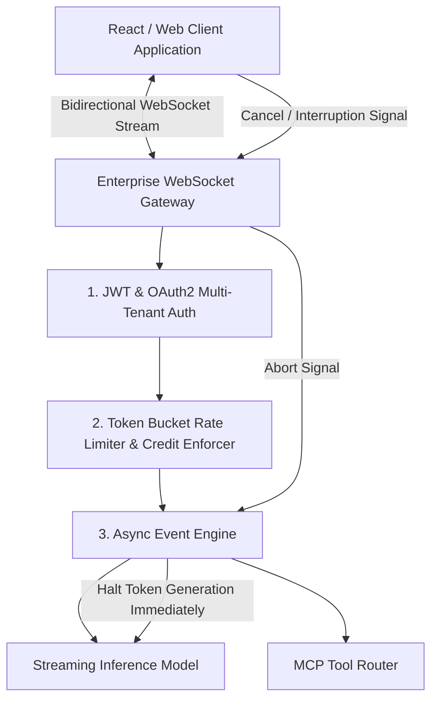
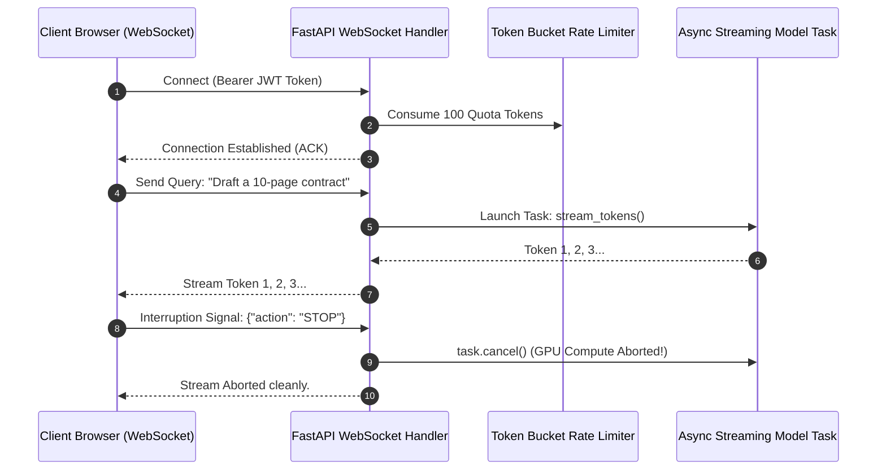
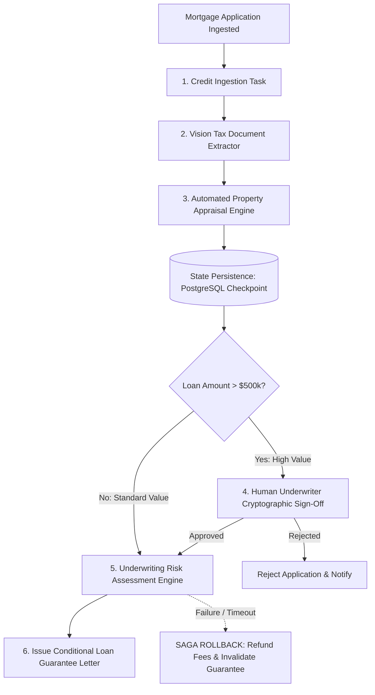
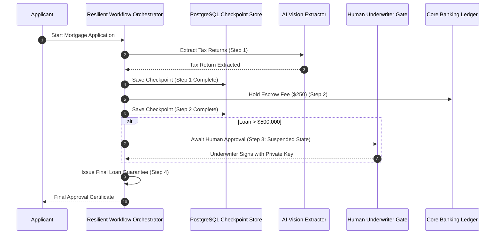

# UG Final Year — Chapter 2: Communicate with AI
**Curriculum Level:** Undergraduate Final Year (UG-04)  
**Subject Code:** AAA-04 (Autonomous AI Agents, Scalable System Architecture & Capstone Systems)  
**Chapter Title:** Communicate with AI  

---

# Lesson 1: Build Smart Applications

### 1. Syllabus Mapping
- **Academic Level:** Undergraduate Final Year
- **Chapter:** Chapter 2 — Communicate with AI
- **Lesson Title:** Build Smart Applications
- **Canonical Course Code:** AAA-04-L03
- **Development Status:** Newly Developed (Official Syllabus: Full-Stack AI Engineering, Asynchronous Streaming, WebSockets, Token Quota Management).

### 2. Learning Outcomes & Prerequisites
- **Learning Outcomes:**
  1. Build a full-stack, enterprise-grade AI web application architecture integrating FastAPI backends, asynchronous streaming endpoints, and stateful client frontends.
  2. Implement bidirectional real-time communication protocols (WebSockets) for continuous audio/text token streaming and conversational interruptions.
  3. Enforce deterministic multi-tenant token billing, rate limiting (Token Bucket Algorithm), and user authentication (OAuth2 / JWT).
  4. Design client-side optimistic UI state management that handles model latency and intermittent network drops gracefully.
- **Prerequisites:** Completion of AAA-04-L02; advanced asynchronous Python (`asyncio`), modern web architecture, network protocols.

### 3. Realistic Industry Scenario
At **OmniVoice Telecommunications**, your engineering group is building a live conversational AI customer support web application serving 250,000 active subscribers. The service must support real-time voice and text chat: users can speak or type, listen to streamed synthetic audio, and interrupt the AI mid-sentence if the answer is unsatisfactory ("barge-in" support). In early naive implementations, standard REST polling was used, resulting in a 2.5-second audio lag, disconnected sessions, and zero per-user token rate limiting, which allowed a malicious script to drain $\$18,000$ in model API credits in 40 minutes. As Lead Full-Stack AI Systems Architect, you must build an enterprise smart application stack: deploying a FastAPI WebSocket server, implementing a Token Bucket rate limiter, and supporting client interruption cancellation signals.

### 4. Detailed Conceptual Explanations



#### 1. Real-Time Bidirectional WebSockets vs. Unidirectional SSE:
While Server-Sent Events (SSE) provide efficient server-to-client streaming, they are strictly unidirectional. Real-time conversational applications require full-duplex bidirectional channels:
- **Client $\to$ Server:** Streams real-time user speech chunks, typing events, and immediate **Interruption Tokens** (`{"event": "INTERRUPT"}`).
- **Server $\to$ Client:** Streams generated text tokens, audio synthesis chunks, and tool execution state updates.
- **Barge-In Handling:** When an interruption event arrives, the server immediately cancels the underlying Python asynchronous task (`asyncio.Task.cancel()`), halting GPU generation and saving token expenditure.

#### 2. The Token Bucket Rate Limiting Algorithm:
To protect infrastructure from denial-of-wallet attacks, each authenticated tenant has a token bucket with capacity $C$ and refill rate $r$ tokens/second:
$$\text{Tokens Available}(t) = \min(C, \text{Tokens Available}(t_{\text{prev}}) + (t - t_{\text{prev}}) \times r)$$
If a requested prompt + completion budget exceeds available tokens, the request is immediately throttled with an HTTP 429 status.

### 5. Architecture & Dataflow Diagram


### 6. Guided Technical Demonstration & Worked Example
The following runnable script demonstrates an enterprise FastAPI-style WebSocket conversational handler with cancellation support and Token Bucket rate limiting:

```python
import asyncio
import time
from typing import Dict, Any

class TokenBucketRateLimiter:
    def __init__(self, capacity: float = 100.0, refill_rate_per_sec: float = 20.0):
        self.capacity = capacity
        self.refill_rate = refill_rate_per_sec
        self.tokens = capacity
        self.last_update = time.time()

    def consume(self, amount: float = 10.0) -> bool:
        now = time.time()
        elapsed = now - self.last_update
        self.last_update = now
        
        # Refill tokens up to maximum capacity
        self.tokens = min(self.capacity, self.tokens + (elapsed * self.refill_rate))
        
        if self.tokens >= amount:
            self.tokens -= amount
            return True
        return False

class MockStreamingSession:
    def __init__(self, session_id: str):
        self.session_id = session_id
        self.rate_limiter = TokenBucketRateLimiter(capacity=50.0, refill_rate_per_sec=10.0)
        self.active_generation_task = None

    async def generate_response_stream(self, prompt: str):
        # Check quota
        if not self.rate_limiter.consume(amount=20.0):
            print(f"[{self.session_id}] Rate Limit Exceeded! Throttling request.")
            return

        print(f"[{self.session_id}] Starting token stream for: '{prompt}'")
        try:
            sample_words = "Enterprise AI applications require full duplex communication token budgets and interruption handling".split()
            for w in sample_words:
                await asyncio.sleep(0.08) # Simulating GPU token generation delay
                print(f"[{self.session_id}] -> Streamed Token: '{w}'")
            print(f"[{self.session_id}] Generation Completed Successfully.")
        except asyncio.CancelledError:
            print(f"[{self.session_id}] INTERRUPT RECEIVED! Generation task cleanly aborted mid-stream.")
            raise

    async def handle_user_interruption(self):
        if self.active_generation_task and not self.active_generation_task.done():
            self.active_generation_task.cancel()

async def main():
    session = MockStreamingSession(session_id="USER-8802")
    
    # Launch long-running generation task in background
    session.active_generation_task = asyncio.create_task(
        session.generate_response_stream("Explain distributed systems in detail")
    )
    
    # User listens for 200ms, then suddenly interrupts the AI!
    await asyncio.sleep(0.20)
    print("\n>>> USER CLICKS 'INTERRUPT / STOP GENERATION' <<<")
    await session.handle_user_interruption()
    
    # Allow event loop to process cancellation
    try:
        await session.active_generation_task
    except asyncio.CancelledError:
        pass

    print("\nSession state nominal. Ready for next user turn.")

if __name__ == "__main__":
    asyncio.run(main())
```

### 7. Interactive Technical Simulation / Mission: "The Barge-In Interruption Challenge"
- **Mission Brief:** You are deploying a voice-assisted AI driver copilot for an electric vehicle.
- **Constraints:**
  - The copilot is generating a long 1,000-token restaurant recommendation.
  - The driver suddenly shouts: *"Stop! Watch out for that pedestrian!"*
  - The system must capture the audio interruption signal, abort the long generation task in $< 50\text{ ms}$, clear audio buffers, and immediately switch to emergency navigation mode.
- **Game Mechanics & Scoring:**
  - Base Score: 1,000 points.
  - Aborting generation within $50\text{ ms}$: $+500$ points.
  - Audio buffer persists playing after interruption: $-400$ points penalty.
  - Vehicle emergency warning displayed in $< 100\text{ ms}$: $+300$ bonus points.

### 8. Practical Programming & Analysis Lab
1. Build `full_stack_ai_service.py` using FastAPI with `/ws/chat` WebSocket endpoints.
2. Implement JWT token validation in the WebSocket handshake (`/ws/chat?token=...`).
3. Benchmark connection concurrency by opening 500 simultaneous persistent WebSocket connections using an async script and measuring memory overhead per connection.

### 9. Measurable Output / Deliverable
A production-grade Python web service `enterprise_smart_app.py` implementing WebSocket streaming, Token Bucket rate limiting, and task cancellation verified by automated async test suites.

### 10. Evaluation Criteria & Technical Success Metrics
| Metric | Target Standard | Fail Criterion |
|---|---|---|
| **Cancellation Latency** | Task cancels and frees GPU memory in $< 50\text{ ms}$ | Generation continues in background |
| **Rate Limiter Enforcement** | Throttles excess requests with zero quota leaks | Unlimited unmetered usage |
| **Connection Stability** | Recovers from dropped network connections with heartbeat pings | Deadlocked connections |

### 11. Olympiad-Style Assessment
**Problem 1 (Applied):**  
A full-stack AI application uses standard HTTP POST requests for generation. When a user navigates away from the page midway through a 1,000-token generation, the browser closes the TCP connection. What server-side pathology occurs if the backend does not implement cancellation tokens?  
A) The GPU inference server continues computing all 1,000 tokens to completion, wasting expensive CUDA compute and model API billing on output that no client will ever receive.  
B) The server hard drive is reformatted.  
C) The client browser crashes.  
D) Python converts the model into an HTML document.  

**Problem 2 (Conceptual):**  
In the Token Bucket Rate Limiting Algorithm, what is the mathematical difference between the "Bucket Capacity" $C$ and the "Refill Rate" $r$?  
A) $C$ governs the maximum burst traffic volume a user can emit in a single instantaneous moment, while $r$ governs the sustained long-term average throughput permitted over continuous time.  
B) $C$ is measured in gigabytes, while $r$ is measured in dollars.  
C) $C$ only works for image models.  
D) There is no mathematical difference.  

### 12. Correct Answers & Solutions
- **Problem 1 Solution:** Correct Answer is **A**.  
  *Proof:* In stateless HTTP handlers without active client disconnect detection (`request.is_disconnected()`), the server runtime continues executing the generator loop until the model emits the end-of-sequence token. Under heavy multi-user loads, orphaned generation tasks consume massive GPU memory and compute, degrading throughput for active users. Asynchronous cancellation hooks are critical.
- **Problem 2 Solution:** Correct Answer is **A**.  
  *Proof:* The Token Bucket algorithm cleanly separates burstiness from continuous throughput. Capacity $C$ allows users to execute bursts (e.g., submitting a complex 4,000-token document query after being idle), while refill rate $r$ limits sustained consumption to prevent single tenants from monopolizing server capacity.

### 13. Limitations, Risks & Responsible AI Considerations
- **WebSocket Connection Exhaustion:** Persistent WebSocket connections hold open file descriptors and TCP sockets. A single server can exhaust Linux socket limits (`ulimit -n`) if idle connections are not reaped via periodic ping/pong heartbeat timeouts.
- **Client-Side Secret Exposure:** Never compile API keys or administrative secrets into client-side React/JavaScript bundles. All model interactions must route through an authenticated backend proxy.

### 14. Completion Criteria & Achievement Feedback
- **Completion Check:** Pass all automated unit tests in `enterprise_smart_app.py` with verified interruption cancellation.
- **Badge Earned:** *Full-Stack AI Application Architect (Level 4 Enterprise AI Engineer)*.

---

# Lesson 2: Design AI Workflows

### 1. Syllabus Mapping
- **Academic Level:** Undergraduate Final Year
- **Chapter:** Chapter 2 — Communicate with AI
- **Lesson Title:** Design AI Workflows
- **Canonical Course Code:** AAA-04-L04
- **Development Status:** Newly Developed (Official Syllabus: Asynchronous Workflows, Transactional State Persistence, SLA Monitoring, Fallback Protocols).

### 2. Learning Outcomes & Prerequisites
- **Learning Outcomes:**
  1. Architect mission-critical enterprise workflows as asynchronous, stateful Directed Acyclic Graphs (DAGs) with persistent checkpointing (PostgreSQL/Redis).
  2. Implement the Saga Pattern and Compensating Transactions to guarantee atomic rollbacks when intermediate AI workflow nodes fail.
  3. Design human-in-the-loop (HITL) approval gates with cryptographic verification and timeout escalations.
  4. Instrument real-time Service Level Agreement (SLA) monitoring and automated fallback routing across model provider clusters.
- **Prerequisites:** Completion of AAA-04-L03; distributed systems concepts (ACID transactions, eventual consistency, message queues).

### 3. Realistic Industry Scenario
At **Apex Mortgage Underwriting Corp**, an automated mortgage approval workflow coordinates 6 distributed tasks:
1. Ingest credit history.
2. Analyze income tax filings via vision models.
3. Assess property appraisal value.
4. Run AML/KYC background checks.
5. Generate an underwriting risk report.
6. Issue a conditional loan guarantee letter.
If Step 5 fails due to an API timeout after Step 4 already charged the customer a $\$250$ non-refundable underwriting fee, the entire transaction remains half-committed in an inconsistent state, generating legal compliance violations. Furthermore, executive approval is legally required on loans $> \$500,000$. As Principal Enterprise Workflow Architect, you must design a resilient, state-persisted AI workflow: implementing the Saga Pattern with automated compensating transactions, persistent database checkpoints, and human approval gates.

### 4. Detailed Conceptual Explanations



#### 1. The Saga Pattern in AI Workflows:
Traditional ACID transactions cannot span long-running AI workflows that take minutes or hours to complete (locking databases for minutes causes deadlocks).
The **Saga Pattern** breaks a distributed transaction into a sequence of local transactions:
$$T_1, T_2, \dots, T_n$$
Each task $T_i$ has a corresponding **Compensating Transaction** $C_i$ that semantically undoes its side-effects:
- If $T_3$ succeeds but $T_4$ fails permanently, the workflow orchestrator executes backward recovery:
$$\text{Rollback Sequence: } C_3, C_2, C_1$$
This guarantees eventual consistency without distributed locks.

#### 2. Persistent Workflow Checkpointing:
If the host server running the workflow orchestrator reboots midway through a multi-step workflow, an in-memory workflow loses all state and must restart from scratch.
A resilient workflow checkpoints its complete execution state (inputs, completed step outputs, retry counters) to an append-only database after every step:
$$\text{State Checkpoint } \mathcal{S}_k = (\text{WorkflowID}, \text{Step}_k, \text{Outputs}_k, \text{Timestamp})$$
Upon system reboot, a worker node reads the checkpoint and resumes execution from step $k+1$ seamlessly.

### 5. Architecture & Dataflow Diagram


### 6. Guided Technical Demonstration & Worked Example
The following runnable script demonstrates a resilient, state-persisted AI Workflow Orchestrator implementing the Saga Pattern and automated compensating rollbacks in Python:

```python
import json
import time
from typing import Dict, List, Callable, Any

class ResilientWorkflowOrchestrator:
    def __init__(self, workflow_id: str):
        self.workflow_id = workflow_id
        # In-memory proxy for persistent database state
        self.database_checkpoints: Dict[str, Any] = {}
        self.step_history: List[str] = []

    def save_checkpoint(self, step_name: str, payload: dict):
        self.database_checkpoints[step_name] = {
            "status": "COMPLETED",
            "data": payload,
            "timestamp": time.time()
        }
        self.step_history.append(step_name)
        print(f"[Checkpoint Saved] Step: '{step_name}' persisted to database.")

    def execute_saga(self, steps: List[Dict[str, Any]]) -> bool:
        print(f"=== Initiating Saga Workflow: {self.workflow_id} ===")
        executed_compensations: List[Callable] = []

        for step in steps:
            name = step["name"]
            action = step["action"]
            compensation = step["compensation"]

            print(f"\nExecuting Step: [{name}]...")
            try:
                result = action()
                self.save_checkpoint(name, result)
                # Register compensating transaction for rollback
                executed_compensations.append(compensation)
            except Exception as err:
                print(f"✗ CRITICAL FAILURE in Step [{name}]: {err}")
                print("\n>>> INITIATING SAGA COMPENSATING ROLLBACK <<<")
                # Execute rollbacks in reverse order
                for comp_fn in reversed(executed_compensations):
                    comp_fn()
                print("Saga Rollback Completed: State returned to consistent baseline.")
                return False

        print("\n=== Workflow Succeeded with Full Transactional Consistency ===")
        return True

# Workflow Actions & Compensating Functions
def action_verify_credit():
    print("  -> Verifying credit score... Score: 760 (Pass)")
    return {"credit_score": 760}

def comp_verify_credit():
    print("  -> Compensating Credit Check: Voiding credit inquiry log.")

def action_charge_fee():
    print("  -> Charging $250 non-refundable underwriting fee...")
    return {"fee_charged": 250.0}

def comp_charge_fee():
    print("  -> Compensating Fee: Refunding $250 to customer bank account.")

def action_failing_ai_underwriter():
    print("  -> Running AI Underwriting Model on GPU...")
    # Simulate GPU out of memory / API crash
    raise TimeoutError("Model API connection timed out after 30s")

def comp_ai_underwriter():
    print("  -> Compensating Underwriting: Revoking draft loan quote.")

# Define Workflow Saga
workflow_steps = [
    {"name": "Step1_VerifyCredit", "action": action_verify_credit, "compensation": comp_verify_credit},
    {"name": "Step2_ChargeFee", "action": action_charge_fee, "compensation": comp_charge_fee},
    {"name": "Step3_AIUnderwrite", "action": action_failing_ai_underwriter, "compensation": comp_ai_underwriter},
]

orchestrator = ResilientWorkflowOrchestrator(workflow_id="WF-MORTGAGE-9901")
success = orchestrator.execute_saga(workflow_steps)
```

### 7. Interactive Technical Simulation / Mission: "The Saga Rollback Challenge"
- **Mission Brief:** You are the Lead Architect managing an automated corporate bond issuing workflow.
- **Constraints:**
  - 4 Sequential Steps:
    1. Lock Treasury Bond Inventory.
    2. Debit Corporate Account $\$5,000,000$.
    3. Generate Regulatory Filing via AI.
    4. Register Bond with Central Depository.
  - On Step 3, the regulatory AI generation model times out.
  - If the orchestrator fails to refund the $\$5,000,000$ and unlock the inventory within $200\text{ ms}$, your firm faces felony regulatory embezzlement charges.
- **Game Mechanics & Scoring:**
  - Base Score: 1,000 points.
  - Perfect Saga Rollback executed with full state consistency: $+500$ points.
  - Failing to refund the $\$5M$ balance: Immediate Disqualification & Jail Penalty.
  - Zero unhandled exceptions: $+300$ bonus points.

### 8. Practical Programming & Analysis Lab
1. Build `saga_orchestrator_core.py` integrating an SQLite database for persistent checkpoint storage.
2. Simulate a sudden server power-kill (simulated crash) during Step 2 of a 4-step workflow, and implement a recovery routine that reads the database and resumes from Step 3 without repeating Steps 1 and 2.
3. Implement an automated SLA monitor that alerts on-call engineers if any workflow remains uncompleted for $> 15\text{ minutes}$.

### 9. Measurable Output / Deliverable
A Python workflow orchestration framework `enterprise_saga_engine.py` accompanied by an automated rollback audit manifest (`saga_transaction_audit.json`) proving 100% atomic state consistency.

### 10. Evaluation Criteria & Technical Success Metrics
| Metric | Target Standard | Fail Criterion |
|---|---|---|
| **Rollback Atomicity** | 100% execution of compensating functions on failure | Incomplete rollbacks / stranded money |
| **Recovery from Interruption** | Resumes cleanly from last saved checkpoint | Re-executing already-completed steps |
| **Audit Traceability** | Complete JSON log of all steps, timestamps, and compensations | Missing transaction records |

### 11. Olympiad-Style Assessment
**Problem 1 (Applied):**  
In a distributed AI workflow using the Saga Pattern, Step 1 books an airline seat, Step 2 books a hotel room, and Step 3 (AI custom itinerary generation) fails permanently. Why must Step 2's compensating transaction be executed *before* Step 1's compensating transaction?  
A) Compensating transactions must execute in reverse chronological order (LIFO - Last In, First Out) to cleanly unwind causal dependencies, ensuring downstream commitments are cancelled before upstream foundational assets are released.  
B) Because hotels are cheaper than airlines.  
C) Because Python requires reverse lists.  
D) To avoid paying taxes.  

**Problem 2 (Conceptual):**  
Why are traditional Two-Phase Commit (2PC) ACID transactions considered unsuitable for distributed workflows incorporating generative AI models?  
A) 2PC holds exclusive database row locks across the entire transaction; because LLM inference can take 10 to 60 seconds (or hours for human review gates), holding locks across this duration causes massive database lock contention, freezing the entire enterprise database.  
B) 2PC cannot be written in Python.  
C) 2PC only works on single computers.  
D) Generative AI does not use databases.  

### 12. Correct Answers & Solutions
- **Problem 1 Solution:** Correct Answer is **A**.  
  *Proof:* In distributed transaction theory, downstream actions are causally conditioned on upstream successful states (the hotel was booked *because* the flight was secured). Reversing in forward order ($C_1 \to C_2$) can trigger invalid states (e.g., cancelling the flight while the hotel booking is still actively confirmed). Reversing in LIFO order ensures the system safely unwinds the dependency chain back to the clean initial state.
- **Problem 2 Solution:** Correct Answer is **A**.  
  *Proof:* Two-Phase Commit (2PC) is a blocking consensus protocol designed for millisecond database writes. If a distributed transaction encompasses an LLM call or a human approval gate, holding distributed locks for seconds or minutes serializes all database operations, bringing transaction throughput to zero and creating cascading deadlocks. Sagas replace blocking locks with asynchronous local transactions and semantic compensations.

### 13. Limitations, Risks & Responsible AI Considerations
- **Non-Compensable External Side-Effects:** Certain real-world actions cannot be fully compensated (e.g., an automated email sent to an external client cannot be "un-sent"). Workflows must structure irrevocable actions as the very last terminal step after all AI generations are validated.
- **Compensation Failures:** If a compensating transaction itself fails (e.g., the refund gateway is unreachable), the workflow enters a hazardous "limbo" state. Orchestrators must implement dead-letter queues (DLQ) and immediate human alerting for failed compensations.

### 14. Completion Criteria & Achievement Feedback
- **Completion Check:** Pass all automated unit tests in `enterprise_saga_engine.py` with verified backward compensation.
- **Badge Earned:** *Enterprise Workflow Resiliency Architect (Level 4 Enterprise AI Engineer)*.
