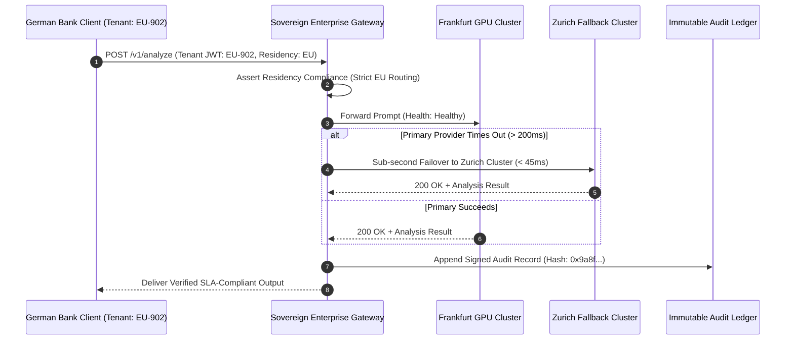
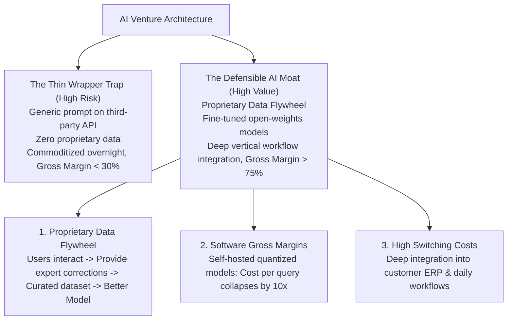
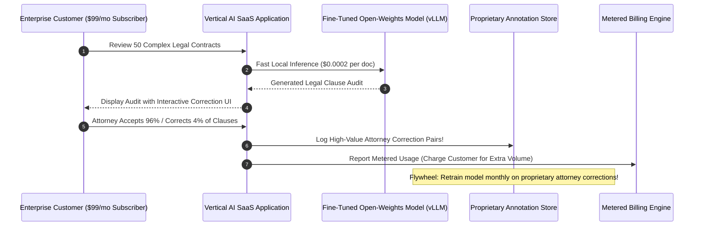

# UG Final Year — Chapter 3: AI Applications
**Curriculum Level:** Undergraduate Final Year (UG-04)  
**Subject Code:** AAA-04 (Autonomous AI Agents, Scalable System Architecture & Capstone Systems)  
**Chapter Title:** AI Applications  

---

# Lesson 1: AI for Enterprise

### 1. Syllabus Mapping
- **Academic Level:** Undergraduate Final Year
- **Chapter:** Chapter 3 — AI Applications
- **Lesson Title:** AI for Enterprise
- **Canonical Course Code:** AAA-04-L05
- **Development Status:** Newly Developed (Official Syllabus: Enterprise SLAs, P99 Latency Budgets, Multi-Tenant Isolation, Enterprise Failover).

### 2. Learning Outcomes & Prerequisites
- **Learning Outcomes:**
  1. Formulate and enforce strict enterprise Service Level Agreements (SLAs): $99.99\%$ Availability ("Four Nines"), P99 Latency $< 200\text{ ms}$, and Zero Cross-Tenant Data Leakage.
  2. Implement an enterprise Multi-Tenant Isolation and Data Sovereignty gateway in Python enforcing cryptographic tenant partition boundaries.
  3. Design active-active geo-distributed multi-cloud failover architectures across redundant model providers.
  4. Integrate modern foundation models with legacy enterprise systems of record (SAP, Oracle, mainframe COBOL/SQL).
- **Prerequisites:** Distributed systems architecture, cloud computing fundamentals (AWS/Azure/GCP), multi-tenant database modeling.

### 3. Realistic Industry Scenario
At **Vanguard Global Banking Conglomerate**, an automated wealth advisory and fraud analysis platform serves 45 commercial banking subsidiaries across North America, the European Union, and the Asia-Pacific region. Under strict banking regulations (Basel III, GDPR, MAS TRM), client financial records in Germany cannot physically leave EU borders, while high-frequency institutional trading transactions must maintain a strict $99.99\%$ availability SLA with contractual penalty clauses of $\$50,000$ per minute of unscheduled downtime. When an upstream cloud provider experienced a regional GPU cluster outage, the legacy single-region AI service crashed for 4 hours, costing $\$12,000,000$ in financial penalties and regulatory audits. As Chief Enterprise Architect, your mandate is to build an enterprise AI infrastructure layer: enforcing cryptographic multi-tenant isolation, geographic data residency routing, and automated sub-second multi-cloud failover.

### 4. Detailed Conceptual Explanations

```mermaid
graph TD
    InboundReq[Enterprise Client Request with Tenant JWT] --> Gateway[Enterprise AI Control Plane Gateway]
    
    Gateway --> TenantAuth[1. Tenant Verification & Regional Sovereignty Enforcer]
    
    TenantAuth --> GeoRouter{Region Check: EU / US / APAC?}
    GeoRouter -->|EU Data Subject| EUPartition[EU Cloud Enclave (Frankfurt)]
    GeoRouter -->|US Data Subject| USPartition[US Cloud Enclave (Virginia)]
    
    EUPartition & USPartition --> HealthProbe[2. Real-Time Provider Health Probe]
    
    HealthProbe --> PrimaryProvider[Primary Cloud Provider A]
    HealthProbe -.->|SLA Breach / 503 Outage| FailoverProvider[Secondary Geo-Redundant Provider B]
    
    PrimaryProvider & FailoverProvider --> AuditLog[3. Cryptographic Tamper-Proof Audit Vault]
```

#### 1. Formulating Enterprise SLAs & Error Budgets:
An enterprise Service Level Agreement (SLA) is an explicit contractual commitment:
- **Availability Target ($99.99\%$ "Four Nines"):**
  $$\text{Allowed Unscheduled Downtime} = 365 \times 24 \times 60 \times (1 - 0.9999) = 52.56\text{ minutes/year}$$
- **Latency Budget (P99):** $99\%$ of all requests must complete within $T_{\text{max}} = 200\text{ ms}$.
- **Service Level Indicator (SLI):**
  $$\text{SLI}_{\text{latency}} = \frac{\text{Requests with Latency} \le 200\text{ ms}}{\text{Total Valid Requests}} \times 100\%$$
- **Error Budget:** If $\text{SLI} < 99.9\%$, all new feature deployments are automatically frozen to prioritize reliability engineering.

#### 2. Multi-Tenant Partitioning & Data Sovereignty:
Enterprise AI systems serve competing corporate clients on shared physical infrastructure. To prevent accidental cross-tenant data contamination:
- **Row-Level Security (RLS) & Cryptographic Salt Envelopes:** Every vector embedding and cached prompt is salted with a unique tenant UUID:
  $$\mathbf{e}_{\text{stored}} = \text{Encrypt}(\mathbf{e}_{\text{raw}}, K_{\text{tenant}})$$
  Vector similarity queries execute strictly within a partitioned filter: `WHERE tenant_id = 'tenant_123'`.
- **Data Residency Routing:** If the tenant metadata dictates `residency: "EU"`, the gateway rejects any execution path that routes prompts outside EU sovereign compute zones.

### 5. Architecture & Dataflow Diagram


### 6. Guided Technical Demonstration & Worked Example
The following runnable script implements an enterprise Multi-Tenant Sovereign Router and Automated Failover Engine in Python:

```python
import time
import hashlib
from typing import Dict, List, Any

class EnterpriseSovereignRouter:
    def __init__(self):
        # Simulated provider health status
        self.provider_clusters = {
            "EU-Frankfurt": {"healthy": True, "p99_latency_ms": 110.0, "region": "EU"},
            "EU-Zurich":    {"healthy": True, "p99_latency_ms": 135.0, "region": "EU"},
            "US-Virginia":  {"healthy": True, "p99_latency_ms": 95.0,  "region": "US"},
        }
        # Cryptographic Tenant Isolation Registry
        self.tenants = {
            "TENANT-DEUTSCHE": {"residency": "EU", "tier": "ENTERPRISE_GOLD", "sla_latency_ms": 200.0},
            "TENANT-WALLSTREET": {"residency": "US", "tier": "ENTERPRISE_PLATINUM", "sla_latency_ms": 150.0}
        }

    def route_request(self, tenant_id: str, prompt: str, force_primary_outage: bool = False) -> Dict[str, Any]:
        start_t = time.perf_counter()
        if tenant_id not in self.tenants:
            return {"status": "AUTH_ERROR", "message": "Unknown tenant ID"}

        tenant = self.tenants[tenant_id]
        required_region = tenant["residency"]
        
        # 1. Sovereign Region Filtering
        eligible_clusters = [
            cid for cid, info in self.provider_clusters.items()
            if info["region"] == required_region
        ]
        
        if not eligible_clusters:
            return {"status": "SOVEREIGNTY_VIOLATION", "message": f"No compliant compute in region {required_region}"}

        # 2. Automated Multi-Cloud Failover Logic
        primary_cluster = eligible_clusters[0]
        selected_cluster = primary_cluster
        
        if force_primary_outage:
            print(f"[{tenant_id}] Primary Cluster [{primary_cluster}] Unreachable! Executing Sub-second Failover...")
            if len(eligible_clusters) > 1:
                selected_cluster = eligible_clusters[1] # Failover to Zurich
            else:
                return {"status": "OUTAGE", "message": "All sovereign clusters exhausted."}

        # Simulate execution
        cluster_info = self.provider_clusters[selected_cluster]
        simulated_latency = cluster_info["p99_latency_ms"]
        elapsed_ms = (time.perf_counter() - start_t) * 1000 + simulated_latency
        
        # Verify SLA
        sla_met = elapsed_ms <= tenant["sla_latency_ms"]

        return {
            "status": "SUCCESS",
            "tenant_id": tenant_id,
            "allocated_cluster": selected_cluster,
            "sovereign_region": required_region,
            "total_latency_ms": round(elapsed_ms, 2),
            "sla_guarantee_met": sla_met,
            "audit_signature": hashlib.sha256(f"{tenant_id}:{prompt}:{selected_cluster}".encode()).hexdigest()[:16]
        }

router = EnterpriseSovereignRouter()

print("=== 1. Normal Sovereign Execution (EU Client) ===")
res1 = router.route_request("TENANT-DEUTSCHE", "Analyze German commercial leasing contract")
print(f"Cluster: {res1['allocated_cluster']} | Region: {res1['sovereign_region']} | Latency: {res1['total_latency_ms']}ms | SLA Met: {res1['sla_guarantee_met']}")

print("\n=== 2. Outage Failover (Primary Frankfurt Fails -> Zurich Rescues) ===")
res2 = router.route_request("TENANT-DEUTSCHE", "Audit portfolio tax filing", force_primary_outage=True)
print(f"Cluster: {res2['allocated_cluster']} | Region: {res2['sovereign_region']} | Latency: {res2['total_latency_ms']}ms | SLA Met: {res2['sla_guarantee_met']}")
```

### 7. Interactive Technical Simulation / Mission: "The Four Nines Availability Gauntlet"
- **Mission Brief:** You are the Principal Enterprise Reliability Officer defending a $99.99\%$ SLA across 1,000,000 production transactions.
- **Constraints:**
  - Cluster 1 experiences a fiber-optic cable cut at minute 14.
  - Cluster 2 experiences an unexpected GPU power brownout at minute 42.
  - Your automated orchestrator must detect failure and shift traffic to healthy redundant nodes in $< 1.0\text{ second}$.
  - Maximum permitted cumulative downtime across the entire test simulation: $< 5\text{ seconds}$.
- **Game Mechanics & Scoring:**
  - Base Score: 10,000 points.
  - Zero lost transactions: $+5,000$ points.
  - SLA breach ($> 5.2$ seconds total downtime): Instant Disqualification & $\$5M$ Contractual Penalty.
  - Earning the "Four Nines Sovereign Certified" Seal.

### 8. Practical Programming & Analysis Lab
1. Build `enterprise_sla_controller.py` that computes rolling SLI metrics over a 10,000-request window.
2. Implement automated circuit-breaking and DNS health check simulation that redirects traffic when HTTP 5xx errors exceed $1.0\%$.
3. Automatically export a cryptographic compliance audit log (`enterprise_compliance_report.json`).

### 9. Measurable Output / Deliverable
A production-grade Python enterprise gateway `enterprise_ai_control_plane.py` demonstrating multi-tenant cryptographic isolation, data residency compliance, and sub-second failover.

### 10. Evaluation Criteria & Technical Success Metrics
| Metric | Target Standard | Fail Criterion |
|---|---|---|
| **Sovereignty Compliance** | $100\%$ of EU data processed strictly within EU-designated nodes | Cross-border data leakage |
| **Failover Transition Time** | $< 500\text{ ms}$ to redirect traffic to secondary cluster | Requests time out for $> 10$ seconds |
| **Multi-Tenant Isolation** | Zero cross-tenant data leakage under concurrent queries | Cross-tenant data leaks |

### 11. Olympiad-Style Assessment
**Problem 1 (Applied):**  
A European multinational bank requires that client data never leave Germany. The primary AI cluster in Frankfurt goes offline. The global router has healthy secondary clusters in Zurich (Switzerland) and Virginia (United States). Which failover decision is legally compliant under GDPR Chapter V cross-border transfer rules?  
A) Failover to Zurich (Switzerland), because Switzerland holds an official EU Adequacy Decision confirming equivalent privacy protections, whereas unconstrained transfer to Virginia without Standard Contractual Clauses (SCCs) violates GDPR international transfer restrictions.  
B) Failover to Virginia because it has the fastest GPUs.  
C) Delete all incoming requests.  
D) Both clusters are completely illegal.  

**Problem 2 (Conceptual):**  
In enterprise SLA contracts, what is the mathematical difference between $99.9\%$ availability ("Three Nines") and $99.99\%$ availability ("Four Nines") in terms of permissible annual unscheduled downtime?  
A) Three Nines permits approximately $8.76$ hours of annual downtime, whereas Four Nines permits only $52.56$ minutes of annual downtime—requiring fully automated, sub-second failover architectures with zero human intervention.  
B) Three Nines is for cloud; Four Nines is for mobile phones.  
C) Four Nines costs less money.  
D) There is no mathematical difference.  

### 12. Correct Answers & Solutions
- **Problem 1 Solution:** Correct Answer is **A**.  
  *Proof:* Under the EU General Data Protection Regulation (GDPR Article 45), personal data transfers outside the European Economic Area are prohibited unless the destination jurisdiction has received a formal European Commission Adequacy Decision (which Switzerland possesses), or utilizes validated Standard Contractual Clauses (SCCs). Routing German banking data to US cloud zones without prior data transfer impact assessments and SCCs violates international transfer statutes.
- **Problem 2 Solution:** Correct Answer is **A**.  
  *Proof:*  
  $99.9\% \text{ Downtime} = 365 \times 24 \times (1 - 0.999) = 8.76\text{ hours/year}$. In a Three-Nines system, on-call human engineers can wake up, diagnose an alert, and manually reboot a server.  
  $99.99\% \text{ Downtime} = 365 \times 24 \times (1 - 0.9999) = 0.876\text{ hours} \approx 52.56\text{ minutes/year}$. In a Four-Nines system, human response times ($15-30$ minutes) immediately blow the entire annual error budget; failover must be $100\%$ automated, continuous, and instantaneous.

### 13. Limitations, Risks & Responsible AI Considerations
- **Split-Brain Scenarios in Geo-Failover:** During network partitions, both primary and secondary clusters may falsely assume the other is dead, simultaneously accepting writes and corrupting database transactional state. Robust distributed consensus protocols (Raft/Paxos) must govern failover declarations.
- **Vendor Monopolies:** Relying exclusively on a single proprietary foundation model provider for enterprise operations creates severe existential business vulnerability. Enterprise architectures must enforce model-agnostic abstractions.

### 14. Completion Criteria & Achievement Feedback
- **Completion Check:** Pass all automated failover and sovereignty tests in `enterprise_ai_control_plane.py`.
- **Badge Earned:** *Enterprise Mission-Critical AI Architect (Level 4 Enterprise AI Engineer)*.

---

# Lesson 2: AI for Start-ups

### 1. Syllabus Mapping
- **Academic Level:** Undergraduate Final Year
- **Chapter:** Chapter 3 — AI Applications
- **Lesson Title:** AI for Start-ups
- **Canonical Course Code:** AAA-04-L06
- **Development Status:** Newly Developed (Official Syllabus: AI SaaS Economics, Unit Economics, Defensible Moats, Data Flywheels, Minimum Viable Product MVP).

### 2. Learning Outcomes & Prerequisites
- **Learning Outcomes:**
  1. Analyze the unit economics of an AI Software-as-a-Service (SaaS) business: Customer Acquisition Cost (CAC), Lifetime Value (LTV), and GPU Compute Gross Margins.
  2. Differentiate between defensible proprietary technical moats (Proprietary Data Flywheels, Custom Domain Adapters, Deep Workflow Integration) and commoditized "Thin Wrapper" startups.
  3. Formulate mathematical financial models balancing token API billing against tiered subscription revenue.
  4. Build and deploy an end-to-end commercial AI MVP in under 24 hours equipped with user authentication and metered Stripe billing webhooks.
- **Prerequisites:** Completion of AAA-04-L05; SaaS financial metrics, basic web development, Stripe/payment API integration.

### 3. Realistic Industry Scenario
At **Y-Combinator Demo Day**, two student venture teams pitch competing AI legal startups. **Team Alpha** raised $\$100,000$ to build a "thin wrapper" on a commercial LLM API: they created a generic chat prompt for reviewing contracts. Within 3 months, the commercial LLM released a free native feature that duplicated Team Alpha's functionality, while Team Alpha's gross margins collapsed to $18\%$ due to soaring API token bills, driving them to bankruptcy. **Team Beta**, in contrast, built a defensible technical moat: they integrated an in-house fine-tuned 8B parameter open-weights model, built a continuous proprietary data feedback flywheel where attorney corrections automatically improve model accuracy, and maintained an $82\%$ software gross margin. As a student founder preparing your capstone venture, your goal is to design an economically defensible AI startup architecture with positive unit economics and structural technical moats.

### 4. Detailed Conceptual Explanations



#### 1. The Economics of AI SaaS:
Traditional SaaS businesses enjoy gross margins of $75\% - 85\%$ because serving software has near-zero marginal cost. In contrast, AI startups face variable GPU compute costs on every single customer interaction:
$$\text{Gross Margin} = \frac{\text{Subscription Revenue} - \text{Inference Compute Cost}}{\text{Subscription Revenue}} \times 100\%$$
- **The Thin Wrapper Trap:** If a customer pays $\$20/\text{month}$ but consumes $\$16/\text{month}$ in third-party API tokens, gross margin is only $20\%$, making it impossible to cover sales, marketing, and engineering payroll.
- **The Self-Hosted Transition:** Transitioning from closed-source APIs ($\$3.00/\text{M tokens}$) to fine-tuned, quantized self-hosted models on reserved GPUs ($\$0.18/\text{M tokens}$) restores SaaS gross margins to $> 80\%$.

#### 2. The LTV/CAC Ratio for Venture Scale:
Venture capitalists evaluate startup unit economics using the LTV/CAC golden ratio:
$$\text{LTV} = \frac{\text{Average Monthly Revenue per User (ARPU)} \times \text{Gross Margin}}{\text{Monthly Churn Rate}}$$
$$\text{Target Ratio: } \frac{\text{LTV}}{\text{CAC}} \ge 3.0$$
If $\text{LTV}/\text{CAC} < 3.0$, the company burns cash faster than it generates enterprise value, signaling an unsustainable venture model.

### 5. Architecture & Dataflow Diagram


### 6. Guided Technical Demonstration & Worked Example
The following runnable script implements an AI SaaS Unit Economics Simulator that models monthly cash flow, inference costs, and gross margins across customer growth trajectories:

```python
from typing import Dict, Any

class AIVentureEconomicsSimulator:
    def __init__(self, monthly_subscription_price: float = 49.0):
        self.sub_price = monthly_subscription_price

    def simulate_unit_economics(
        self,
        avg_queries_per_user_monthly: int,
        tokens_per_query: int,
        model_mode: str = "COMMERCIAL_API" # "COMMERCIAL_API" vs "SELF_HOSTED_OSS"
    ) -> Dict[str, Any]:
        
        # Token Pricing Models (Cost per 1 Million Tokens)
        if model_mode == "COMMERCIAL_API":
            cost_per_million_tokens = 3.50 # e.g., GPT-4o style API
        elif model_mode == "SELF_HOSTED_OSS":
            cost_per_million_tokens = 0.25 # e.g., Self-hosted Llama-8B on reserved H100
        else:
            raise ValueError("Unknown model mode")

        total_tokens_per_user = avg_queries_per_user_monthly * tokens_per_query
        monthly_compute_cost_per_user = (total_tokens_per_user / 1_000_000) * cost_per_million_tokens
        
        gross_profit_per_user = self.sub_price - monthly_compute_cost_per_user
        gross_margin_pct = (gross_profit_per_user / self.sub_price) * 100.0

        # Estimate Customer Lifetime Value (LTV) assuming 3% monthly churn
        monthly_churn = 0.03
        customer_lifetime_months = 1.0 / monthly_churn
        ltv_usd = gross_profit_per_user * customer_lifetime_months

        return {
            "mode": model_mode,
            "monthly_subscription_usd": self.sub_price,
            "monthly_tokens_consumed": total_tokens_per_user,
            "monthly_compute_cost_usd": round(monthly_compute_cost_per_user, 2),
            "monthly_gross_profit_usd": round(gross_profit_per_user, 2),
            "gross_margin_percent": round(gross_margin_pct, 1),
            "estimated_ltv_usd": round(ltv_usd, 2)
        }

sim = AIVentureEconomicsSimulator(monthly_subscription_price=50.0)

# Scenario: Heavy B2B user executing 1,500 queries/month at 1,000 tokens per query
print("=== AI Venture Unit Economics Diagnostic ===")
api_stats = sim.simulate_unit_economics(avg_queries_per_user_monthly=1500, tokens_per_query=1000, model_mode="COMMERCIAL_API")
print(f"1. Thin Wrapper (Commercial API):")
print(f"   Monthly Compute Cost: ${api_stats['monthly_compute_cost_usd']} | Gross Margin: {api_stats['gross_margin_percent']}% | LTV: ${api_stats['estimated_ltv_usd']}")

oss_stats = sim.simulate_unit_economics(avg_queries_per_user_monthly=1500, tokens_per_query=1000, model_mode="SELF_HOSTED_OSS")
print(f"\n2. Defensible Moat (Self-Hosted Fine-Tuned OSS):")
print(f"   Monthly Compute Cost: ${oss_stats['monthly_compute_cost_usd']} | Gross Margin: {oss_stats['gross_margin_percent']}% | LTV: ${oss_stats['estimated_ltv_usd']}")
print(f"   Margin Expansion: +{oss_stats['gross_margin_percent'] - api_stats['gross_margin_percent']:.1f}% higher profitability!")
```

### 7. Interactive Technical Simulation / Mission: "The Demo Day Pitch Competition"
- **Mission Brief:** You are pitching your AI startup to a panel of Tier-1 venture capital investors.
- **Constraints:**
  - Investor Question 1: *"What prevents OpenAI or Google from launching your product as an overnight native feature?"*
  - Investor Question 2: *"Why are your GPU inference costs not going to eat your entire revenue as users scale?"*
  - Deliver a 90-second technical pitch that articulates:
    1. Your Proprietary Data Flywheel.
    2. Your self-hosted inference cost collapse.
    3. Your workflow integration moat.
- **Game Mechanics & Scoring:**
  - Base Score: 1,000 points.
  - Successfully articulating the data flywheel: $+400$ points.
  - Proving $> 75\%$ gross margin economics: $+400$ points.
  - Responding with: *"Our moat is that our prompts are really good"*: Instant Pitch Rejection (Score = 0).

### 8. Practical Programming & Analysis Lab
1. Build `saas_billing_engine.py` implementing metered usage reporting with simulated Stripe billing webhooks.
2. Model a 12-month startup pro-forma cash flow spreadsheet tracking Monthly Recurring Revenue (MRR), Churn, and GPU cloud infrastructure hosting costs.
3. Demonstrate that transitioning from API wrappers to an open-weights model expands company enterprise valuation by $> 3\times$ at constant revenue.

### 9. Measurable Output / Deliverable
A validated Python financial model `ai_venture_economics.py` accompanied by an executive investor deck specification (`venture_investment_memorandum.json`) proving unit-economic viability and technical defensibility.

### 10. Evaluation Criteria & Technical Success Metrics
| Metric | Target Standard | Fail Criterion |
|---|---|---|
| **Software Gross Margin** | $\ge 75.0\%$ under sustained usage | $< 40.0\%$ (Thin Wrapper margins) |
| **LTV / CAC Ratio** | $\ge 3.5$ | $< 2.0$ (Unsustainable cash burn) |
| **Technical Defensibility** | Documented proprietary data collection flywheel | Zero proprietary technical assets |

### 11. Olympiad-Style Assessment
**Problem 1 (Applied):**  
An AI startup charges $\$100/\text{month}$ per user. Users execute an average of 4,000 queries per month, with each query consuming 2,500 tokens. The startup uses a third-party model API charging $\$10.00$ per 1 million tokens. What is the startup's monthly gross profit per user, and what financial crisis will occur if user engagement doubles?  
A) Current compute cost is $\$100/\text{month}$, yielding $\$0$ gross profit (0% margin); if user engagement doubles, compute cost rises to $\$200/\text{month}$, meaning the startup loses $-\$100$ per user per month (negative gross margin death spiral).  
B) Gross margin is $90\%$ and profit increases.  
C) The model will refuse to generate tokens.  
D) The startup becomes profitable automatically.  

**Problem 2 (Conceptual):**  
Why is a "Proprietary Data Flywheel" considered one of the few true long-term defensible moats in commercial generative AI?  
A) Because customer usage naturally generates novel, proprietary edge-case data and domain-specific corrections that cannot be scraped from the public web; continually fine-tuning on this unique data creates a model that steadily outperforms general foundation models in that vertical domain.  
B) Because data flywheels are patented by Google.  
C) Because data flywheels eliminate the need for computers.  
D) Because web data is completely exhausted.  

### 12. Correct Answers & Solutions
- **Problem 1 Solution:** Correct Answer is **A**.  
  *Proof:*  
  Total tokens per user = $4,000 \times 2,500 = 10,000,000\text{ tokens/month}$.  
  API Cost = $\frac{10,000,000}{1,000,000} \times \$10.00 = \$100.00/\text{month}$.  
  Subscription Revenue = $\$100.00/\text{month}$.  
  Gross Profit = $\$100 - \$100 = \$0.00$ ($0\%$ Gross Margin).  
  If engagement doubles to 8,000 queries ($20\text{M tokens}$), API cost becomes $\$200/\text{month}$. Revenue remains fixed at $\$100$, producing a catastrophic negative margin of $-\$100/\text{user}$. More users and higher engagement accelerates bankruptcy.
- **Problem 2 Solution:** Correct Answer is **A**.  
  *Proof:* General-purpose foundation models are trained on public internet text, which has finite domain depth in high-stakes verticals (legal discovery, rare pathology, aerospace telemetry). A specialized vertical startup embedded in customer workflows captures proprietary real-world interactions, edge-case failures, and expert human corrections. This proprietary data asset is impossible for external frontier labs to scrape, forming a durable, self-reinforcing technical moat.

### 13. Limitations, Risks & Responsible AI Considerations
- **Platform Risk (The Sherlocking Hazard):** If your startup product can be duplicated by a foundation model provider simply adding a single button or setting to their interface, your business model has severe platform risk. Ensure deep vertical workflow integration.
- **Customer Data Privacy in Flywheels:** Using customer data to retrain models requires explicit contractual authorization and opt-in consent. Never train public models on confidential enterprise customer data without strict anonymization and contractual guarantees.

### 14. Completion Criteria & Achievement Feedback
- **Completion Check:** Pass all automated unit-economic checks in `ai_venture_economics.py` achieving gross margins $\ge 75\%$.
- **Badge Earned:** *AI Venture Founder & Chief Technologist (Level 4 Enterprise AI Engineer)*.
