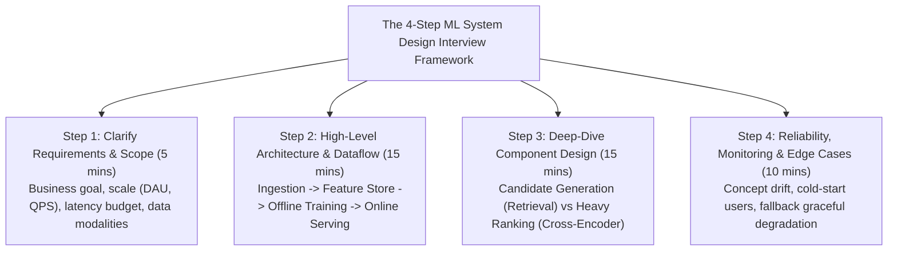
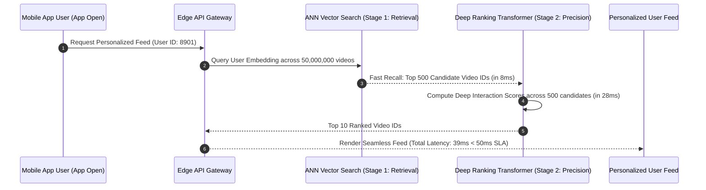
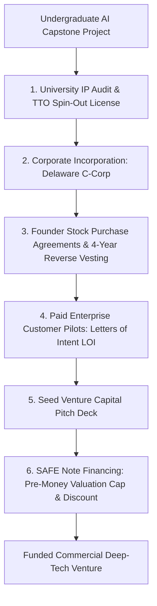
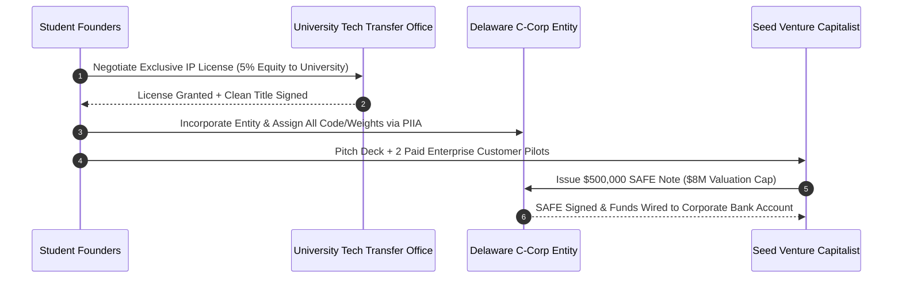

# UG Final Year — Chapter 4: AI and Career
**Curriculum Level:** Undergraduate Final Year (UG-04)  
**Subject Code:** AAA-04 (Autonomous AI Agents, Scalable System Architecture & Capstone Systems)  
**Chapter Title:** AI and Career  

---

# Lesson 1: From Campus to AI Career

### 1. Syllabus Mapping
- **Academic Level:** Undergraduate Final Year
- **Chapter:** Chapter 4 — AI and Career
- **Lesson Title:** From Campus to AI Career
- **Canonical Course Code:** AAA-04-L07
- **Development Status:** Newly Developed (Official Syllabus: Transitioning to Senior Tech Leadership, AI System Design Interviews, Equity & Compensation).

### 2. Learning Outcomes & Prerequisites
- **Learning Outcomes:**
  1. Master the standard 45-minute Machine Learning System Design Interview framework used by Tier-1 technology companies (Google, Meta, Anthropic, Databricks).
  2. Model and negotiate total compensation packages (Base Salary, Equity/RSUs, Stock Options, Cliff Schedules, Acceleration Clauses) in AI startups vs. public tech giants.
  3. Cultivate high-leverage engineering leadership competencies: authoring Request for Comments (RFC) architectural proposals, mentoring junior engineers, and executing blameless postmortems.
  4. Formulate an automated Equity Valuation Calculator in Python that models stock option dilution across Series A, B, and C venture rounds.
- **Prerequisites:** Completion of AAA-04-L06; distributed systems architecture, startup capitalization tables.

### 3. Realistic Industry Scenario
As a graduating university senior, you receive two competing employment offers:
- **Offer A (Big Tech):** $\$160,000$ Base Salary + $\$80,000/\text{year}$ liquid public Restricted Stock Units (RSUs) at a mature search engine giant.
- **Offer B (High-Growth AI Startup):** $\$130,000$ Base Salary + $0.25\%$ equity in stock options at a Series A generative AI foundation model company valued at $\$60,000,000$.
Many student engineers accept offers blindly based solely on headline base salary, or fall for illiquid option grants that get wiped out by liquidation preferences. Furthermore, during final-round onsite interviews, candidates are tested not on multiple-choice trivia, but on end-to-end ML System Design (e.g., *"Design TikTok's real-time video recommendation pipeline"*). As an aspiring Senior AI Engineer, you must master the System Design interview framework and model startup equity mathematically.

### 4. Detailed Conceptual Explanations



#### 1. The Two-Stage Recommendation Architecture:
In production systems serving millions of items (e.g., YouTube, Netflix, TikTok), running a heavy deep neural network over 100,000,000 candidate items violates the 50ms latency budget. Production systems always employ the **Two-Stage Pattern**:
1. **Stage 1: Retrieval / Candidate Generation ($100\text{M} \to 1,000$ items in $< 10\text{ms}$):** Fast, approximate nearest neighbor (ANN) vector search (HNSW, FAISS) or two-tower embedding models. Prioritizes high recall ($> 95\%$).
2. **Stage 2: Heavy Ranking / Scoring ($1,000 \to 10$ items in $< 35\text{ms}$):** A complex, multi-task cross-encoder transformer evaluating rich user-context interaction features (recency, device, cross-features). Prioritizes precision and user engagement.

#### 2. Startup Stock Option Math & Dilution:
A stock option grants the right to purchase shares at a fixed **Strike Price**. Total value is governed by enterprise exit valuation, liquidation preferences, and dilution:
$$\text{Diluted Ownership} = \text{Initial Equity} \times \prod_{i=1}^k (1 - D_i)$$
where $D_i$ is the dilution fraction (typically $15\% - 25\%$) incurred at each subsequent venture capital fundraising round.

### 5. Architecture & Dataflow Diagram


### 6. Guided Technical Demonstration & Worked Example
The following runnable script implements a Startup Equity & Valuation Simulator that models startup option value under funding dilution and exit valuations:

```python
from typing import Dict, Any

class TechCompensationEquityCalculator:
    def __init__(self, base_salary: float, equity_percentage: float, current_valuation: float, strike_price_per_share: float = 1.0):
        self.base = base_salary
        self.equity_pct = equity_percentage # e.g. 0.25% = 0.0025
        self.current_val = current_valuation

    def simulate_exit_scenarios(
        self,
        exit_valuations: list[float],
        future_dilution_rounds: list[float]
    ) -> list[Dict[str, Any]]:
        
        # Calculate cumulative dilution: (1 - d1) * (1 - d2) * ...
        retention_multiplier = 1.0
        for d in future_dilution_rounds:
            retention_multiplier *= (1.0 - d)

        diluted_equity = self.equity_pct * retention_multiplier

        results = []
        for val in exit_valuations:
            equity_dollar_value = val * diluted_equity
            total_annualized_comp_4yr = self.base + (equity_dollar_value / 4.0)
            
            results.append({
                "exit_valuation_usd": f"${val:,.0f}",
                "diluted_equity_percent": f"{diluted_equity * 100:.4f}%",
                "gross_equity_payout_usd": round(equity_dollar_value, 2),
                "total_annualized_compensation_4yr": round(total_annualized_comp_4yr, 2)
            })
            
        return results

# Model Offer B: $130,000 Base + 0.25% Equity at $60M Series A valuation
calc = TechCompensationEquityCalculator(
    base_salary=130000.0,
    equity_percentage=0.0025, # 0.25%
    current_valuation=60000000.0
)

# Simulate Series B (20% dilution) and Series C (15% dilution)
future_dilution = [0.20, 0.15]
# Potential Exit Valuations: $100M (Modest), $500M (Good), $2B (Unicorn)
exit_scenarios = [100_000_000.0, 500_000_000.0, 2_000_000_000.0]

print("=== Startup Equity & Total Compensation Model ===")
reports = calc.simulate_exit_scenarios(exit_scenarios, future_dilution)
for rep in reports:
    print(f"\nScenario Exit: {rep['exit_valuation_usd']}")
    print(f"  Diluted Ownership: {rep['diluted_equity_percent']}")
    print(f"  Equity Payout at Exit: ${rep['gross_equity_payout_usd']:,.2f}")
    print(f"  Effective Annualized Compensation (Base + Equity/4): ${rep['total_annualized_compensation_4yr']:,.2f}")
```

### 7. Interactive Technical Simulation / Mission: "The System Design Whiteboard Gauntlet"
- **Mission Brief:** You are on the whiteboard during a final-round System Design Interview at a top tech company.
- **Problem Statement:** *"Design an AI-Powered Real-Time Video Copyright Infringement Detection Engine that scans 500 hours of video uploaded every minute."*
- **Constraints:**
  - You have 20 minutes to diagram:
    1. Video Frame Ingestion & Perceptual Hashing (pHash).
    2. Approximate Nearest Neighbor (ANN) Index across 100M registered copyright clips.
    3. Asynchronous Worker Queue for Deep Audio-Visual Model Inspection.
    4. DMCA Takedown and Appeal State Machine.
- **Game Mechanics & Scoring:**
  - Base Score: 1,000 points.
  - Designing a Two-Stage Filter (Fast pHash $\to$ Heavy CNN): $+500$ points.
  - Hand-waving database scaling under 500 hrs/min: $-400$ points.
  - Senior Architect Badge Earned on score $\ge 1,200$.

### 8. Practical Programming & Analysis Lab
1. Build `two_stage_recommender.py` implementing:
   - Stage 1: Vector ANN Candidate Generator retrieving top 50 candidates from 10,000 items.
   - Stage 2: Heavy multi-feature scorer ranking the top 50 down to the top 5 recommendations.
2. Benchmark end-to-end latency and verify that total execution completes within $< 45\text{ ms}$.

### 9. Measurable Output / Deliverable
A Python implementation `production_recommender_pipeline.py` accompanied by an engineering Request for Comments (RFC) document (`system_architecture_rfc.md`) proposing a complete production ML system.

### 10. Evaluation Criteria & Technical Success Metrics
| Metric | Target Standard | Fail Criterion |
|---|---|---|
| **Two-Stage Latency Budget** | Total P99 latency $< 45\text{ ms}$ | Running heavy model on all 10,000 items |
| **System Design Completeness** | Addresses ingestion, storage, serving, and monitoring | Omitting data storage or caching |
| **Equity Model Precision** | Correctly accounts for multi-round dilution factors | Assuming zero future dilution |

### 11. Olympiad-Style Assessment
**Problem 1 (Applied):**  
In large-scale industrial recommendation engines (e.g., YouTube), why is it impossible to evaluate a high-accuracy Cross-Encoder Transformer directly over the entire catalog of 500,000,000 videos for every user query, and what pattern solves this?  
A) Running a deep transformer over 500 million videos requires trillions of floating point operations per request, taking minutes and bankrupting infrastructure; the Two-Stage pattern solves this by using fast, lightweight Approximate Nearest Neighbor (ANN) search to filter down to 500 candidates in $< 10\text{ms}$ before applying the heavy transformer.  
B) Cross-encoders cannot process video titles.  
C) YouTube only has 10 videos.  
D) Deep transformers cannot run on servers.  

**Problem 2 (Conceptual):**  
In startup compensation agreements, what is a "Standard 4-Year Vesting Schedule with a 1-Year Cliff"?  
A) The employee receives zero equity if they leave the company before 12 months (the cliff); after 12 months, exactly $25\%$ of their total option grant vests immediately, followed by monthly or quarterly vesting of the remaining $75\%$ over the subsequent 36 months.  
B) The employee is fired off a physical cliff.  
C) The employee works for free for 4 years.  
D) The company pays taxes on behalf of the employee.  

### 12. Correct Answers & Solutions
- **Problem 1 Solution:** Correct Answer is **A**.  
  *Proof:* Computational complexity scaling. If a single transformer inference pass takes $1\text{ ms}$, evaluating 500 million items sequentially takes 500,000 seconds ($\approx 5.8$ days). Even distributed across 1,000 GPUs, it is impossible to meet a $50\text{ ms}$ web SLA. Vector index retrieval (HNSW/ScANN) projects user and item embeddings into a shared vector space, retrieving 500 candidate neighbors in $O(\log N)$ time ($< 10\text{ ms}$). The deep multi-task ranker then only computes inference over the 500 candidates, meeting the SLA comfortably.
- **Problem 2 Solution:** Correct Answer is **A**.  
  *Proof:* The 1-year cliff is the industry-standard equity protection mechanism for tech companies. If an employee departs or is terminated within the first 12 months of employment, zero equity vests, protecting the company's capitalization table from equity dispersion. Upon reaching the 1-year anniversary, $1/4$ ($25\%$) vests in a single lump-sum, followed by linear $1/48$ vesting every month thereafter.

### 13. Limitations, Risks & Responsible AI Considerations
- **Golden Handcuffs & Illiquid Stock:** Startup stock options are illiquid and carry high financial risk (over $90\%$ of venture-backed startups exit at $\$0$ or below liquidation preference). Never value illiquid startup equity as guaranteed cash when budgeting personal living expenses.
- **Architectural Hubris:** In System Design interviews, avoid proposing hyper-complex multi-cloud distributed systems when a simple monolithic architecture with a PostgreSQL database and an in-memory cache meets the business requirements with $10\times$ less operational complexity.

### 14. Completion Criteria & Achievement Feedback
- **Completion Check:** Pass all automated latency and ranking tests in `production_recommender_pipeline.py`.
- **Badge Earned:** *Senior AI Systems Architect (Level 4 Enterprise AI Engineer)*.

---

# Lesson 2: Idea to AI Venture

### 1. Syllabus Mapping
- **Academic Level:** Undergraduate Final Year
- **Chapter:** Chapter 4 — AI and Career
- **Lesson Title:** Idea to AI Venture
- **Canonical Course Code:** AAA-04-L08
- **Development Status:** Newly Developed (Official Syllabus: Venture Engineering, Capstone Commercialization, Seed Capital Raising, Term Sheets).

### 2. Learning Outcomes & Prerequisites
- **Learning Outcomes:**
  1. Transform an undergraduate technical AI capstone project into a viable venture-backed commercial enterprise.
  2. Navigate university Intellectual Property (IP) assignment agreements, Bayh-Dole Act licensing, and university tech transfer office (TTO) spin-out policies.
  3. Formulate an institutional Venture Pitch Deck structure (Problem, Technical Solution, Proprietary Moat, Go-To-Market, Financial Projections).
  4. Deconstruct venture capital Term Sheets: Pre-Money Valuation, SAFE notes (Simple Agreement for Future Equity), Liquidation Preferences, and Board Seats.
- **Prerequisites:** Completion of AAA-04-L07; understanding of software licensing, startup legal corporate structures (Delaware C-Corp).

### 3. Realistic Industry Scenario
During your final-year undergraduate engineering capstone, your team developed an innovative Computer Vision algorithm that detects microscopic hairline fractures in semiconductor wafers $10\times$ faster than existing laser interferometers. Two multinational chip manufacturers approach your team offering $\$200,000$ pilot contracts, and a prominent Silicon Valley seed accelerator offers a $\$500,000$ pre-seed investment. However, because you trained the model using university lab servers and university funding grants, the University Technology Transfer Office (TTO) claims 100% ownership of the patent and copyright. You must navigate university IP spin-out negotiations, incorporate a Delaware C-Corporation, issue founder equity with reverse vesting, and negotiate a clean SAFE note investment round.

### 4. Detailed Conceptual Explanations



#### 1. University Intellectual Property & Tech Transfer (TTO):
Under the US Bayh-Dole Act and international university patent policies, research created using substantial university resources or grant funding is owned by the university.
To legally commercialize a capstone AI venture:
1. **Invention Disclosure:** Submit a formal disclosure to the university Tech Transfer Office (TTO).
2. **Exclusive License Agreement:** The startup licenses the patents and copyright from the university in exchange for university equity ($3\% - 8\%$) and a modest royalty ($1\% - 3\%$).
3. **Clean IP Assignment:** Ensure all student co-founders sign a formal **Proprietary Information and Inventions Agreement (PIIA)** assigning all code and models exclusively to the newly incorporated company.

#### 2. The SAFE (Simple Agreement for Future Equity) Mechanics:
Pioneered by Y Combinator, the post-money SAFE is the global standard for pre-seed and seed financing. An investor gives the company cash today in exchange for the right to convert into preferred stock during a future priced round (Series A):
$$\text{Conversion Price} = \min\left(\frac{\text{Post-Money Valuation Cap}}{\text{Total Company Shares}}, \text{Series A Price} \times (1 - \text{Discount})\right)$$
- **Valuation Cap:** The maximum effective valuation at which the investor converts (e.g., $\$10,000,000$).
- **Discount:** A percentage discount on the future priced share price (typically $20\%$).

### 5. Architecture & Dataflow Diagram


### 6. Guided Technical Demonstration & Worked Example
The following runnable script implements a Capstone Venture Capitalization Table and SAFE Conversion Simulator in Python:

```python
from typing import Dict, List, Any

class StartupCapTableSimulator:
    def __init__(self, initial_founder_shares: int = 8_000_000, unallocated_option_pool: int = 2_000_000):
        self.founder_shares = initial_founder_shares
        self.option_pool = unallocated_option_pool
        self.total_initial_shares = initial_founder_shares + unallocated_option_pool

    def simulate_safe_conversion(
        self,
        safe_investment_amount: float,
        safe_valuation_cap: float,
        series_a_pre_money_val: float,
        series_a_new_money: float
    ) -> Dict[str, Any]:
        
        # Calculate SAFE Investor Ownership at Series A Conversion
        # Using Post-Money Valuation Cap formula: Ownership = Investment / Cap
        safe_ownership_pct = safe_investment_amount / safe_valuation_cap
        
        # Series A New Shares Issued
        series_a_post_money = series_a_pre_money_val + series_a_new_money
        series_a_investor_pct = series_a_new_money / series_a_post_money

        # Post-Series A Diluted Ownership Table
        remaining_pool_pct = (1.0 - safe_ownership_pct) * (1.0 - series_a_investor_pct)
        founder_diluted_pct = (self.founder_shares / self.total_initial_shares) * remaining_pool_pct
        option_pool_diluted_pct = (self.option_pool / self.total_initial_shares) * remaining_pool_pct

        return {
            "safe_investment_usd": f"${safe_investment_amount:,.2f}",
            "safe_valuation_cap": f"${safe_valuation_cap:,.2f}",
            "series_a_pre_money": f"${series_a_pre_money_val:,.2f}",
            "series_a_new_cash": f"${series_a_new_money:,.2f}",
            "post_series_a_cap_table": {
                "Founders_Ownership": f"{founder_diluted_pct * 100:.2f}%",
                "Employee_Option_Pool": f"{option_pool_diluted_pct * 100:.2f}%",
                "Seed_SAFE_Investors": f"{safe_ownership_pct * (1.0 - series_a_investor_pct) * 100:.2f}%",
                "Series_A_Lead_VC": f"{series_a_investor_pct * 100:.2f}%"
            }
        }

# Capstone Spin-out Scenario:
# Founders raise $500,000 on an $8,000,000 Cap SAFE.
# Later, they raise a $4,000,000 Series A at a $20,000,000 Pre-Money Valuation.
simulator = StartupCapTableSimulator()
cap_table = simulator.simulate_safe_conversion(
    safe_investment_amount=500_000.0,
    safe_valuation_cap=8_000_000.0,
    series_a_pre_money_val=20_000_000.0,
    series_a_new_money=4_000_000.0
)

print("=== Capstone AI Venture: Capitalization Table Evolution ===")
for k, v in cap_table["post_series_a_cap_table"].items():
    print(f"  Stakeholder [{k}]: {v}")
```

### 7. Interactive Technical Simulation / Mission: "The Seed Investor Term Sheet Negotiation"
- **Mission Brief:** You are negotiating a $\$1,000,000$ seed term sheet with a venture capital fund.
- **Constraints:**
  - The VC offers two term sheet options:
    - **Term Sheet 1:** $\$1,000,000$ at $\$10,000,000$ Post-Money SAFE (Standard, Founder-Friendly).
    - **Term Sheet 2:** $\$1,000,000$ at $\$14,000,000$ Valuation, but includes a "2X Participating Preferred Liquidation Preference" and a "Full Ratchet Anti-Dilution Clause" (Extremely Hazardous Toxic Terms).
  - Select the correct term sheet and write a 100-word justification explaining why the toxic liquidation terms in Option 2 can completely wipe out the founders during a modest $\$15M$ acquisition.
- **Game Mechanics & Scoring:**
  - Base Score: 1,000 points.
  - Selecting Term Sheet 1 and diagnosing liquidation preference risks: $+600$ points.
  - Falling for the higher headline valuation in Term Sheet 2: Instant Disqualification & Complete Founder Wipeout.

### 8. Practical Programming & Analysis Lab
1. Build `venture_incorporation_suite.py` that models dilution and founder equity vesting schedules.
2. Author a formal 10-slide Venture Pitch Deck outline in markdown for your undergraduate capstone project.
3. Formulate a commercial Customer Letter of Intent (LOI) template establishing commercial validation.

### 9. Measurable Output / Deliverable
A complete venture foundation package `ai_capstone_venture_blueprint.md` containing a capitalization table simulation, customer LOI template, and an investor pitch deck specification.

### 10. Evaluation Criteria & Technical Success Metrics
| Metric | Target Standard | Fail Criterion |
|---|---|---|
| **Cap Table Mathematical Accuracy** | Total stakeholder percentages sum to exactly $100.0\%$ | Mathematical rounding/dilution errors |
| **IP Cleanliness** | Formal PIIA and university licensing strategy documented | Ambiguous student/lab IP ownership |
| **Pitch Structure** | Covers Problem, Solution, Data Flywheel, Moat, and Team | Vague product pitch lacking economics |

### 11. Olympiad-Style Assessment
**Problem 1 (Applied):**  
A startup raises $\$2,000,000$ using a "2X Participating Preferred" liquidation preference. The company struggles and is sold 2 years later in an emergency acquisition for $\$5,000,000$. How much cash do the preferred investors take before the common shareholders (founders and employees) receive a single dollar, and how much is left for the founders?  
A) The investors take $2 \times \$2,000,000 = \$4,000,000$ off the top; because the stock is "participating", they also take their pro-rata equity share of the remaining $\$1,000,000$, leaving almost zero for the founders.  
B) The founders receive all $\$5,000,000$.  
C) The government takes all the money.  
D) The investors and founders split the money equally.  

**Problem 2 (Conceptual):**  
Why must student co-founders establish "4-Year Reverse Vesting" on their own founder equity when incorporating a venture-backed company?  
A) To protect the company and remaining founders if one co-founder quits after 3 months; unvested shares are repurchased by the company at nominal price, preventing an ex-founder from retaining $50\%$ of the company equity while doing zero work.  
B) Because Delaware state law requires founders to pay monthly rent.  
C) Because reverse vesting decreases software execution speed.  
D) Because venture capital investors do not permit founders to own stock.  

### 12. Correct Answers & Solutions
- **Problem 1 Solution:** Correct Answer is **A**.  
  *Proof:* Liquidation preferences dictate payment priority during an exit. A "2X" multiple means investors are guaranteed $2 \times \text{Investment} = \$4,000,000$ before common stockholders receive anything. Furthermore, "Participating" stock allows investors to double-dip: receiving their preferred return *and then* participating alongside common stockholders in whatever proceeds remain. Out of a $\$5,000,000$ sale, investors take $\$4.0\text{M} + \text{pro-rata}(\$1.0\text{M})$, wiping out founder common equity completely.
- **Problem 2 Solution:** Correct Answer is **A**.  
  *Proof:* If two student founders split a company 50/50 with immediate vesting, and Founder A quits after 90 days to take a corporate job, Founder A legally retains $50\%$ of the corporate equity. Founder B would have to do all remaining years of work while diluting themselves, and no future venture capitalist will ever invest in a company where an inactive ex-employee owns half the equity. Reverse vesting ensures equity is earned through continuous service.

### 13. Limitations, Risks & Responsible AI Considerations
- **Venture Capital Treadmill:** Raising venture capital is not a measure of success; it is a debt of growth expectations. Once institutional venture capital is accepted, the company must pursue a $> \$100\text{M}$ exit or unicorn valuation, closing off sustainable lifestyle business pathways.
- **Academic Conflict of Interest:** Using university laboratory computers, compute credits, or student colleagues for commercial startup gain without formal disclosure can violate academic integrity policies, leading to expulsion and immediate revocation of IP licenses.

### 14. Completion Criteria & Achievement Feedback
- **Completion Check:** Pass all automated cap table calculations in `venture_incorporation_suite.py` with verified SAFE dilution.
- **Badge Earned:** *Deep-Tech Venture Founder (Level 4 Enterprise AI Engineer)*.
