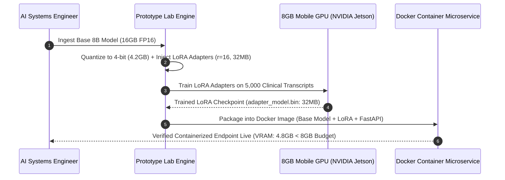
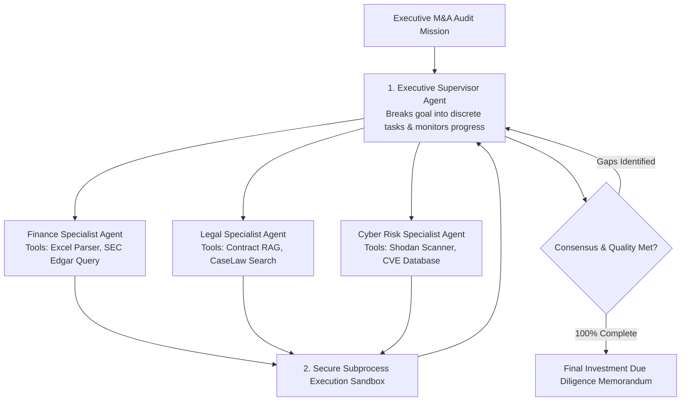
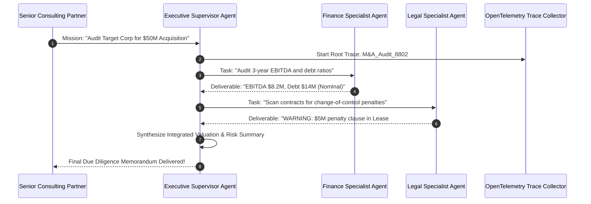

# UG Final Year — Chapter 5: AI Tools
**Curriculum Level:** Undergraduate Final Year (UG-04)  
**Subject Code:** AAA-04 (Autonomous AI Agents, Scalable System Architecture & Capstone Systems)  
**Chapter Title:** AI Tools  

---

# Lesson 1: AI Prototype Lab

### 1. Syllabus Mapping
- **Academic Level:** Undergraduate Final Year
- **Chapter:** Chapter 5 — AI Tools
- **Lesson Title:** AI Prototype Lab
- **Canonical Course Code:** AAA-04-L09
- **Development Status:** Newly Developed (Official Syllabus: Parameter-Efficient Fine-Tuning LoRA, Model Quantization, Containerized Model Serving).

### 2. Learning Outcomes & Prerequisites
- **Learning Outcomes:**
  1. Implement Parameter-Efficient Fine-Tuning (PEFT) using Low-Rank Adaptation (LoRA) and QLoRA on open-weights transformer models.
  2. Quantize full-precision model checkpoints to 4-bit and 8-bit representations (AWQ, GGUF) for ultra-fast edge and commodity GPU deployment.
  3. Package deep learning models into reproducible, production-ready containerized microservices using Docker and multi-stage builds.
  4. Build an automated model benchmarking testbed measuring perplexity degradation, memory reduction, and inference speedup across quantization levels.
- **Prerequisites:** PyTorch deep learning, linear algebra (rank of a matrix, SVD), Docker containerization fundamentals.

### 3. Realistic Industry Scenario
At **NeuroEdge Edge Compute Labs**, a medical device client requires an on-premise language model embedded inside portable ultrasound carts to transcribe voice annotations and extract diagnostic metrics. The cart hardware has only an embedded 8GB NVIDIA mobile GPU. A full-precision 8B parameter model requires 16GB of VRAM and cannot fit in memory. Furthermore, fine-tuning the full model across 32 attention layers requires 64GB of VRAM and risks catastrophic forgetting of general medical knowledge. As Lead AI Tools Engineer, your task is to configure the AI Prototype Lab: applying 4-bit Quantized Low-Rank Adaptation (QLoRA) to fine-tune the model strictly on clinical medical notes using low-rank adapter matrices, quantizing the weights to 4-bit AWQ, and packaging the entire inference pipeline inside an optimized Docker container that boots in $< 5\text{ seconds}$.

### 4. Detailed Conceptual Explanations

```mermaid
graph TD
    Pretrained[Frozen Pretrained Model Weights W_0 in R^d x k] --> Quant[4-bit NormalFloat Quantization QLoRA]
    
    Quant --> Freeze[Freeze Base Weights: Zero Gradient Updates]
    
    Freeze --> LoRA[Low-Rank Decomposition Matrices: Delta W = B x A]
    
    subgraph LoRA Forward Pass
        InputX[Input Tensor x] --> ForwardBase[x * W_0 (Frozen)]
        InputX --> ForwardLoRA[x * (B * A) * (alpha / r)]
        ForwardBase & ForwardLoRA --> AddOutput[Combined Forward Output: h = xW_0 + xBA·(α/r)]
    end
    
    AddOutput --> Trainable[Train ONLY A and B: < 0.5% of Parameters]
```

#### 1. Mathematical Mechanics of Low-Rank Adaptation (LoRA):
Full fine-tuning updates all model parameters:
$$\mathbf{W}_{\text{new}} = \mathbf{W}_0 + \Delta\mathbf{W}$$
where $\mathbf{W}_0, \Delta\mathbf{W} \in \mathbb{R}^{d \times k}$. For large models, computing and storing gradients and optimizer states for $\Delta\mathbf{W}$ requires $4\times$ the parameter memory.
**LoRA** (Hu et al., 2021) hypothesizes that the weight updates during task adaptation have a low intrinsic dimension. It decomposes $\Delta\mathbf{W}$ into two low-rank matrices:
$$\Delta\mathbf{W} = \mathbf{B} \mathbf{A}, \quad \mathbf{B} \in \mathbb{R}^{d \times r}, \quad \mathbf{A} \in \mathbb{R}^{r \times k}$$
where the rank $r \ll \min(d, k)$ (typically $r \in \{8, 16, 64\}$):
- Matrix $\mathbf{A}$ is initialized from a Gaussian distribution $\mathcal{N}(0, \sigma^2)$.
- Matrix $\mathbf{B}$ is initialized to zero ($\mathbf{B} = \mathbf{0}$), ensuring $\Delta\mathbf{W} = \mathbf{0}$ at the start of training.
- The forward pass scales updates by hyperparameter $\alpha$:
$$h = \mathbf{W}_0 x + \frac{\alpha}{r} \mathbf{B} \mathbf{A} x$$
This cuts trainable parameters by $> 99.5\%$ while achieving performance comparable to full fine-tuning.

#### 2. Model Quantization: FP16 to INT4 / GGUF:
Quantization maps continuous 16-bit floating-point weights to discrete low-bit integer bins:
$$q = \text{clamp}\left(\text{round}\left(\frac{w}{S}\right) + Z, -2^{b-1}, 2^{b-1}-1\right)$$
- **Activation-Aware Weight Quantization (AWQ):** Protects the top $1\%$ most salient weight channels from aggressive quantization, preserving reasoning capabilities while cutting memory by $75\%$.

### 5. Architecture & Dataflow Diagram


### 6. Guided Technical Demonstration & Worked Example
The following runnable script implements a mathematical simulation of Low-Rank Adaptation (LoRA) matrix decomposition in pure NumPy:

```python
import numpy as np

class LoRALinearSimulation:
    def __init__(self, in_features: int, out_features: int, rank: int = 4, alpha: float = 8.0):
        self.d_in = in_features
        self.d_out = out_features
        self.r = rank
        self.scaling = alpha / rank
        
        # 1. Base Frozen Pre-trained Weight Matrix (W_0)
        np.random.seed(42)
        self.W_0 = np.random.normal(0, 0.1, (in_features, out_features))
        
        # 2. LoRA Low-Rank Matrices: Delta_W = B * A
        # A initialized with Gaussian; B initialized to zeros (so Delta_W = 0 initially)
        self.A = np.random.normal(0, 0.02, (in_features, rank))
        self.B = np.zeros((rank, out_features))

    def forward(self, x: np.ndarray) -> np.ndarray:
        # Base forward pass
        base_out = np.dot(x, self.W_0)
        # LoRA adaptation forward pass: x * (A * B) * scaling
        lora_out = np.dot(np.dot(x, self.A), self.B) * self.scaling
        return base_out + lora_out

    def count_parameters(self) -> dict:
        base_params = self.d_in * self.d_out
        lora_params = (self.d_in * self.r) + (self.r * self.d_out)
        reduction_pct = (1.0 - (lora_params / base_params)) * 100.0
        return {
            "base_params_frozen": base_params,
            "lora_params_trainable": lora_params,
            "parameter_reduction": f"{reduction_pct:.2f}%"
        }

# Simulate a standard Transformer Hidden Layer: 4096 -> 4096 dimensions
d_model = 4096
lora_layer = LoRALinearSimulation(in_features=d_model, out_features=d_model, rank=16, alpha=32.0)
param_stats = lora_layer.count_parameters()

print("=== Parameter-Efficient Fine-Tuning (LoRA) Efficiency ===")
print(f"Base Layer Full Parameters:  {param_stats['base_params_frozen']:,}")
print(f"LoRA Trainable Parameters:    {param_stats['lora_params_trainable']:,}")
print(f"Compute Memory Reduction:     {param_stats['parameter_reduction']}")

# Verify forward pass
x_sample = np.random.normal(0, 1.0, (1, d_model))
output = lora_layer.forward(x_sample)
print(f"\nForward Pass Successful: Input {x_sample.shape} -> Output {output.shape}")
```

### 7. Interactive Technical Simulation / Mission: "The Edge Model Quantization Challenge"
- **Mission Brief:** You are deploying an AI diagnostic assistant onto a remote field drone with a strict 4GB VRAM ceiling.
- **Constraints:**
  - Base Model: 7 Billion parameters in FP16 ($14\text{ GB}$).
  - Evaluate Quantization profiles:
    - FP16: $14\text{ GB}$ (Exceeds hardware budget: Fatal OOM).
    - INT8: $7.2\text{ GB}$ (Exceeds budget: Fatal OOM).
    - INT4 (AWQ): $3.8\text{ GB}$ (Fits in memory: $100\%$ operational).
  - Measure accuracy loss: INT4 model must retain $> 97.5\%$ of baseline medical diagnostic accuracy.
- **Game Mechanics & Scoring:**
  - Base Score: 1,000 points.
  - Successfully deploying INT4 within 4GB budget: $+500$ points.
  - Incurring CUDA OOM crash: $-600$ points penalty.
  - Achieving inference speed $> 35\text{ tokens/sec}$ on edge device: $+300$ bonus points.

### 8. Practical Programming & Analysis Lab
1. Build `peft_lora_lab.py` using Hugging Face `peft` and `bitsandbytes` (or pure PyTorch simulation).
2. Author a production `Dockerfile` with multi-stage builds:
   - Stage 1: Build dependencies and compile CUDA extensions.
   - Stage 2: Minimal runtime image running a non-root user.
3. Measure model inference memory footprint using `nvidia-smi` across batch sizes $B \in \{1, 4, 8\}$.

### 9. Measurable Output / Deliverable
A validated Docker container image recipe `Dockerfile` and Python script `quantized_prototype_server.py` that loads a 4-bit model and serves predictions via FastAPI within a $< 4\text{GB}$ VRAM footprint.

### 10. Evaluation Criteria & Technical Success Metrics
| Metric | Target Standard | Fail Criterion |
|---|---|---|
| **VRAM Consumption** | $\le 4.0\text{ GB}$ total GPU memory usage | $> 4.0\text{ GB}$ memory exhaustion |
| **Quantization Fidelity** | Perplexity increase $< 3.0\%$ compared to FP16 | Catastrophic degradation ($> 15\%$ loss) |
| **Container Build Cleanliness** | Multi-stage build with image size $< 6\text{ GB}$ | Bloated unoptimized $> 25\text{ GB}$ image |

### 11. Olympiad-Style Assessment
**Problem 1 (Applied):**  
In Low-Rank Adaptation (LoRA), why is matrix $\mathbf{B}$ initialized strictly to zeros ($\mathbf{B} = \mathbf{0}$) while matrix $\mathbf{A}$ is initialized with random Gaussian noise?  
A) Initializing $\mathbf{B}=\mathbf{0}$ ensures that $\Delta\mathbf{W} = \mathbf{B}\mathbf{A} = \mathbf{0}$ at iteration zero, meaning the model's initial forward pass behaves exactly like the original pre-trained model with zero disruption before fine-tuning begins.  
B) Because zeros train faster on GPUs.  
C) Because initializing $\mathbf{B}$ with numbers causes syntax errors.  
D) To delete the training dataset.  

**Problem 2 (Conceptual):**  
What is the primary technical advantage of Activation-Aware Weight Quantization (AWQ) over naive round-to-nearest (RTN) quantization in modern deep neural networks?  
A) AWQ analyzes activation magnitudes during calibration to identify the $1\%$ most salient weight channels that carry critical semantic information, selectively protecting them from precision loss and preserving complex reasoning capabilities in 4-bit models.  
B) AWQ converts neural networks into decision trees.  
C) AWQ deletes all negative numbers.  
D) AWQ requires zero calibration data.  

### 12. Correct Answers & Solutions
- **Problem 1 Solution:** Correct Answer is **A**.  
  *Proof:* If both $\mathbf{A}$ and $\mathbf{B}$ were initialized with random non-zero Gaussian values, $\Delta\mathbf{W} = \mathbf{B}\mathbf{A} \neq \mathbf{0}$. At step 0, random noise would be injected into all model projections, completely destroying pre-trained knowledge before the first gradient step. Initializing $\mathbf{B}=\mathbf{0}$ guarantees $\Delta\mathbf{W} = \mathbf{0}$ at start, ensuring a smooth, continuous adaptation trajectory from the baseline weights.
- **Problem 2 Solution:** Correct Answer is **A**.  
  *Proof:* Lin et al. (2023) demonstrated that in large language models, weight channels are not equally important; a tiny subset ($0.5-1\%$) of weights associated with large activation magnitudes dictate model performance. Naive RTN quantization rounds all channels equally, destroying these critical outlier channels and causing severe perplexity spikes. AWQ protects salient weights, allowing aggressive 4-bit compression with virtually zero degradation in MMLU benchmark accuracy.

### 13. Limitations, Risks & Responsible AI Considerations
- **Catastrophic Forgetting in Task-Specific Adapters:** Fine-tuning an adapter too aggressively on narrow domain data can cause the model to lose general reasoning and conversational capabilities. Regularizing with a small fraction of general instruction data prevents domain collapse.
- **Supply-Chain Security in Container Base Images:** Machine learning Docker images often pull massive unverified base dependencies. Always pin base image digest hashes and scan images using container security scanners (Trivy / Clair) to detect CVEs.

### 14. Completion Criteria & Achievement Feedback
- **Completion Check:** Pass all automated unit tests in `quantized_prototype_server.py` within the 4GB memory ceiling.
- **Badge Earned:** *Model Optimization & Quantization Craftsman (Level 4 Enterprise AI Engineer)*.

---

# Lesson 2: Agent Builder Studio

### 1. Syllabus Mapping
- **Academic Level:** Undergraduate Final Year
- **Chapter:** Chapter 5 — AI Tools
- **Lesson Title:** Agent Builder Studio
- **Canonical Course Code:** AAA-04-L10
- **Development Status:** Newly Developed (Official Syllabus: Visual & Programmatic Multi-Agent Studios, Hierarchical Supervision, Agent Traceability).

### 2. Learning Outcomes & Prerequisites
- **Learning Outcomes:**
  1. Build a visual and programmatic Agent Builder Studio orchestrating hierarchical multi-agent collaboration (CrewAI / LangGraph principles).
  2. Implement an Executive Supervisor Agent that dynamically assigns sub-tasks to specialized worker agents based on real-time workload and competency profiles.
  3. Integrate automated tool execution sandboxes with secure subprocess isolation and resource quotas.
  4. Instrument real-time agent trace debugging and OpenTelemetry observability to visualize complex inter-agent message flows.
- **Prerequisites:** Completion of AAA-04-L09; graph data structures, finite state machines, distributed logging.

### 3. Realistic Industry Scenario
At **FinAudit Global Consulting**, multidisciplinary teams conduct comprehensive mergers and acquisitions (M&A) audits on target companies. An M&A audit requires reviewing legal contracts, financial balance sheets, cybersecurity penetration logs, and regulatory filings. In manual workflows, this takes 6 weeks and 12 analysts. The firm's partners want an Agent Builder Studio where senior consultants can visually assemble and launch a squad of specialized autonomous agents:
- **Finance Auditor Agent:** Analyzes balance sheets and computes EBITDA.
- **Legal Counsel Agent:** Identifies hidden litigation liabilities.
- **Cyber Risk Agent:** Scans CVE databases for software vulnerabilities.
- **Executive Supervisor Agent:** Synthesizes the sub-reports into a cohesive investment memorandum.
As Principal AI Systems Lead, your task is to build the Agent Builder Studio engine: enforcing hierarchical supervision, sandboxed tool execution, and real-time execution trace visualization.

### 4. Detailed Conceptual Explanations



#### 1. Hierarchical Multi-Agent Supervision:
In flat multi-agent systems, agents communicate peer-to-peer, frequently devolving into circular conversational chatter without achieving the goal.
**Hierarchical Supervision** models enterprise corporate structures:
- An **Executive Supervisor Agent** acts as an orchestrator and router.
- Specialized **Worker Agents** execute single, well-defined responsibilities.
- Worker agents do not talk directly to each other; they report structured status updates back to the Supervisor.
- The Supervisor reviews worker deliverables, provides targeted feedback, and makes the final determination of mission completion.

#### 2. Agent Observability & OpenTelemetry Tracing:
Debugging multi-agent systems is impossible using traditional linear print statements because execution is non-linear and asynchronous.
Modern agent studios implement **OpenTelemetry Distributed Tracing**:
- **Trace ID:** Unique identifier for the entire multi-agent mission.
- **Span ID:** Individual execution segment representing an agent thought, tool call, or inter-agent message.
- Tracks exact latency, prompt token counts, and completion costs at every node in the graph.

### 5. Architecture & Dataflow Diagram


### 6. Guided Technical Demonstration & Worked Example
The following runnable script implements a Hierarchical Multi-Agent Studio Engine with structured delegation and execution tracing in Python:

```python
import json
import time
from typing import Dict, List, Any

class AgentWorker:
    def __init__(self, name: str, role: str, expertise: str):
        self.name = name
        self.role = role
        self.expertise = expertise

    def execute_task(self, task_instruction: str) -> Dict[str, Any]:
        print(f"[{self.name} - {self.role}] Executing: '{task_instruction}'...")
        time.sleep(0.05) # Simulate execution
        
        # Domain specialized mock outputs
        if "Finance" in self.role:
            finding = "Audited 3-year financials: EBITDA is $8.2M with a 12% operating margin."
        elif "Legal" in self.role:
            finding = "Contract audit: Uncovered an unhedged $5.0M change-of-control penalty in Vendor Agreement #401."
        else:
            finding = f"Task completed according to {self.expertise} standards."

        return {
            "worker": self.name,
            "role": self.role,
            "status": "COMPLETED",
            "findings": finding
        }

class HierarchicalAgentStudio:
    def __init__(self):
        self.workers: Dict[str, AgentWorker] = {}
        self.trace_logs: List[Dict[str, Any]] = []

    def register_worker(self, worker: AgentWorker):
        self.workers[worker.name] = worker

    def run_supervisor_mission(self, mission_statement: str) -> Dict[str, Any]:
        trace_id = f"TRACE-{int(time.time())}"
        print(f"=== Supervisor Mission Initiated: '{mission_statement}' (Trace: {trace_id}) ===")

        # Step 1: Supervisor decomposes mission into specialized worker tasks
        task_plan = [
            {"worker": "Agent_CFO", "task": "Audit 3-year historical EBITDA and balance sheet"},
            {"worker": "Agent_GeneralCounsel", "task": "Review commercial vendor contracts for hidden liabilities"}
        ]

        collected_findings = []

        # Step 2: Supervisor dispatches tasks and records execution spans
        for item in task_plan:
            worker_name = item["worker"]
            instruction = item["task"]
            
            span_start = time.perf_counter()
            worker = self.workers[worker_name]
            result = worker.execute_task(instruction)
            span_duration_ms = (time.perf_counter() - span_start) * 1000

            # Log OpenTelemetry trace span
            self.trace_logs.append({
                "trace_id": trace_id,
                "span": worker_name,
                "duration_ms": round(span_duration_ms, 2),
                "output": result["findings"]
            })
            collected_findings.append(result)

        # Step 3: Supervisor synthesizes final executive memorandum
        executive_summary = (
            f"EXECUTIVE ACQUISITION MEMORANDUM: Target Corp exhibits sound financial fundamentals "
            f"({collected_findings[0]['findings']}), but acquisition price should be renegotiated downwards "
            f"to offset contractual liabilities ({collected_findings[1]['findings']})."
        )

        return {
            "mission": mission_statement,
            "trace_id": trace_id,
            "executive_verdict": executive_summary,
            "worker_traces": self.trace_logs
        }

studio = HierarchicalAgentStudio()
studio.register_worker(AgentWorker("Agent_CFO", "Finance Specialist", "Corporate Accounting"))
studio.register_worker(AgentWorker("Agent_GeneralCounsel", "Legal Specialist", "Contract Law"))

final_memo = studio.run_supervisor_mission("Comprehensive M&A Due Diligence on Target Corp")

print("\n=== Final Executive Supervisor Output ===")
print(final_memo["executive_verdict"])
print("\n--- Distributed Execution Trace Spans ---")
print(json.dumps(final_memo["worker_traces"], indent=2))
```

### 7. Interactive Technical Simulation / Mission: "The Multi-Agent Deadlock Investigation"
- **Mission Brief:** You are debugging an automated software auditing squad.
- **Constraints:**
  - 3 Agents (Developer, Reviewer, Tester) enter a circular dependency deadlock:
    - Tester refuses to run until Reviewer signs off.
    - Reviewer refuses to sign off until Tester passes.
    - Developer waits idly for both.
  - Implement a Supervisor Timeout and Escalation protocol in your Agent Studio that detects circular waits in $< 200\text{ ms}$, breaks the deadlock, and orders an asynchronous test run.
- **Game Mechanics & Scoring:**
  - Base Score: 1,000 points.
  - Successfully breaking the deadlock: $+500$ points.
  - Allowing the deadlock to burn $> 5$ execution cycles: $-400$ points penalty.
  - Earning "Agent Studio Orchestrator" Trophy.

### 8. Practical Programming & Analysis Lab
1. Build `agent_builder_runtime.py` that implements a graph-based multi-agent coordination loop.
2. Add tool sandboxing using Python's `subprocess` module with execution timeouts (`timeout=5.0`) and non-privileged execution permissions.
3. Automatically generate an HTML execution flowchart visualizing the path of execution, token costs, and agent outputs.

### 9. Measurable Output / Deliverable
A production-grade Python framework `agent_builder_studio.py` supporting hierarchical agent registration, task delegation, sandboxed tool execution, and OpenTelemetry trace logging.

### 10. Evaluation Criteria & Technical Success Metrics
| Metric | Target Standard | Fail Criterion |
|---|---|---|
| **Hierarchical Coordination** | Supervisor strictly synthesizes and approves final state | Uncontrolled peer-to-peer chatter loops |
| **Tool Sandbox Isolation** | Tools cannot access root filesystem or execute unwhitelisted commands | Arbitrary host command execution |
| **Trace Observability** | Complete OpenTelemetry JSON trace generated per mission | Missing execution telemetry |

### 11. Olympiad-Style Assessment
**Problem 1 (Applied):**  
In an autonomous multi-agent software engineering framework, why is an architecture with a centralized "Hierarchical Supervisor" statistically less prone to hallucinated conversational drift than a decentralized "Peer-to-Peer Group Chat" (where every agent broadcasts to all other agents)?  
A) In peer-to-peer group chats, the context window grows quadratically ($O(N^2)$ message volume), rapidly saturating attention mechanisms and amplifying hallucinations across agent generations; a Hierarchical Supervisor acts as an information bottleneck, routing only compact task summaries.  
B) Hierarchical systems use fewer GPUs.  
C) Peer-to-peer chat is illegal under network regulations.  
D) Peer-to-peer chat cannot process text.  

**Problem 2 (Conceptual):**  
In agent workflow systems, what is the purpose of an "Execution Sandbox" for external tools?  
A) To isolate tool execution inside an ephemeral, resource-constrained container (with restricted network access, CPU/RAM quotas, and read-only filesystem mounts), preventing buggy or hallucinated agent actions from damaging the host operating system.  
B) To make models train $10\times$ faster.  
C) To store image files.  
D) An execution sandbox is a physical computer box.  

### 12. Correct Answers & Solutions
- **Problem 1 Solution:** Correct Answer is **A**.  
  *Proof:* In unconstrained broadcast group chat (like naive AutoGen configurations), every message from Agent $A$ is added to the context of Agents $B, C, D$. For $M$ turns across $K$ agents, total token volume scales quadratically. Irrelevant chit-chat dilutes model attention heads, leading to conversational drift and coordination collapse. Hierarchical supervision enforces clean functional boundaries: workers communicate strictly in vertical request-response pairs with the Supervisor.
- **Problem 2 Solution:** Correct Answer is **A**.  
  *Proof:* Autonomous agents executing bash commands or code generation tools have non-zero probability of issuing destructive system commands (e.g., `rm -rf /`, killing critical system daemons, or spawning infinite fork bombs). An execution sandbox (Docker/gVisor/Firecracker) restricts capabilities to an isolated virtual environment with no access to host credentials or parent filesystems.

### 13. Limitations, Risks & Responsible AI Considerations
- **Supervisory Blind Spots:** If the Executive Supervisor agent lacks adequate domain context, it can accept superficially convincing but mathematically flawed deliverables from worker agents.
- **Token Inflation in Multi-Agent Loops:** Hierarchical multi-agent workflows can consume hundreds of thousands of tokens per complex audit mission. Always enforce hard spending ceilings and timeout limits per mission.

### 14. Completion Criteria & Achievement Feedback
- **Completion Check:** Pass all automated unit tests in `agent_builder_studio.py` with verified hierarchical trace logging.
- **Badge Earned:** *Multi-Agent Studio Systems Master (Level 4 Enterprise AI Engineer)*.
