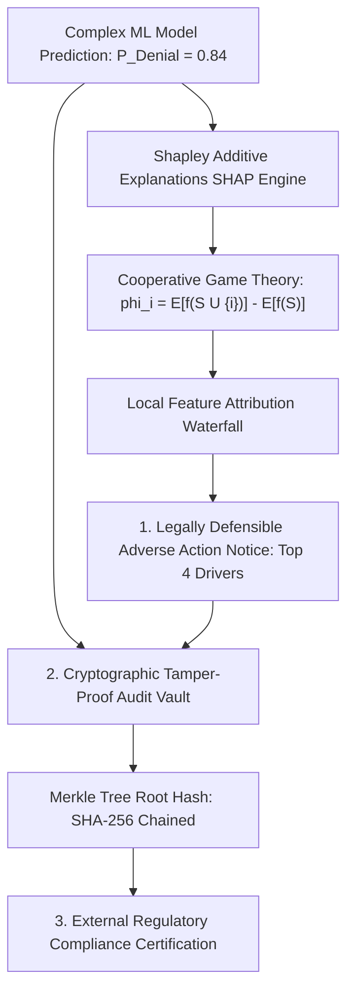
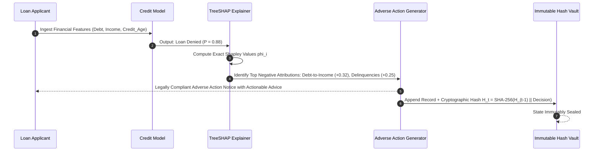
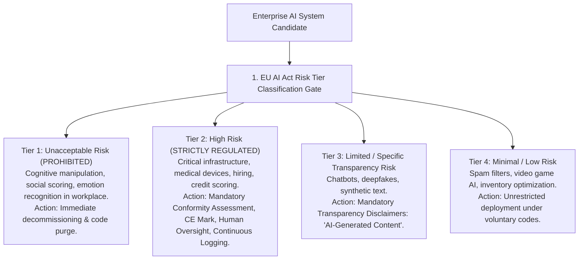
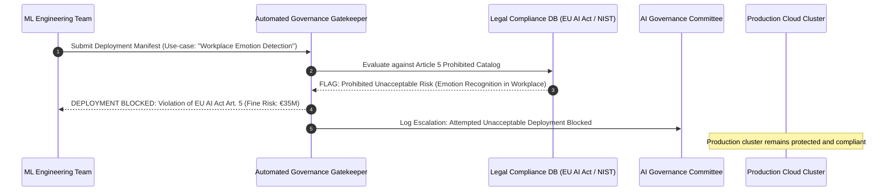

# UG Final Year — Chapter 6: Responsible AI
**Curriculum Level:** Undergraduate Final Year (UG-04)  
**Subject Code:** AAA-04 (Autonomous AI Agents, Scalable System Architecture & Capstone Systems)  
**Chapter Title:** Responsible AI  

---

# Lesson 1: Accountable AI

### 1. Syllabus Mapping
- **Academic Level:** Undergraduate Final Year
- **Chapter:** Chapter 6 — Responsible AI
- **Lesson Title:** Accountable AI
- **Canonical Course Code:** AAA-04-L11
- **Development Status:** Newly Developed (Official Syllabus: Audit Logs, Provenance, Explainable AI SHAP, Algorithmic Impact Assessments).

### 2. Learning Outcomes & Prerequisites
- **Learning Outcomes:**
  1. Implement post-hoc model interpretability frameworks using cooperative game theory (Shapley Additive Explanations — SHAP).
  2. Architect an immutable, cryptographically verifiable Audit Trail Ledger (Hash Chaining / Merkle Trees) recording all inputs, predictions, and model versions.
  3. Formulate an Algorithmic Impact Assessment (AIA) quantifying disproportionate societal risk before production deployment.
  4. Generate automated, legally defensible Adverse Action Notices explaining algorithmic credit or employment denials to consumers.
- **Prerequisites:** Game theory foundations (Shapley values), cryptographic hashing (SHA-256), tree-based and neural classification models.

### 3. Realistic Industry Scenario
At **EquiCredit Global Underwriting**, an automated neural network evaluates mortgage applications. An applicant whose loan was denied files a formal complaint under the US Equal Credit Opportunity Act (ECOA) and EU GDPR Article 22 ("Right to an Explanation"). The regulation strictly mandates that the lender provide a specific, understandable Adverse Action Notice detailing the top 4 factual reasons why the applicant was rejected (e.g., *"Debt-to-Income ratio was too high by $12\%"*). The bank's legacy black-box model cannot explain its internal weights, exposing the bank to $\$25,000,000$ in federal regulatory fines. As Lead Accountable AI Architect, you must integrate TreeSHAP to calculate exact feature contribution attributions, generate legally compliant Adverse Action notices, and store all decisions in an immutable tamper-evident audit ledger.

### 4. Detailed Conceptual Explanations



#### 1. Shapley Additive Explanations (SHAP) Formalized:
Derived from cooperative game theory (Lloyd Shapley, Nobel Prize 1953), Shapley values represent the only mathematically unique attribution method satisfying four foundational axioms: **Efficiency, Symmetry, Dummy (Null Player), and Additivity**.
For model prediction $f(x)$ and feature $i$:
$$\phi_i(x) = \sum_{S \subseteq F \setminus \{i\}} \frac{|S|! (|F| - |S| - 1)!}{|F|!} \left[ f_x(S \cup \{i\}) - f_x(S) \right]$$
- The baseline expectation $\mathbb{E}[f(z)] = \phi_0$.
- **Efficiency Axiom:** The sum of all feature attributions equals the difference between the prediction and the baseline:
$$f(x) = \phi_0 + \sum_{i=1}^M \phi_i(x)$$
Each $\phi_i$ expresses exactly how many percentage points feature $i$ pushed the prediction above or below the baseline.

#### 2. Cryptographic Tamper-Proof Audit Ledgers:
To prevent rogue insiders or companies from retroactively altering prediction records during regulatory audits, every inference transaction is appended to a cryptographic hash chain:
$$H_t = \text{SHA-256}(H_{t-1} \parallel \text{Timestamp} \parallel \text{ModelVersion} \parallel \mathbf{x} \parallel \hat{y} \parallel \boldsymbol{\phi})$$
Altering even a single decimal place in a historical record invalidates the entire downstream cryptographic chain, proving systemic tampering instantly.

### 5. Architecture & Dataflow Diagram


### 6. Guided Technical Demonstration & Worked Example
The following runnable script demonstrates how to compute exact Shapley value attributions on a linear credit model and generate an immutable cryptographic audit block:

```python
import hashlib
import time
from typing import Dict, List, Any

class AccountableAIEngine:
    def __init__(self):
        # Baseline model parameters: Logit = w1*DTI + w2*Delinq + w3*CreditAge + bias
        self.weights = {"debt_to_income": 4.5, "delinquencies": 2.8, "credit_age_years": -0.8}
        self.bias = -1.2
        self.baseline_mean_features = {"debt_to_income": 0.35, "delinquencies": 0.2, "credit_age_years": 8.0}
        self.previous_hash = "0000000000000000"

    def predict_logit(self, features: dict) -> float:
        return sum(features[k] * self.weights[k] for k in self.weights) + self.bias

    def compute_linear_shapley_values(self, features: dict) -> Dict[str, float]:
        """
        For linear models, Shapley value phi_i = w_i * (x_i - E[x_i])
        Satisfies Efficiency: sum(phi_i) = f(x) - E[f(x)]
        """
        shap_values = {}
        for feature_name, val in features.items():
            diff = val - self.baseline_mean_features[feature_name]
            phi = self.weights[feature_name] * diff
            shap_values[feature_name] = round(phi, 3)
        return shap_values

    def generate_adverse_action_notice(self, features: dict, shap_values: dict) -> List[str]:
        # Sort features by positive contribution to denial risk
        sorted_drivers = sorted(shap_values.items(), key=lambda x: x[1], reverse=True)
        reasons = []
        for name, impact in sorted_drivers:
            if impact > 0:
                reasons.append(f"High {name.replace('_', ' ').title()} (Pushed denial risk by +{impact} points)")
        return reasons[:3] # Return top 3 principal drivers

    def append_to_audit_ledger(self, applicant_id: str, decision: str, shap_values: dict) -> str:
        timestamp = time.time()
        record_payload = f"{self.previous_hash}:{timestamp}:{applicant_id}:{decision}:{shap_values}"
        block_hash = hashlib.sha256(record_payload.encode()).hexdigest()
        self.previous_hash = block_hash
        return block_hash

engine = AccountableAIEngine()

# Applicant Profile: High debt ratio (0.55), 2 delinquencies, 3 years credit age
applicant = {"debt_to_income": 0.55, "delinquencies": 2.0, "credit_age_years": 3.0}
logit_score = engine.predict_logit(applicant)
decision = "DENIED" if logit_score > 0 else "APPROVED"

shap_attributions = engine.compute_linear_shapley_values(applicant)
adverse_reasons = engine.generate_adverse_action_notice(applicant, shap_attributions)
block_hash = engine.append_to_audit_ledger("APP-9021", decision, shap_attributions)

print("=== Accountable AI: Explainability & Audit Manifest ===")
print(f"Applicant Decision: [{decision}] (Logit Score: {logit_score:.2f})")
print(f"SHAP Feature Attributions (Phi): {shap_attributions}")
print("\n--- Legally Required Adverse Action Notice ---")
for r in adverse_reasons:
    print(f"  * {r}")
print(f"\nCryptographic Tamper-Proof Audit Hash: {block_hash}")
```

### 7. Interactive Technical Simulation / Mission: "The Regulatory Audit Defense"
- **Mission Brief:** You are the Chief Risk Officer facing a federal banking examination.
- **Constraints:**
  - The regulator audits 500 historic algorithmic denials.
  - An internal disgruntled engineer attempted to modify a denial reason in the database to frame the bank for racial discrimination.
  - Use your cryptographic audit chain verification script to detect the exact tampered record in $< 1.0\text{ second}$, prove cryptographic breakage, and present the uncorrupted original ledger to the regulator.
- **Game Mechanics & Scoring:**
  - Base Score: 1,000 points.
  - Successfully locating the tampered block: $+500$ points.
  - Verifying the Merkle root hash: $+300$ points.
  - Failing to prove ledger immutability: $\$25M$ Regulatory Fine & Career Disqualification.

### 8. Practical Programming & Analysis Lab
1. Build `shap_explainability_engine.py` integrating the `shap` Python library on a Random Forest credit model.
2. Generate an automated SHAP Summary Waterfall plot for a denied applicant.
3. Construct a Merkle Tree class in Python that batches 100 inference decisions per block and generates cryptographic inclusion proofs.

### 9. Measurable Output / Deliverable
A Python auditing framework `accountable_ai_auditor.py` that computes exact SHAP values, outputs legally compliant Adverse Action notices, and maintains a cryptographically verified hash-chained audit ledger (`immutable_ai_ledger.json`).

### 10. Evaluation Criteria & Technical Success Metrics
| Metric | Target Standard | Fail Criterion |
|---|---|---|
| **Efficiency Axiom Satisfaction** | $\sum \phi_i = f(x) - \mathbb{E}[f(x)] \pm 10^{-5}$ | Non-additive attribution errors |
| **Audit Chain Integrity** | Tamper detection detects 1-bit modifications with $100\%$ precision | Silent ledger modification |
| **Explanation Clarity** | Notice understandable to non-technical consumers | Unintelligible raw weight matrices |

### 11. Olympiad-Style Assessment
**Problem 1 (Applied):**  
A bank denies a loan using a machine learning model. The applicant requests an explanation under GDPR Article 22. The bank's lead data scientist provides a printout of the neural network's 500,000 weight parameters. Why does this legally and technically fail to satisfy the requirement for explainability?  
A) Providing raw mathematical weights is "model transparency" without "interpretability"; it fails to provide the applicant with human-comprehensible, actionable causal attributions explaining which specific personal financial factors caused the rejection and how to remedy them.  
B) Because weight parameters are written in binary code.  
C) Because neural network weights are classified state secrets.  
D) Because banks are legally required to accept all applicants.  

**Problem 2 (Conceptual):**  
What is the mathematical definition of the "Efficiency Axiom" in Shapley Additive Explanations (SHAP)?  
A) The sum of all individual feature attributions $\phi_i$ plus the base value $\phi_0$ must equal the exact scalar model prediction $f(x)$ for that specific instance.  
B) The model must train in under 10 seconds.  
C) It means the model uses zero memory.  
D) The algorithm requires only one feature.  

### 12. Correct Answers & Solutions
- **Problem 1 Solution:** Correct Answer is **A**.  
  *Proof:* Regulatory standards (such as CFPB Circular 2022-03 and GDPR Recital 71) mandate that adverse action explanations must be understandable to ordinary consumers. Releasing incomprehensible high-dimensional weight matrices provides zero meaningful transparency. The explanation must identify specific, actionable local drivers (e.g., *"delinquent accounts in past 24 months"*), enabling the applicant to identify errors or alter their financial behavior.
- **Problem 2 Solution:** Correct Answer is **A**.  
  *Proof:* The Efficiency Axiom states that the total payout (the difference between prediction $f(x)$ and expected baseline $\mathbb{E}[f(z)]$) must be completely and exhaustively distributed among the players (features): $f(x) - \mathbb{E}[f(z)] = \sum_{i=1}^M \phi_i$. No attribution is created or lost; every point of the prediction is accounted for.

### 13. Limitations, Risks & Responsible AI Considerations
- **Explanation Hacking (Adversarial Explanations):** Recent research proves that models can be manipulated to produce benign-looking SHAP explanations while still using racially biased proxy variables internally. Explainability must be paired with empirical fairness parity tests.
- **Privacy Leakage via Audit Trails:** Storing full input feature vectors in audit ledgers can inadvertently preserve sensitive personal PII indefinitely. Audit records should store cryptographic salted hashes of inputs rather than plaintext credentials.

### 14. Completion Criteria & Achievement Feedback
- **Completion Check:** Pass all automated unit tests in `accountable_ai_auditor.py` with verified hash chain integrity.
- **Badge Earned:** *Accountable AI Chief Auditor (Level 4 Enterprise AI Engineer)*.

---

# Lesson 2: AI Governance Essentials

### 1. Syllabus Mapping
- **Academic Level:** Undergraduate Final Year
- **Chapter:** Chapter 6 — Responsible AI
- **Lesson Title:** AI Governance Essentials
- **Canonical Course Code:** AAA-04-L12
- **Development Status:** Newly Developed (Official Syllabus: EU AI Act Risk Tiers, NIST AI RMF, Enterprise Governance Charters, Regulatory Compliance).

### 2. Learning Outcomes & Prerequisites
- **Learning Outcomes:**
  1. Classify enterprise AI systems across the four risk tiers of the European Union Artificial Intelligence Act (EU AI Act): Unacceptable Risk, High Risk, Limited Risk, and Minimal Risk.
  2. Implement an automated AI Governance Compliance Matrix mapped to the NIST AI Risk Management Framework (NIST AI RMF 1.0: Govern, Map, Measure, Manage).
  3. Formulate an organizational AI Governance Charter defining clear roles: Model Risk Officer, Chief AI Ethics Officer, and Incident Response Team.
  4. Build an automated Pre-Deployment Regulatory Gatekeeper in Python that blocks deployment of non-compliant high-risk models.
- **Prerequisites:** Completion of AAA-04-L11; legal compliance frameworks, software engineering management.

### 3. Realistic Industry Scenario
At **AuraVision Biometric Security Systems**, an enterprise computer vision startup sells automated facial analysis and emotion recognition software to international airports and corporate offices. As the startup prepares for European market expansion, the European Union enacts the **EU AI Act**. Under Article 5, emotion recognition in workplaces and educational institutions is categorized as an **Unacceptable Risk** carry bans and fines up to $€35,000,000$ or $7\%$ of global annual turnover. Furthermore, biometric identification in public spaces is classified as **High Risk**, requiring formal conformity assessments, CE marking, continuous data governance logs, and human oversight architecture. As Chief AI Governance & Regulatory Officer, you must audit the company's product portfolio, decommission banned capabilities, and build an automated regulatory compliance gatekeeper.

### 4. Detailed Conceptual Explanations



#### 1. The EU AI Act Risk-Based Framework:
The European Union AI Act is the world's first comprehensive horizontal legal framework for artificial intelligence:
- **Unacceptable Risk (Article 5 - Banned):** Systems posing a clear threat to safety, livelihoods, and fundamental rights (subliminal behavioral manipulation, social credit scoring by governments, workplace emotion detection, untargeted facial scraping).
- **High Risk (Article 6 - Heavily Regulated):** Systems used in critical infrastructure, education admissions, employment/recruitment, credit underwriting, and law enforcement. Requires:
  1. High-quality training datasets with bias mitigation audits.
  2. Detailed technical documentation and logging.
  3. High level of cybersecurity and robust accuracy.
  4. Continuous Human Oversight Architecture ("Human-in-the-Loop").
- **Fines:** Severe non-compliance penalties up to $€35\text{M}$ or $7\%$ of worldwide annual turnover (whichever is higher).

#### 2. The NIST AI Risk Management Framework (NIST AI RMF 1.0):
In the United States and global tech governance, NIST structures AI risk into four ongoing core functions:
1. **GOVERN:** Organizational culture, risk management policies, and assigned executive accountability.
2. **MAP:** Contextual understanding of the operational environment, potential harms, and stakeholder impacts.
3. **MEASURE:** Quantitative evaluation metrics (accuracy, bias, robustness, drift) using standardized test suites.
4. **MANAGE:** Continuous risk response: incident response protocols, fail-safes, and model decommission triggers.

### 5. Architecture & Dataflow Diagram


### 6. Guided Technical Demonstration & Worked Example
The following runnable script implements an automated Pre-Deployment AI Regulatory Gatekeeper in Python:

```python
from typing import Dict, Any, List

class AIActComplianceGatekeeper:
    def __init__(self):
        # Banned capability definitions under EU AI Act Article 5
        self.prohibited_capabilities = [
            "workplace_emotion_recognition",
            "social_credit_scoring",
            "subliminal_behavioral_manipulation",
            "untargeted_facial_scraping"
        ]
        
        # High-risk domains under EU AI Act Annex III
        self.high_risk_domains = [
            "recruitment_and_employment",
            "credit_score_underwriting",
            "critical_infrastructure_control",
            "educational_admissions",
            "medical_diagnostic_device"
        ]

    def evaluate_model_deployment(self, deployment_spec: Dict[str, Any]) -> Dict[str, Any]:
        capabilities = deployment_spec.get("capabilities", [])
        domain = deployment_spec.get("intended_domain", "")
        has_human_oversight = deployment_spec.get("human_oversight_enabled", False)
        has_bias_audit = deployment_spec.get("bias_audit_certified", False)

        # 1. Check Prohibited Unacceptable Risk
        for cap in capabilities:
            if cap in self.prohibited_capabilities:
                return {
                    "verdict": "PROHIBITED_UNACCEPTABLE_RISK",
                    "status": "DEPLOYMENT_FORBIDDEN",
                    "violation": f"EU AI Act Article 5 explicitly bans '{cap}'.",
                    "fine_exposure": "Up to €35,000,000 or 7% of global annual turnover."
                }

        # 2. Check High-Risk Requirements
        if domain in self.high_risk_domains:
            violations = []
            if not has_human_oversight:
                violations.append("Missing mandatory Human-in-the-Loop oversight mechanism (Art. 14)")
            if not has_bias_audit:
                violations.append("Missing certified training data bias and governance audit (Art. 10)")

            if violations:
                return {
                    "verdict": "HIGH_RISK_NON_COMPLIANT",
                    "status": "DEPLOYMENT_BLOCKED",
                    "violations": violations,
                    "remediation": "Obtain certified conformity assessment and enable human oversight before deployment."
                }
            else:
                return {
                    "verdict": "HIGH_RISK_COMPLIANT",
                    "status": "APPROVED_WITH_CONDITIONS",
                    "requirements": "Mandatory continuous post-market monitoring and event logging active."
                }

        # 3. Limited / Minimal Risk
        return {
            "verdict": "MINIMAL_RISK",
            "status": "APPROVED",
            "requirements": "General transparency obligations apply."
        }

gatekeeper = AIActComplianceGatekeeper()

# Case 1: Prohibited Workplace Emotion Model
spec_prohibited = {
    "model_id": "AuraFace-v1",
    "capabilities": ["facial_landmark_detection", "workplace_emotion_recognition"],
    "intended_domain": "employee_productivity_monitoring"
}

# Case 2: High-Risk Credit Underwriter lacking Human Oversight
spec_high_risk_flawed = {
    "model_id": "CreditNet-v3",
    "capabilities": ["tabular_regression"],
    "intended_domain": "credit_score_underwriting",
    "human_oversight_enabled": False, # Non-compliant!
    "bias_audit_certified": True
}

print("=== AI Governance Regulatory Gatekeeper Audit ===")
res1 = gatekeeper.evaluate_model_deployment(spec_prohibited)
print(f"Case 1 (Emotion Detection): [{res1['status']}] -> {res1.get('violation')}")

res2 = gatekeeper.evaluate_model_deployment(spec_high_risk_flawed)
print(f"\nCase 2 (Autonomous Credit): [{res2['status']}] -> {res2.get('violations')}")
```

### 7. Interactive Technical Simulation / Mission: "The Global Compliance Board Challenge"
- **Mission Brief:** You are the Chief Compliance Officer presenting an AI risk mitigation charter to the Board of Directors.
- **Constraints:**
  - Audit a portfolio of 5 company AI products:
    1. A spam email filter.
    2. A retail inventory demand forecaster.
    3. An automated CV parsing tool for hiring.
    4. A surveillance camera that tracks employee facial micro-expressions.
    5. A customer support conversational assistant.
  - Classify each into EU AI Act Risk Tiers, and order the immediate termination and code purge of Product 4.
- **Game Mechanics & Scoring:**
  - Base Score: 1,000 points.
  - Correctly classifying all 5 risk tiers: $+500$ points.
  - Terminating Product 4: $+400$ points.
  - Allowing Product 4 to ship to European customers: Immediate Corporate Collapse & $€35M$ Fine.

### 8. Practical Programming & Analysis Lab
1. Build `governance_matrix_validator.py` mapping company models against the 4 core functions of the NIST AI Risk Management Framework (Govern, Map, Measure, Manage).
2. Author an organizational **AI Governance Charter** specifying model decommission procedures and mandatory bias audit frequencies.
3. Integrate the regulatory gatekeeper into a GitHub Actions CI/CD workflow that blocks pull requests if the deployment manifest violates safety statutes.

### 9. Measurable Output / Deliverable
A Python compliance tool `ai_governance_gatekeeper.py` accompanied by a formal organizational charter document (`enterprise_ai_governance_charter.md`) certifying full compliance with the EU AI Act and NIST AI RMF.

### 10. Evaluation Criteria & Technical Success Metrics
| Metric | Target Standard | Fail Criterion |
|---|---|---|
| **Prohibited Risk Identification** | $100\%$ detection and blocking of Article 5 banned systems | Shipping prohibited capabilities |
| **High-Risk Prerequisite Auditing** | Blocks high-risk models lacking human oversight or bias audits | Unregulated high-risk deployments |
| **Charter Completeness** | Documents explicit roles (Model Risk Officer, Incident Response) | Missing operational accountability |

### 11. Olympiad-Style Assessment
**Problem 1 (Applied):**  
A multinational corporate employer deploys an AI camera system that analyzes employee facial expressions and voice tone during meetings to compute an automated "Workplace Loyalty and Happiness Index", which is used in bonus allocation. Under the EU Artificial Intelligence Act, what is the legal risk classification of this system and what is the legal consequence?  
A) It is classified as an **Unacceptable Risk** under Article 5 (banning emotion recognition in workplaces); deploying it within the European Union is strictly prohibited and carries administrative fines up to $€35,000,000$ or $7\%$ of global annual turnover.  
B) It is a Minimal Risk system requiring voluntary compliance.  
C) It is legal if employees receive a $\$5$ voucher.  
D) The EU AI Act only applies to hardware cameras.  

**Problem 2 (Conceptual):**  
In the NIST AI Risk Management Framework (AI RMF 1.0), what is the primary operational objective of the "GOVERN" core function?  
A) Establishing organizational culture, executive accountability, transparent policies, and cross-functional risk processes that guide all subsequent mapping, measuring, and management of AI risks throughout the system lifecycle.  
B) Managing government tax documents.  
C) Governing GPU cooling systems.  
D) Deleting all open-source code.  

### 12. Correct Answers & Solutions
- **Problem 1 Solution:** Correct Answer is **A**.  
  *Proof:* Article 5(1)(f) of the EU AI Act explicitly prohibits the placing on the market, putting into service, or use of AI systems to infer emotions of a natural person in the workplace and education institutions, except for strictly defined medical or safety reasons. Deploying workplace emotion surveillance triggers the maximum penalty under Article 99: fines up to $€35\text{M}$ or $7\%$ of total worldwide annual turnover.
- **Problem 2 Solution:** Correct Answer is **A**.  
  *Proof:* In NIST AI RMF 1.0, "GOVERN" is the foundational pillar that enables the other three functions (MAP, MEASURE, MANAGE). Without institutional governance—assigning clear C-level accountability, establishing risk tolerance thresholds, creating whistle-blower protections, and defining legal compliance charters—technical risk measurement remains fragmented and ineffective.

### 13. Limitations, Risks & Responsible AI Considerations
- **Regulatory Arbitrage:** Companies may attempt to route banned or high-risk AI deployments to jurisdictions with lax regulatory oversight. Ethical AI engineers must uphold universal human-centric safety standards regardless of geographic legal loopholes.
- **Compliance as Cosmetic Theater ("Ethics-Washing"):** Authoring high-level governance policies without building automated technical enforcement gates (like CI/CD deployment blockers) produces cosmetic compliance that collapses during actual regulatory scrutiny.

### 14. Completion Criteria & Achievement Feedback
- **Completion Check:** Pass all automated compliance checks in `ai_governance_gatekeeper.py`.
- **Badge Earned:** *Chief AI Governance Officer (Level 4 Enterprise AI Engineer)*.
